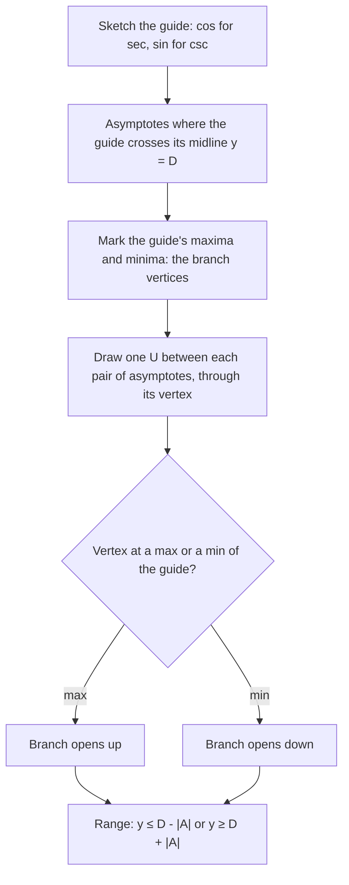

## Graphs built from reciprocals

Secant and cosecant are $\tfrac{1}{\cos x}$ and $\tfrac{1}{\sin x}$. The easiest way to graph
them is to draw cosine or sine first, lightly, and then take reciprocals of the
$y$-values. Every feature of the reciprocal graph comes from a feature of the original:
zeros become asymptotes, and peaks and valleys stay where they are.

## How a reciprocal behaves

Take $y = \sec x = \tfrac{1}{\cos x}$ and look at what happens to each kind of point on the
cosine graph:

- **Where $\cos x = 0$** the reciprocal is undefined, and nearby, where $\cos x$ is tiny,
  $\sec x$ is huge. So the zeros of cosine become **vertical asymptotes** of secant:
  $x = \tfrac{\pi}{2} + k\pi$.
- **Where $\cos x = 1$**, $\sec x = 1$ too, and since $\cos x \le 1$ nearby, $\sec x \ge 1$
  nearby. A maximum of cosine becomes a **local minimum** of secant.
- **Where $\cos x = -1$**, $\sec x = -1$, and nearby $\sec x \le -1$: a minimum of cosine
  becomes a **local maximum** of secant.
- Sign is preserved: secant is positive exactly where cosine is.

The result is a row of U-shaped branches opening up (above the cosine peaks) and down
(below the cosine valleys), separated by asymptotes.

```plot
{"x": [-4.8, 4.8], "y": [-4, 4], "functions": [{"f": "1/cos(x)", "label": "y = sec x"}, {"f": "cos(x)", "dashed": true, "label": "cos x"}], "segments": [{"from": [-4.7124, -4], "to": [-4.7124, 4], "dashed": true}, {"from": [-1.5708, -4], "to": [-1.5708, 4], "dashed": true}, {"from": [1.5708, -4], "to": [1.5708, 4], "dashed": true}, {"from": [4.7124, -4], "to": [4.7124, 4], "dashed": true}], "points": [{"at": [0, 1], "label": "(0, 1)"}, {"at": [3.1416, -1], "label": "(π, −1)"}], "caption": "y = sec x (solid) drawn from y = cos x (dashed)"}
```

Features of $y = \sec x$: domain $x \ne \tfrac{\pi}{2} + k\pi$; range
$(-\infty, -1] \cup [1, \infty)$; period $2\pi$; even (symmetric about the $y$-axis); no zeros.

## The graph of $y = \csc x$

The same construction on $y = \sin x$: asymptotes at the zeros of sine, $x = k\pi$; local
minimum $(\tfrac{\pi}{2}, 1)$; local maximum $(\tfrac{3\pi}{2}, -1)$; period $2\pi$; range
$(-\infty, -1] \cup [1, \infty)$; odd.

```plot
{"x": [-3.5, 6.6], "y": [-4, 4], "functions": [{"f": "1/sin(x)", "label": "y = csc x"}, {"f": "sin(x)", "dashed": true}], "segments": [{"from": [-3.1416, -4], "to": [-3.1416, 4], "dashed": true}, {"from": [0, -4], "to": [0, 4], "dashed": true}, {"from": [3.1416, -4], "to": [3.1416, 4], "dashed": true}, {"from": [6.2832, -4], "to": [6.2832, 4], "dashed": true}], "points": [{"at": [1.5708, 1], "label": "(π/2, 1)"}, {"at": [4.7124, -1], "label": "(3π/2, −1)"}], "caption": "y = csc x (solid) drawn from y = sin x (dashed)"}
```

## Transformations

For $y = A\sec(B(x - C)) + D$ or $y = A\csc(B(x - C)) + D$, graph the matching cosine or sine
$y = A\cos(B(x - C)) + D$ first. The reciprocal graph:

- has the same period $\tfrac{2\pi}{B}$;
- has asymptotes where the guide graph crosses its midline $y = D$;
- touches the guide graph at its maxima and minima, which become the local minima and
  maxima of the branches;
- has range $(-\infty, D - |A|] \cup [D + |A|, \infty)$.

As a procedure:



### Example 1

Describe $y = 2\csc x$: its asymptotes, local extrema and range.

Guide graph: $y = 2\sin x$. Asymptotes at its zeros, $x = k\pi$. The guide's maximum
$\left(\tfrac{\pi}{2}, 2\right)$ is a local minimum of $2\csc x$; its minimum
$\left(\tfrac{3\pi}{2}, -2\right)$ is a local maximum. Range: $(-\infty, -2] \cup [2, \infty)$.

### Example 2

Describe $y = \sec(2x) + 1$.

Guide: $y = \cos(2x) + 1$, period $\pi$, midline $y = 1$, max 2 at $x = 0$, min 0 at
$x = \tfrac{\pi}{2}$. The guide crosses its midline where $\cos 2x = 0$:
$2x = \tfrac{\pi}{2} + k\pi$, so $x = \tfrac{\pi}{4} + \tfrac{k\pi}{2}$. Those are the asymptotes.

Branches: a U opening up with vertex $(0, 2)$, and an upside-down U with vertex
$\left(\tfrac{\pi}{2}, 0\right)$. Range: $(-\infty, 0] \cup [2, \infty)$.

```plot
{"x": [-2.4, 3.9], "y": [-3, 5], "functions": [{"f": "1/cos(2x) + 1", "label": "y = sec 2x + 1"}, {"f": "cos(2x) + 1", "dashed": true}], "segments": [{"from": [-2.3562, -3], "to": [-2.3562, 5], "dashed": true}, {"from": [-0.7854, -3], "to": [-0.7854, 5], "dashed": true}, {"from": [0.7854, -3], "to": [0.7854, 5], "dashed": true}, {"from": [2.3562, -3], "to": [2.3562, 5], "dashed": true}], "points": [{"at": [0, 2], "label": "(0, 2)"}, {"at": [1.5708, 0], "label": "(π/2, 0)"}], "caption": "y = sec 2x + 1 with its guide y = cos 2x + 1"}
```

### Example 3

The graph of $y = -3\csc\!\left(x - \tfrac{\pi}{4}\right)$: where are the asymptotes, and what is
the vertex of the branch between the first two positive asymptotes?

Guide: $y = -3\sin\!\left(x - \tfrac{\pi}{4}\right)$, which is zero where $x - \tfrac{\pi}{4} = k\pi$, so
the asymptotes are $x = \tfrac{\pi}{4} + k\pi$. The first two positive ones are $\tfrac{\pi}{4}$ and
$\tfrac{5\pi}{4}$. Midway, at $x = \tfrac{3\pi}{4}$, the guide is $-3\sin\tfrac{\pi}{2} = -3$ (its minimum,
because $A < 0$ flips it), so this branch opens downward with vertex $\left(\tfrac{3\pi}{4}, -3\right)$.

### Example 4: a transformed secant

Find the period, the asymptotes and the range of $y = 3\sec\tfrac{\pi x}{2} - 1$.

Guide: $y = 3\cos\tfrac{\pi x}{2} - 1$, with period $\tfrac{2\pi}{\pi/2} = 4$, midline $y = -1$, maximum 2 and
minimum $-4$. Asymptotes are where $\cos\tfrac{\pi x}{2} = 0$: $\tfrac{\pi x}{2} = \tfrac{\pi}{2} + k\pi$, so $x = 1 + 2k$ (the odd
integers). The branches turn at heights 2 and $-4$, so the range is
$(-\infty, -4] \cup [2, \infty)$.

## Where reciprocal graphs appear

The secant graph has a physical meaning: if a lighthouse beam rotates at a steady rate and
shines on a straight wall, the distance from the lighthouse to the lit spot is proportional
to $\sec\theta$, where $\theta$ is the beam's angle from the perpendicular to the wall, which grows without bound as the beam turns parallel to the wall. Reciprocal
trig functions also appear in calculus, as derivatives ($\tfrac{d}{dx}\tan x = \sec^2 x$) and
antiderivatives.

## Reading the graph

Each U-shaped branch sits between two consecutive asymptotes and touches the guide curve at
exactly one point, its vertex. Branches alternate between opening up and opening down, just
as the guide curve alternates between peaks and valleys.


## Common mistakes

- **Putting asymptotes at the peaks.** Asymptotes come from the *zeros* (midline crossings)
  of the guide graph; the peaks are where the branches turn.
- **Thinking secant can be between $-1$ and $1$.** A reciprocal of a number in $(-1, 1)$ has
  absolute value greater than 1.
- **Forgetting the guide graph's vertical shift.** With $+D$, asymptotes are where the guide
  crosses $y = D$, not the $x$-axis.
- **Calling the branch vertices maxima and minima of the whole function.** They are only
  local: secant has no overall maximum or minimum.

## Key points

- Graph $\sec$ and $\csc$ from $\cos$ and $\sin$: zeros become asymptotes, peaks become
  turning points of U-shaped branches.
- $\sec x$: asymptotes $x = \tfrac{\pi}{2} + k\pi$. $\csc x$: asymptotes $x = k\pi$. Both have period $2\pi$.
- Range of $A\sec(\cdot) + D$ or $A\csc(\cdot) + D$: $(-\infty, D - |A|] \cup [D + |A|, \infty)$.
