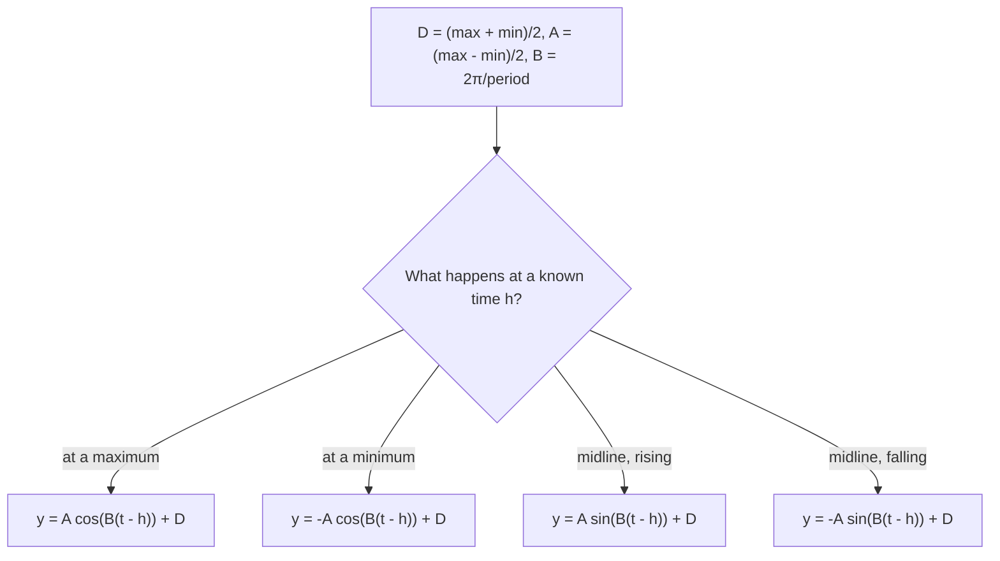

## Why sinusoids model the world

Anything driven by rotation or by a restoring force tends to rise and fall in a
sinusoidal pattern: daylight hours over a year (Earth's orbit and tilt), tides (the Moon's
orbit), a rider's height on a Ferris wheel, a weight bouncing on a spring, alternating
current. This lesson turns the four constants of the last lessons into a recipe for
building such models from a description or from data, and introduces the physics term for
the cleanest case: simple harmonic motion.

## The recipe

To fit $y = A\cos\big(B(t - C)\big) + D$ (or the sine version) to a repeating quantity:

1. **Midline:** $D = \dfrac{\max + \min}{2}$.
2. **Amplitude:** $|A| = \dfrac{\max - \min}{2}$.
3. **Period:** the time for one full cycle (peak to next peak, or twice peak to trough).
   Then $B = \dfrac{2\pi}{\text{period}}$.
4. **Phase shift:** with cosine, $C$ is the time of a maximum (use $-A$ and a minimum if
   that's what you know). With sine, $C$ is a time when the quantity crosses the midline
   going up.

A model built this way assumes the pattern is perfectly sinusoidal. Real data only
approximately are, so treat predictions as estimates.

Step 4 is where most choices are made. This chart sums it up, with $A$ the (positive) amplitude
and $h$ the time of the moment you know:



### Example 1: seasonal temperature

In a certain city the average daily high is lowest in January, $31^\circ$F, and highest in
July, $89^\circ$F. Let $t$ be the month ($t = 1$ for January). Build a model and estimate the
average high in May.

- $D = \tfrac{89 + 31}{2} = 60$ and $A = \tfrac{89 - 31}{2} = 29$.
- The cycle is one year, 12 months: $B = \tfrac{2\pi}{12} = \tfrac{\pi}{6}$.
- The maximum is at $t = 7$, so use cosine with $C = 7$:

$$T(t) = 29\cos\!\left(\tfrac{\pi}{6}(t - 7)\right) + 60.$$

May is $t = 5$: $T(5) = 29\cos\!\left(-\tfrac{\pi}{3}\right) + 60 = 29\cdot\tfrac12 + 60 = 74.5^\circ$F.

```plot
{"x": [0, 13], "y": [20, 100], "functions": [{"f": "29cos(pi/6*(x - 7)) + 60", "label": "T(t)"}], "points": [{"at": [1, 31], "label": "Jan 31°"}, {"at": [7, 89], "label": "Jul 89°"}, {"at": [5, 74.5], "label": "May ≈ 74.5°"}], "xLabel": "month t", "yLabel": "°F", "caption": "A sinusoidal model of average daily highs"}
```

Check: at $t = 1$, $\cos(-\pi) = -1$ gives $T = 31$. ✓

### Example 2: a Ferris wheel

A Ferris wheel 50 m in diameter has its center 30 m above the ground and turns once every
4 minutes. A rider boards at the bottom at $t = 0$. Write the rider's height $h(t)$ in
meters and find when the rider first reaches 42.5 m.


- Midline: the center, $D = 30$. Amplitude: the radius, $25$. Lowest point $5$ m, highest $55$ m.
- Period 4 min, so $B = \tfrac{2\pi}{4} = \tfrac{\pi}{2}$.
- The rider starts at a minimum. A cosine starts at a maximum, so flip it: $A = -25$, $C = 0$.

$$h(t) = 30 - 25\cos\!\left(\tfrac{\pi}{2}t\right).$$

Set $h = 42.5$: $-25\cos\!\left(\tfrac{\pi}{2}t\right) = 12.5$, so $\cos\!\left(\tfrac{\pi}{2}t\right) = -\tfrac12$. The
first positive solution has $\tfrac{\pi}{2}t = \tfrac{2\pi}{3}$, so $t = \tfrac43$ min, 80 seconds.

### Example 3: tides

At a harbor, high tide of 4.2 m occurs at 2:00 AM and the next low tide, 0.6 m, at
8:12 AM. Estimate the depth at noon.

- $D = \tfrac{4.2 + 0.6}{2} = 2.4$, $A = \tfrac{4.2 - 0.6}{2} = 1.8$.
- High to low is half a period: 6 h 12 min $= 6.2$ h, so the period is $12.4$ h and
  $B = \tfrac{2\pi}{12.4}$.
- Cosine with the maximum at $t = 2$ (hours after midnight):

$$h(t) = 1.8\cos\!\left(\tfrac{2\pi}{12.4}(t - 2)\right) + 2.4.$$

At noon, $t = 12$: $h(12) = 1.8\cos\!\left(\tfrac{2\pi \cdot 10}{12.4}\right) + 2.4 \approx 1.8(0.3473) + 2.4 \approx 3.03$ m.
The tide is coming back in toward the next high at 2:24 PM.

## Simple harmonic motion

A weight on a spring, pulled down and released, bobs up and down. If friction is ignored,
its displacement from the rest position (the **equilibrium**) is a pure sinusoid in time.
Motion of this kind is called **simple harmonic motion**:

$$d = a\sin(\omega t) \qquad\text{or}\qquad d = a\cos(\omega t),$$

where $|a|$ is the amplitude (the greatest distance from equilibrium), $\omega > 0$ is the
angular frequency, the period is $\tfrac{2\pi}{\omega}$, and the **frequency** (cycles per unit
time) is $f = \tfrac{\omega}{2\pi}$. With $t$ in seconds, frequency is measured in hertz (Hz),
cycles per second.

Use cosine when the object starts at its farthest point (released from rest after being
pulled), and sine when it starts at equilibrium with some velocity.

### Example 4

A spring's displacement is $d = 6\sin(3\pi t)$ cm, with $t$ in seconds. Find the amplitude,
period and frequency, and the displacement at $t = 0.25$ s.

Amplitude $6$ cm. Period $\tfrac{2\pi}{3\pi} = \tfrac23$ s. Frequency $\tfrac{3\pi}{2\pi} = 1.5$ Hz.
$d(0.25) = 6\sin(0.75\pi) = 6\cdot\tfrac{\sqrt2}{2} = 3\sqrt2 \approx 4.24$ cm.

### Example 5

A mass is pulled 4 cm below equilibrium and released; it completes 2 oscillations per
second. Write $d(t)$, taking up as positive.

It starts at its lowest point, so use $-4\cos(\omega t)$. Frequency 2 Hz means
$\omega = 2\pi f = 4\pi$. So $d(t) = -4\cos(4\pi t)$.

In reality friction makes the swings shrink over time. That is **damped harmonic
motion**, modeled by multiplying by a decaying factor, as in $d = 4e^{-0.3t}\cos(4\pi t)$.

```plot
{"x": [0, 4], "y": [-4.5, 4.5], "functions": [{"f": "4exp(-0.3x)cos(4pi*x)", "label": "damped"}, {"f": "4exp(-0.3x)", "dashed": true}, {"f": "-4exp(-0.3x)", "dashed": true}], "xLabel": "t", "yLabel": "d", "caption": "d = 4e^(−0.3t) cos(4πt): the amplitude decays inside an exponential envelope (dashed)"}
```

## Common mistakes

- **Confusing period and frequency.** Period is time per cycle; frequency is cycles per
  unit time. They are reciprocals.
- **Using half a period as the period.** Peak to trough is only half a cycle.
- **Wrong starting point.** A rider boarding at the bottom, or a spring released from its
  lowest point, starts at a minimum: use $-\cos$.
- **Calculator in degree mode** when evaluating a model whose argument is in radians.

## Key points

- $D = \tfrac{\max + \min}{2}$, $|A| = \tfrac{\max - \min}{2}$, $B = \tfrac{2\pi}{\text{period}}$, and $C$
  from a known peak (cosine) or upward midline crossing (sine).
- Simple harmonic motion: $d = a\sin\omega t$ or $a\cos\omega t$, period $\tfrac{2\pi}{\omega}$,
  frequency $\tfrac{\omega}{2\pi}$.
- Start with $\cos$ at a maximum, $-\cos$ at a minimum, $\sin$ at equilibrium moving up.
