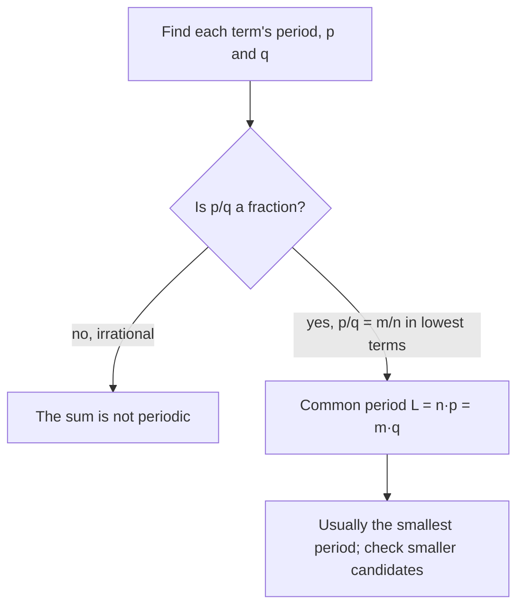

## Beyond a single wave

Every graph in this module so far has been one sinusoid (or one tangent, secant or cosecant),
stretched and shifted. Lesson 17 already hinted that real signals are messier: the damped spring
$d = 4e^{-0.3t}\cos(4\pi t)$ is a cosine *multiplied* by a shrinking exponential. The note of a guitar string or a flute is close to
a *sum* of a main tone and quieter overtones at two, three, four times its frequency. A tide is
closer to a sum of several sinusoids with different periods than to a single one.

This lesson shows how to sketch such combinations without plotting hundreds of points, and
answers two questions that the single-sinusoid lessons never had to ask: when is a sum of
periodic functions periodic, and what controls the height of a product?

## Adding graphs point by point

To graph $y = f(x) + g(x)$, add the two heights at each $x$. This is called **addition of
ordinates** (an *ordinate* is a $y$-coordinate). In practice:

1. Sketch $f$ and $g$ lightly on the same axes.
2. Mark the easy $x$-values: where either graph is 0 (the sum equals the other graph there),
   and where either reaches a maximum or minimum.
3. At each marked $x$, add the two heights and plot the result.
4. Join the points smoothly.

Step 2 is the shortcut that makes the method fast. Wherever $g(x) = 0$, the sum is sitting
exactly on the graph of $f$.

### Example 1: a wave riding on a line

Sketch $y = x + \sin x$ for $0 \le x \le 4\pi$.

Here $f(x) = x$ and $g(x) = \sin x$. Where $\sin x = 0$, at $x = 0, \pi, 2\pi, 3\pi, 4\pi$, the sum is
on the line $y = x$. Where $\sin x = 1$, at $x = \tfrac{\pi}{2}$ and $\tfrac{5\pi}{2}$, the sum is one unit
*above* the line; where $\sin x = -1$, at $\tfrac{3\pi}{2}$ and $\tfrac{7\pi}{2}$, it is one unit below. So the
graph winds around the line $y = x$, crossing it every $\pi$ units and never straying more than 1
from it.

```plot
{"x": [-0.5, 13.2], "y": [-1.5, 14], "functions": [{"f": "x + sin(x)", "label": "y = x + sin x"}, {"f": "x", "dashed": true, "label": "y = x"}], "points": [{"at": [3.1416, 3.1416], "label": "(π, π)"}, {"at": [7.854, 8.854], "label": "(5π/2, 5π/2 + 1)"}], "caption": "y = x + sin x winds around the line y = x and meets it wherever sin x = 0"}
```

Notice that $y = x + \sin x$ is *not* periodic, even though one of its parts is: the line keeps
climbing. Adding a periodic function to a non-periodic one gives a non-periodic result.

### Example 2: a wave plus its overtone

Sketch $y = \sin x + \sin 2x$ on $[0, 2\pi]$.

The second term has period $\pi$, so it changes twice as fast. Use quarter-points of the faster
term, multiples of $\tfrac{\pi}{4}$:

| $x$ | $0$ | $\tfrac{\pi}{4}$ | $\tfrac{\pi}{2}$ | $\tfrac{3\pi}{4}$ | $\pi$ | $\tfrac{5\pi}{4}$ | $\tfrac{3\pi}{2}$ | $\tfrac{7\pi}{4}$ | $2\pi$ |
|---|---|---|---|---|---|---|---|---|---|
| $\sin x$ | 0 | 0.707 | 1 | 0.707 | 0 | −0.707 | −1 | −0.707 | 0 |
| $\sin 2x$ | 0 | 1 | 0 | −1 | 0 | 1 | 0 | −1 | 0 |
| sum | 0 | 1.707 | 1 | −0.293 | 0 | 0.293 | −1 | −1.707 | 0 |

```plot
{"x": [-0.3, 6.6], "y": [-2.2, 2.2], "functions": [{"f": "sin(x) + sin(2x)", "label": "y = sin x + sin 2x"}, {"f": "sin(x)", "dashed": true}, {"f": "sin(2x)", "dashed": true}], "points": [{"at": [0.7854, 1.7071]}, {"at": [5.4978, -1.7071]}], "caption": "The sum (solid) of sin x and sin 2x (dashed); the pattern repeats every 2π"}
```

The sum is a lopsided wave that repeats every $2\pi$. Its highest point is *not* at $\tfrac{\pi}{4}$:
a finer table (or a graphing tool) puts it near $x \approx 0.936$ with $y \approx 1.760$. Addition of
ordinates gives the shape quickly, but it can miss the exact location of a peak, because the
peaks of the parts generally fall at different places.

## When is a sum periodic?

Suppose $f$ has period $p$ and $g$ has period $q$. If some length $L$ is a whole number of
$p$'s *and* a whole number of $q$'s, both parts repeat after $L$, so the sum does too. The
smallest such $L$ is the **least common multiple** of the periods.

To find it, divide the periods. If $\tfrac{p}{q} = \tfrac{m}{n}$ in lowest terms, then $np = mq$, and
$L = np$ is the least common multiple.



### Example 3: two different periods

Find the period of $y = \sin\tfrac{\pi x}{3} + \cos\tfrac{\pi x}{2}$, and of $y = \sin 2x + \cos 3x$.

For the first, the periods are $\tfrac{2\pi}{\pi/3} = 6$ and $\tfrac{2\pi}{\pi/2} = 4$. Then
$\tfrac{6}{4} = \tfrac{3}{2}$, so $L = 2 \cdot 6 = 3 \cdot 4 = 12$. After 12 units the first term has done 2
cycles and the second 3, and both are back where they started.

For the second, the periods are $\pi$ and $\tfrac{2\pi}{3}$. Their ratio is $\tfrac{\pi}{2\pi/3} = \tfrac32$, so
$L = 2 \cdot \pi = 3 \cdot \tfrac{2\pi}{3} = 2\pi$. A common slip is to multiply the periods
($\pi \cdot \tfrac{2\pi}{3}$) or add them; neither has anything to do with when the pattern repeats.

For both functions a numerical check confirms that no shorter shift works, so 12 and $2\pi$ are
the smallest periods. When the two terms are sinusoids with *different* frequencies, this is
always so. But in other cases the sum can repeat sooner than the least common multiple. For
example $|\sin x|$ and $|\cos x|$ each have period $\pi$, yet $|\sin x| + |\cos x|$ has period
$\tfrac{\pi}{2}$: shifting by a quarter turn just swaps the two terms. That is why the diagram says
"usually".

### When the ratio is irrational

The function $y = \sin x + \sin(\sqrt2\,x)$ has periods $2\pi$ and $\sqrt2\,\pi$, whose ratio is
$\sqrt2$, an irrational number. No length is a whole number of both periods, and in fact the sum
is not periodic at all: its graph wanders forever without exactly repeating. (A short proof
uses the sum formulas of Module 6; here we state the result.) You can see a symptom: the sum
would equal 2 only if both sines were 1 at the same $x$, which would make $\sqrt2$ a ratio of two
whole numbers. So the graph comes as close to 2 as you like but never gets there.

## Multiplying: envelopes

Now take a product $y = f(x)\sin x$, where $f(x) \ge 0$. Because $-1 \le \sin x \le 1$,

$$-f(x) \le f(x)\sin x \le f(x).$$

The graph is trapped between the curves $y = f(x)$ and $y = -f(x)$, which together are called its
**envelope**. Three facts make products easy to sketch:

- the graph **touches** the upper envelope where $\sin x = 1$ and the lower one where $\sin x = -1$;
- it is **zero** where $\sin x = 0$ (and wherever $f(x) = 0$);
- between those points it swings from one envelope to the other.

The same holds with $\cos x$ in place of $\sin x$. The damped spring of Lesson 17 is exactly this
picture with the envelope $\pm 4e^{-0.3t}$.

### Example 4: a growing wave

Sketch $y = x\sin x$ for $0 \le x \le 4\pi$.

The envelope is $y = \pm x$, two lines through the origin. The graph touches $y = x$ at
$x = \tfrac{\pi}{2}, \tfrac{5\pi}{2}$ and $y = -x$ at $x = \tfrac{3\pi}{2}, \tfrac{7\pi}{2}$. It is zero at every multiple
of $\pi$.


A subtle point: the touching points are *not* the peaks. At $x = \tfrac{\pi}{2}$ the graph touches the
envelope at height $\tfrac{\pi}{2} \approx 1.571$, but the first peak comes a little later, near
$x \approx 2.029$, at height about $1.820$. There the curve is below the envelope (which is at
2.029) but higher than at the touching point, because the growing factor $x$ keeps pushing it
up after $\sin x$ has passed its maximum. Further right the difference shrinks: the peak near
$5\pi/2 \approx 7.854$ is at $x \approx 7.979$.

### Example 5: how long a damped wave lasts

A plucked string's displacement is modeled by $y = 3e^{-0.2t}\cos(2\pi t)$ mm, $t$ in seconds. When
has the envelope dropped to 10% of its starting height, and about how many vibrations happen
before then?

The envelope is $3e^{-0.2t}$, which starts at 3. Set $e^{-0.2t} = 0.1$ and take natural logs:
$-0.2t = \ln 0.1$, so $t = \tfrac{\ln 10}{0.2} \approx 11.51$ s. The cosine has period
$\tfrac{2\pi}{2\pi} = 1$ s, so about 11 to 12 full vibrations happen first. The envelope sets *how big*
the swings are; the cosine sets *how often* they happen. The two jobs are separate, which is why
envelopes are so useful.

## A product with a shrinking envelope

The function $y = \dfrac{\sin x}{x}$ is $\sin x$ times $\dfrac{1}{x}$. For $x > 0$ the envelope is
$y = \pm\dfrac{1}{x}$, so the waves die away as $x$ grows, and the zeros are at $x = \pi, 2\pi, 3\pi, \ldots$
At $x = 0$ the formula is undefined ($\tfrac{0}{0}$), yet the values near 0 settle down:

| $x$ | 0.5 | 0.1 | 0.01 | 0.001 |
|---|---|---|---|---|
| $\dfrac{\sin x}{x}$ | 0.95885 | 0.99833 | 0.99998 | 0.9999998 |

The values approach 1. The graph is even (both $\sin x$ and $x$ are odd, and an odd function
divided by an odd one is even), so the same happens from the left. The next lesson proves that
the limit really is 1, with a picture of the unit circle.

```plot
{"x": [-15, 15.4], "y": [-0.4, 1.2], "functions": [{"f": "sin(x)/x", "label": "y = sin x / x"}, {"f": "1/abs(x)", "dashed": true}, {"f": "-1/abs(x)", "dashed": true}], "points": [{"at": [0, 1], "open": true, "label": "approaches 1"}], "caption": "y = (sin x)/x: undefined at 0 but approaching 1; envelope y = ±1/|x| (dashed)"}
```

## Common mistakes

- **Multiplying or adding the periods.** The period of a sum comes from the least common
  multiple: periods 6 and 4 give 12, not 24 or 10.
- **Assuming every sum is periodic.** If the ratio of the periods is irrational, the sum never
  repeats; if one part is not periodic (like $x$), neither is the sum.
- **Putting the peaks of a product at the envelope.** A product touches its envelope where the
  sine is $\pm1$, but its local maxima are usually nearby, not exactly there.
- **Forgetting the envelope's sign.** For $f(x)\sin x$ with $f$ sometimes negative, the envelope
  is $y = \pm|f(x)|$.

## Key points

- Addition of ordinates: add heights point by point; where one part is 0, the sum lies on the other.
- A sum of terms with periods $p$ and $q$ repeats after their least common multiple: if
  $\tfrac{p}{q} = \tfrac{m}{n}$ in lowest terms, $L = np = mq$. Usually that is the smallest period.
- If $\tfrac{p}{q}$ is irrational, a sum of two sinusoids is not periodic.
- $y = f(x)\sin x$ lies between $\pm|f(x)|$, touches them where $\sin x = \pm1$, and is zero where
  $\sin x = 0$.
- $\dfrac{\sin x}{x}$ is undefined at 0 but its values approach 1.
