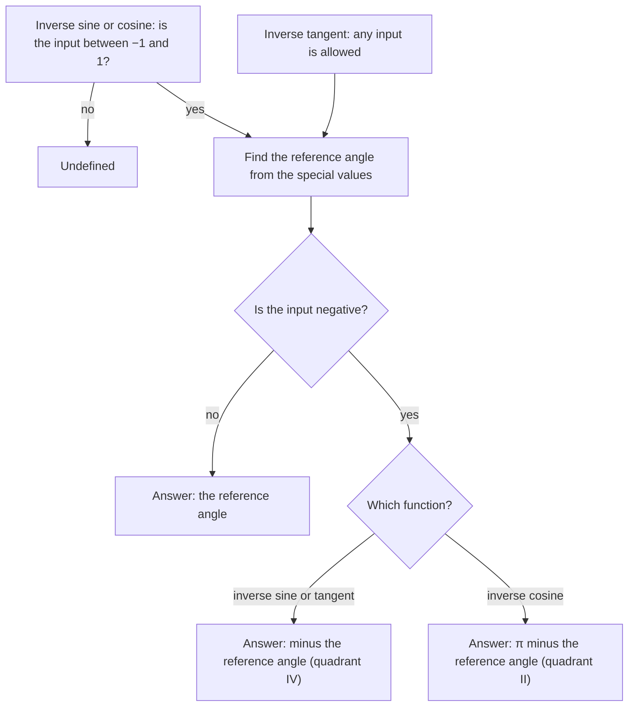

## Running trig backward

So far we have gone from an angle to a ratio: given $\theta$, find $\sin\theta$. Many problems
run the other way: a ramp rises 1 m over 12 m, so what is its angle? You have already
used the $\sin^{-1}$ and $\tan^{-1}$ keys for acute angles in right triangles. This lesson
makes those keys into honest functions and pins down exactly which angle they return.

## The problem: too many answers

For a function to have an inverse, each output must come from only one input; such a
function is called **one-to-one**. Sine is not: $\sin\theta = \tfrac12$ for
$\theta = \tfrac{\pi}{6}, \tfrac{5\pi}{6}, \tfrac{13\pi}{6}, \ldots$, infinitely many angles. A horizontal
line crosses the sine graph infinitely often.

The fix is to **restrict the domain** to a piece of the graph that

- takes every value in the range exactly once, and
- includes the acute angles $0$ to $\tfrac{\pi}{2}$, so right-triangle answers come out naturally.

The plot shows the piece of the sine graph that is kept for the inverse sine. The dashed line
$y = \tfrac12$ crosses the full sine curve over and over (open dots), but it crosses the solid
piece exactly once.

```plot
{"x": [-6.4, 6.4], "y": [-1.6, 1.6], "functions": [{"f": "sin(x)", "dashed": true}, {"f": "sin(x)", "from": -1.5708, "to": 1.5708, "label": "kept piece"}, {"f": "0.5", "dashed": true}], "points": [{"at": [0.5236, 0.5], "label": "π/6"}, {"at": [2.618, 0.5], "open": true}, {"at": [-3.6652, 0.5], "open": true}, {"at": [-5.7596, 0.5], "open": true}], "caption": "sin x = 1/2 has infinitely many solutions, but only π/6 lies on the kept piece from −π/2 to π/2"}
```

## Inverse sine

Restrict sine to $\left[-\tfrac{\pi}{2}, \tfrac{\pi}{2}\right]$. On that interval it increases from $-1$ to 1
and hits each value once. The **inverse sine** (or **arcsine**) is

$$y = \sin^{-1}x = \arcsin x \quad\Longleftrightarrow\quad \sin y = x \text{ and } -\tfrac{\pi}{2} \le y \le \tfrac{\pi}{2}.$$

Domain $[-1, 1]$, range $\left[-\tfrac{\pi}{2}, \tfrac{\pi}{2}\right]$. In words: $\sin^{-1}x$ is *the angle between
$-\tfrac{\pi}{2}$ and $\tfrac{\pi}{2}$ whose sine is $x$*. On the unit circle those angles are quadrants I and
IV, the right half.

The $-1$ in $\sin^{-1}$ means inverse function, not reciprocal: $\sin^{-1}x \ne \tfrac{1}{\sin x}$.
The reciprocal is $\csc x$. Writing $\arcsin x$ avoids the confusion.

## Inverse cosine

Cosine is not one-to-one on $\left[-\tfrac{\pi}{2}, \tfrac{\pi}{2}\right]$ (it's even), so a different piece is
used: $[0, \pi]$, where cosine decreases from 1 to $-1$. The **inverse cosine**
(**arccosine**) is

$$y = \cos^{-1}x = \arccos x \quad\Longleftrightarrow\quad \cos y = x \text{ and } 0 \le y \le \pi.$$

Domain $[-1, 1]$, range $[0, \pi]$: the upper half of the unit circle, quadrants I and II.

## Inverse tangent

Restrict tangent to the open interval $\left(-\tfrac{\pi}{2}, \tfrac{\pi}{2}\right)$, one full branch. The
**inverse tangent** (**arctangent**) is

$$y = \tan^{-1}x = \arctan x \quad\Longleftrightarrow\quad \tan y = x \text{ and } -\tfrac{\pi}{2} < y < \tfrac{\pi}{2}.$$

Domain all reals, range $\left(-\tfrac{\pi}{2}, \tfrac{\pi}{2}\right)$. The endpoints are excluded because tangent is
undefined there; the graph of $\tan^{-1}x$ has horizontal asymptotes $y = \pm\tfrac{\pi}{2}$.

```plot
{"x": [-4, 4], "y": [-2, 3.6], "equal": true, "functions": [{"f": "asin(x)", "label": "sin⁻¹ x"}, {"f": "acos(x)", "label": "cos⁻¹ x"}, {"f": "atan(x)", "label": "tan⁻¹ x"}, {"f": "1.5708", "dashed": true}, {"f": "-1.5708", "dashed": true}], "caption": "The three inverse functions; tan⁻¹ x approaches ±π/2 (dashed)"}
```

| Function | Domain | Range | Quadrants of the answer |
|---|---|---|---|
| $\sin^{-1}x$ | $[-1, 1]$ | $\left[-\tfrac{\pi}{2}, \tfrac{\pi}{2}\right]$ | I, IV |
| $\cos^{-1}x$ | $[-1, 1]$ | $[0, \pi]$ | I, II |
| $\tan^{-1}x$ | all reals | $\left(-\tfrac{\pi}{2}, \tfrac{\pi}{2}\right)$ | I, IV |

On the unit circle the three ranges look like this. The shaded half of each circle holds every
angle the function can return; an open dot marks an endpoint that is not included.


## Exact values

To evaluate exactly: identify the reference angle from the special values, then pick the
angle *in the range* with the right sign.



### Example 1

Find $\sin^{-1}\!\left(-\tfrac12\right)$, $\cos^{-1}\!\left(-\tfrac{\sqrt2}{2}\right)$ and $\tan^{-1}(-\sqrt3)$.

**$\sin^{-1}\!\left(-\tfrac12\right)$:** the reference angle with sine $\tfrac12$ is $\tfrac{\pi}{6}$. The answer must
be in $\left[-\tfrac{\pi}{2}, \tfrac{\pi}{2}\right]$ with a negative sine, so quadrant IV: $-\tfrac{\pi}{6}$.
(Not $\tfrac{11\pi}{6}$ or $\tfrac{7\pi}{6}$: they have the right sine but are outside the range.)

**$\cos^{-1}\!\left(-\tfrac{\sqrt2}{2}\right)$:** reference angle $\tfrac{\pi}{4}$. The range is $[0, \pi]$ and cosine
is negative, so quadrant II: $\pi - \tfrac{\pi}{4} = \tfrac{3\pi}{4}$.

**$\tan^{-1}(-\sqrt3)$:** reference angle $\tfrac{\pi}{3}$; negative, so quadrant IV: $-\tfrac{\pi}{3}$.

Note the asymmetry: a negative input to $\sin^{-1}$ or $\tan^{-1}$ gives a negative angle, but a
negative input to $\cos^{-1}$ gives an angle between $\tfrac{\pi}{2}$ and $\pi$. In symbols:
$$\sin^{-1}(-x) = -\sin^{-1}x, \qquad \tan^{-1}(-x) = -\tan^{-1}x, \qquad \cos^{-1}(-x) = \pi - \cos^{-1}x.$$

### Example 2

Find $\sin^{-1}1$, $\cos^{-1}0$, $\tan^{-1}1$ and $\cos^{-1}(-1)$.

$\sin^{-1}1 = \tfrac{\pi}{2}$; $\cos^{-1}0 = \tfrac{\pi}{2}$; $\tan^{-1}1 = \tfrac{\pi}{4}$; $\cos^{-1}(-1) = \pi$.

## Using a calculator

For other inputs use the $\sin^{-1}$, $\cos^{-1}$, $\tan^{-1}$ keys, in radian or degree mode as
the problem requires. The calculator always returns the value in the range above.

### Example 3

Approximate $\sin^{-1}(0.3)$, $\cos^{-1}(-0.62)$ and $\tan^{-1}(4.5)$ in radians and in degrees.

| Expression | Radians | Degrees |
|---|---|---|
| $\sin^{-1}(0.3)$ | $\approx 0.3047$ | $\approx 17.46^\circ$ |
| $\cos^{-1}(-0.62)$ | $\approx 2.2395$ | $\approx 128.32^\circ$ |
| $\tan^{-1}(4.5)$ | $\approx 1.3521$ | $\approx 77.47^\circ$ |

Each answer lies in its function's range: $\cos^{-1}(-0.62)$ is obtuse, as it should be for a
negative cosine.

### Example 4

Evaluate $\sin^{-1}(2)$ and $\cos^{-1}(1.5)$.

Both are **undefined**: sine and cosine never exceed 1, so no angle works. A calculator gives
a domain error. ($\tan^{-1}$ accepts any real input.)

### Example 5: an angle from a measurement

A 12-ft ladder reaches 10.5 ft up a vertical wall. What angle does it make with the ground?

The height is opposite the angle and the ladder is the hypotenuse: $\sin\theta = \tfrac{10.5}{12} = 0.875$,
so $\theta = \sin^{-1}(0.875) \approx 61.04^\circ$. Here the range restriction causes no trouble, because a
physical angle in a right triangle is acute anyway.

## Common mistakes

- **Answering outside the range.** $\sin^{-1}\!\left(-\tfrac12\right)$ is $-\tfrac{\pi}{6}$, not $\tfrac{11\pi}{6}$;
  $\cos^{-1}\!\left(-\tfrac12\right)$ is $\tfrac{2\pi}{3}$, not $-\tfrac{\pi}{3}$ or $\tfrac{4\pi}{3}$.
- **Treating $\sin^{-1}$ as a reciprocal.** $\sin^{-1}(0.5) = \tfrac{\pi}{6}$, while $(\sin 0.5)^{-1} \approx 2.09$.
- **Using the same range for all three.** Cosine's range is $[0, \pi]$, unlike the other two.
- **Feeding an out-of-range value** to $\sin^{-1}$ or $\cos^{-1}$.

## Key points

- Inverse trig functions undo trig functions on restricted domains.
- $\sin^{-1}$: $[-1,1] \to \left[-\tfrac{\pi}{2}, \tfrac{\pi}{2}\right]$; $\cos^{-1}$: $[-1,1] \to [0, \pi]$;
  $\tan^{-1}$: $\mathbb{R} \to \left(-\tfrac{\pi}{2}, \tfrac{\pi}{2}\right)$.
- Exact values: reference angle first, then the quadrant allowed by the range.
- $\sin^{-1}x$ means arcsine, never $\tfrac{1}{\sin x}$.
