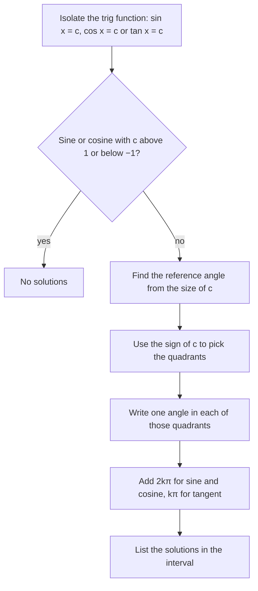

## One answer from the calculator, infinitely many in reality

The inverse functions return one angle. A **trigonometric equation** such as
$\sin x = \tfrac12$ has infinitely many solutions, because sine repeats. Solving one means
finding them all: either every solution (the **general solution**) or every solution in
a stated interval, usually $[0, 2\pi)$ or $[0^\circ, 360^\circ)$. The tools are the unit
circle, reference angles and periodicity. In Module 6 identities will let us rewrite
harder equations into these basic forms.

## The three basic equations

**$\sin x = c$** (with $-1 < c < 1$). On the unit circle, the horizontal line $y = c$ meets
the circle at two points, symmetric about the $y$-axis. If $\alpha = \sin^{-1}c$ is one angle,
the other is $\pi - \alpha$. Adding full turns:
$$x = \alpha + 2k\pi \quad\text{or}\quad x = \pi - \alpha + 2k\pi, \qquad k \text{ an integer}.$$

**$\cos x = c$** (with $-1 < c < 1$). The vertical line $x = c$ meets the circle at two
points symmetric about the $x$-axis: angles $\pm\beta$ with $\beta = \cos^{-1}c$.
$$x = \pm\beta + 2k\pi.$$

In the picture, the vertical line $x = c$ cuts the circle at the angle $\beta$ and at its mirror
image across the $x$-axis, $-\beta$, which is the same point as $2\pi - \beta$.


**$\tan x = c$** (any $c$). Tangent has period $\pi$, and one solution per period:
$$x = \tan^{-1}c + k\pi.$$

When $c = \pm1$ (for sine or cosine) the two points merge into one: $\sin x = 1$ only at
$x = \tfrac{\pi}{2} + 2k\pi$. When $|c| > 1$ there are no solutions.

```plot
{"x": [-1.6, 1.6], "y": [-1.5, 1.5], "equal": true, "circles": [{"center": [0, 0], "r": 1}], "segments": [{"from": [-1.5, 0.5], "to": [1.5, 0.5], "dashed": true, "label": "y = 1/2"}, {"from": [0, 0], "to": [0.866, 0.5]}, {"from": [0, 0], "to": [-0.866, 0.5]}], "points": [{"at": [0.866, 0.5], "label": "π/6"}, {"at": [-0.866, 0.5], "label": "5π/6"}], "caption": "sin x = 1/2 at two points per turn: π/6 and π − π/6 = 5π/6"}
```

### Example 1

Find the general solution of $\sin x = \tfrac12$, and the solutions in $[0, 2\pi)$.

$\alpha = \sin^{-1}\tfrac12 = \tfrac{\pi}{6}$, and the second angle is $\pi - \tfrac{\pi}{6} = \tfrac{5\pi}{6}$.
$$x = \tfrac{\pi}{6} + 2k\pi \quad\text{or}\quad x = \tfrac{5\pi}{6} + 2k\pi.$$
In $[0, 2\pi)$, take $k = 0$: $x = \tfrac{\pi}{6}, \tfrac{5\pi}{6}$.

## Isolate, then solve

Most basic equations are linear in a single trig function. Isolate it with ordinary
algebra, then use the unit circle.



### Example 2

Solve $2\cos x + \sqrt3 = 0$ on $[0, 2\pi)$.

**Isolate:** $\cos x = -\tfrac{\sqrt3}{2}$.

**Reference angle:** $\tfrac{\pi}{6}$. Cosine is negative in quadrants II and III:
$$x = \pi - \tfrac{\pi}{6} = \tfrac{5\pi}{6}, \qquad x = \pi + \tfrac{\pi}{6} = \tfrac{7\pi}{6}.$$

**Check:** $2\cos\tfrac{5\pi}{6} + \sqrt3 = 2\left(-\tfrac{\sqrt3}{2}\right) + \sqrt3 = 0$. ✓

### Example 3

Solve $3\tan\theta - 4 = 0$ for $0^\circ \le \theta < 360^\circ$, to the nearest hundredth of a degree.

$\tan\theta = \tfrac43$, so $\theta = \tan^{-1}\tfrac43 \approx 53.13^\circ$. Tangent repeats every $180^\circ$:
$\theta \approx 53.13^\circ$ or $53.13^\circ + 180^\circ = 233.13^\circ$.

The graph shows the pattern in radians: each branch of $y = \tan x$ crosses the line $y = \tfrac43$
exactly once, so the solutions are one period ($\pi$, or $180^\circ$) apart.

```plot
{"x": [0, 6.3], "y": [-4, 4], "functions": [{"f": "tan(x)", "label": "y = tan x"}, {"f": "4/3", "dashed": true, "label": "y = 4/3"}], "points": [{"at": [0.9273, 1.3333], "label": "0.9273 (53.13°)"}, {"at": [4.0689, 1.3333], "label": "4.0689 (233.13°)"}], "caption": "tan x = 4/3 has one solution in each period of length π"}
```

### Example 4: values that aren't special

Solve $\cos x = 0.3$ on $[0, 2\pi)$, to four decimals.

$\beta = \cos^{-1}(0.3) \approx 1.2661$ (quadrant I). The other solution is in quadrant IV:
$2\pi - 1.2661 \approx 5.0171$. The calculator only gives the first; the unit circle gives the
second.

## Multiple angles

For an equation like $\sin 2x = \tfrac{\sqrt3}{2}$, solve for the whole argument $2x$ first, with
the general solution, *then* divide. Because $x$ in $[0, 2\pi)$ means $2x$ in $[0, 4\pi)$, there
are twice as many solutions.

### Example 5

Solve $\sin 2x = \tfrac{\sqrt3}{2}$ on $[0, 2\pi)$.

**Solve for $u = 2x$:** $u = \tfrac{\pi}{3} + 2k\pi$ or $u = \tfrac{2\pi}{3} + 2k\pi$.

**Divide by 2:** $x = \tfrac{\pi}{6} + k\pi$ or $x = \tfrac{\pi}{3} + k\pi$.

**List those in $[0, 2\pi)$** ($k = 0, 1$): $x = \tfrac{\pi}{6}, \tfrac{\pi}{3}, \tfrac{7\pi}{6}, \tfrac{4\pi}{3}$.

Dividing too early (finding only $\tfrac{\pi}{6}$ and $\tfrac{\pi}{3}$) is the most common error here: the
$+2k\pi$ becomes $+k\pi$ after dividing, which brings in more solutions.

```plot
{"x": [0, 6.4], "y": [-1.3, 1.3], "functions": [{"f": "sin(2x)", "label": "sin 2x"}, {"f": "0.866", "dashed": true}], "points": [{"at": [0.5236, 0.866]}, {"at": [1.0472, 0.866]}, {"at": [3.6652, 0.866]}, {"at": [4.1888, 0.866]}], "caption": "sin 2x = √3/2 has four solutions in [0, 2π)"}
```

## Equations that factor

If an equation is quadratic in a trig function, or a product equal to zero, factor and
set each factor to zero.

### Example 6

Solve $2\sin^2 x - \sin x - 1 = 0$ on $[0, 2\pi)$.

Treat it as $2u^2 - u - 1 = 0$ with $u = \sin x$: $(2u + 1)(u - 1) = 0$.

$\sin x = 1$ gives $x = \tfrac{\pi}{2}$. $\sin x = -\tfrac12$ gives $x = \tfrac{7\pi}{6}, \tfrac{11\pi}{6}$.
Solutions: $\tfrac{\pi}{2}, \tfrac{7\pi}{6}, \tfrac{11\pi}{6}$.

Never divide both sides by a trig expression that might be zero: in $\sin x\cos x = \sin x$,
dividing by $\sin x$ leaves $\cos x = 1$, so only $x = 0$, and the solution $x = \pi$ (where
$\sin x = 0$) is lost. Move everything to one side and factor instead: $\sin x(\cos x - 1) = 0$,
which gives $x = 0$ and $x = \pi$.

### Example 7: a non-special sine

Solve $\sin x = -0.42$ on $[0, 2\pi)$, to four decimals.

The reference angle is $\sin^{-1}(0.42) \approx 0.4334$. Sine is negative in quadrants III and IV:
$x \approx \pi + 0.4334 = 3.5750$ and $x \approx 2\pi - 0.4334 = 5.8498$. Working with the positive
reference angle avoids juggling the calculator's negative output $-0.4334$.

## Common mistakes

- **Stopping at the calculator's answer.** Sine and cosine equations usually have two
  solutions per period; find the second from the unit circle.
- **Dividing a multiple angle too soon.** Write the general solution for $2x$ or $3x$ first.
- **Using $+2k\pi$ for tangent.** Tangent's solutions repeat every $\pi$.
- **Dividing by a trig function.** Factor instead.

## Key points

- $\sin x = c$: $x = \alpha + 2k\pi$ or $\pi - \alpha + 2k\pi$, $\alpha = \sin^{-1}c$.
- $\cos x = c$: $x = \pm\cos^{-1}c + 2k\pi$. $\tan x = c$: $x = \tan^{-1}c + k\pi$.
- Isolate the trig function, find the reference angle, place it in every quadrant with the
  right sign, then add periods.
- With $\sin(bx)$ etc., solve for $bx$ in general form, then divide by $b$.
