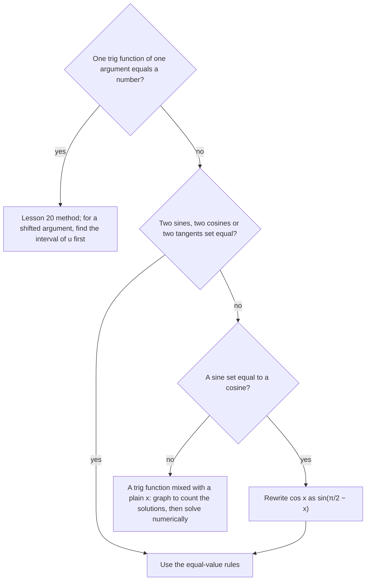

## Beyond sin x = c

Lesson 20 solved equations with one trig function equal to a number, such as $\sin x = \tfrac12$. Two
kinds of equation fall outside that pattern. Some set two trig expressions equal to each other,
such as $\sin 3x = \sin x$; these yield to a sharper version of the unit-circle reasoning, with no
new identities needed. Others mix a trig function with a plain $x$, such as $\cos x = x$; no
formula solves these at all, and the answer has to be found numerically. This lesson handles
both, and ends with an equation that astronomers have been solving this way since the 1600s.

## When two sines are equal

Two angles have the same sine exactly when their terminal points are at the same height on the
unit circle. The horizontal line at that height meets the circle at two points, mirror images
across the $y$-axis: the angle $B$ and the angle $\pi - B$.


Adding full turns gives every possibility:
$$\sin A = \sin B \iff A = B + 2k\pi \ \text{ or } \ A = \pi - B + 2k\pi \qquad (k \text{ an integer}).$$
The same reasoning with a vertical line (mirror images across the $x$-axis) and with tangent's
period $\pi$ gives the other two:
$$\cos A = \cos B \iff A = \pm B + 2k\pi, \qquad \tan A = \tan B \iff A = B + k\pi \ \text{(both defined)}.$$
These are the rules behind Lesson 20's formulas: $\sin x = c$ is $\sin x = \sin\alpha$ with $\alpha = \sin^{-1}c$.

### Example 1: equal sines

Solve $\sin 3x = \sin x$ on $[0, 2\pi)$.

**Family 1:** $3x = x + 2k\pi$, so $2x = 2k\pi$ and $x = k\pi$. In the interval: $x = 0, \pi$.

**Family 2:** $3x = \pi - x + 2k\pi$, so $4x = \pi + 2k\pi$ and $x = \tfrac{\pi}{4} + \tfrac{k\pi}{2}$. In the interval
($k = 0, 1, 2, 3$): $x = \tfrac{\pi}{4}, \tfrac{3\pi}{4}, \tfrac{5\pi}{4}, \tfrac{7\pi}{4}$.

That is six solutions: $0, \tfrac{\pi}{4}, \tfrac{3\pi}{4}, \pi, \tfrac{5\pi}{4}, \tfrac{7\pi}{4}$. **Check** one from each family:
$\sin 3\pi = 0 = \sin\pi$, and $\sin\tfrac{9\pi}{4} = \tfrac{\sqrt2}{2} = \sin\tfrac{\pi}{4}$. Notice that dividing the $2k\pi$ by 4 turned it
into steps of $\tfrac{\pi}{2}$, just as with the multiple angles in Lesson 20.

### Example 2: a sine equal to a cosine

Solve $\sin 2x = \cos x$ on $[0, 2\pi)$.

A cofunction identity (Lesson 6) turns the cosine into a sine: $\cos x = \sin\left(\tfrac{\pi}{2} - x\right)$. Now the equation is
$\sin 2x = \sin\left(\tfrac{\pi}{2} - x\right)$.

**Family 1:** $2x = \tfrac{\pi}{2} - x + 2k\pi$, so $x = \tfrac{\pi}{6} + \tfrac{2k\pi}{3}$: that is $\tfrac{\pi}{6}, \tfrac{5\pi}{6}, \tfrac{3\pi}{2}$.

**Family 2:** $2x = \pi - \left(\tfrac{\pi}{2} - x\right) + 2k\pi = \tfrac{\pi}{2} + x + 2k\pi$, so $x = \tfrac{\pi}{2} + 2k\pi$: that is $\tfrac{\pi}{2}$.

Solutions: $\tfrac{\pi}{6}, \tfrac{\pi}{2}, \tfrac{5\pi}{6}, \tfrac{3\pi}{2}$. In Module 6 the double-angle formula gives the same four by
factoring, $\cos x\,(2\sin x - 1) = 0$; it is reassuring when two methods agree.

## One formula for each family

The two families for $\sin x = c$ can be packed into one line. With $\alpha = \sin^{-1}c$,
$$x = (-1)^n\alpha + n\pi \qquad (n \text{ an integer}).$$
Even $n = 2k$ gives $\alpha + 2k\pi$; odd $n = 2k + 1$ gives $-\alpha + \pi + 2k\pi$, the second family. Some books
write general solutions this way; it is the same set of angles, so either form is correct. For
cosine and tangent the usual forms, $\pm\beta + 2n\pi$ and $\tan^{-1}c + n\pi$, are already one line.

## Shifted arguments

For an equation like $\sin\left(2x - \tfrac{\pi}{3}\right) = \tfrac12$, let $u$ stand for the whole argument and work out the
interval $u$ runs over before listing anything.

### Example 3

Solve $\sin\left(2x - \tfrac{\pi}{3}\right) = \tfrac12$ on $[0, 2\pi)$.

**Interval for $u$.** With $u = 2x - \tfrac{\pi}{3}$ and $0 \le x < 2\pi$: $-\tfrac{\pi}{3} \le u < 4\pi - \tfrac{\pi}{3} = \tfrac{11\pi}{3}$.

**Solve for $u$.** $\sin u = \tfrac12$ at $u = \tfrac{\pi}{6} + 2k\pi$ and $\tfrac{5\pi}{6} + 2k\pi$. In $\left[-\tfrac{\pi}{3}, \tfrac{11\pi}{3}\right)$ that is
$u = \tfrac{\pi}{6}, \tfrac{5\pi}{6}, \tfrac{13\pi}{6}, \tfrac{17\pi}{6}$. (The next ones down, $-\tfrac{11\pi}{6}$ and $-\tfrac{7\pi}{6}$, are below $-\tfrac{\pi}{3}$.)

**Back to $x$.** $x = \tfrac{u + \pi/3}{2}$: $x = \tfrac{\pi}{4}, \tfrac{7\pi}{12}, \tfrac{5\pi}{4}, \tfrac{19\pi}{12}$.

The interval for $u$ has length $4\pi$, two full periods, so four solutions is the right count. In
general, any interval of length $2\pi$ (closed at one end, open at the other) holds exactly two
solutions of $\sin u = c$ when $-1 < c < 1$, so counting periods predicts how many answers to expect.

## Choosing a method



## Equations no formula can solve

The equation $\cos x = x$ has a solution (the graphs of $y = \cos x$ and $y = x$ cross), but no
combination of inverse functions and algebra isolates $x$. An equation that mixes trig (or
exponential or logarithmic) functions with polynomials in this way is called a
**transcendental equation**. Two dependable tools find its solutions to any accuracy you like.

The **bisection method** needs only a sign change. Write the equation as $f(x) = 0$. If $f(a)$ and
$f(b)$ have opposite signs and $f$ is continuous, there is a root between $a$ and $b$. Evaluate $f$ at the
midpoint, keep the half where the sign still changes, and repeat. Each step halves the interval.

**Fixed-point iteration** works on equations written as $x = g(x)$: start with a guess $x_0$ and
compute $x_1 = g(x_0)$, $x_2 = g(x_1)$, and so on. If the values settle down, they settle on a solution.
It converges when $g$ is not too steep near the solution (roughly, when $|g'| < 1$ there, in calculus
language); otherwise the values can wander off, so treat it as a tool to try, not a guarantee.

### Example 4: bisection for cos x = x

Let $f(x) = \cos x - x$ (radians). $f(0) = 1 > 0$ and $f(1) = \cos 1 - 1 \approx -0.4597 < 0$, so a root lies in $[0, 1]$.

| Interval | Midpoint $m$ | $f(m)$ | Keep |
|---|---|---|---|
| $[0, 1]$ | 0.5 | $0.3776 > 0$ | $[0.5, 1]$ |
| $[0.5, 1]$ | 0.75 | $-0.0183 < 0$ | $[0.5, 0.75]$ |
| $[0.5, 0.75]$ | 0.625 | $0.1860 > 0$ | $[0.625, 0.75]$ |
| $[0.625, 0.75]$ | 0.6875 | $0.0853 > 0$ | $[0.6875, 0.75]$ |
| $[0.6875, 0.75]$ | 0.71875 | $0.0339 > 0$ | $[0.71875, 0.75]$ |

After five steps the root is pinned inside an interval of width $\tfrac{1}{32} \approx 0.031$. Carrying on (or
using a calculator's solver) gives $x \approx 0.7391$. Is that the only solution? Yes: $y = x$ is above 1
for $x > 1$ and below $-1$ for $x < -1$, where cosine cannot reach it, and on $[-1, 1]$ the function
$\cos x - x$ only decreases. Counting solutions with a graph before solving is always worth it.

```plot
{"x": [-2, 2.5], "y": [-1.6, 1.8], "equal": true, "functions": [{"f": "cos(x)", "label": "y = cos x"}, {"f": "x", "dashed": true, "label": "y = x"}], "points": [{"at": [0.7391, 0.7391], "label": "x ≈ 0.7391"}], "caption": "cos x = x has exactly one solution"}
```

### Example 5: Kepler's equation

An object in an elliptical orbit does not move at a steady angular speed, and
**Kepler's equation** connects time to position:
$$M = E - e\sin E.$$
Here $e$ is the orbit's eccentricity (between 0 and 1), $M$ is an angle that grows steadily with time
(the "mean anomaly"), and $E$ is an angle that locates the object on its ellipse (the "eccentric
anomaly"), all in radians. Kepler met this equation in his work on the orbit of Mars, published in
1609. Given $M$, finding $E$ is a transcendental equation, the everyday job of orbit software.

Take $e = 0.2$ and $M = 1$. Rewrite as $E = M + e\sin E$ and iterate from $E_0 = M = 1$:

| $n$ | $E_n = 1 + 0.2\sin E_{n-1}$ |
|---|---|
| 1 | $1 + 0.2\sin 1 \approx 1.168294$ |
| 2 | $1 + 0.2\sin 1.168294 \approx 1.184017$ |
| 3 | $\approx 1.185226$ |
| 4 | $\approx 1.185317$ |
| 5 | $\approx 1.185324$ |

The values settle on $E \approx 1.1853$. The iteration converges here because $e\cos E$ is at most 0.2 in size,
so each step shrinks the error by a factor of about 5 or more. **Check:** $1.1853 - 0.2\sin 1.1853 \approx 1.0000$.
For orbits with $e$ close to 1 this simple iteration slows down, and orbit software uses faster
methods (this is a simplified picture of how it is done).

## Common mistakes

- **Using only one family.** $\sin A = \sin B$ also allows $A = \pi - B + 2k\pi$; dropping it lost four of the six
  solutions in Example 1.
- **Writing $\pm$ for sines.** $A = \pm B + 2k\pi$ is the rule for cosines. For sines the second family is
  $\pi - B$, not $-B$.
- **Listing $u$-values from $[0, 2\pi)$** when the argument is shifted or multiplied. Find $u$'s own interval first.
- **Dividing too early.** Write the families with $+2k\pi$, then divide; the step size shrinks with it.
- **Trusting a numerical answer without counting.** Bisection finds *a* root in an interval. A graph
  tells you how many roots there are and where to look for each.

## Key points

- $\sin A = \sin B$: $A = B + 2k\pi$ or $A = \pi - B + 2k\pi$. $\cos A = \cos B$: $A = \pm B + 2k\pi$. $\tan A = \tan B$: $A = B + k\pi$.
- Turn a cosine into a sine with $\cos x = \sin\left(\tfrac{\pi}{2} - x\right)$ to compare them.
- $x = (-1)^n\alpha + n\pi$ is a one-line form of both families for $\sin x = \sin\alpha$.
- For a shifted argument, find the interval of $u$, solve there, then convert back to $x$.
- Transcendental equations such as $\cos x = x$ and Kepler's equation are solved numerically, by
  bisection or fixed-point iteration, after a graph shows how many solutions to look for.
