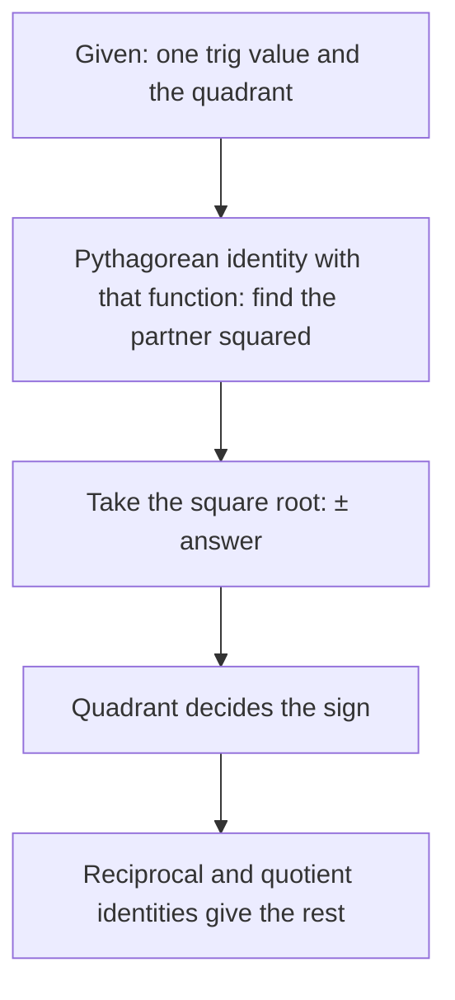

## Equations that are always true

An equation like $2\sin x = 1$ is true only for certain $x$. An **identity** is an equation
that is true for *every* value of the variable for which both sides are defined, such as
$\tan x = \tfrac{\sin x}{\cos x}$. Identities are the algebra of trigonometry: they let you
rewrite an expression into a more useful form, the same way factoring and expanding work
in algebra. You have already met most of the basic ones. This lesson collects them,
proves the Pythagorean identities, and puts them to work.

## The list

**Reciprocal identities**
$$\csc x = \frac{1}{\sin x}, \qquad \sec x = \frac{1}{\cos x}, \qquad \cot x = \frac{1}{\tan x}.$$

**Quotient identities**
$$\tan x = \frac{\sin x}{\cos x}, \qquad \cot x = \frac{\cos x}{\sin x}.$$

**Pythagorean identities**
$$\sin^2 x + \cos^2 x = 1, \qquad 1 + \tan^2 x = \sec^2 x, \qquad 1 + \cot^2 x = \csc^2 x.$$

**Even–odd identities**
$$\sin(-x) = -\sin x, \quad \cos(-x) = \cos x, \quad \tan(-x) = -\tan x$$
(and $\csc$, $\cot$ odd, $\sec$ even).

**Cofunction identities**
$$\sin\left(\tfrac{\pi}{2} - x\right) = \cos x, \quad \cos\left(\tfrac{\pi}{2} - x\right) = \sin x, \quad \tan\left(\tfrac{\pi}{2} - x\right) = \cot x,$$
and similarly for the other pairs.

The full sheet is in the identities reference.

## Where the Pythagorean identities come from

The point $(\cos x, \sin x)$ is on the unit circle $X^2 + Y^2 = 1$, so
$$\cos^2 x + \sin^2 x = 1.$$
This is the Pythagorean theorem for the triangle with hypotenuse 1, hence the name.

Divide every term by $\cos^2 x$ (where $\cos x \ne 0$):
$$\frac{\sin^2 x}{\cos^2 x} + \frac{\cos^2 x}{\cos^2 x} = \frac{1}{\cos^2 x} \;\Longrightarrow\; \tan^2 x + 1 = \sec^2 x.$$

Divide instead by $\sin^2 x$:
$$1 + \cot^2 x = \csc^2 x.$$

Each comes in several rearranged forms that are worth recognizing on sight:
$$\sin^2 x = 1 - \cos^2 x, \quad \cos^2 x = 1 - \sin^2 x, \quad \sec^2 x - \tan^2 x = 1, \quad \csc^2 x - 1 = \cot^2 x.$$

Each Pythagorean identity is the Pythagorean theorem for a right triangle with an acute angle $x$.
Scale the basic triangle (hypotenuse 1) so that its adjacent side is 1, or so that its opposite side
is 1, and the other two identities appear:


## Using identities to find values

Given one trig value and the quadrant, the Pythagorean identity gives the partner value;
the sign comes from the quadrant.

The same four steps work every time:



### Example 1

$\sin\theta = -\tfrac23$ and $\theta$ is in quadrant III. Find $\cos\theta$, $\tan\theta$ and $\sec\theta$.

**$\cos\theta$:** $\cos^2\theta = 1 - \sin^2\theta = 1 - \tfrac49 = \tfrac59$, so $\cos\theta = \pm\tfrac{\sqrt5}{3}$.
In quadrant III cosine is negative: $\cos\theta = -\tfrac{\sqrt5}{3}$.

**$\tan\theta$:** $\dfrac{\sin\theta}{\cos\theta} = \dfrac{-2/3}{-\sqrt5/3} = \dfrac{2}{\sqrt5} = \dfrac{2\sqrt5}{5}$ (positive in QIII ✓).

**$\sec\theta$:** $\dfrac{1}{\cos\theta} = -\dfrac{3}{\sqrt5} = -\dfrac{3\sqrt5}{5}$.

### Example 2

$\tan\theta = 3$ and $\sin\theta < 0$. Find $\sec\theta$.

$\sec^2\theta = 1 + \tan^2\theta = 10$, so $\sec\theta = \pm\sqrt{10}$. Tangent positive and sine
negative means quadrant III, where cosine (and secant) is negative: $\sec\theta = -\sqrt{10}$.

## Simplifying expressions

To **simplify** a trig expression means to rewrite it with fewer functions or terms.
There's no single algorithm, but these moves work most of the time:

1. Look for a Pythagorean pattern ($1 - \sin^2$, $\sec^2 - 1$, …) and replace it.
2. Factor out common factors.
3. Rewrite everything in terms of sine and cosine.
4. Combine fractions over a common denominator.

### Example 3

Simplify $\sec x - \sec x\sin^2 x$.

Factor: $\sec x(1 - \sin^2 x) = \sec x\cos^2 x = \dfrac{1}{\cos x}\cdot\cos^2 x = \cos x$.

### Example 4

Simplify $\dfrac{1 + \tan^2 x}{\csc^2 x}$.

Pythagorean on top: $\dfrac{\sec^2 x}{\csc^2 x} = \dfrac{1/\cos^2 x}{1/\sin^2 x} = \dfrac{\sin^2 x}{\cos^2 x} = \tan^2 x$.

### Example 5

Write $\tan x + \cot x$ as a single term.

Sines and cosines: $\dfrac{\sin x}{\cos x} + \dfrac{\cos x}{\sin x}$. Common denominator:
$$\frac{\sin^2 x + \cos^2 x}{\sin x\cos x} = \frac{1}{\sin x\cos x} = \sec x\csc x.$$

### Example 6

Factor and simplify $\sin^4 x - \cos^4 x$.

Difference of squares: $(\sin^2 x - \cos^2 x)(\sin^2 x + \cos^2 x) = \sin^2 x - \cos^2 x$.
(In Lesson 24 this becomes $-\cos 2x$.)

## Checking an identity numerically

A quick way to catch errors is to test a value. If you think $\tfrac{1 + \tan^2 x}{\csc^2 x} = \tan^2 x$,
try $x = \tfrac{\pi}{4}$: left side $\tfrac{1 + 1}{2} = 1$, right side $1$. ✓ One matching value doesn't
prove an identity (a false equation can hold at some points), but one mismatch proves it
false.

```plot
{"x": [-3.2, 3.2], "y": [-0.3, 1.3], "functions": [{"f": "sin(x)^2", "label": "sin² x"}, {"f": "cos(x)^2", "label": "cos² x"}, {"f": "sin(x)^2 + cos(x)^2", "dashed": true, "label": "sum = 1"}], "caption": "sin² x and cos² x trade off so that their sum is always 1"}
```

### Example 7: one function in terms of another

For $\theta$ in quadrant I, write $\sec\theta$ and $\tan\theta$ in terms of $\sin\theta$ alone.

$\cos\theta = \sqrt{1 - \sin^2\theta}$ (positive in quadrant I), so
$\sec\theta = \dfrac{1}{\sqrt{1 - \sin^2\theta}}$ and $\tan\theta = \dfrac{\sin\theta}{\sqrt{1 - \sin^2\theta}}$.
In other quadrants the square root may need a minus sign.

## Common mistakes

- **Writing $\sin^2 x + \cos^2 x = 1$ as $\sin x + \cos x = 1$.** The squares matter;
  $\sin x + \cos x$ is $\sqrt2$ at $\tfrac{\pi}{4}$.
- **Dropping the $\pm$ and the sign check** when taking square roots.
- **Mixing up $1 + \tan^2 = \sec^2$ and $1 + \cot^2 = \csc^2$.** Tangent goes with secant
  (both have $\cos$ in the denominator); cotangent with cosecant.
- **"Cancelling" across addition.** $\tfrac{\sin x + 1}{\sin x} \ne 1 + 1$; only common factors cancel.

## Key points

- An identity holds for every input where both sides are defined.
- Pythagorean: $\sin^2 + \cos^2 = 1$, $1 + \tan^2 = \sec^2$, $1 + \cot^2 = \csc^2$.
- Find missing values with a Pythagorean identity, then fix the sign by quadrant.
- To simplify: substitute Pythagorean forms, factor, convert to $\sin$ and $\cos$, combine fractions.
