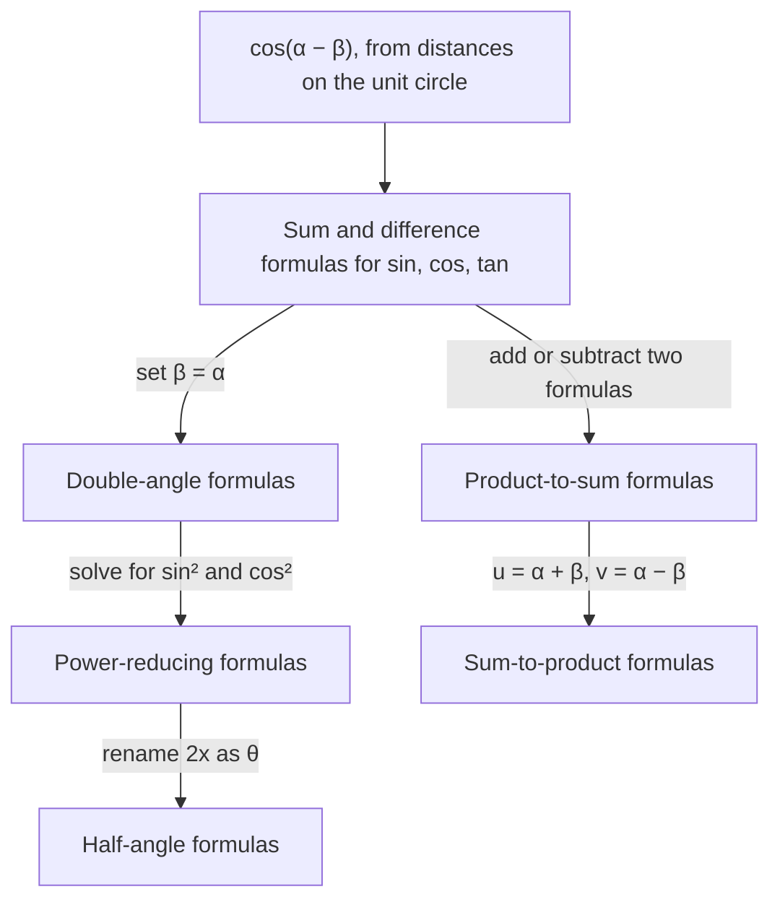

## Trig of a sum is not a sum of trig

It's tempting to think $\sin(\alpha + \beta) = \sin\alpha + \sin\beta$. Try $\alpha = \beta = \tfrac{\pi}{2}$: the
left side is $\sin\pi = 0$, the right side is 2. The true formulas are a little more
involved, and they are the foundation for everything else in this module: double-angle,
half-angle, product-to-sum, and the combining of waves. They also give exact values for
angles like $15^\circ$ and $75^\circ$ that the special triangles miss.

## The cosine difference formula

$$\cos(\alpha - \beta) = \cos\alpha\cos\beta + \sin\alpha\sin\beta.$$

**Why it's true.** Put $P = (\cos\alpha, \sin\alpha)$ and $Q = (\cos\beta, \sin\beta)$ on the unit
circle. The angle between them is $\alpha - \beta$. Compute the squared distance $PQ^2$ two ways.

*With the distance formula:*
$$PQ^2 = (\cos\alpha - \cos\beta)^2 + (\sin\alpha - \sin\beta)^2 = 2 - 2(\cos\alpha\cos\beta + \sin\alpha\sin\beta),$$
after expanding and using $\cos^2 + \sin^2 = 1$ twice.

*By rotating* the picture so $Q$ sits at $(1, 0)$: then $P$ is at $(\cos(\alpha - \beta), \sin(\alpha - \beta))$,
and the distance is unchanged:
$$PQ^2 = (\cos(\alpha - \beta) - 1)^2 + \sin^2(\alpha - \beta) = 2 - 2\cos(\alpha - \beta).$$

Setting the two expressions equal gives the formula.

```plot
{"x": [-1.4, 1.4], "y": [-0.5, 1.4], "equal": true, "circles": [{"center": [0, 0], "r": 1}], "segments": [{"from": [0, 0], "to": [-0.3420, 0.9397]}, {"from": [0, 0], "to": [0.8660, 0.5]}, {"from": [-0.3420, 0.9397], "to": [0.8660, 0.5], "dashed": true}], "points": [{"at": [-0.342, 0.9397], "label": "P (angle α)"}, {"at": [0.866, 0.5], "label": "Q (angle β)"}], "caption": "The chord PQ depends only on the angle α − β between the radii"}
```

## The rest of the family

Replace $\beta$ by $-\beta$ (cosine is even, sine is odd) to get the sum formula for cosine.
Use the cofunction identity $\sin\theta = \cos\left(\tfrac{\pi}{2} - \theta\right)$ to get the sine formulas, and
divide sine by cosine for tangent:

$$\sin(\alpha \pm \beta) = \sin\alpha\cos\beta \pm \cos\alpha\sin\beta$$
$$\cos(\alpha \pm \beta) = \cos\alpha\cos\beta \mp \sin\alpha\sin\beta$$
$$\tan(\alpha \pm \beta) = \frac{\tan\alpha \pm \tan\beta}{1 \mp \tan\alpha\tan\beta}$$

These are the **sum formulas** and **difference formulas**. Memory aids: sine keeps the sign
and mixes functions ("sin cos, cos sin"); cosine keeps functions together ("cos cos, sin
sin") and *flips* the sign.

For acute angles there is also a picture proof. Stack a right triangle with angle $\beta$ and hypotenuse 1
on top of one with angle $\alpha$, and fit them in a rectangle: the right side of the rectangle is
$\sin(\alpha + \beta)$, made of two pieces, and the top piece $TP$ is $\cos(\alpha + \beta)$, the bottom $OR$ minus the short piece $SP$.


Reading the right side, $\sin(\alpha + \beta) = \sin\alpha\cos\beta + \cos\alpha\sin\beta$; reading the top, $\cos(\alpha + \beta) = \cos\alpha\cos\beta - \sin\alpha\sin\beta$.

## Exact values

Write the angle as a sum or difference of special angles.

### Example 1

Find the exact value of $\cos 15^\circ$.

$15^\circ = 45^\circ - 30^\circ$:
$$\cos 15^\circ = \cos 45^\circ\cos 30^\circ + \sin 45^\circ\sin 30^\circ = \frac{\sqrt2}{2}\cdot\frac{\sqrt3}{2} + \frac{\sqrt2}{2}\cdot\frac12 = \frac{\sqrt6 + \sqrt2}{4}.$$
Check: $\tfrac{2.449 + 1.414}{4} \approx 0.9659$ and $\cos 15^\circ \approx 0.9659$. ✓

### Example 2

Find $\sin\tfrac{7\pi}{12}$ and $\tan\tfrac{\pi}{12}$ exactly.

$\tfrac{7\pi}{12} = \tfrac{\pi}{3} + \tfrac{\pi}{4}$:
$$\sin\tfrac{7\pi}{12} = \sin\tfrac{\pi}{3}\cos\tfrac{\pi}{4} + \cos\tfrac{\pi}{3}\sin\tfrac{\pi}{4} = \frac{\sqrt3}{2}\cdot\frac{\sqrt2}{2} + \frac12\cdot\frac{\sqrt2}{2} = \frac{\sqrt6 + \sqrt2}{4}.$$

$\tfrac{\pi}{12} = \tfrac{\pi}{3} - \tfrac{\pi}{4}$:
$$\tan\tfrac{\pi}{12} = \frac{\sqrt3 - 1}{1 + \sqrt3\cdot 1} = \frac{(\sqrt3 - 1)(\sqrt3 - 1)}{(\sqrt3 + 1)(\sqrt3 - 1)} = \frac{4 - 2\sqrt3}{2} = 2 - \sqrt3.$$

## Using given values

### Example 3

$\sin\alpha = \tfrac35$ with $\alpha$ in quadrant II, and $\cos\beta = -\tfrac{5}{13}$ with $\beta$ in
quadrant III. Find $\sin(\alpha + \beta)$ and $\cos(\alpha - \beta)$.

**Missing values first.** $\cos\alpha = -\tfrac45$ (QII). $\sin\beta = -\tfrac{12}{13}$ (QIII).

$$\sin(\alpha + \beta) = \tfrac35\left(-\tfrac{5}{13}\right) + \left(-\tfrac45\right)\left(-\tfrac{12}{13}\right) = -\tfrac{15}{65} + \tfrac{48}{65} = \tfrac{33}{65}.$$
$$\cos(\alpha - \beta) = \left(-\tfrac45\right)\left(-\tfrac{5}{13}\right) + \tfrac35\left(-\tfrac{12}{13}\right) = \tfrac{20}{65} - \tfrac{36}{65} = -\tfrac{16}{65}.$$

### Example 4: recognizing a formula

Evaluate $\sin 80^\circ\cos 20^\circ - \cos 80^\circ\sin 20^\circ$.

This is the pattern of $\sin(\alpha - \beta)$ with $\alpha = 80^\circ$, $\beta = 20^\circ$: it equals
$\sin 60^\circ = \tfrac{\sqrt3}{2}$.

### Example 5: proving reduction identities

Show that $\sin\left(x + \tfrac{\pi}{2}\right) = \cos x$ and $\cos(\pi - x) = -\cos x$.

$\sin\left(x + \tfrac{\pi}{2}\right) = \sin x\cdot 0 + \cos x\cdot 1 = \cos x$.
$\cos(\pi - x) = \cos\pi\cos x + \sin\pi\sin x = -\cos x$.

## Combining two waves

The sum formula runs backward too. Any combination $a\sin x + b\cos x$ is a single sinusoid
$R\sin(x + \varphi)$, where $R = \sqrt{a^2 + b^2}$, $\cos\varphi = \tfrac{a}{R}$ and $\sin\varphi = \tfrac{b}{R}$.
Expanding $R\sin(x + \varphi) = R\cos\varphi\sin x + R\sin\varphi\cos x$ shows why.

### Example 6

Write $\sin x + \sqrt3\cos x$ as a single sine.

$R = \sqrt{1 + 3} = 2$, $\cos\varphi = \tfrac12$, $\sin\varphi = \tfrac{\sqrt3}{2}$, so $\varphi = \tfrac{\pi}{3}$:
$$\sin x + \sqrt3\cos x = 2\sin\left(x + \tfrac{\pi}{3}\right).$$
The sum of the two waves has amplitude 2, more than either piece but less than $1 + \sqrt3$.

```plot
{"x": [-3.5, 6.6], "y": [-2.5, 2.5], "functions": [{"f": "sin(x)", "dashed": true}, {"f": "sqrt(3)cos(x)", "dashed": true}, {"f": "sin(x) + sqrt(3)cos(x)", "label": "2 sin(x + π/3)"}], "caption": "Adding sin x and √3 cos x gives one sinusoid of amplitude 2"}
```

### Example 7: tangent and a simplification

(a) If $\tan\alpha = \tfrac12$ and $\tan\beta = \tfrac13$, find $\tan(\alpha - \beta)$.
(b) Simplify $\sin\left(x + \tfrac{\pi}{6}\right) + \sin\left(x - \tfrac{\pi}{6}\right)$.

**(a)** $\dfrac{\tfrac12 - \tfrac13}{1 + \tfrac12\cdot\tfrac13} = \dfrac{1/6}{7/6} = \dfrac17$.

**(b)** Expand both: the $\cos x\sin\tfrac{\pi}{6}$ terms cancel, leaving $2\sin x\cos\tfrac{\pi}{6} = 2\sin x\cdot\tfrac{\sqrt3}{2} = \sqrt3\sin x$.

## Why the formulas matter

The sum and difference formulas are the source of almost every identity in the rest of this
module: double-angle formulas set $\beta = \alpha$, half-angle formulas come from those, and
product-to-sum formulas come from adding two sum formulas. In physics they describe how two
waves combine. In Lesson 38 they explain why multiplying complex numbers adds their
angles. If you remember only one group of identities beyond the Pythagorean ones, make it this
one, because the others can be rebuilt from it in a few lines.



## Common mistakes

- **Distributing:** $\sin(\alpha + \beta) \ne \sin\alpha + \sin\beta$.
- **Wrong sign in the cosine formula.** $\cos(\alpha + \beta)$ has a minus sign.
- **Forgetting quadrant signs** when finding the missing sine or cosine.
- **Tangent denominator sign.** $\tan(\alpha + \beta)$ has $1 - \tan\alpha\tan\beta$ underneath.

## Key points

- $\sin(\alpha \pm \beta) = \sin\alpha\cos\beta \pm \cos\alpha\sin\beta$.
- $\cos(\alpha \pm \beta) = \cos\alpha\cos\beta \mp \sin\alpha\sin\beta$.
- $\tan(\alpha \pm \beta) = \dfrac{\tan\alpha \pm \tan\beta}{1 \mp \tan\alpha\tan\beta}$.
- Exact values for $15^\circ, 75^\circ, 105^\circ, \ldots$ come from sums and differences of special angles.
- $a\sin x + b\cos x = R\sin(x + \varphi)$ with $R = \sqrt{a^2 + b^2}$.
