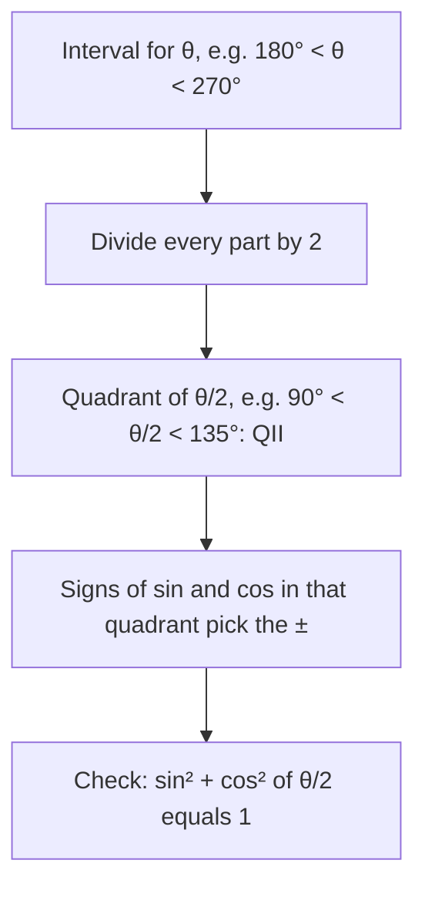

## Halving instead of doubling

The power-reducing formulas from the last lesson say $\sin^2 x = \tfrac{1 - \cos 2x}{2}$. Rename
$2x$ as $\theta$ (so $x = \tfrac{\theta}{2}$) and take square roots, and you get formulas for the trig
functions of *half* an angle. They give exact values like $\sin 22.5^\circ$ and
$\cos 105^\circ$, and they let you find $\sin\tfrac{\theta}{2}$ when you only know $\cos\theta$.

## The formulas

$$\sin\frac{\theta}{2} = \pm\sqrt{\frac{1 - \cos\theta}{2}}, \qquad \cos\frac{\theta}{2} = \pm\sqrt{\frac{1 + \cos\theta}{2}},$$

$$\tan\frac{\theta}{2} = \frac{1 - \cos\theta}{\sin\theta} = \frac{\sin\theta}{1 + \cos\theta}.$$

These are the **half-angle formulas**.

**The sign.** In the sine and cosine formulas, the $\pm$ is *not* "both answers". Exactly one
sign is right, and it is decided by the quadrant of $\tfrac{\theta}{2}$, **not** the quadrant of $\theta$.



**Why the tangent formulas have no $\pm$.** Multiply top and bottom of $\tan\tfrac{\theta}{2} = \tfrac{\sin(\theta/2)}{\cos(\theta/2)}$
by $2\sin\tfrac{\theta}{2}$:
$$\tan\frac{\theta}{2} = \frac{2\sin^2(\theta/2)}{2\sin(\theta/2)\cos(\theta/2)} = \frac{1 - \cos\theta}{\sin\theta},$$
using the power-reducing formula on top and the double-angle formula underneath. The signs
take care of themselves. Multiplying by $2\cos\tfrac{\theta}{2}$ instead gives the second form.

For $0 < \theta < 180^\circ$ there is also a picture. Put $P = (\cos\theta, \sin\theta)$ on the unit circle and join it to
$A = (-1, 0)$. The angle at $A$ is $\tfrac{\theta}{2}$ (an angle with its vertex on a circle is half the central angle on the
same arc), and the right triangle $AFP$ has legs $1 + \cos\theta$ and $\sin\theta$, so $\tan\tfrac{\theta}{2} = \tfrac{\sin\theta}{1 + \cos\theta}$. (If you did the Module 2 honors lesson on exact values from regular polygons, this is its angle-halving construction: extend the adjacent leg by the hypotenuse, here of length 1.)


## Exact values

### Example 1

Find $\sin 22.5^\circ$ exactly.

$22.5^\circ = \tfrac{45^\circ}{2}$, in quadrant I, so take the positive root:
$$\sin 22.5^\circ = \sqrt{\frac{1 - \cos 45^\circ}{2}} = \sqrt{\frac{1 - \frac{\sqrt2}{2}}{2}} = \sqrt{\frac{2 - \sqrt2}{4}} = \frac{\sqrt{2 - \sqrt2}}{2}.$$
Check: $\tfrac{\sqrt{0.5858}}{2} \approx 0.3827$ and $\sin 22.5^\circ \approx 0.3827$. ✓

### Example 2

Find $\cos 105^\circ$ exactly.

$105^\circ = \tfrac{210^\circ}{2}$, and $105^\circ$ is in quadrant II, where cosine is negative:
$$\cos 105^\circ = -\sqrt{\frac{1 + \cos 210^\circ}{2}} = -\sqrt{\frac{1 - \frac{\sqrt3}{2}}{2}} = -\frac{\sqrt{2 - \sqrt3}}{2} \approx -0.2588.$$
(The sum formula with $60^\circ + 45^\circ$ gives the same number in the form $\tfrac{\sqrt2 - \sqrt6}{4}$; both are
correct.)

### Example 3

Find $\tan\tfrac{\pi}{8}$ exactly.

Using the tangent formula with $\theta = \tfrac{\pi}{4}$:
$$\tan\frac{\pi}{8} = \frac{1 - \cos\frac{\pi}{4}}{\sin\frac{\pi}{4}} = \frac{1 - \frac{\sqrt2}{2}}{\frac{\sqrt2}{2}} = \frac{2 - \sqrt2}{\sqrt2} = \sqrt2 - 1.$$
No square root and no sign decision needed.

## Using a given value

### Example 4

$\cos\theta = -\tfrac{7}{25}$ and $180^\circ < \theta < 270^\circ$. Find $\sin\tfrac{\theta}{2}$, $\cos\tfrac{\theta}{2}$ and $\tan\tfrac{\theta}{2}$.

**Quadrant of the half angle.** Divide the inequality by 2: $90^\circ < \tfrac{\theta}{2} < 135^\circ$,
quadrant II. So $\sin\tfrac{\theta}{2} > 0$ and $\cos\tfrac{\theta}{2} < 0$.

$$\sin\frac{\theta}{2} = +\sqrt{\frac{1 - (-7/25)}{2}} = \sqrt{\frac{32/25}{2}} = \sqrt{\frac{16}{25}} = \frac45.$$
$$\cos\frac{\theta}{2} = -\sqrt{\frac{1 + (-7/25)}{2}} = -\sqrt{\frac{18/25}{2}} = -\sqrt{\frac{9}{25}} = -\frac35.$$
For the tangent, $\sin\theta = -\tfrac{24}{25}$ (QIII), and
$$\tan\frac{\theta}{2} = \frac{1 - \cos\theta}{\sin\theta} = \frac{32/25}{-24/25} = -\frac43,$$
which matches $\tfrac{4/5}{-3/5}$. ✓

```plot
{"x": [-1.4, 1.4], "y": [-1.4, 1.4], "equal": true, "circles": [{"center": [0, 0], "r": 1}], "segments": [{"from": [0, 0], "to": [-0.28, -0.96], "arrow": true}, {"from": [0, 0], "to": [-0.6, 0.8], "arrow": true}], "labels": [{"at": [-0.55, -1.15], "text": "θ (QIII)"}, {"at": [-0.85, 1.05], "text": "θ/2 (QII)"}], "caption": "θ in quadrant III, but θ/2 is in quadrant II: the half angle decides the signs"}
```

## A note on choosing a method

For angles like $15^\circ$ or $75^\circ$ you can use either a difference formula ($45^\circ - 30^\circ$)
or a half-angle formula ($\tfrac{30^\circ}{2}$). The difference formula avoids nested roots; the
half-angle formula is the only way when the angle is half of a special angle but not a
sum of two ($22.5^\circ$, $67.5^\circ$, $\tfrac{\pi}{8}$).

### Example 5: from a cosine in quadrant IV

$\cos\theta = \tfrac35$ and $270^\circ < \theta < 360^\circ$. Find $\sin\tfrac{\theta}{2}$, $\cos\tfrac{\theta}{2}$ and $\tan\tfrac{\theta}{2}$.

**Locate the half angle.** $135^\circ < \tfrac{\theta}{2} < 180^\circ$: quadrant II, so sine is positive and cosine negative.

$$\sin\frac{\theta}{2} = \sqrt{\frac{1 - 3/5}{2}} = \sqrt{\frac15} = \frac{\sqrt5}{5}, \qquad \cos\frac{\theta}{2} = -\sqrt{\frac{1 + 3/5}{2}} = -\sqrt{\frac45} = -\frac{2\sqrt5}{5}.$$

For the tangent, $\sin\theta = -\tfrac45$ (quadrant IV), so $\tan\tfrac{\theta}{2} = \dfrac{1 - 3/5}{-4/5} = -\dfrac12$. This matches
$\tfrac{\sqrt5/5}{-2\sqrt5/5} = -\tfrac12$. ✓ Notice that $\theta$'s cosine was positive, yet $\cos\tfrac{\theta}{2}$ came out negative:
the half angle, not the original, decides the sign.

### Example 6: an identity

Verify $\tan\tfrac{x}{2} = \csc x - \cot x$.

Start from the half-angle formula and split the fraction:
$$\tan\frac{x}{2} = \frac{1 - \cos x}{\sin x} = \frac{1}{\sin x} - \frac{\cos x}{\sin x} = \csc x - \cot x. \;\checkmark$$

## Where half-angle formulas are used

Half-angle formulas turn up whenever an angle is naturally doubled or halved: in calculus,
the substitution $t = \tan\tfrac{x}{2}$ turns any rational expression in sine and cosine into an
ordinary rational function; in geometry, the angle bisectors of a triangle bring in half
angles; and in optics and surveying, the angle between two lines of sight is often split in
half. The formulas themselves are the same in radians: for example,
$\sin\tfrac{\pi}{12} = \sqrt{\tfrac{1 - \cos(\pi/6)}{2}} = \tfrac{\sqrt{2 - \sqrt3}}{2}$.

## Checking a half-angle answer

Square your answers and add: $\sin^2\tfrac{\theta}{2} + \cos^2\tfrac{\theta}{2}$ must equal 1. In Example 4,
$\tfrac{16}{25} + \tfrac{9}{25} = 1$. ✓ Then compare the signs with a sketch of $\tfrac{\theta}{2}$. These two checks catch
almost every error with half-angle formulas.

### Example 7: two forms of the same number

Find $\sin 15^\circ$ with the half-angle formula and compare with the difference formula.

Half-angle: $\sin 15^\circ = \sqrt{\tfrac{1 - \cos 30^\circ}{2}} = \sqrt{\tfrac{2 - \sqrt3}{4}} = \tfrac{\sqrt{2 - \sqrt3}}{2}$.
Difference formula ($45^\circ - 30^\circ$): $\sin 15^\circ = \tfrac{\sqrt6 - \sqrt2}{4}$.

They look different but are equal: square the second, $\tfrac{6 - 2\sqrt{12} + 2}{16} = \tfrac{8 - 4\sqrt3}{16} = \tfrac{2 - \sqrt3}{4}$,
which is the square of the first. Both are about $0.2588$. When an answer key's form differs
from yours, compare decimals before deciding you made a mistake.

## Common mistakes

- **Choosing the sign from $\theta$'s quadrant.** Use the quadrant of $\tfrac{\theta}{2}$.
- **Writing both signs in the answer.** Exactly one is correct.
- **Mixing up $1 - \cos$ and $1 + \cos$.** Sine of the half angle uses $1 - \cos\theta$. Check
  with $\theta = 0$: $\sin 0 = 0$ requires $1 - \cos 0 = 0$.
- **Forgetting to halve the inequality** when locating $\tfrac{\theta}{2}$.

## Key points

- $\sin\tfrac{\theta}{2} = \pm\sqrt{\tfrac{1 - \cos\theta}{2}}$, $\cos\tfrac{\theta}{2} = \pm\sqrt{\tfrac{1 + \cos\theta}{2}}$, sign from the
  quadrant of $\tfrac{\theta}{2}$.
- $\tan\tfrac{\theta}{2} = \tfrac{1 - \cos\theta}{\sin\theta} = \tfrac{\sin\theta}{1 + \cos\theta}$, with no sign ambiguity.
- They come from the power-reducing formulas with $x = \tfrac{\theta}{2}$.
