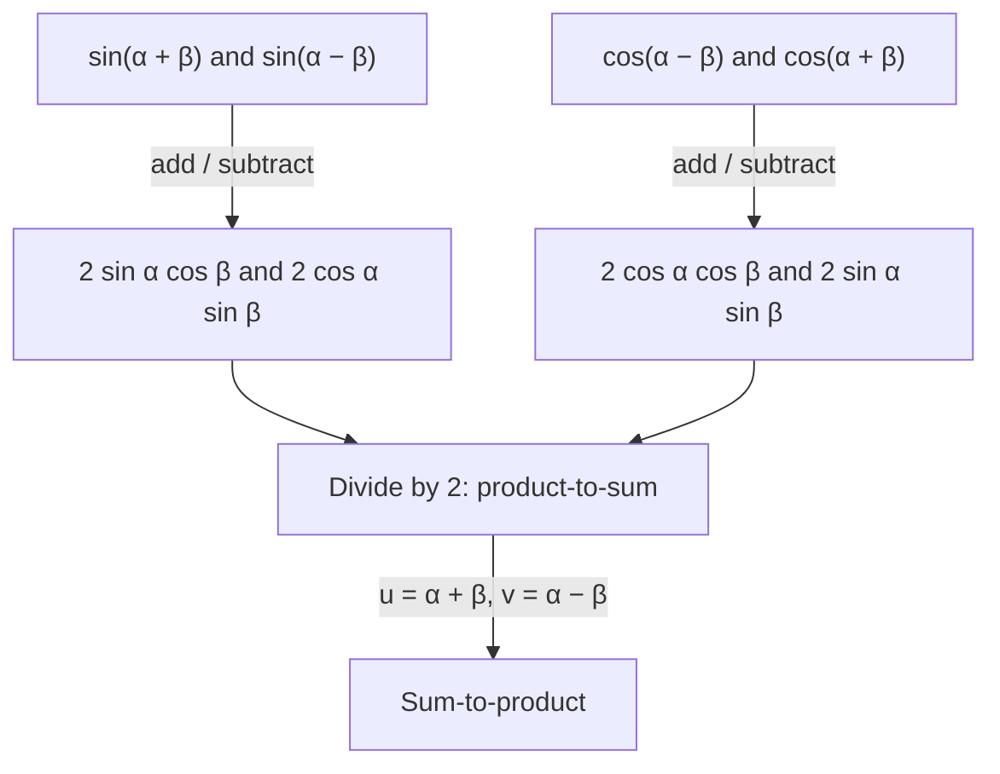

## Turning products into sums and back

Products of trig functions are awkward: hard to integrate, hard to graph, hard to solve.
Sums are easy. The formulas in this lesson convert between the two. They come straight
from adding and subtracting the sum and difference formulas, so there's nothing new to
memorize in principle, only new ways to use what you know. They also explain a real
phenomenon: the "beats" you hear when two nearly equal notes play together.

## Product-to-sum

Write the sum and difference formulas for sine one above the other:
$$\sin(\alpha + \beta) = \sin\alpha\cos\beta + \cos\alpha\sin\beta$$
$$\sin(\alpha - \beta) = \sin\alpha\cos\beta - \cos\alpha\sin\beta$$
Adding them cancels the $\cos\alpha\sin\beta$ terms: $\sin(\alpha + \beta) + \sin(\alpha - \beta) = 2\sin\alpha\cos\beta$.
Doing the same with the cosine formulas, adding and subtracting, gives the full set of
**product-to-sum formulas**:

$$\sin\alpha\cos\beta = \tfrac12\left[\sin(\alpha + \beta) + \sin(\alpha - \beta)\right]$$
$$\cos\alpha\sin\beta = \tfrac12\left[\sin(\alpha + \beta) - \sin(\alpha - \beta)\right]$$
$$\cos\alpha\cos\beta = \tfrac12\left[\cos(\alpha - \beta) + \cos(\alpha + \beta)\right]$$
$$\sin\alpha\sin\beta = \tfrac12\left[\cos(\alpha - \beta) - \cos(\alpha + \beta)\right]$$

Notice that the last one has the *difference* angle first; getting that order wrong flips
the sign.

### Example 1

Write $\sin 5x\cos 3x$ as a sum.

$\alpha = 5x$, $\beta = 3x$: $\sin 5x\cos 3x = \tfrac12\left[\sin 8x + \sin 2x\right]$.

Graphing both sides shows they are the same function: the product, which is hard to picture, is
an ordinary sum of two sine waves.

```plot
{"x": [0, 3.2], "y": [-1.2, 1.2], "functions": [{"f": "sin(5x)cos(3x)", "label": "sin 5x cos 3x"}, {"f": "0.5(sin(8x) + sin(2x))", "dashed": true, "label": "½(sin 8x + sin 2x)"}], "caption": "The product sin 5x cos 3x and the sum ½(sin 8x + sin 2x) have the same graph"}
```

### Example 2

Find $\cos 75^\circ\cos 15^\circ$ exactly.

$$\cos 75^\circ\cos 15^\circ = \tfrac12\left[\cos 60^\circ + \cos 90^\circ\right] = \tfrac12\left[\tfrac12 + 0\right] = \tfrac14.$$
Neither factor is a special value, but their product is.

### Example 3

Write $\sin 2x\sin 7x$ as a sum or difference.

$\alpha = 2x$, $\beta = 7x$: $\tfrac12\left[\cos(2x - 7x) - \cos(2x + 7x)\right] = \tfrac12\left[\cos 5x - \cos 9x\right]$,
using $\cos(-5x) = \cos 5x$.

## Sum-to-product

Reverse the process. Set $u = \alpha + \beta$ and $v = \alpha - \beta$, so $\alpha = \tfrac{u + v}{2}$ and
$\beta = \tfrac{u - v}{2}$. Substituting into the product-to-sum formulas (and multiplying by 2) gives
the **sum-to-product formulas**:

$$\sin u + \sin v = 2\sin\frac{u + v}{2}\cos\frac{u - v}{2}$$
$$\sin u - \sin v = 2\cos\frac{u + v}{2}\sin\frac{u - v}{2}$$
$$\cos u + \cos v = 2\cos\frac{u + v}{2}\cos\frac{u - v}{2}$$
$$\cos u - \cos v = -2\sin\frac{u + v}{2}\sin\frac{u - v}{2}$$

### Example 4

Find $\sin 75^\circ + \sin 15^\circ$ exactly.

$$2\sin\frac{90^\circ}{2}\cos\frac{60^\circ}{2} = 2\sin 45^\circ\cos 30^\circ = 2\cdot\frac{\sqrt2}{2}\cdot\frac{\sqrt3}{2} = \frac{\sqrt6}{2}.$$

### Example 5

Write $\cos 5x - \cos 3x$ as a product.

$$-2\sin\frac{5x + 3x}{2}\sin\frac{5x - 3x}{2} = -2\sin 4x\sin x.$$

### Example 6: solving an equation

Solve $\sin 3x + \sin x = 0$ on $[0, 2\pi)$.

Sum-to-product: $2\sin 2x\cos x = 0$. So $\sin 2x = 0$ or $\cos x = 0$.

$\sin 2x = 0$: $2x = k\pi$, $x = 0, \tfrac{\pi}{2}, \pi, \tfrac{3\pi}{2}$. $\cos x = 0$: $x = \tfrac{\pi}{2}, \tfrac{3\pi}{2}$ (already listed).

Solutions: $0, \tfrac{\pi}{2}, \pi, \tfrac{3\pi}{2}$.

## Beats

Two tones of nearly equal frequency, say 440 Hz and 444 Hz, played together:
$$\sin(880\pi t) + \sin(888\pi t) = 2\cos(4\pi t)\sin(884\pi t).$$
The right side is a 442 Hz tone whose amplitude $2\cos(4\pi t)$ swells and fades. The loudness
peaks whenever $|\cos 4\pi t| = 1$, which happens 4 times per second: you hear 4 **beats** per
second, the difference of the two frequencies. Musicians tune instruments by adjusting
until the beats disappear.

```plot
{"x": [0, 1], "y": [-2.3, 2.3], "functions": [{"f": "sin(2pi*40x) + sin(2pi*44x)", "label": "sum"}, {"f": "2cos(2pi*2x)", "dashed": true}, {"f": "-2cos(2pi*2x)", "dashed": true}], "xLabel": "t", "caption": "Two close frequencies (here 40 and 44) combine into a wave whose loudness pulses 4 times per unit time"}
```

### Example 7: an identity with sum-to-product

Verify $\dfrac{\sin 3x + \sin x}{\cos 3x + \cos x} = \tan 2x$.

Convert the top and bottom separately:
$$\frac{2\sin 2x\cos x}{2\cos 2x\cos x} = \frac{\sin 2x}{\cos 2x} = \tan 2x. \;\checkmark$$
The common factor $2\cos x$ cancels, which is exactly why sum-to-product is the right tool
here: it turns sums (which can't be cancelled) into products (which can).

### Example 8: a product of cosines

Write $\cos 4x\cos x$ as a sum and use it to evaluate $\cos 4x\cos x$ at $x = \tfrac{\pi}{12}$.

$\cos 4x\cos x = \tfrac12[\cos 3x + \cos 5x]$. At $x = \tfrac{\pi}{12}$:
$\tfrac12\left[\cos\tfrac{\pi}{4} + \cos\tfrac{5\pi}{12}\right]$. The first term is $\tfrac{\sqrt2}{2}$; the second is $\cos 75^\circ = \tfrac{\sqrt6 - \sqrt2}{4}$
(Lesson 23). So the value is $\tfrac12\left[\tfrac{2\sqrt2}{4} + \tfrac{\sqrt6 - \sqrt2}{4}\right] = \tfrac{\sqrt2 + \sqrt6}{8} \approx 0.483$.
Check: $\cos 60^\circ\cos 15^\circ = \tfrac12(0.9659) \approx 0.483$. ✓

## Remembering the formulas

You don't need to memorize all eight formulas cold. Remember the derivation: write the sum
and difference formulas for sine (or cosine) one above the other, then add or subtract.
Two lines on scrap paper rebuild any product-to-sum formula, and solving for $\alpha$ and $\beta$
gives the sum-to-product versions.



## Common mistakes

- **Forgetting the factor $\tfrac12$** in product-to-sum, or the factor 2 in sum-to-product.
- **Reversing the order in $\sin\alpha\sin\beta$.** It's $\cos(\alpha - \beta) - \cos(\alpha + \beta)$; reversing gives the
  wrong sign.
- **Dropping the minus in $\cos u - \cos v$.** Check with $u = 0$, $v = \pi$: left side $2$,
  right side $-2\sin\tfrac{\pi}{2}\sin\left(-\tfrac{\pi}{2}\right) = 2$. ✓
- **Halving only one of the angles.** Both $\tfrac{u + v}{2}$ and $\tfrac{u - v}{2}$ are halved.

## Key points

- Product-to-sum formulas come from adding or subtracting the sum and difference formulas.
- $\sin\alpha\cos\beta = \tfrac12[\sin(\alpha + \beta) + \sin(\alpha - \beta)]$, $\cos\alpha\cos\beta = \tfrac12[\cos(\alpha - \beta) + \cos(\alpha + \beta)]$,
  $\sin\alpha\sin\beta = \tfrac12[\cos(\alpha - \beta) - \cos(\alpha + \beta)]$.
- Sum-to-product: $\sin u + \sin v = 2\sin\tfrac{u + v}{2}\cos\tfrac{u - v}{2}$, and similar.
- Turning a sum into a product is a strong tool for solving equations (set each factor to 0).
