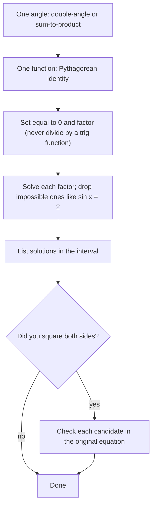

## Bringing it together

Lesson 20 solved equations that were already in a basic form like $\sin x = c$, or that
factored right away. Most equations aren't so cooperative: they mix sines and cosines,
or mix $x$ with $2x$. The identities of this module are the tools for rewriting such an
equation in terms of a *single* function of a *single* angle. After that, the methods of
Lesson 20 finish the job.

## The general plan

1. **One angle.** If the equation has both $2x$ and $x$, use a double-angle formula to
   rewrite everything in terms of $x$ (or a sum-to-product formula to factor).
2. **One function.** Use a Pythagorean identity to replace $\cos^2$ by $1 - \sin^2$, $\sec^2$ by
   $1 + \tan^2$, and so on.
3. **Rearrange to zero and factor.** Treat it like a polynomial in $\sin x$ (or whichever
   function remains). Never divide by an expression that could be zero.
4. **Solve each basic equation** and collect all solutions in the requested interval.
5. **Check**, especially if you squared both sides.



### Example 1

Solve $2\cos^2 x + 3\sin x - 3 = 0$ on $[0, 2\pi)$.

Two functions, one angle. Replace $\cos^2 x$ with $1 - \sin^2 x$:
$$2(1 - \sin^2 x) + 3\sin x - 3 = 0 \;\Longrightarrow\; -2\sin^2 x + 3\sin x - 1 = 0 \;\Longrightarrow\; 2\sin^2 x - 3\sin x + 1 = 0.$$
Factor as a quadratic in $\sin x$: $(2\sin x - 1)(\sin x - 1) = 0$.

$\sin x = \tfrac12$: $x = \tfrac{\pi}{6}, \tfrac{5\pi}{6}$. $\sin x = 1$: $x = \tfrac{\pi}{2}$.

Solutions: $\tfrac{\pi}{6}, \tfrac{\pi}{2}, \tfrac{5\pi}{6}$.

### Example 2

Solve $\sin 2x = \cos x$ on $[0, 2\pi)$.

Make the angles match with $\sin 2x = 2\sin x\cos x$, then move everything to one side:
$$2\sin x\cos x - \cos x = 0 \;\Longrightarrow\; \cos x(2\sin x - 1) = 0.$$
$\cos x = 0$: $x = \tfrac{\pi}{2}, \tfrac{3\pi}{2}$. $\sin x = \tfrac12$: $x = \tfrac{\pi}{6}, \tfrac{5\pi}{6}$.

Solutions: $\tfrac{\pi}{6}, \tfrac{\pi}{2}, \tfrac{5\pi}{6}, \tfrac{3\pi}{2}$. Dividing both sides by $\cos x$ at the start would
have lost $\tfrac{\pi}{2}$ and $\tfrac{3\pi}{2}$.

```plot
{"x": [0, 6.4], "y": [-1.4, 1.4], "functions": [{"f": "sin(2x)", "label": "sin 2x"}, {"f": "cos(x)", "label": "cos x"}], "points": [{"at": [0.5236, 0.866]}, {"at": [1.5708, 0]}, {"at": [2.618, -0.866]}, {"at": [4.7124, 0]}], "caption": "The graphs of sin 2x and cos x cross at the four solutions"}
```

### Example 3

Solve $\cos 2x + \cos x = 0$ on $[0, 2\pi)$.

Choose the form of $\cos 2x$ that leaves only cosine: $2\cos^2 x - 1$.
$$2\cos^2 x + \cos x - 1 = 0 \;\Longrightarrow\; (2\cos x - 1)(\cos x + 1) = 0.$$
$\cos x = \tfrac12$: $x = \tfrac{\pi}{3}, \tfrac{5\pi}{3}$. $\cos x = -1$: $x = \pi$.

Solutions: $\tfrac{\pi}{3}, \pi, \tfrac{5\pi}{3}$.

## Squaring and extraneous solutions

Sometimes squaring both sides is the only way to bring in a Pythagorean identity. Squaring
can create solutions of the squared equation that don't satisfy the original. These are
**extraneous solutions**, and every candidate must be checked.

### Example 4

Solve $\sin x + \cos x = 1$ on $[0, 2\pi)$.

Square both sides: $\sin^2 x + 2\sin x\cos x + \cos^2 x = 1$, so $1 + \sin 2x = 1$ and $\sin 2x = 0$.
Candidates: $2x = 0, \pi, 2\pi, 3\pi$, i.e. $x = 0, \tfrac{\pi}{2}, \pi, \tfrac{3\pi}{2}$.

Check each in the *original* equation:

| $x$ | $\sin x + \cos x$ | OK? |
|---|---|---|
| $0$ | $0 + 1 = 1$ | yes |
| $\tfrac{\pi}{2}$ | $1 + 0 = 1$ | yes |
| $\pi$ | $0 - 1 = -1$ | no |
| $\tfrac{3\pi}{2}$ | $-1 + 0 = -1$ | no |

Solutions: $0$ and $\tfrac{\pi}{2}$. The other two solve $\sin x + \cos x = -1$, which has the same square.

The graph shows why: $\sin x + \cos x$ meets the line $y = 1$ at the two real solutions and the line $y = -1$ at
the two extraneous ones.

```plot
{"x": [0, 6.4], "y": [-1.7, 1.7], "functions": [{"f": "sin(x) + cos(x)"}, {"f": "1", "dashed": true}, {"f": "-1", "dashed": true}], "points": [{"at": [0, 1]}, {"at": [1.5708, 1], "label": "π/2"}, {"at": [3.1416, -1]}, {"at": [4.7124, -1]}], "labels": [{"at": [0.2, 0.78], "text": "0"}, {"at": [2.95, -1.25], "text": "π"}, {"at": [5.05, -1.25], "text": "3π/2"}, {"at": [2.4, 1.48], "text": "sin x + cos x"}, {"at": [5.0, 1.1], "text": "y = 1"}, {"at": [1.2, -0.9], "text": "y = −1"}], "caption": "Squaring merges sin x + cos x = 1 with sin x + cos x = −1; only the crossings with y = 1 solve the original"}
```
(Alternatively, $\sin x + \cos x = \sqrt2\sin\left(x + \tfrac{\pi}{4}\right)$ from Lesson 23 avoids squaring entirely.)

## When the values aren't special

### Example 5

Solve $3\sin^2 x - 5\sin x - 2 = 0$ on $[0, 2\pi)$, to four decimals.

Factor: $(3\sin x + 1)(\sin x - 2) = 0$. $\sin x = 2$ is impossible. $\sin x = -\tfrac13$:
the reference angle is $\sin^{-1}\tfrac13 \approx 0.3398$, and sine is negative in quadrants III and IV:
$$x \approx \pi + 0.3398 = 3.4814, \qquad x \approx 2\pi - 0.3398 = 5.9433.$$

Using the reference angle (positive) and placing it in the right quadrants is cleaner than
working with the calculator's negative answer $\sin^{-1}\!\left(-\tfrac13\right) \approx -0.3398$.

### Example 6

Solve $\sec^2 x = 2\tan x$ on $[0, 2\pi)$.

Replace $\sec^2 x$ with $1 + \tan^2 x$: $\tan^2 x - 2\tan x + 1 = 0$, so $(\tan x - 1)^2 = 0$ and
$\tan x = 1$. Solutions: $\tfrac{\pi}{4}, \tfrac{5\pi}{4}$.

## Checking with a graph

A graphing tool gives an independent check: graph each side of the equation as its own
function and look for intersections in $[0, 2\pi)$. The number of intersections should match the
number of solutions you found, and their $x$-values should match your answers. Graphs can't
give exact values like $\tfrac{5\pi}{6}$, but they catch missing or extraneous solutions instantly.

## Common mistakes

- **Dividing by a trig function** and losing the solutions where it's zero.
- **Not checking after squaring.** Extraneous solutions are the rule, not the exception.
- **Mixing angles.** In $\sin 2x = \cos x$, don't factor until both sides use the same angle.
- **Keeping impossible factors.** $\sin x = 2$ or $\cos x = -3$ give no solutions; say so and move on.

## Key points

- Rewrite in one angle (double-angle, sum-to-product) and one function (Pythagorean).
- Set equal to zero, factor, and solve each factor as a basic equation.
- Squaring both sides can add extraneous solutions; check every candidate in the original.
- For non-special values, use the reference angle from an inverse function and place it by quadrant.
