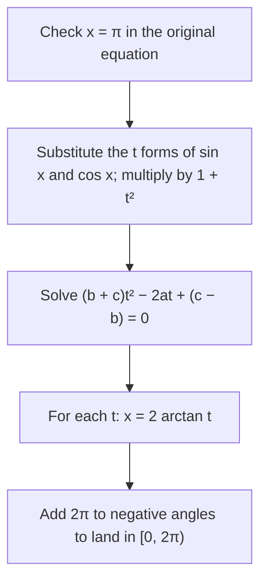

## One number that controls everything

Lesson 25 gave a half-angle formula with no $\pm$ sign: $\tan\tfrac{\theta}{2} = \tfrac{\sin\theta}{1 + \cos\theta}$. This
honors lesson turns that formula around. If you know the single number $t = \tan\tfrac{x}{2}$, you
know $\sin x$, $\cos x$ and $\tan x$ exactly, and each one is a fraction built from $t$ with no
square roots at all. That change of variable is called the **tangent half-angle substitution**.

It pays off in three places. It turns the unit circle into a straight line you can walk along
with fractions, which produces every **Pythagorean triple**. It turns any equation
$a\sin x + b\cos x = c$ into an ordinary quadratic. And in calculus it turns integrals of
fractions built from sines and cosines into integrals of ordinary fractions. You will see the
first two in full here.

## Sine and cosine as fractions of $t$

Let $t = \tan\tfrac{x}{2}$. Start from the double-angle formula and divide by $1 = \cos^2\tfrac{x}{2} + \sin^2\tfrac{x}{2}$:
$$\sin x = \frac{2\sin\frac{x}{2}\cos\frac{x}{2}}{\cos^2\frac{x}{2} + \sin^2\frac{x}{2}}.$$
Now divide the top and bottom by $\cos^2\tfrac{x}{2}$. The top becomes $2\tan\tfrac{x}{2}$ and the bottom becomes $1 + \tan^2\tfrac{x}{2}$:
$$\sin x = \frac{2t}{1 + t^2}.$$
The same two moves on $\cos x = \cos^2\tfrac{x}{2} - \sin^2\tfrac{x}{2}$ give
$$\cos x = \frac{1 - t^2}{1 + t^2}, \qquad \text{and dividing,} \qquad \tan x = \frac{2t}{1 - t^2}.$$
The last one is just the double-angle formula for tangent from Lesson 24.

**When it fails.** $t = \tan\tfrac{x}{2}$ is undefined when $\tfrac{x}{2} = \tfrac{\pi}{2} + k\pi$, that is, when $x = \pi + 2k\pi$: the
angles whose terminal side points straight left. Every other angle has a value of $t$. Keep
$x = \pi$ in mind; it is the one solution this method can lose.

A quick check: $\left(\tfrac{2t}{1 + t^2}\right)^2 + \left(\tfrac{1 - t^2}{1 + t^2}\right)^2 = \tfrac{4t^2 + 1 - 2t^2 + t^4}{(1 + t^2)^2} = \tfrac{(1 + t^2)^2}{(1 + t^2)^2} = 1$, as it must be.

### Example 1

$\tan\tfrac{x}{2} = \tfrac12$. Find $\sin x$, $\cos x$ and $\tan x$, and the angle $x$ in $(0, 2\pi)$.

With $t = \tfrac12$, $1 + t^2 = \tfrac54$:
$$\sin x = \frac{1}{5/4} = \frac45, \qquad \cos x = \frac{3/4}{5/4} = \frac35, \qquad \tan x = \frac{4/5}{3/5} = \frac43.$$
Since $\tfrac{x}{2} = \tan^{-1}\tfrac12 \approx 0.4636$, $x \approx 0.9273$ rad $\approx 53.13^\circ$. The familiar 3-4-5 triangle has
appeared from the single number $\tfrac12$.

### Example 2

$\tan\tfrac{x}{2} = -3$ and $-\pi < x < \pi$. Find $\sin x$ and $\cos x$, and the quadrant of $x$.

$1 + t^2 = 10$, so $\sin x = \tfrac{-6}{10} = -\tfrac35$ and $\cos x = \tfrac{1 - 9}{10} = -\tfrac45$. Both are negative: quadrant III.
Check with the angle itself: $\tfrac{x}{2} = \tan^{-1}(-3) \approx -1.2490$, so $x \approx -2.4981$ rad $\approx -143.13^\circ$, which is
coterminal with $216.87^\circ$, in quadrant III. The signs took care of themselves; there was no
$\pm$ to decide.

## The picture: a line through $(-1, 0)$

Draw the line through $A = (-1, 0)$ with slope $t$. It crosses the $y$-axis at $(0, t)$ and meets the
unit circle at one more point $P$. Here is why $P = (\cos x, \sin x)$ with $t = \tan\tfrac{x}{2}$.

**Geometry.** If $P$ is at angle $x$ from the center, the angle at $A$ between the $x$-axis and line
$AP$ is $\tfrac{x}{2}$. This is the inscribed angle theorem: an angle with its vertex on the circle is half
the central angle that cuts off the same arc. (The figure in Lesson 25 showed the same thing
with a right triangle.) So the slope of $AP$ is $\tan\tfrac{x}{2} = t$.

**Algebra.** Substitute the line $y = t(X + 1)$ into $X^2 + y^2 = 1$:
$$(1 + t^2)X^2 + 2t^2X + (t^2 - 1) = 0.$$
One root is $X = -1$ (the point $A$). The product of the two roots of a quadratic is the
constant term over the leading coefficient, $\tfrac{t^2 - 1}{1 + t^2}$, so the other root is $X = \tfrac{1 - t^2}{1 + t^2}$. Then
$y = t(X + 1) = \tfrac{2t}{1 + t^2}$. The formulas from the last section have reappeared.

As $t$ runs over all real numbers, $P$ runs once around the whole circle, missing only $A$ itself;
$A$ corresponds to $x = \pi$, where $t$ "is infinite". This is a **rational parametrization** of the
circle: both coordinates are fractions of polynomials in $t$, with no roots or trig functions.

## Every Pythagorean triple

If $t$ is a fraction, both coordinates of $P$ are fractions. Put $t = \tfrac{p}{q}$ and multiply the top and
bottom of each by $q^2$:
$$\cos x = \frac{q^2 - p^2}{q^2 + p^2}, \qquad \sin x = \frac{2pq}{q^2 + p^2}.$$
Since $\cos^2 x + \sin^2 x = 1$, clearing denominators gives whole numbers with
$$(q^2 - p^2)^2 + (2pq)^2 = (q^2 + p^2)^2.$$
So $(q^2 - p^2,\; 2pq,\; q^2 + p^2)$ is a Pythagorean triple for any whole numbers $q > p > 0$. This recipe
was known to Euclid (it appears in the *Elements*, around 300 BCE). Going the other way, every
point of the circle with rational coordinates (other than $A$) joins $A$ by a line of rational slope, so
every right triangle with whole-number sides has the same shape as one this recipe makes (it is
that triple scaled up or down).

### Example 3

Find the triples for $t = \tfrac23$, $t = \tfrac34$ and $t = \tfrac14$.

| $t = \tfrac{p}{q}$ | $q^2 - p^2$ | $2pq$ | $q^2 + p^2$ | Triple |
|---|---|---|---|---|
| $\tfrac23$ | $9 - 4 = 5$ | $12$ | $13$ | 5, 12, 13 |
| $\tfrac34$ | $16 - 9 = 7$ | $24$ | $25$ | 7, 24, 25 |
| $\tfrac14$ | $16 - 1 = 15$ | $8$ | $17$ | 15, 8, 17 |

When $p$ and $q$ are both odd, every number comes out even and you can divide by 2: $t = \tfrac13$
gives $(8, 6, 10)$, which is $2 \times (4, 3, 5)$.

## Solving $a\sin x + b\cos x = c$

Lesson 23 solved this equation by writing the left side as $R\sin(x + \varphi)$. The substitution gives
a second, purely algebraic method. Replace $\sin x$ and $\cos x$ by their $t$ forms and multiply by
$1 + t^2$:
$$2at + b(1 - t^2) = c(1 + t^2) \quad\Longrightarrow\quad (b + c)\,t^2 - 2a\,t + (c - b) = 0.$$
A quadratic in $t$. Its discriminant is $4a^2 - 4(c - b)(c + b) = 4(a^2 + b^2 - c^2)$, so there are real
solutions exactly when $c^2 \le a^2 + b^2$, that is, $|c| \le R$. The two methods agree, as they must.

### Example 4

Solve $3\sin x + 4\cos x = 2$ on $[0, 2\pi)$.

**Check $x = \pi$:** $3(0) + 4(-1) = -4 \ne 2$. Not a solution.

**Quadratic:** $a = 3$, $b = 4$, $c = 2$ give $6t^2 - 6t - 2 = 0$, or $3t^2 - 3t - 1 = 0$:
$$t = \frac{3 \pm \sqrt{9 + 12}}{6} = \frac{3 \pm \sqrt{21}}{6}, \qquad t_1 \approx 1.26376, \quad t_2 \approx -0.26376.$$

**Back to $x$:** $x = 2\tan^{-1}t$. For $t_1$: $x \approx 2(0.90139) = 1.8028$. For $t_2$: $x \approx 2(-0.25789) = -0.5158$,
and adding $2\pi$ gives $5.7674$.

**Check with the other method:** $R = 5$ and $\varphi = \tan^{-1}\tfrac43 \approx 0.9273$, so $\sin(x + \varphi) = 0.4$, giving
$x + \varphi \approx 0.4115$ or $2.7301$. Then $x \approx 2.7301 - 0.9273 = 1.8028$ and $x \approx 0.4115 - 0.9273 + 2\pi = 5.7674$. ✓

### Example 5: the lost solution

Solve $\sin x - \cos x = 1$ on $[0, 2\pi)$.

**Check $x = \pi$:** $0 - (-1) = 1$. ✓ So $\pi$ is a solution.

**Quadratic:** $a = 1$, $b = -1$, $c = 1$, so $b + c = 0$ and the $t^2$ term vanishes: $-2t + 2 = 0$, $t = 1$,
and $x = 2\tan^{-1}1 = \tfrac{\pi}{2}$. Check: $1 - 0 = 1$. ✓

Solutions: $\tfrac{\pi}{2}$ and $\pi$. The quadratic dropping to a linear equation is the warning sign: when
$b + c = 0$, the "missing" root is $x = \pi$, where $t$ does not exist.

## In calculus, and a note on the name

In calculus the substitution also converts $dx$: from $x = 2\tan^{-1}t$, $dx = \tfrac{2\,dt}{1 + t^2}$. So any integral of
a fraction built from $\sin x$ and $\cos x$ becomes an integral of an ordinary fraction in $t$, which can
always be done (in principle) by partial fractions. Many calculus books call it the
"Weierstrass substitution", but historians have found no clear source for that name: the method
appears in Leonhard Euler's integral calculus of 1768, and Legendre described it in general in
the early 1800s. Other names in use are the half-tangent substitution and, in Russian textbooks,
the universal trigonometric substitution.

## Common mistakes

- **Forgetting $x = \pi$.** The substitution cannot see it. Test it in the original equation first.
- **Using $x = \tan^{-1}t$.** The angle whose tangent is $t$ is $\tfrac{x}{2}$, so $x = 2\tan^{-1}t$.
- **Leaving a negative angle.** $2\tan^{-1}t$ lies in $(-\pi, \pi)$; add $2\pi$ when the problem asks for $[0, 2\pi)$.
- **Sign slips in the quadratic.** Multiply carefully: $c(1 + t^2)$ moves over as $-c - ct^2$, giving
  $(b + c)t^2 - 2at + (c - b) = 0$. Check a root by substituting back.
- **Taking a triple's order for granted.** $(q^2 - p^2, 2pq, q^2 + p^2)$ can list the larger leg first, as in
  $(15, 8, 17)$. The hypotenuse is always $q^2 + p^2$.

## Key points

- With $t = \tan\tfrac{x}{2}$: $\sin x = \tfrac{2t}{1 + t^2}$, $\cos x = \tfrac{1 - t^2}{1 + t^2}$, $\tan x = \tfrac{2t}{1 - t^2}$. No square roots, no sign choices.
- It works for every angle except $x = \pi + 2k\pi$.
- Geometrically, $t$ is the slope of the line from $(-1, 0)$ to $(\cos x, \sin x)$; rational slopes give
  rational points, and $t = \tfrac{p}{q}$ gives the triple $(q^2 - p^2, 2pq, q^2 + p^2)$.
- $a\sin x + b\cos x = c$ becomes $(b + c)t^2 - 2at + (c - b) = 0$; solvable exactly when $c^2 \le a^2 + b^2$.
