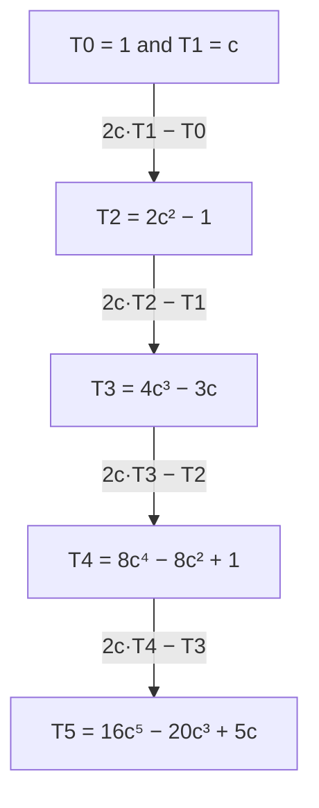

## Beyond the double angle

Lesson 24 found $\cos 2x = 2\cos^2 x - 1$ and, with one more sum formula, $\cos 3x = 4\cos^3 x - 3\cos x$.
Both right sides are polynomials in $\cos x$. That is no accident: for every whole number $n$,
$\cos nx$ is a polynomial in $\cos x$ of degree $n$. This honors lesson finds a fast way to build those
polynomials, uses them to get an exact value no special triangle gives, solves cubic equations
with cosines, and sees why some angles can never be cut into three equal parts with straightedge
and compass. It ends with a product-to-sum trick that adds up long lists of sines in one line.

## A recursion from sum-to-product

Add the sum and difference formulas for $\cos(nx + x)$ and $\cos(nx - x)$. The sine terms cancel:
$$\cos\big((n + 1)x\big) + \cos\big((n - 1)x\big) = 2\cos x\cos nx.$$
(This is the sum-to-product formula of Lesson 26 read in one direction.) Solve for the highest
multiple:
$$\cos\big((n + 1)x\big) = 2\cos x\cos nx - \cos\big((n - 1)x\big).$$
So each multiple comes from the two before it. Write $c = \cos x$ and call the polynomial for
$\cos nx$ by the name $T_n(c)$. Then $T_0 = 1$, $T_1 = c$, and
$$T_{n+1}(c) = 2c\,T_n(c) - T_{n-1}(c).$$
These are the **Chebyshev polynomials**, named for the Russian mathematician Pafnuty Chebyshev
(1821–1894), who studied them in the 1850s for problems about approximating functions. The
letter $T$ comes from older spellings of his name such as Tchebycheff.



Three patterns are worth noticing. The leading coefficient doubles each time, so $T_n$ starts with
$2^{n-1}c^n$ (for $n \ge 1$). Only even powers or only odd powers appear, matching whether $n$ is even or odd.
And since $T_n(\cos x) = \cos nx$ always lies between $-1$ and $1$, the graph of $T_n$ on $-1 \le c \le 1$ wiggles
between $-1$ and $1$, touching each of them again and again.

```plot
{"x": [-1.1, 1.1], "y": [-1.3, 1.3], "functions": [{"f": "2x^2 - 1", "label": "T₂"}, {"f": "4x^3 - 3x", "label": "T₃", "dashed": true}, {"f": "8x^4 - 8x^2 + 1", "label": "T₄"}], "caption": "T₂, T₃ and T₄ on −1 ≤ c ≤ 1: each stays between −1 and 1 and touches those levels n + 1 times"}
```

### Example 1

Find $T_4$ and check it at $x = \tfrac{\pi}{3}$.

$T_4 = 2c(4c^3 - 3c) - (2c^2 - 1) = 8c^4 - 6c^2 - 2c^2 + 1 = 8c^4 - 8c^2 + 1.$

At $x = \tfrac{\pi}{3}$, $c = \tfrac12$: $T_4\left(\tfrac12\right) = \tfrac{8}{16} - \tfrac84 + 1 = \tfrac12 - 2 + 1 = -\tfrac12$. And directly, $\cos\tfrac{4\pi}{3} = -\tfrac12$. ✓

### Example 2

$\cos\theta = \tfrac13$. Find $\cos 3\theta$ and $\cos 4\theta$ exactly.

$\cos 3\theta = 4\left(\tfrac13\right)^3 - 3\left(\tfrac13\right) = \tfrac{4}{27} - 1 = -\tfrac{23}{27}$.

$\cos 4\theta = 8\left(\tfrac{1}{81}\right) - 8\left(\tfrac19\right) + 1 = \tfrac{8 - 72 + 81}{81} = \tfrac{17}{81}$.

Check $\cos 4\theta$ another way: $\cos 2\theta = 2\cdot\tfrac19 - 1 = -\tfrac79$, and $\cos 4\theta = 2\cos^2 2\theta - 1 = \tfrac{98}{81} - 1 = \tfrac{17}{81}$. ✓ Notice
that you never needed $\theta$ itself, or $\sin\theta$.

**Sines of multiples** work similarly, with one twist: $\sin nx$ is $\sin x$ times a polynomial in $\cos x$.
For odd $n$ it can also be written in $\sin x$ alone, for example
$$\sin 3x = \sin 2x\cos x + \cos 2x\sin x = 2\sin x(1 - \sin^2 x) + (1 - 2\sin^2 x)\sin x = 3\sin x - 4\sin^3 x.$$

## An exact value from a fifth multiple

Let $\theta = 18^\circ$. Then $5\theta = 90^\circ$, so $2\theta = 90^\circ - 3\theta$, and the cofunction identity gives
$$\sin 2\theta = \cos 3\theta.$$
Expand both sides: $2\sin\theta\cos\theta = 4\cos^3\theta - 3\cos\theta$. Divide by $\cos\theta$, which is not zero:
$$2\sin\theta = 4\cos^2\theta - 3 = 4(1 - \sin^2\theta) - 3 = 1 - 4\sin^2\theta.$$
So $s = \sin 18^\circ$ solves $4s^2 + 2s - 1 = 0$, and since $s > 0$,
$$\sin 18^\circ = \frac{-2 + \sqrt{4 + 16}}{8} = \frac{\sqrt5 - 1}{4} \approx 0.30902.$$
Then $\cos 36^\circ = 1 - 2\sin^2 18^\circ = 1 - \tfrac{6 - 2\sqrt5}{8} = \tfrac{1 + \sqrt5}{4} \approx 0.80902$, half the golden ratio. (The
Module 2 honors lesson reaches the same values with a golden triangle; here pure algebra does
it.)

## Cubics solved with cosines

The identity $\cos 3\theta = 4\cos^3\theta - 3\cos\theta$ can be read backward: it solves a cubic equation. If an
equation can be put in the form
$$4c^3 - 3c = k \quad\text{with}\quad -1 \le k \le 1,$$
then setting $c = \cos\theta$ turns it into $\cos 3\theta = k$, which you can solve with an inverse cosine.
Because $3\theta$ can be $\cos^{-1}k$ plus any multiple of $360^\circ$, $\theta$ takes three values $120^\circ$ apart,
giving three real roots. This is the **trigonometric solution of the cubic**, worked out by the
French mathematician François Viète around 1600.

### Example 3

Solve $8c^3 - 6c - 1 = 0$.

Divide by 2: $4c^3 - 3c = \tfrac12$. With $c = \cos\theta$, $\cos 3\theta = \tfrac12$, so $3\theta = 60^\circ$, $300^\circ$, $420^\circ$, and
$\theta = 20^\circ, 100^\circ, 140^\circ$. The roots are
$$c = \cos 20^\circ \approx 0.93969, \qquad \cos 100^\circ \approx -0.17365, \qquad \cos 140^\circ \approx -0.76604.$$
Check: the cubic has no $c^2$ term, so its roots must add to 0, and $0.93969 - 0.17365 - 0.76604 = 0$. ✓
More values of $3\theta$ only repeat these three cosines.

## Why $60^\circ$ cannot be trisected

Greek geometers asked whether every angle can be cut into three equal angles using only a
straightedge and compass. Some can: $90^\circ$ splits into $30^\circ$ angles, which are easy to construct. But
consider $60^\circ$. Trisecting it means constructing $20^\circ$, which means constructing the length
$\cos 20^\circ$ (given a unit length). Example 3 shows $\cos 20^\circ$ is a root of $8c^3 - 6c - 1 = 0$, and you can
check that this cubic has no rational roots (none of $\pm1, \pm\tfrac12, \pm\tfrac14, \pm\tfrac18$ works) and so cannot
be factored over the rationals.

Straightedge and compass can only add, subtract, multiply, divide and take square roots, over
and over. In 1837 Pierre Wantzel proved that numbers built that way can never be roots of a
cubic like this one, one with rational coefficients and no rational root. So no straightedge-and-compass
construction trisects $60^\circ$, and therefore no such method works for every angle. We state Wantzel's
theorem without proof here; it belongs to a later course in abstract algebra. (With other tools,
such as a marked ruler or folded paper, $60^\circ$ can be trisected.)

## Adding many sines at once

How big is $\sin x + \sin 2x + \cdots + \sin nx$? Multiply each term by $2\sin\tfrac{x}{2}$ and use the
product-to-sum formula $2\sin A\sin B = \cos(A - B) - \cos(A + B)$:
$$2\sin\tfrac{x}{2}\sin kx = \cos\left(k - \tfrac12\right)x - \cos\left(k + \tfrac12\right)x.$$
Adding these for $k = 1$ to $n$, the middle terms cancel in pairs (the sum **telescopes**), leaving
$\cos\tfrac{x}{2} - \cos\left(n + \tfrac12\right)x$. A sum-to-product formula turns that into $2\sin\tfrac{nx}{2}\sin\tfrac{(n + 1)x}{2}$, so
$$\sin x + \sin 2x + \cdots + \sin nx = \frac{\sin\frac{nx}{2}\,\sin\frac{(n + 1)x}{2}}{\sin\frac{x}{2}} \qquad \left(\sin\tfrac{x}{2} \ne 0\right).$$
The same steps for cosines give $\cos x + \cdots + \cos nx = \dfrac{\sin\frac{nx}{2}\,\cos\frac{(n + 1)x}{2}}{\sin\frac{x}{2}}$.

### Example 4

Find $\sin 30^\circ + \sin 60^\circ + \sin 90^\circ + \sin 120^\circ + \sin 150^\circ + \sin 180^\circ$.

Here $x = 30^\circ$ and $n = 6$:
$$\frac{\sin 90^\circ\,\sin 105^\circ}{\sin 15^\circ} = \frac{\sin 105^\circ}{\sin 15^\circ} = \frac{\cos 15^\circ}{\sin 15^\circ} = \cot 15^\circ = 2 + \sqrt3 \approx 3.7321.$$
Adding directly: $\tfrac12 + \tfrac{\sqrt3}{2} + 1 + \tfrac{\sqrt3}{2} + \tfrac12 + 0 = 2 + \sqrt3$. ✓ ($\cot 15^\circ = 2 + \sqrt3$ is the reciprocal of
$\tan 15^\circ = 2 - \sqrt3$ from Lesson 23.)

## Common mistakes

- **Running the recursion with the wrong sign.** It is $T_{n+1} = 2cT_n - T_{n-1}$, a minus. Test any
  $T_n$ at $c = 1$: since $\cos 0 = 1$, every $T_n(1)$ must equal 1.
- **Thinking $\cos 3\theta = 3\cos\theta$**, or that the triple-angle formula for sine looks just like the one
  for cosine. The signs are swapped: $\sin 3x = 3\sin x - 4\sin^3 x$, while $\cos 3x = 4\cos^3 x - 3\cos x$.
- **Keeping only one root of the cubic.** $\cos 3\theta = k$ gives three angles $\theta$, $120^\circ$ apart.
- **Overstating the trisection result.** Some angles can be trisected; the theorem says no single
  straightedge-and-compass method works for all of them, and $60^\circ$ is a specific example.

## Key points

- $\cos(n + 1)x = 2\cos x\cos nx - \cos(n - 1)x$; the Chebyshev polynomials satisfy $T_n(\cos x) = \cos nx$.
- $T_2 = 2c^2 - 1$, $T_3 = 4c^3 - 3c$, $T_4 = 8c^4 - 8c^2 + 1$; $\sin 3x = 3\sin x - 4\sin^3 x$.
- $5 \times 18^\circ = 90^\circ$ leads to $\sin 18^\circ = \tfrac{\sqrt5 - 1}{4}$ and $\cos 36^\circ = \tfrac{1 + \sqrt5}{4}$.
- A cubic $4c^3 - 3c = k$ with $|k| \le 1$ has the three roots $c = \cos\theta$ where $\cos 3\theta = k$.
- $\sum_{k=1}^{n}\sin kx = \dfrac{\sin\frac{nx}{2}\sin\frac{(n + 1)x}{2}}{\sin\frac{x}{2}}$, by telescoping product-to-sum terms.
