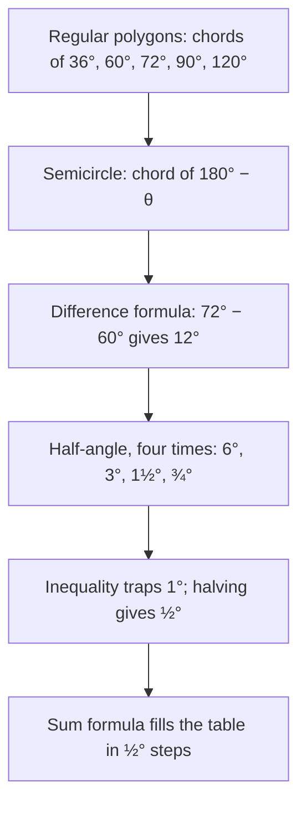

## A trig table with no sine in it

The sum and difference formulas of Lesson 23 are much older than the words "sine" and
"cosine". Greek astronomers needed to turn angles into lengths to predict where the Sun, Moon
and planets would appear, and they did it with one function: the length of a **chord**. The
oldest table of chords that survives is in the *Almagest* of Claudius Ptolemy, written in Alexandria
in the second century CE. An earlier table, now lost, is usually credited to Hipparchus in the
second century BCE.

This honors lesson rebuilds Ptolemy's toolkit. You will see how a chord relates to sine, prove
**Ptolemy's theorem** about four points on a circle, get the sum formula for sine out of it in
one line, and follow the steps Ptolemy used to fill a table with 360 entries using nothing but
these identities and some careful arithmetic.

## Chords and sines

In a circle of radius $R$, the chord cut off by a central angle $\theta$ is written $\text{crd}\,\theta$. Drop the
perpendicular from the center to the chord: it bisects both the chord and the angle, making two
right triangles with hypotenuse $R$ and angle $\tfrac{\theta}{2}$. Each half of the chord is $R\sin\tfrac{\theta}{2}$, so
$$\text{crd}\,\theta = 2R\sin\frac{\theta}{2}.$$

Ptolemy used a circle of radius 60 (diameter 120 "parts") because he computed in base 60, the
**sexagesimal** system inherited from Babylonian astronomers. A value such as $84;51,10$ means
$84 + \tfrac{51}{60} + \tfrac{10}{60^2}$, just like degrees, minutes and seconds in Lesson 1.

Later astronomers in India tabulated the half-chord $R\sin\tfrac{\theta}{2}$ instead, and that half-chord is the
ancestor of our sine (the Module 3 honors lesson tells that story). This lesson is about how Ptolemy
actually computed his chords.

### Example 1

With $R = 60$, find $\text{crd}\,60^\circ$, $\text{crd}\,120^\circ$ and $\text{crd}\,36^\circ$, and write the last two in sexagesimal.

$\text{crd}\,60^\circ = 120\sin 30^\circ = 60$ (a side of the regular hexagon equals the radius).

$\text{crd}\,120^\circ = 120\sin 60^\circ = 60\sqrt3 \approx 103.92305$. In base 60: the fraction $0.92305 \times 60 = 55.383$, so 55
sixtieths; $0.383 \times 60 \approx 23$, so 23 more: $103;55,23$.

$\text{crd}\,36^\circ = 120\sin 18^\circ = 120\cdot\tfrac{\sqrt5 - 1}{4} = 30(\sqrt5 - 1) \approx 37.08204$, using the exact value of $\sin 18^\circ$
from the previous honors lesson. In base 60: $0.08204 \times 60 = 4.922$ and $0.922 \times 60 \approx 55$, so $37;4,55$.

## Ptolemy's theorem

**Ptolemy's theorem.** If $A$, $B$, $C$, $D$ lie on a circle in that order, then
$$AC \cdot BD = AB \cdot CD + AD \cdot BC.$$
In words: the product of the diagonals equals the sum of the products of the opposite sides. A
quadrilateral whose four vertices lie on one circle is called a **cyclic quadrilateral**.

**Proof.** Choose $E$ on diagonal $AC$ so that $\angle ABE = \angle DBC$.

1. Triangles $ABE$ and $DBC$ are similar. They have $\angle ABE = \angle DBC$ by the choice of $E$, and
   $\angle BAE = \angle BAC = \angle BDC$, because both are inscribed angles that cut off the same arc $BC$.
   So $\tfrac{AE}{AB} = \tfrac{DC}{DB}$, which gives $AE \cdot BD = AB \cdot CD$.
2. Triangles $ABD$ and $EBC$ are similar. Adding $\angle EBD$ to both sides of $\angle ABE = \angle DBC$ gives
   $\angle ABD = \angle EBC$, and $\angle ADB = \angle ACB$ (both cut off arc $AB$). So $\tfrac{EC}{BC} = \tfrac{AD}{BD}$, which gives
   $EC \cdot BD = AD \cdot BC$.
3. Add the two results: $(AE + EC)\cdot BD = AB \cdot CD + AD \cdot BC$, and $AE + EC = AC$. ∎

A quick test: for a rectangle with sides $a$ and $b$, both diagonals are $d$ and the theorem says
$d^2 = a^2 + b^2$, the Pythagorean theorem.

### Example 2

A cyclic quadrilateral has $AB = 4$, $BC = 8$, $CD = 6$, $DA = 4$, and diagonal $AC = 8$. Find $BD$.

$8 \cdot BD = AB \cdot CD + AD \cdot BC = 4 \cdot 6 + 4 \cdot 8 = 56$, so $BD = 7$. (Ptolemy's theorem needs the
quadrilateral to be cyclic; for a quadrilateral that is not, the product of the diagonals is strictly
smaller than the right side.)

## The sum formula in one line

Take a circle of diameter 1, so $R = \tfrac12$. An inscribed angle $\varphi$ cuts off the same arc as a central
angle $2\varphi$ (the inscribed angle theorem), so its chord is $2R\sin\varphi = \sin\varphi$: in this circle, every chord
equals the sine of an inscribed angle that cuts it off. Let $AC$ be a diameter, with $B$ on one side
and $D$ on the other, $\angle BAC = \alpha$ and $\angle CAD = \beta$. The angles at $B$ and $D$ are right angles (angles in a
semicircle), so
$$AB = \cos\alpha, \quad BC = \sin\alpha, \quad AD = \cos\beta, \quad CD = \sin\beta,$$
and the diagonal $BD$ is cut off by the inscribed angle $\angle BAD = \alpha + \beta$, so $BD = \sin(\alpha + \beta)$. Ptolemy's
theorem, with $AC = 1$, reads
$$\sin(\alpha + \beta) = \sin\alpha\cos\beta + \cos\alpha\sin\beta.$$
Make a side the diameter instead of a diagonal (say $AD$, with $B$ and $C$ on the same side of it) and
the same theorem gives the difference formula. Ptolemy stated his results for chords, not sines, but they are these identities.

## How Ptolemy built his table

Ptolemy's table lists chords for every arc from $\tfrac12^\circ$ to $180^\circ$ in steps of $\tfrac12^\circ$. His plan used
exactly the tools of this module:

In chord language with $R = 60$, the supplement rule is $\text{crd}^2\,\theta + \text{crd}^2(180^\circ - \theta) = 120^2$ (Pythagoras in
the semicircle), and the difference formula is
$$120\cdot\text{crd}(\alpha - \beta) = \text{crd}\,\alpha\cdot\text{crd}(180^\circ - \beta) - \text{crd}\,\beta\cdot\text{crd}(180^\circ - \alpha).$$
Dividing by $120^2$ turns this into $\sin\tfrac{\alpha - \beta}{2} = \sin\tfrac{\alpha}{2}\cos\tfrac{\beta}{2} - \cos\tfrac{\alpha}{2}\sin\tfrac{\beta}{2}$, the formula you know.

### Example 3

Find $\text{crd}\,12^\circ$ from $\text{crd}\,72^\circ \approx 70.5342$, $\text{crd}\,60^\circ = 60$, $\text{crd}\,120^\circ \approx 103.9230$ and
$\text{crd}\,108^\circ \approx 97.0820$.

With $\alpha = 72^\circ$ and $\beta = 60^\circ$:
$$\text{crd}\,12^\circ = \frac{70.5342 \times 103.9230 - 60 \times 97.0820}{120} = \frac{7330.13 - 5824.92}{120} \approx 12.5434.$$
Check: $120\sin 6^\circ \approx 12.5434$. ✓ In sexagesimal that is $12;32,36$.

## The one step that is not exact

Halving from $12^\circ$ gives $6^\circ$, $3^\circ$, $1\tfrac12^\circ$ and $\tfrac34^\circ$. Every starting arc ($36^\circ$, $60^\circ$, $72^\circ$,
$90^\circ$, $120^\circ$) is a multiple of $3^\circ$, and halving, adding and subtracting only ever produce $3^\circ$ times
a fraction whose denominator is a power of 2. One degree, $3^\circ \times \tfrac13$, is never reached exactly. Getting
the $1^\circ$ chord from the $3^\circ$ chord would mean dividing an angle by 3, and the previous honors
lesson showed that this leads to a cubic equation. Ptolemy
avoided the cubic with an inequality: for arcs $\beta < \alpha \le 180^\circ$,
$$\frac{\text{crd}\,\alpha}{\text{crd}\,\beta} < \frac{\alpha}{\beta}.$$
(In modern terms, $\tfrac{\sin u}{u}$ decreases as $u$ grows from 0 to $90^\circ$.) This traps the $1^\circ$ chord from both sides.

### Example 4

Use $\text{crd}\,\tfrac34^\circ \approx 0.785393$ and $\text{crd}\,1\tfrac12^\circ \approx 1.570751$ to bound $\text{crd}\,1^\circ$.

With $\alpha = 1^\circ$, $\beta = \tfrac34^\circ$: $\text{crd}\,1^\circ < \tfrac43\,\text{crd}\,\tfrac34^\circ \approx 1.047190$.

With $\alpha = 1\tfrac12^\circ$, $\beta = 1^\circ$: $\text{crd}\,1\tfrac12^\circ < \tfrac32\,\text{crd}\,1^\circ$, so $\text{crd}\,1^\circ > \tfrac23\,\text{crd}\,1\tfrac12^\circ \approx 1.047168$.

The two bounds differ by about $0.00002$, and both round to $1;2,50$ in sexagesimal, so that is the
value Ptolemy used. The modern value, $120\sin\tfrac12^\circ \approx 1.047184$, indeed lies between them.

## Common mistakes

- **Using $\text{crd}\,\theta = R\sin\theta$.** The chord is twice the half-chord, and the half-chord uses half the
  angle: $\text{crd}\,\theta = 2R\sin\tfrac{\theta}{2}$.
- **Pairing the wrong sides in Ptolemy's theorem.** Multiply *opposite* sides ($AB$ with $CD$, $AD$ with
  $BC$), and the vertices must be in order around the circle.
- **Applying it to any quadrilateral.** The equality needs all four vertices on one circle.
- **Reading $84;51,10$ as a decimal.** The places after the semicolon are sixtieths and
  thirty-six-hundredths, not tenths and hundredths.

## Key points

- $\text{crd}\,\theta = 2R\sin\tfrac{\theta}{2}$; Ptolemy used $R = 60$ and base-60 fractions.
- Ptolemy's theorem: for a cyclic quadrilateral $ABCD$, $AC \cdot BD = AB \cdot CD + AD \cdot BC$.
- With a diameter of length 1 as one diagonal, the theorem is exactly the sine sum formula.
- Ptolemy's table came from polygons, the difference and half-angle formulas, an inequality
  that traps the $1^\circ$ chord, and the sum formula.
