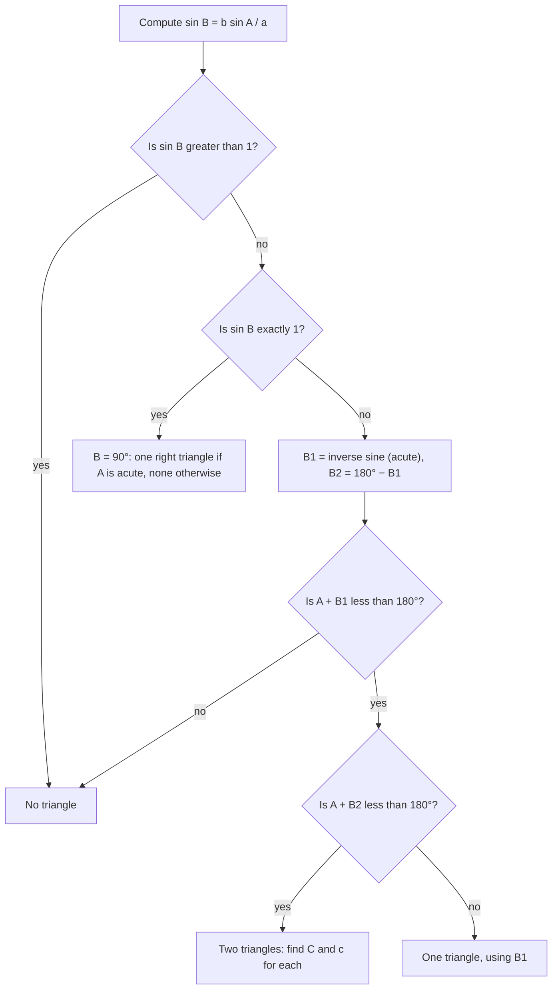

## Two sides and a non-included angle

In AAS and ASA the given parts determine exactly one triangle. With **SSA**, two sides and
an angle opposite one of them, the data might fit no triangle, exactly one, or two different
triangles. This is the **ambiguous case**. It's not a flaw in the law of sines; it's
geometry: the side opposite the given angle can sometimes swing into two different
positions. This lesson shows how to tell which situation you're in and how to find all
solutions.

## The picture

Suppose you know angle $A$, the side $b$ next to it, and the side $a$ opposite it. Draw angle
$A$ with side $b$ along one ray, ending at $C$. The third vertex $B$ must lie on the other ray, at
distance $a$ from $C$. So swing an arc of radius $a$ from $C$ and see where it meets that ray.

The key length is the distance from $C$ to the ray, the **height** $h = b\sin A$.

```plot
{"x": [-0.5, 14.5], "y": [-0.8, 6.2], "equal": true, "segments": [{"from": [0, 0], "to": [14.3, 0]}, {"from": [0, 0], "to": [8.66, 5]}, {"from": [8.66, 5], "to": [8.66, 0], "dashed": true, "label": "h"}, {"from": [8.66, 5], "to": [3.76, 0]}, {"from": [8.66, 5], "to": [13.56, 0]}], "curves": [{"x": "8.66 + 7cos(t)", "y": "5 + 7sin(t)", "t": [3.8, 5.62], "dashed": true}], "points": [{"at": [3.76, 0], "label": "B₂"}, {"at": [13.56, 0], "label": "B₁"}], "labels": [{"at": [-0.3, 0.4], "text": "A"}, {"at": [8.66, 5.6], "text": "C"}, {"at": [4.2, 3.0], "text": "b"}, {"at": [5.6, 2.1], "text": "a"}], "caption": "With h < a < b the arc of radius a meets the ray twice: two triangles"}
```

## Deciding the number of triangles

**If $A$ is acute:**

| Condition | Triangles | Why |
|---|---|---|
| $a < h$ | 0 | the arc doesn't reach the ray |
| $a = h$ | 1 (right triangle) | the arc just touches |
| $h < a < b$ | 2 | the arc crosses the ray twice, both on the correct side of $A$ |
| $a \ge b$ | 1 | the second crossing falls behind $A$ |

**If $A$ is right or obtuse:** one triangle if $a > b$, none if $a \le b$. (The side opposite the
largest angle must be the longest side.)

Here are the four acute cases side by side. In each panel the dashed circle has radius $a$
and is centered at $C$; every point where it meets the horizontal ray is a possible vertex $B$.

![Four panels, each showing angle A with side b rising from A to C, a dashed height h from C down to the horizontal ray, and a dashed circle of radius a around C. Panel 1, a less than h: the circle misses the ray, no triangle. Panel 2, a equals h: the circle just touches the ray at the foot of the height, one right triangle. Panel 3, h less than a less than b: the circle crosses the ray at two points, both to the right of A, two triangles. Panel 4, a at least b: the circle crosses the ray once to the right of A and once behind A (shown as an open dot), one triangle.](images/trig-m7-ssa-cases.svg)

You don't have to memorize the table. The law of sines detects every case automatically
if you remember that $\sin B = k$ gives two candidate angles, $B_1 = \sin^{-1}k$ and
$B_2 = 180^\circ - B_1$, and you check each one.

## The method

1. Compute $\sin B = \dfrac{b\sin A}{a}$.
2. If $\sin B > 1$: no triangle. If $\sin B = 1$: $B = 90^\circ$, one triangle.
3. Otherwise, $B_1 = \sin^{-1}(\sin B)$ is acute and $B_2 = 180^\circ - B_1$ is obtuse.
4. Keep each candidate only if $A + B < 180^\circ$.
5. For each kept $B$, find $C = 180^\circ - A - B$ and then $c = \dfrac{a\sin C}{\sin A}$.

The same method as a decision chart:



### Example 1: no triangle

$A = 30^\circ$, $b = 10$, $a = 4$.

$\sin B = \dfrac{10\sin 30^\circ}{4} = \dfrac{5}{4} = 1.25 > 1$. No angle has this sine: **no triangle**.
In the picture, $h = 10\sin 30^\circ = 5$ and $a = 4$ is too short to reach.

### Example 2: two triangles

$A = 30^\circ$, $b = 10$, $a = 7$.

$\sin B = \dfrac{10(0.5)}{7} \approx 0.7143$. So $B_1 \approx 45.58^\circ$ and $B_2 \approx 134.42^\circ$.

Both satisfy $A + B < 180^\circ$ ($75.58^\circ$ and $164.42^\circ$), so there are **two triangles**:

| | $B$ | $C$ | $c = \dfrac{7\sin C}{\sin 30^\circ}$ |
|---|---|---|---|
| Triangle 1 | $45.58^\circ$ | $104.42^\circ$ | $\approx 13.56$ |
| Triangle 2 | $134.42^\circ$ | $15.58^\circ$ | $\approx 3.76$ |

Check with the table: $h = 5 < a = 7 < b = 10$. ✓

### Example 3: one triangle

$A = 30^\circ$, $b = 10$, $a = 12$.

$\sin B = \dfrac{5}{12} \approx 0.4167$: $B_1 \approx 24.62^\circ$, $B_2 \approx 155.38^\circ$. But $30^\circ + 155.38^\circ > 180^\circ$, so $B_2$
is impossible. One triangle: $C \approx 125.38^\circ$, $c = \dfrac{12\sin 125.38^\circ}{\sin 30^\circ} \approx 19.57$.

Here $a \ge b$, matching the table.

### Example 4: obtuse given angle

$A = 110^\circ$, $a = 9$, $b = 12$.

The given angle is obtuse, so it must be the largest angle and $a$ must be the longest side.
But $a = 9 < b = 12$: **no triangle**. (The law of sines agrees: $\sin B = \tfrac{12\sin 110^\circ}{9} \approx 1.253 > 1$.)

## An application where both triangles matter

A ship sails due east from point $A$. A lighthouse $C$ is 10 mi from $A$, in a direction $30^\circ$
north of the ship's course, and its light can be seen from up to 7 mi away. Where along the
course is the ship within sight of the light?

The ship is at the edge of visibility when it is exactly 7 mi from $C$: that's Example 2, with
$b = AC = 10$, $a = 7$, $A = 30^\circ$. The two triangles give the two points on the course at
distance 7 from the lighthouse: $c \approx 3.76$ mi and $c \approx 13.56$ mi from $A$. The ship sees the
light between those two points, a stretch of about $9.8$ mi. Here neither triangle is
"extra"; each answers part of the question. Always ask what the second triangle means
before discarding it.

## Common mistakes

- **Accepting only the calculator's angle.** $\sin^{-1}$ returns an acute angle; the obtuse
  supplement may also work.
- **Accepting the obtuse candidate without checking** $A + B < 180^\circ$.
- **Forgetting that $\sin B > 1$ means no triangle,** not a calculator glitch.
- **Applying the ambiguity to AAS or ASA.** With two angles known, there's only ever one triangle.

## Key points

- SSA can give 0, 1 or 2 triangles; the critical height is $h = b\sin A$.
- Acute $A$: none if $a < h$, one right triangle if $a = h$, two if $h < a < b$, one if $a \ge b$.
- Obtuse $A$: one triangle if $a > b$, none otherwise.
- From $\sin B = \tfrac{b\sin A}{a}$, test both $B$ and $180^\circ - B$; keep those with $A + B < 180^\circ$.
