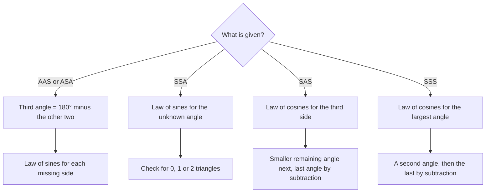

## When the law of sines can't start

The law of sines needs a side together with its opposite angle. In two cases you don't
have such a pair: **SAS** (two sides and the angle between them) and **SSS** (three sides).
For those, the law of cosines takes over. It's a generalization of the Pythagorean
theorem with a correction term that measures how far the angle is from $90^\circ$.

## The law

$$a^2 = b^2 + c^2 - 2bc\cos A$$
$$b^2 = a^2 + c^2 - 2ac\cos B$$
$$c^2 = a^2 + b^2 - 2ab\cos C$$

This is the **law of cosines**. The pattern: one side squared equals the sum of the squares of
the other two, minus twice their product times the cosine of the angle *between* them,
which is the angle *opposite* the first side.

If $C = 90^\circ$, $\cos C = 0$ and the third line is exactly $c^2 = a^2 + b^2$. If $C$ is obtuse,
$\cos C < 0$ and $c^2 > a^2 + b^2$: the side across an obtuse angle is longer than the
Pythagorean theorem would predict.

The picture compares the three cases with the same two sides $a$ and $b$: as the angle $C$
between them opens up, the side $c$ across from it grows, passing the Pythagorean length exactly at $90^\circ$.


**Why it's true.** Put $A$ at the origin and $B$ at $(c, 0)$. Then $C$ is at $(b\cos A, b\sin A)$, by
the definition of sine and cosine. The distance formula for $a = BC$:
$$a^2 = (b\cos A - c)^2 + (b\sin A)^2 = b^2\cos^2 A - 2bc\cos A + c^2 + b^2\sin^2 A = b^2 + c^2 - 2bc\cos A,$$
using $\cos^2 A + \sin^2 A = 1$. This works whether $A$ is acute or obtuse.

```plot
{"x": [-1, 12], "y": [-1, 7], "equal": true, "polygons": [{"points": [[0, 0], [11, 0], [6.389, 4.815]]}], "labels": [{"at": [-0.5, -0.5], "text": "A (0, 0)"}, {"at": [11.3, -0.6], "text": "B (c, 0)"}, {"at": [6.4, 5.5], "text": "C (b cos A, b sin A)"}, {"at": [2.8, 3.0], "text": "b"}, {"at": [9.2, 2.8], "text": "a"}, {"at": [5.5, -0.5], "text": "c"}], "caption": "Coordinates turn the law of cosines into the distance formula"}
```

## SAS: find the third side

### Example 1

Solve the triangle with $b = 8$, $c = 11$ and $A = 37^\circ$.

**Side $a$** (the angle between $b$ and $c$ is known, so use the first form):
$$a^2 = 8^2 + 11^2 - 2(8)(11)\cos 37^\circ \approx 185 - 140.56 = 44.44, \qquad a \approx 6.67.$$

**An angle.** Now a side–angle pair ($a$, $A$) is known, so either law works. A safe choice
is the angle opposite the *shorter* of the remaining sides, which can't be obtuse. $b = 8$ is
shorter than $c = 11$:
$$\sin B = \frac{8\sin 37^\circ}{6.67} \approx 0.7222, \qquad B \approx 46.24^\circ.$$

**Last angle:** $C \approx 180^\circ - 37^\circ - 46.24^\circ = 96.76^\circ$.

Had we used the law of sines for $C$ first, we'd have gotten $\sin^{-1}(0.9930) \approx 83.24^\circ$, the
acute supplement of the true answer. The largest angle is the one that might be obtuse;
find it last (or with the law of cosines, which never confuses the two).

## SSS: find an angle

Solve the law of cosines for the cosine:
$$\cos A = \frac{b^2 + c^2 - a^2}{2bc}, \quad \cos B = \frac{a^2 + c^2 - b^2}{2ac}, \quad \cos C = \frac{a^2 + b^2 - c^2}{2ab}.$$
Since $\cos^{-1}$ returns angles between $0^\circ$ and $180^\circ$, it correctly reports an obtuse angle as
obtuse. No ambiguity.

### Example 2

Solve the triangle with $a = 7$, $b = 9$, $c = 12$.

**Largest angle first** (opposite the longest side, $c$):
$$\cos C = \frac{49 + 81 - 144}{2(7)(9)} = \frac{-14}{126} \approx -0.1111, \qquad C \approx 96.38^\circ.$$
The negative cosine tells us $C$ is obtuse.

**Angle $A$:** $\cos A = \dfrac{81 + 144 - 49}{2(9)(12)} = \dfrac{176}{216} \approx 0.8148$, so $A \approx 35.43^\circ$.

**Angle $B$:** $B \approx 180^\circ - 96.38^\circ - 35.43^\circ = 48.19^\circ$.

If three given "sides" violate the triangle inequality (say 2, 3, 6), the formula produces a
cosine outside $[-1, 1]$: no triangle exists.

### Example 3: navigation

A ship sails 40 mi on a bearing of $060^\circ$, then turns and sails 25 mi on a bearing of
$110^\circ$. How far is it from port?

At the turning point the ship changes heading by $110^\circ - 60^\circ = 50^\circ$, so the angle inside the
triangle at that vertex is $180^\circ - 50^\circ = 130^\circ$. The two legs and the included angle are SAS:
$$d^2 = 40^2 + 25^2 - 2(40)(25)\cos 130^\circ \approx 2225 + 1285.6 = 3510.6, \qquad d \approx 59.25 \text{ mi}.$$

```plot
{"x": [-5, 65], "y": [-5, 30], "equal": true, "polygons": [{"points": [[0, 0], [34.64, 20], [58.13, 11.45]]}], "labels": [{"at": [-2.5, -2.5], "text": "port"}, {"at": [34.6, 22.6], "text": "130°"}, {"at": [15, 13], "text": "40"}, {"at": [48, 18], "text": "25"}, {"at": [32, 3], "text": "d"}], "caption": "Two legs and the angle between them: SAS"}
```

## Which law?

| Given | First step |
|---|---|
| AAS, ASA | third angle, then law of sines |
| SSA | law of sines; check for 0, 1 or 2 triangles |
| SAS | law of cosines for the third side |
| SSS | law of cosines for the largest angle |

The same choice as a decision chart, with the steps that follow the first one:



## The law of cosines and the dot product

If you study vectors (Module 8), you'll see the law of cosines again: it is exactly what
proves the formula $\mathbf{u}\cdot\mathbf{v} = \lVert\mathbf{u}\rVert\lVert\mathbf{v}\rVert\cos\theta$ for the angle between two vectors. The same
correction term $-2bc\cos A$ measures how far two directions are from being perpendicular.

## Common mistakes

- **Using the wrong angle.** In $a^2 = b^2 + c^2 - 2bc\cos A$, the angle is the one *between* $b$
  and $c$, opposite $a$.
- **Order of operations.** Compute $2bc\cos A$ as one product, then subtract. $(b^2 + c^2 - 2bc)\cos A$ is wrong.
- **Following the law of cosines with the law of sines for the largest angle.** That angle
  could be obtuse; find it with the law of cosines or by subtraction.
- **Forgetting the minus sign when $\cos A$ is negative.** $-2bc\cos 130^\circ$ is *positive*.

## Key points

- $c^2 = a^2 + b^2 - 2ab\cos C$ (and the two rotations).
- It reduces to the Pythagorean theorem at $90^\circ$.
- SAS: find the third side. SSS: find the largest angle first with $\cos C = \tfrac{a^2 + b^2 - c^2}{2ab}$.
- $\cos^{-1}$ distinguishes acute from obtuse, so the law of cosines has no ambiguous case.
