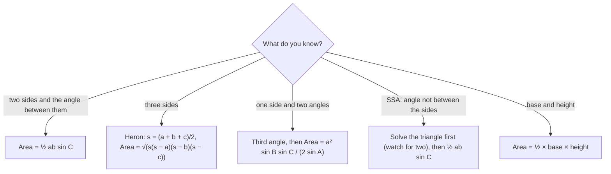

## Area without the height

The familiar formula $\text{area} = \tfrac12\cdot\text{base}\cdot\text{height}$ needs the height, which you
rarely measure directly. Trigonometry supplies it. With two sides and the angle between
them, the height is one sine away; with three sides, Heron's formula finds the area with no
angles at all. Surveyors use both to compute land areas from boundary measurements.

## The SAS area formula

Take side $b$ as the base. The height from $B$ to that base is $h = c\sin A$ (the same right-triangle idea
that proved the law of sines). So
$$\text{Area} = \tfrac12 bc\sin A = \tfrac12 ab\sin C = \tfrac12 ac\sin B.$$
In words: **half the product of two sides times the sine of the angle between them.** If the
angle is obtuse, the formula still works, because $\sin A = \sin(180^\circ - A)$ and the altitude
outside the triangle has that length.

```shape
{"polygons": [{"points": [[0, 0], [10, 0], [3.5, 4.2]]}], "segments": [{"from": [3.5, 4.2], "to": [3.5, 0], "dashed": true, "label": "h = c sin A"}], "rightAngles": [[[3.5, 0], [10, 0], [3.5, 4.2]]], "labels": [{"at": [-0.35, -0.35], "text": "A"}, {"at": [10.35, -0.35], "text": "C"}, {"at": [3.5, 4.65], "text": "B"}, {"at": [1.3, 2.5], "text": "c"}, {"at": [5, -0.5], "text": "b"}], "caption": "With base b, the height is c sin A"}
```

When the angle $A$ is obtuse, the height from $B$ lands on the extension of side $b$, outside the
triangle. Its length is $c\sin(180^\circ - A)$, which equals $c\sin A$, so the area formula needs no change:

```shape
{"polygons": [{"points": [[3, 0], [10, 0], [1, 3]]}], "segments": [{"from": [3, 0], "to": [1, 0], "dashed": true}, {"from": [1, 3], "to": [1, 0], "dashed": true, "label": "h = c sin A"}], "rightAngles": [[[1, 0], [3, 0], [1, 3]]], "labels": [{"at": [3.2, -0.45], "text": "A"}, {"at": [10.35, -0.3], "text": "C"}, {"at": [1, 3.45], "text": "B"}, {"at": [2.05, 0.35], "text": "180° − A"}, {"at": [2.35, 1.75], "text": "c"}, {"at": [6.5, -0.45], "text": "b"}], "caption": "Obtuse A: the height c sin(180° − A) = c sin A lies outside the triangle"}
```

At $A = 90^\circ$ the formula is $\tfrac12 bc$, the right-triangle area. The area is largest, for
given sides $b$ and $c$, when the angle between them is $90^\circ$.

### Example 1

Find the area of a triangle with $a = 12$, $b = 15$ and $C = 40^\circ$.

$C$ is between $a$ and $b$: $\text{Area} = \tfrac12(12)(15)\sin 40^\circ \approx 90(0.6428) \approx 57.85$.

### Example 2: a parallelogram

A parallelogram-shaped lot has sides 120 m and 80 m with an angle of $65^\circ$ between them.
Find its area.

A diagonal splits it into two congruent triangles, each with area $\tfrac12(120)(80)\sin 65^\circ$. The
lot's area is twice that:
$$120 \cdot 80\sin 65^\circ \approx 8700.6 \text{ m}^2.$$

### Example 3: AAS or ASA

If you know two angles and one side, first find another side with the law of sines. Or
combine the steps: with $a$ and all three angles,
$$\text{Area} = \frac{a^2\sin B\sin C}{2\sin A}.$$
For $A = 40^\circ$, $B = 60^\circ$, $a = 12$ (so $C = 80^\circ$):
$$\text{Area} = \frac{144\sin 60^\circ\sin 80^\circ}{2\sin 40^\circ} \approx 95.53.$$
(From Lesson 28, $b \approx 16.17$, and $\tfrac12(12)(16.17)\sin 80^\circ \approx 95.53$ agrees.)

## Heron's formula

When all three sides are known (SSS), Heron of Alexandria's formula gives the area
directly. Let the **semiperimeter** be
$$s = \frac{a + b + c}{2}.$$
Then
$$\text{Area} = \sqrt{s(s - a)(s - b)(s - c)}.$$
This is **Heron's formula**.

**Where it comes from (sketch).** Start from $\text{Area} = \tfrac12 ab\sin C$ and replace
$\sin C = \sqrt{1 - \cos^2 C}$, with $\cos C$ from the law of cosines. After squaring and
factoring the differences of squares, the expression collapses to $s(s - a)(s - b)(s - c)$.
It's a pleasant algebra exercise; the factored form is what makes the formula memorable.

### Example 4

Find the area of a triangle with sides 7, 9 and 12.

$s = \tfrac{7 + 9 + 12}{2} = 14$. Then
$$\text{Area} = \sqrt{14(14 - 7)(14 - 9)(14 - 12)} = \sqrt{14 \cdot 7 \cdot 5 \cdot 2} = \sqrt{980} \approx 31.30.$$
Check with Lesson 30, where $C \approx 96.38^\circ$: $\tfrac12(7)(9)\sin 96.38^\circ \approx 31.30$. ✓

### Example 5: a triangular plot

A triangular garden has sides 15 ft, 20 ft and 25 ft. How many square feet of mulch cover it?

$s = 30$; $\text{Area} = \sqrt{30 \cdot 15 \cdot 10 \cdot 5} = \sqrt{22{,}500} = 150 \text{ ft}^2$. (It's a 3-4-5 right
triangle scaled by 5, and $\tfrac12 \cdot 15 \cdot 20 = 150$ confirms it.)

If any factor $s - a$, $s - b$ or $s - c$ is zero or negative, the three lengths don't form a
triangle.

## Choosing a formula

| Known | Area formula |
|---|---|
| two sides and the included angle | $\tfrac12 ab\sin C$ |
| three sides | Heron: $\sqrt{s(s-a)(s-b)(s-c)}$ |
| one side and all angles | $\dfrac{a^2\sin B\sin C}{2\sin A}$ |
| base and height | $\tfrac12 bh$ |

As a decision chart:



### Example 6: land area in acres

A triangular lot has two sides of 150 ft and 210 ft meeting at a $72^\circ$ corner. One acre is
43,560 ft². How large is the lot?

$\text{Area} = \tfrac12(150)(210)\sin 72^\circ \approx 14{,}979$ ft², which is $\tfrac{14{,}979}{43{,}560} \approx 0.344$ acre.

## Area and the law of sines

Combining $\text{Area} = \tfrac12 bc\sin A$ with the law of sines gives a neat fact: the ratio
$\tfrac{a}{\sin A}$ that appears in the law of sines equals $2R$, the diameter of the circle passing through
all three vertices. You won't need it in this course, but it shows how tightly the area
formula, the law of sines and the geometry of circles are linked. It also explains why the
law of sines works: every side is a chord of that same circle.

## Heron's formula and rounding

Heron's formula is exact when the sides are exact, but when the sides are measured
values it can be sensitive to rounding for very thin triangles, where one factor $s - a$ is
tiny. In that case, find an angle with the law of cosines and use $\tfrac12 ab\sin C$ instead, carrying
full precision.

## Common mistakes

- **Using an angle that isn't between the two sides.** In $\tfrac12 ab\sin C$, $C$ must be the angle
  formed by $a$ and $b$.
- **Forgetting the $\tfrac12$** (that gives a parallelogram's area).
- **Using the perimeter instead of the semiperimeter** in Heron's formula.
- **Degree/radian mode** when evaluating $\sin C$.

## Key points

- SAS: $\text{Area} = \tfrac12 ab\sin C$, half the product of two sides times the sine of the included angle.
- SSS: Heron's formula with $s = \tfrac{a + b + c}{2}$.
- Area formulas let you skip measuring heights; they work for obtuse triangles too.
