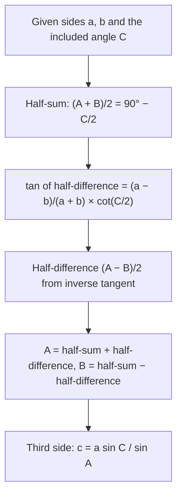

## Formulas made of products

The core lessons solved SSS and SAS triangles with the law of cosines and gave only a sketch
of why Heron's formula is true. This lesson builds a second toolkit for the same jobs: formulas
for the *half* angles of a triangle in terms of its sides, a complete proof of Heron's formula,
the law of tangents for SAS, and Mollweide's formulas for checking a finished solution.

These formulas were the working tools of surveyors and navigators for centuries.
Before electronic calculators, long calculations were done with tables of logarithms, which
turn products, quotients and roots into easy additions but do nothing for sums. The law of
cosines mixes squares and sums, so it was awkward to compute that way; every formula in this
lesson is a product or quotient of simple pieces. They still earn their place today. One of
them stays accurate for very thin triangles, where the law of cosines loses precision, and
Mollweide's formulas check all six parts of a triangle at once.

Throughout, $s = \tfrac{a + b + c}{2}$ is the semiperimeter, and the identities you need are the half-angle
identities from Module 6, $\cos^2\tfrac{\theta}{2} = \tfrac{1 + \cos\theta}{2}$ and $\sin^2\tfrac{\theta}{2} = \tfrac{1 - \cos\theta}{2}$, and the sum-to-product formulas.

## Half angles from the sides

Start from the law of cosines in the form $\cos A = \tfrac{b^2 + c^2 - a^2}{2bc}$ and add 1:
$$1 + \cos A = \frac{2bc + b^2 + c^2 - a^2}{2bc} = \frac{(b + c)^2 - a^2}{2bc} = \frac{(b + c + a)(b + c - a)}{2bc}.$$
Now $b + c + a = 2s$ and $b + c - a = 2s - 2a = 2(s - a)$, so $1 + \cos A = \tfrac{2s(s - a)}{bc}$. Dividing by 2:
$$\cos^2\frac{A}{2} = \frac{s(s - a)}{bc}.$$
Subtracting from 1 instead:
$$1 - \cos A = \frac{a^2 - (b - c)^2}{2bc} = \frac{(a - b + c)(a + b - c)}{2bc} = \frac{2(s - b)(s - c)}{bc}, \qquad \sin^2\frac{A}{2} = \frac{(s - b)(s - c)}{bc}.$$
Because $A$ is between $0^\circ$ and $180^\circ$, the half angle $\tfrac{A}{2}$ is between $0^\circ$ and $90^\circ$, so every
square root is positive:
$$\sin\frac{A}{2} = \sqrt{\frac{(s - b)(s - c)}{bc}}, \qquad \cos\frac{A}{2} = \sqrt{\frac{s(s - a)}{bc}}, \qquad \tan\frac{A}{2} = \sqrt{\frac{(s - b)(s - c)}{s(s - a)}}.$$
Rotating the letters gives the formulas for $B$ and $C$. A memory aid: the sine uses the two
factors that *don't* involve the angle's own side; the cosine uses $s$ and the one that does.

The tangent version has a picture. In the honors lesson on the circumcircle and incircle you
saw that the incircle touches the two sides at $A$ at distance $s - a$ from $A$. The incenter lies on
the bisector of $A$, so the right triangle formed by $A$, the incenter and a touching point has
legs $r$ and $s - a$ and the angle $\tfrac{A}{2}$ at $A$:
$$\tan\frac{A}{2} = \frac{r}{s - a}.$$

### Example 1: all three angles of the 7-9-12 triangle

Lesson 30 solved $a = 7$, $b = 9$, $c = 12$ with the law of cosines. Do it again with half-angle tangents.

$s = 14$, so $s - a = 7$, $s - b = 5$, $s - c = 2$.

- $\tan\dfrac{A}{2} = \sqrt{\dfrac{5 \cdot 2}{14 \cdot 7}} = \sqrt{\dfrac{10}{98}} \approx 0.3194$, so $\dfrac{A}{2} \approx 17.72^\circ$ and $A \approx 35.43^\circ$.
- $\tan\dfrac{B}{2} = \sqrt{\dfrac{7 \cdot 2}{14 \cdot 5}} = \sqrt{0.2} \approx 0.4472$, so $\dfrac{B}{2} \approx 24.09^\circ$ and $B \approx 48.19^\circ$.
- $\tan\dfrac{C}{2} = \sqrt{\dfrac{7 \cdot 5}{14 \cdot 2}} = \sqrt{1.25} \approx 1.1180$, so $\dfrac{C}{2} \approx 48.19^\circ$ and $C \approx 96.38^\circ$.

The three angles were found independently, and they add to $180.00^\circ$: a built-in check. The
obtuse angle came out obtuse automatically, because a half angle is always acute and
$\tan^{-1}$ returns it without any ambiguity.

## Heron's formula, proved

With the half-angle formulas, the proof sketched in Lesson 31 takes three lines. Use the double-angle
identity $\sin A = 2\sin\tfrac{A}{2}\cos\tfrac{A}{2}$:
$$K = \frac12 bc\sin A = bc\,\sin\frac{A}{2}\cos\frac{A}{2} = bc\sqrt{\frac{(s - b)(s - c)}{bc}}\sqrt{\frac{s(s - a)}{bc}} = \sqrt{s(s - a)(s - b)(s - c)}.$$
The two factors of $bc$ under the roots cancel the $bc$ in front. Heron of Alexandria gave a
purely geometric proof, using the incircle, in his *Metrica* (1st century AD); some historians
think Archimedes knew the formula earlier, but that can't be confirmed.

## A precision bonus: very thin triangles

### Example 2

An isosceles triangle has $a = b = 1000$ and $c = 1$. Find the small angle $C$.

**Law of cosines:** $\cos C = \dfrac{1000^2 + 1000^2 - 1^2}{2 \cdot 1000 \cdot 1000} = 0.9999995$. A calculator that keeps
only six decimal places stores this as $1.000000$ or $0.999999$, which give $C = 0^\circ$ or $C \approx 0.081^\circ$.
Both are badly wrong.

**Half-angle formula:** $s = 1000.5$, $s - a = s - b = 0.5$, so
$$\sin\frac{C}{2} = \sqrt{\frac{(0.5)(0.5)}{1000 \cdot 1000}} = 0.0005, \qquad \frac{C}{2} \approx 0.028648^\circ, \qquad C \approx 0.0573^\circ.$$

Why the difference? Near $0^\circ$ the cosine graph is almost flat ($\cos C \approx 1 - \tfrac{C^2}{2}$ in radians), so
a tiny rounding error in $\cos C$ becomes a large error in $C$. A calculation where small input
errors grow into large output errors is called **ill-conditioned**. The half-angle formula avoids
the trouble by computing the small differences $s - a$ and $s - b$ straight from the sides. (This
is about rounding during arithmetic. If the sides themselves are uncertain measurements, no
formula can recover accuracy the measurements don't have.)

## The law of tangents

$$\frac{a - b}{a + b} = \frac{\tan\frac{A - B}{2}}{\tan\frac{A + B}{2}}.$$

This is the **law of tangents**, and it holds for any pair of sides with their opposite angles.

**Proof.** By the law of sines, $a = k\sin A$ and $b = k\sin B$ for the same constant $k$ (it is $2R$). So
$$\frac{a - b}{a + b} = \frac{\sin A - \sin B}{\sin A + \sin B} = \frac{2\cos\frac{A + B}{2}\sin\frac{A - B}{2}}{2\sin\frac{A + B}{2}\cos\frac{A - B}{2}} = \frac{\tan\frac{A - B}{2}}{\tan\frac{A + B}{2}},$$
using the sum-to-product formulas in the middle step.

**Using it for SAS.** Given $a$, $b$ and the included angle $C$, you know $A + B = 180^\circ - C$, so
$\tfrac{A + B}{2} = 90^\circ - \tfrac{C}{2}$ and $\tan\tfrac{A + B}{2} = \cot\tfrac{C}{2}$. The law becomes
$$\tan\frac{A - B}{2} = \frac{a - b}{a + b}\cot\frac{C}{2}.$$
Knowing the half-sum and the half-difference, add them to get $A$ and subtract to get $B$.

### Example 3

Lesson 30, Example 1 had $b = 8$, $c = 11$ and the included angle $A = 37^\circ$. Solve it with the law of tangents.

The known sides are $c$ and $b$, so use the pair $(c, C)$ and $(b, B)$:
$$\tan\frac{C - B}{2} = \frac{11 - 8}{11 + 8}\cot 18.5^\circ = \frac{3}{19}(2.9887) \approx 0.4719, \qquad \frac{C - B}{2} \approx 25.26^\circ.$$
The half-sum is $\tfrac{C + B}{2} = 90^\circ - 18.5^\circ = 71.5^\circ$. So $C \approx 71.5^\circ + 25.26^\circ = 96.76^\circ$ and
$B \approx 71.5^\circ - 25.26^\circ = 46.24^\circ$. Finally $a = \dfrac{8\sin 37^\circ}{\sin 46.24^\circ} \approx 6.67$. All three agree with Lesson 30, and
again the obtuse angle needed no special care.

**History (disputed).** The law of tangents is credited to the 10th-century Persian
mathematician Abu al-Wafa; in Europe it was printed by Thomas Fincke in 1583, in the same book
that introduced the names *tangent* and *secant*, and François Viète also stated it. Who found it
first depends on which sources you trust.

## Mollweide's formulas

$$\frac{a + b}{c} = \frac{\cos\frac{A - B}{2}}{\sin\frac{C}{2}}, \qquad \frac{a - b}{c} = \frac{\sin\frac{A - B}{2}}{\cos\frac{C}{2}}.$$

These are **Mollweide's formulas**. **Proof of the first.** With $a = k\sin A$, $b = k\sin B$, $c = k\sin C$:
$$\frac{a + b}{c} = \frac{\sin A + \sin B}{\sin C} = \frac{2\sin\frac{A + B}{2}\cos\frac{A - B}{2}}{2\sin\frac{C}{2}\cos\frac{C}{2}}.$$
Since $\tfrac{A + B}{2} = 90^\circ - \tfrac{C}{2}$, the cofunction identity gives $\sin\tfrac{A + B}{2} = \cos\tfrac{C}{2}$, which cancels, leaving
$\tfrac{\cos\frac{A - B}{2}}{\sin\frac{C}{2}}$. The second formula comes the same way from the difference $\sin A - \sin B$, and
dividing the second by the first gives the law of tangents again.

Each formula contains all six parts of the triangle, so it makes an excellent final check: if
any side or angle is wrong, the two sides of the formula disagree.

### Example 4: checking a solution

Lesson 28 found $A = 40^\circ$, $B = 60^\circ$, $C = 80^\circ$, $a = 12$, $b \approx 16.17$, $c \approx 18.39$. Check it.

Left side: $\dfrac{a + b}{c} = \dfrac{28.17}{18.39} \approx 1.5318$. Right side: $\dfrac{\cos(-10^\circ)}{\sin 40^\circ} = \dfrac{0.9848}{0.6428} \approx 1.5321$.
They agree up to the rounding of $b$ and $c$. ✓ Had $b$ and $c$ been swapped by mistake, the
left side would be $\tfrac{12 + 18.39}{16.17} \approx 1.879$, and the error would show at once.

**History.** The formulas carry the name of Karl Mollweide, who published them in 1808, but
they were older: Isaac Newton gave a version of one in 1707, and Friedrich Wilhelm von Oppel
(1746) and Thomas Simpson (1748) published both.

## Common mistakes

- **Swapping the factors.** $\sin\tfrac{A}{2}$ uses $(s - b)(s - c)$, the factors without $a$; $\cos\tfrac{A}{2}$ uses $s(s - a)$.
- **Forgetting to double.** The formulas give $\tfrac{A}{2}$; the angle is twice that.
- **Getting the half-sum wrong.** In SAS, $\tfrac{A + B}{2} = 90^\circ - \tfrac{C}{2}$, so $\tan\tfrac{A + B}{2} = \cot\tfrac{C}{2}$, not $\tan\tfrac{C}{2}$.
- **Dropping a negative half-difference.** If $a < b$, then $\tfrac{A - B}{2}$ is negative, and that is right: $A < B$.
- **Expecting a perfect check.** With rounded values, Mollweide's two sides agree only to rounding.

## Key points

- $\sin\dfrac{A}{2} = \sqrt{\dfrac{(s - b)(s - c)}{bc}}$, $\cos\dfrac{A}{2} = \sqrt{\dfrac{s(s - a)}{bc}}$, $\tan\dfrac{A}{2} = \sqrt{\dfrac{(s - b)(s - c)}{s(s - a)}} = \dfrac{r}{s - a}$.
- Half angles are always acute, so these formulas never confuse an obtuse angle with its supplement.
- Heron's formula follows from $K = bc\sin\tfrac{A}{2}\cos\tfrac{A}{2}$.
- For thin triangles the half-angle formula stays accurate where the law of cosines is ill-conditioned.
- Law of tangents: $\dfrac{a - b}{a + b} = \dfrac{\tan\frac{A - B}{2}}{\tan\frac{A + B}{2}}$; for SAS, $\tan\dfrac{A - B}{2} = \dfrac{a - b}{a + b}\cot\dfrac{C}{2}$.
- Mollweide's formulas involve all six parts and make a quick check of a solved triangle.
