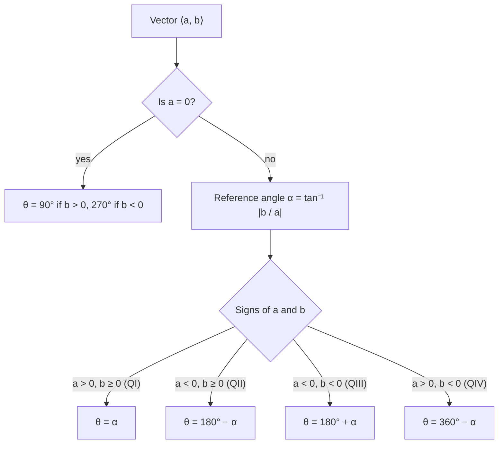

## Quantities with direction

Some quantities are fully described by a single number: temperature, mass, time. These are
**scalars**. Others need a direction too: a wind of 30 km/h *from the northwest*, a force of
200 N *pulling up and to the left*. These are **vectors**. Trigonometry is the bridge between
the two descriptions of a vector: by length and angle, or by horizontal and vertical parts.
This module develops vectors in the plane and uses them for forces and navigation.

## Arrows and their parts

Geometrically, a vector is a directed line segment, an arrow. It runs from an
**initial point** $P$ to a **terminal point** $Q$ and is written $\overrightarrow{PQ}$ or with a bold letter
$\mathbf{v}$. Its length is its **magnitude**, written $\lVert\mathbf{v}\rVert$. Two arrows with the same magnitude
and direction represent the same vector (they are **equivalent vectors**), wherever they are drawn.

The picture names the parts you will use all module: the two endpoints, the horizontal and
vertical components (the legs of a right triangle), the direction angle measured from the
positive $x$ direction, and the magnitude (the hypotenuse).


## Component form

Slide any arrow so it starts at the origin. If it then ends at $(a, b)$, the vector's
**component form** is $\mathbf{v} = \langle a, b\rangle$: $a$ is the horizontal component and $b$ the vertical one.
For an arrow from $P(x_1, y_1)$ to $Q(x_2, y_2)$,
$$\overrightarrow{PQ} = \langle x_2 - x_1,\ y_2 - y_1\rangle \qquad\text{("terminal minus initial")}.$$

By the Pythagorean theorem,
$$\lVert\mathbf{v}\rVert = \sqrt{a^2 + b^2}.$$

### Example 1

Find the component form and magnitude of the vector from $P(2, -1)$ to $Q(7, 3)$.

$\overrightarrow{PQ} = \langle 7 - 2, 3 - (-1)\rangle = \langle 5, 4\rangle$ and $\lVert\overrightarrow{PQ}\rVert = \sqrt{25 + 16} = \sqrt{41} \approx 6.40$.

```plot
{"x": [-1, 9], "y": [-2, 5], "equal": true, "segments": [{"from": [2, -1], "to": [7, 3], "arrow": true, "label": "PQ"}, {"from": [0, 0], "to": [5, 4], "arrow": true, "dashed": true, "label": "⟨5, 4⟩"}], "points": [{"at": [2, -1], "label": "P"}, {"at": [7, 3], "label": "Q"}], "caption": "PQ and the arrow from the origin to (5, 4) are the same vector"}
```

## Magnitude and direction

The **direction angle** $\theta$ of $\mathbf{v}$ is the angle in standard position that the vector makes
with the positive $x$-axis. A vector of magnitude $\lVert\mathbf{v}\rVert$ and direction angle $\theta$ ends at the
point $\lVert\mathbf{v}\rVert$ units out along that ray, so by the definition of sine and cosine,

$$\mathbf{v} = \langle \lVert\mathbf{v}\rVert\cos\theta,\ \lVert\mathbf{v}\rVert\sin\theta\rangle.$$

Going the other way: $\tan\theta = \tfrac{b}{a}$, but as with reference angles, the calculator's $\tan^{-1}$
only returns angles between $-90^\circ$ and $90^\circ$ (quadrants I and IV). Use the signs of $a$ and $b$ to place $\theta$ correctly.

The flowchart turns that rule into a procedure you can follow every time.



### Example 2

A vector has magnitude 12 and direction angle $150^\circ$. Write it in component form.

$\langle 12\cos 150^\circ, 12\sin 150^\circ\rangle = \left\langle 12\left(-\tfrac{\sqrt3}{2}\right), 12\cdot\tfrac12\right\rangle = \langle -6\sqrt3, 6\rangle \approx \langle -10.39, 6\rangle$.

### Example 3

Find the magnitude and direction angle of $\mathbf{v} = \langle -3, 4\rangle$.

$\lVert\mathbf{v}\rVert = \sqrt{9 + 16} = 5$. $\tan\theta = \tfrac{4}{-3}$; the calculator gives $\tan^{-1}\!\left(-\tfrac43\right) \approx -53.13^\circ$,
which points into quadrant IV. But $\mathbf{v}$ has $a < 0$, $b > 0$: quadrant II. Use the reference angle
$53.13^\circ$: $\theta = 180^\circ - 53.13^\circ = 126.87^\circ$.

## Operations

**Addition.** Add components: $\langle a, b\rangle + \langle c, d\rangle = \langle a + c, b + d\rangle$. Geometrically, put the
tail of the second at the head of the first; the sum, called the **resultant**, runs from the
first tail to the second head (the tip-to-tail rule, or the diagonal of the parallelogram).

```plot
{"x": [-1, 8], "y": [-1, 6], "equal": true, "segments": [{"from": [0, 0], "to": [4, 1], "arrow": true, "label": "u"}, {"from": [4, 1], "to": [6, 5], "arrow": true, "label": "v"}, {"from": [0, 0], "to": [6, 5], "arrow": true, "label": "u + v"}, {"from": [0, 0], "to": [2, 4], "dashed": true}, {"from": [2, 4], "to": [6, 5], "dashed": true}], "caption": "Tip-to-tail: u + v is the diagonal of the parallelogram"}
```

**Scalar multiplication.** $k\langle a, b\rangle = \langle ka, kb\rangle$. This stretches the arrow by $|k|$, and reverses
it if $k < 0$. In particular, $\lVert k\mathbf{v}\rVert = |k|\lVert\mathbf{v}\rVert$, and $-\mathbf{v}$ points the opposite way.

**Subtraction.** $\mathbf{u} - \mathbf{v} = \mathbf{u} + (-\mathbf{v})$, componentwise.

The **zero vector** $\mathbf{0} = \langle 0, 0\rangle$ has magnitude 0 and no direction.

## Unit vectors

A **unit vector** has magnitude 1. Dividing any nonzero vector by its magnitude gives the
unit vector in the same direction:
$$\mathbf{u} = \frac{\mathbf{v}}{\lVert\mathbf{v}\rVert}.$$
The **standard unit vectors** are $\mathbf{i} = \langle 1, 0\rangle$ and $\mathbf{j} = \langle 0, 1\rangle$, and every vector can be written
$\langle a, b\rangle = a\mathbf{i} + b\mathbf{j}$. Engineers and physicists often prefer this form.

### Example 4

Let $\mathbf{u} = \langle 2, -5\rangle$ and $\mathbf{v} = \langle -1, 3\rangle$. Find $3\mathbf{u} - 2\mathbf{v}$, $\lVert\mathbf{u} + \mathbf{v}\rVert$, and the unit
vector in the direction of $\mathbf{u}$.

$3\mathbf{u} - 2\mathbf{v} = \langle 6, -15\rangle - \langle -2, 6\rangle = \langle 8, -21\rangle = 8\mathbf{i} - 21\mathbf{j}$.

$\mathbf{u} + \mathbf{v} = \langle 1, -2\rangle$, so $\lVert\mathbf{u} + \mathbf{v}\rVert = \sqrt5$. Note this is not $\lVert\mathbf{u}\rVert + \lVert\mathbf{v}\rVert = \sqrt{29} + \sqrt{10}$:
magnitudes don't add unless the vectors point the same way.

$\lVert\mathbf{u}\rVert = \sqrt{29}$, so the unit vector is $\left\langle \tfrac{2}{\sqrt{29}}, -\tfrac{5}{\sqrt{29}}\right\rangle \approx \langle 0.371, -0.928\rangle$.

### Example 5: a vector of given length in a given direction

Find the vector of magnitude 10 that points in the same direction as $\langle 3, 4\rangle$.

The unit vector in that direction is $\tfrac{\langle 3, 4\rangle}{5} = \left\langle \tfrac35, \tfrac45\right\rangle$. Scale it to length 10:
$10\left\langle \tfrac35, \tfrac45\right\rangle = \langle 6, 8\rangle$. "Unit vector times desired length" is the general recipe.

## Vectors and bearings

Navigation problems often give a direction as a bearing. A bearing $\beta$ measured clockwise from
north converts to the direction angle $\theta = 90^\circ - \beta$ (add $360^\circ$ if negative).

## Common mistakes

- **Initial minus terminal.** Components are terminal minus initial.
- **Trusting $\tan^{-1}$ for the direction angle.** Check the quadrant from the signs of the components.
- **Adding magnitudes.** $\lVert\mathbf{u} + \mathbf{v}\rVert \le \lVert\mathbf{u}\rVert + \lVert\mathbf{v}\rVert$, with equality only for same-direction vectors.
- **Measuring direction from north.** A direction angle is from the positive $x$-axis,
  counterclockwise; a bearing is from north, clockwise. Convert carefully.

## Key points

- $\overrightarrow{PQ} = \langle x_2 - x_1, y_2 - y_1\rangle$; $\lVert\langle a, b\rangle\rVert = \sqrt{a^2 + b^2}$.
- $\mathbf{v} = \langle \lVert\mathbf{v}\rVert\cos\theta, \lVert\mathbf{v}\rVert\sin\theta\rangle$; find $\theta$ from $\tan\theta = \tfrac{b}{a}$ and the quadrant.
- Add and scale componentwise; the sum is the tip-to-tail resultant.
- Unit vector: $\mathbf{v}/\lVert\mathbf{v}\rVert$; $\langle a, b\rangle = a\mathbf{i} + b\mathbf{j}$.
