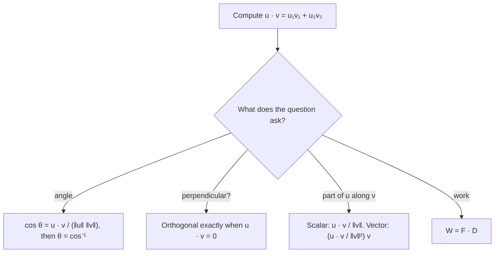

## Multiplying vectors to get a number

Vectors can be added and scaled, but there's also a useful way to "multiply" two vectors
that produces a scalar. This dot product measures how much two vectors point the same
way. It gives the angle between two vectors in one line, tests perpendicularity
instantly, splits a force into useful pieces, and computes work in physics. Underneath, it
is the law of cosines in disguise.

## Definition

For $\mathbf{u} = \langle u_1, u_2\rangle$ and $\mathbf{v} = \langle v_1, v_2\rangle$, the **dot product** is
$$\mathbf{u}\cdot\mathbf{v} = u_1v_1 + u_2v_2.$$
Multiply matching components and add. The result is a number, not a vector.

Properties that follow directly from the definition:

- $\mathbf{u}\cdot\mathbf{v} = \mathbf{v}\cdot\mathbf{u}$ and $\mathbf{u}\cdot(\mathbf{v} + \mathbf{w}) = \mathbf{u}\cdot\mathbf{v} + \mathbf{u}\cdot\mathbf{w}$;
- $(k\mathbf{u})\cdot\mathbf{v} = k(\mathbf{u}\cdot\mathbf{v})$;
- $\mathbf{v}\cdot\mathbf{v} = v_1^2 + v_2^2 = \lVert\mathbf{v}\rVert^2$.

## The angle formula

If $\theta$ is the angle between $\mathbf{u}$ and $\mathbf{v}$ (with $0 \le \theta \le \pi$, placing their tails together),
$$\mathbf{u}\cdot\mathbf{v} = \lVert\mathbf{u}\rVert\,\lVert\mathbf{v}\rVert\cos\theta.$$

**Why.** The vectors $\mathbf{u}$, $\mathbf{v}$ and $\mathbf{u} - \mathbf{v}$ form a triangle with angle $\theta$ between the first two.
The law of cosines says
$$\lVert\mathbf{u} - \mathbf{v}\rVert^2 = \lVert\mathbf{u}\rVert^2 + \lVert\mathbf{v}\rVert^2 - 2\lVert\mathbf{u}\rVert\lVert\mathbf{v}\rVert\cos\theta.$$
The left side is $(\mathbf{u} - \mathbf{v})\cdot(\mathbf{u} - \mathbf{v}) = \lVert\mathbf{u}\rVert^2 - 2\,\mathbf{u}\cdot\mathbf{v} + \lVert\mathbf{v}\rVert^2$. Compare the two and cancel.

```plot
{"x": [-1, 7], "y": [-3, 5], "equal": true, "segments": [{"from": [0, 0], "to": [3, 4], "arrow": true, "label": "u"}, {"from": [0, 0], "to": [5, -2], "arrow": true, "label": "v"}, {"from": [5, -2], "to": [3, 4], "dashed": true, "label": "u − v"}], "curves": [{"x": "0.9cos(t)", "y": "0.9sin(t)", "t": [-0.3805, 0.9273]}], "labels": [{"at": [1.4, 0.4], "text": "θ"}], "caption": "u, v and u − v form a triangle; the law of cosines gives the dot product formula"}
```

Solving for the angle:
$$\cos\theta = \frac{\mathbf{u}\cdot\mathbf{v}}{\lVert\mathbf{u}\rVert\,\lVert\mathbf{v}\rVert}.$$

For nonzero vectors, the sign of the dot product tells the type of angle: positive means
acute, zero means right, negative means obtuse.

### Example 1

Find the angle between $\mathbf{u} = \langle 3, 4\rangle$ and $\mathbf{v} = \langle 5, -2\rangle$.

$\mathbf{u}\cdot\mathbf{v} = 15 - 8 = 7$. $\lVert\mathbf{u}\rVert = 5$, $\lVert\mathbf{v}\rVert = \sqrt{29}$.
$$\cos\theta = \frac{7}{5\sqrt{29}} \approx 0.2600, \qquad \theta \approx 74.93^\circ.$$
The dot product is positive and small compared with $5\sqrt{29} \approx 26.9$, so the angle is acute but
not far from $90^\circ$.

## Orthogonal vectors

Two vectors are **orthogonal** (perpendicular) when the angle between them is $90^\circ$, which
happens exactly when
$$\mathbf{u}\cdot\mathbf{v} = 0.$$
(By convention the zero vector is orthogonal to every vector.)

### Example 2

Are $\langle 2, -3\rangle$ and $\langle 6, 4\rangle$ orthogonal? Find $k$ so that $\langle k, 3\rangle$ is orthogonal to $\langle 2, -5\rangle$.

$\langle 2, -3\rangle\cdot\langle 6, 4\rangle = 12 - 12 = 0$: yes.

$\langle k, 3\rangle\cdot\langle 2, -5\rangle = 2k - 15 = 0$, so $k = 7.5$.

## Projections

Often you need the part of one vector that lies along another, such as the part of
gravity that pulls a cart down a ramp. The **vector projection** of $\mathbf{u}$ onto $\mathbf{v}$ is
$$\text{proj}_{\mathbf{v}}\mathbf{u} = \frac{\mathbf{u}\cdot\mathbf{v}}{\lVert\mathbf{v}\rVert^2}\,\mathbf{v}.$$
Its signed length, $\dfrac{\mathbf{u}\cdot\mathbf{v}}{\lVert\mathbf{v}\rVert} = \lVert\mathbf{u}\rVert\cos\theta$, is the **scalar projection** (or component of $\mathbf{u}$
along $\mathbf{v}$).

**Why.** The shadow of $\mathbf{u}$ on the line of $\mathbf{v}$ has length $\lVert\mathbf{u}\rVert\cos\theta$ (right-triangle trig).
Multiply by the unit vector $\tfrac{\mathbf{v}}{\lVert\mathbf{v}\rVert}$ to give it direction, and use $\lVert\mathbf{u}\rVert\cos\theta = \tfrac{\mathbf{u}\cdot\mathbf{v}}{\lVert\mathbf{v}\rVert}$.

The leftover $\mathbf{w} = \mathbf{u} - \text{proj}_{\mathbf{v}}\mathbf{u}$ is orthogonal to $\mathbf{v}$, so every vector splits into a piece
along $\mathbf{v}$ and a piece perpendicular to it.

In the picture, drop a perpendicular from the tip of $\mathbf{u}$ to the line of $\mathbf{v}$. The projection runs
along $\mathbf{v}$ from the shared tail to the foot of that perpendicular, and $\mathbf{w}$ is the perpendicular itself.


### Example 3

Let $\mathbf{u} = \langle 6, 2\rangle$ and $\mathbf{v} = \langle 3, 4\rangle$. Find $\text{proj}_{\mathbf{v}}\mathbf{u}$ and write $\mathbf{u}$ as a sum of
a vector parallel to $\mathbf{v}$ and one orthogonal to $\mathbf{v}$.

$\mathbf{u}\cdot\mathbf{v} = 18 + 8 = 26$ and $\lVert\mathbf{v}\rVert^2 = 25$:
$$\text{proj}_{\mathbf{v}}\mathbf{u} = \tfrac{26}{25}\langle 3, 4\rangle = \langle 3.12, 4.16\rangle.$$
$\mathbf{w} = \mathbf{u} - \text{proj}_{\mathbf{v}}\mathbf{u} = \langle 2.88, -2.16\rangle$. Check: $\mathbf{w}\cdot\mathbf{v} = 8.64 - 8.64 = 0$. ✓

So $\mathbf{u} = \langle 3.12, 4.16\rangle + \langle 2.88, -2.16\rangle$. The scalar projection is $\tfrac{26}{5} = 5.2$.

```plot
{"x": [-0.5, 7], "y": [-0.5, 5], "equal": true, "segments": [{"from": [0, 0], "to": [6, 2], "arrow": true, "label": "u"}, {"from": [0, 0], "to": [3, 4], "arrow": true, "label": "v"}, {"from": [0, 0], "to": [3.12, 4.16], "arrow": true}, {"from": [3.12, 4.16], "to": [6, 2], "dashed": true, "label": "w"}], "points": [{"at": [3.12, 4.16], "label": "proj"}], "caption": "The projection of u onto v, and the perpendicular remainder w"}
```

### Example 4: the angles of a triangle

Find the angles of the triangle with vertices $A(0, 0)$, $B(4, 1)$, $C(1, 3)$.

At $A$, use the vectors along the two sides leaving $A$: $\overrightarrow{AB} = \langle 4, 1\rangle$ and $\overrightarrow{AC} = \langle 1, 3\rangle$.
$\cos A = \tfrac{4 + 3}{\sqrt{17}\sqrt{10}} = \tfrac{7}{\sqrt{170}} \approx 0.5369$, so $A \approx 57.53^\circ$.

At $B$: $\overrightarrow{BA} = \langle -4, -1\rangle$, $\overrightarrow{BC} = \langle -3, 2\rangle$, $\cos B = \tfrac{12 - 2}{\sqrt{17}\sqrt{13}} = \tfrac{10}{\sqrt{221}}$, so $B \approx 47.73^\circ$.

Then $C \approx 180^\circ - 57.53^\circ - 47.73^\circ = 74.74^\circ$. (Computing it directly from $\overrightarrow{CA}$ and $\overrightarrow{CB}$ gives the
same value, a good check.) Both vectors at a vertex must point *away* from that vertex;
reversing one would give the supplement of the angle.

### Example 5: work as a dot product preview

Pushing a crate 8 m along the floor with a force $\mathbf{F} = \langle 30, -10\rangle$ N (pushing forward and
down), with displacement $\mathbf{D} = \langle 8, 0\rangle$, does work $\mathbf{F}\cdot\mathbf{D} = 240$ J. The downward
part of the push does no work, because it is perpendicular to the motion. Lesson 34 returns
to this idea.

## The Cauchy–Schwarz inequality

Since $|\cos\theta| \le 1$, the formula gives $|\mathbf{u}\cdot\mathbf{v}| \le \lVert\mathbf{u}\rVert\lVert\mathbf{v}\rVert$, with equality exactly when one
vector is a scalar multiple of the other (the vectors are parallel, or one of them is $\mathbf{0}$). This is the Cauchy–Schwarz inequality, a workhorse of higher mathematics.

## Choosing the tool

Almost every dot product question starts with the same computation, $u_1v_1 + u_2v_2$; what you do
with the number depends on what is asked.



## Common mistakes

- **Treating the dot product as a vector.** $\mathbf{u}\cdot\mathbf{v}$ is a number.
- **Dividing by $\lVert\mathbf{v}\rVert$ instead of $\lVert\mathbf{v}\rVert^2$** in the vector projection. (Divide by $\lVert\mathbf{v}\rVert$ for the
  scalar projection.)
- **Projecting onto the wrong vector.** $\text{proj}_{\mathbf{v}}\mathbf{u}$ is parallel to $\mathbf{v}$.
- **Expecting an angle over $180^\circ$.** The angle between vectors is always in $[0^\circ, 180^\circ]$, which
  is exactly the range of $\cos^{-1}$.

## Key points

- $\mathbf{u}\cdot\mathbf{v} = u_1v_1 + u_2v_2 = \lVert\mathbf{u}\rVert\lVert\mathbf{v}\rVert\cos\theta$, a scalar.
- $\cos\theta = \dfrac{\mathbf{u}\cdot\mathbf{v}}{\lVert\mathbf{u}\rVert\lVert\mathbf{v}\rVert}$; positive = acute, zero = orthogonal, negative = obtuse.
- $\text{proj}_{\mathbf{v}}\mathbf{u} = \dfrac{\mathbf{u}\cdot\mathbf{v}}{\lVert\mathbf{v}\rVert^2}\mathbf{v}$; $\mathbf{u} - \text{proj}_{\mathbf{v}}\mathbf{u}$ is orthogonal to $\mathbf{v}$.
- $\mathbf{v}\cdot\mathbf{v} = \lVert\mathbf{v}\rVert^2$.
