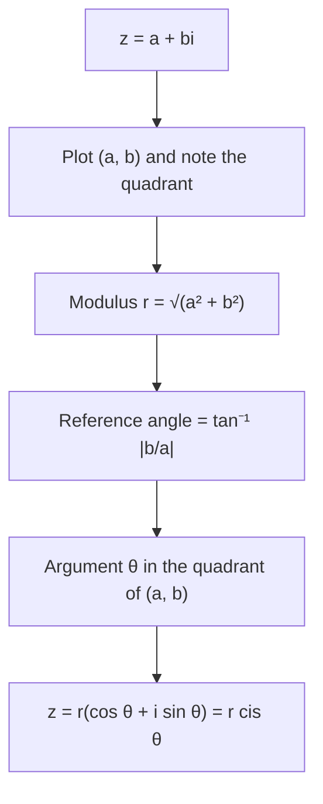

## Complex numbers as points

A complex number $z = a + bi$ (with $i^2 = -1$) has two real parts, so it can be drawn as the point
$(a, b)$, or the vector $\langle a, b\rangle$, in the **complex plane**: the horizontal **real axis** holds $a$
and the vertical **imaginary axis** holds $b$. Once complex numbers are points, polar
coordinates apply to them. The payoff is remarkable: multiplying complex numbers, which
is messy in $a + bi$ form, becomes "multiply the lengths and add the angles".

## Modulus and argument

The **modulus** of $z = a + bi$ is its distance from the origin:
$$|z| = r = \sqrt{a^2 + b^2}.$$
An **argument** of $z$ is an angle $\theta$ from the positive real axis to the point, so that
$\tan\theta = \tfrac{b}{a}$ with $\theta$ in the quadrant of $(a, b)$. (Arguments differ by multiples of $2\pi$;
we usually choose $0 \le \theta < 2\pi$.)

Since $a = r\cos\theta$ and $b = r\sin\theta$,
$$z = r(\cos\theta + i\sin\theta).$$
This is the **trigonometric form** (or polar form) of $z$. It's often abbreviated
$z = r\operatorname{cis}\theta$, where **cis** stands for "$\cos + i\sin$".

The picture collects the names: the two axes, the number $z = a + bi$, its modulus $r = |z|$, its argument $\theta$, and its
conjugate $\bar z = a - bi$ (used later in this lesson), the mirror image across the real axis.


Converting $a + bi$ to trigonometric form always follows the same steps:



```plot
{"x": [-4, 2], "y": [-0.8, 4.5], "equal": true, "segments": [{"from": [0, 0], "to": [-2, 3.4641], "arrow": true, "label": "r = 4"}, {"from": [-2, 0], "to": [-2, 3.4641], "dashed": true}], "curves": [{"x": "0.7cos(t)", "y": "0.7sin(t)", "t": [0, 2.0944]}], "points": [{"at": [-2, 3.4641], "label": "−2 + 2√3 i"}], "labels": [{"at": [0.75, 0.75], "text": "θ = 2π/3"}], "xLabel": "real", "yLabel": "imaginary", "caption": "−2 + 2√3 i has modulus 4 and argument 2π/3"}
```

### Example 1

Write $z = -2 + 2\sqrt3\,i$ in trigonometric form.

$r = \sqrt{4 + 12} = 4$. The point $(-2, 2\sqrt3)$ is in quadrant II with $\tan\theta = -\sqrt3$, so the
reference angle is $\tfrac{\pi}{3}$ and $\theta = \tfrac{2\pi}{3}$.
$$z = 4\left(\cos\tfrac{2\pi}{3} + i\sin\tfrac{2\pi}{3}\right) = 4\operatorname{cis}\tfrac{2\pi}{3}.$$

### Example 2

Write $3 - 4i$ in trigonometric form, with $\theta$ in radians to four decimals.

$r = 5$. Quadrant IV; $\tan^{-1}\!\left(-\tfrac43\right) \approx -0.9273$, or $2\pi - 0.9273 \approx 5.3559$ in $[0, 2\pi)$.
$$3 - 4i \approx 5\operatorname{cis}(5.3559).$$

### Example 3

Write $6\operatorname{cis}225^\circ$ in the form $a + bi$.

$6\cos 225^\circ = 6\left(-\tfrac{\sqrt2}{2}\right) = -3\sqrt2$ and likewise for sine:
$6\operatorname{cis}225^\circ = -3\sqrt2 - 3\sqrt2\,i \approx -4.24 - 4.24i$.

## Multiplying and dividing

Let $z_1 = r_1\operatorname{cis}\theta_1$ and $z_2 = r_2\operatorname{cis}\theta_2$. Multiply out:
$$z_1z_2 = r_1r_2\left[(\cos\theta_1\cos\theta_2 - \sin\theta_1\sin\theta_2) + i(\sin\theta_1\cos\theta_2 + \cos\theta_1\sin\theta_2)\right].$$
The brackets are exactly the sum formulas from Lesson 23:
$$z_1z_2 = r_1r_2\operatorname{cis}(\theta_1 + \theta_2).$$
**Multiply the moduli and add the arguments.** Similarly,
$$\frac{z_1}{z_2} = \frac{r_1}{r_2}\operatorname{cis}(\theta_1 - \theta_2) \qquad (z_2 \ne 0).$$
**Divide the moduli and subtract the arguments.**

Geometrically, multiplying by $r\operatorname{cis}\theta$ stretches by $r$ and rotates by $\theta$. Multiplying by
$i = 1\operatorname{cis}90^\circ$ rotates a point a quarter turn counterclockwise.

### Example 4

Find $z_1z_2$ and $\dfrac{z_1}{z_2}$ for $z_1 = 2\operatorname{cis}40^\circ$ and $z_2 = 3\operatorname{cis}110^\circ$. Give the product in $a + bi$ form.

$z_1z_2 = 6\operatorname{cis}150^\circ = 6\left(-\tfrac{\sqrt3}{2} + \tfrac12 i\right) = -3\sqrt3 + 3i$.

$\dfrac{z_1}{z_2} = \tfrac23\operatorname{cis}(-70^\circ) = \tfrac23\operatorname{cis}290^\circ$.

### Example 5: checking against algebra

Compute $(1 + i)(\sqrt3 + i)$ both ways.

Trigonometric: $1 + i = \sqrt2\operatorname{cis}45^\circ$ and $\sqrt3 + i = 2\operatorname{cis}30^\circ$, so the product is
$2\sqrt2\operatorname{cis}75^\circ$.

Algebraic: $\sqrt3 + i + \sqrt3\,i + i^2 = (\sqrt3 - 1) + (\sqrt3 + 1)i$.

They agree: $2\sqrt2\cos 75^\circ = 2\sqrt2\cdot\tfrac{\sqrt6 - \sqrt2}{4} = \sqrt3 - 1$. As a bonus, this gives a new way
to find $\cos 75^\circ$.

```plot
{"x": [-1, 3], "y": [-0.5, 3.2], "equal": true, "segments": [{"from": [0, 0], "to": [1, 1], "arrow": true, "label": "1 + i"}, {"from": [0, 0], "to": [1.7321, 1], "arrow": true, "label": "√3 + i"}, {"from": [0, 0], "to": [0.7321, 2.7321], "arrow": true, "label": "product"}], "xLabel": "real", "yLabel": "imaginary", "caption": "Arguments add (45° + 30° = 75°) and moduli multiply (√2 · 2)"}
```

### Example 6: several operations at once

Simplify $\dfrac{(4\operatorname{cis}75^\circ)(2\operatorname{cis}15^\circ)}{8\operatorname{cis}30^\circ}$.

Moduli: $\tfrac{4 \cdot 2}{8} = 1$. Arguments: $75^\circ + 15^\circ - 30^\circ = 60^\circ$. The result is
$\operatorname{cis}60^\circ = \tfrac12 + \tfrac{\sqrt3}{2}i$. In $a + bi$ form the same computation would need two
multiplications and a division by a complex number.

## Arguments are not unique

Because $\operatorname{cis}\theta = \operatorname{cis}(\theta + 360^\circ)$, every nonzero complex number has infinitely many arguments.
Books usually agree on one, called the principal argument, either in $[0^\circ, 360^\circ)$ or in
$(-180^\circ, 180^\circ]$. Both conventions are common; when an answer comes out as $-70^\circ$ and the
book lists $290^\circ$, they name the same number. The number 0 has modulus 0 and no defined
argument.

## The conjugate

The conjugate of $z = a + bi$ is $\bar z = a - bi$, the reflection of $z$ across the real axis. In
trigonometric form, $\overline{r\operatorname{cis}\theta} = r\operatorname{cis}(-\theta)$, and so
$z\bar z = r^2\operatorname{cis}0^\circ = r^2 = a^2 + b^2$, which matches the algebra $(a + bi)(a - bi) = a^2 + b^2$.

### Example 7: rotating a point

Rotate the point $3 + i$ by $90^\circ$ counterclockwise about the origin, and then by $45^\circ$ more.

A $90^\circ$ rotation is multiplication by $i$: $(3 + i)i = 3i + i^2 = -1 + 3i$. A further $45^\circ$
rotation is multiplication by $\operatorname{cis}45^\circ = \tfrac{\sqrt2}{2} + \tfrac{\sqrt2}{2}i$:
$$(-1 + 3i)\left(\tfrac{\sqrt2}{2} + \tfrac{\sqrt2}{2}i\right) = \tfrac{\sqrt2}{2}(-1 - i + 3i + 3i^2) = \tfrac{\sqrt2}{2}(-4 + 2i) = -2\sqrt2 + \sqrt2\,i.$$
The modulus stays $\sqrt{10}$ throughout ($8 + 2 = 10$ ✓), because multiplying by numbers of modulus 1
only rotates. Computer graphics and signal processing use exactly this trick.

```plot
{"x": [-3.8, 3.8], "y": [-1, 3.8], "equal": true, "circles": [{"center": [0, 0], "r": 3.1623}], "segments": [{"from": [0, 0], "to": [3, 1], "arrow": true}, {"from": [0, 0], "to": [-1, 3], "arrow": true}, {"from": [0, 0], "to": [-2.8284, 1.4142], "arrow": true}], "points": [{"at": [3, 1], "label": "3 + i"}, {"at": [-1, 3], "label": "−1 + 3i (×i)"}, {"at": [-2.8284, 1.4142], "label": "−2√2 + √2 i"}], "xLabel": "real", "yLabel": "imaginary", "caption": "Rotating 3 + i by 90° and then 45° keeps it on the circle of radius √10"}
```

## Common mistakes

- **Wrong quadrant for the argument.** As always with $\tan^{-1}$, check the signs of $a$ and $b$.
- **Adding moduli or multiplying arguments.** It's the other way: multiply moduli, add arguments.
- **Subtracting arguments in the wrong order** for a quotient: $\theta_1 - \theta_2$, numerator minus denominator.
- **Forgetting that $i$ goes with sine.** $r\operatorname{cis}\theta = r\cos\theta + (r\sin\theta)i$.

## Key points

- $z = a + bi$ is the point $(a, b)$; $|z| = \sqrt{a^2 + b^2}$; $\tan\theta = \tfrac{b}{a}$ with the quadrant checked.
- Trigonometric form: $z = r(\cos\theta + i\sin\theta) = r\operatorname{cis}\theta$.
- $z_1z_2 = r_1r_2\operatorname{cis}(\theta_1 + \theta_2)$ and $\tfrac{z_1}{z_2} = \tfrac{r_1}{r_2}\operatorname{cis}(\theta_1 - \theta_2)$.
- Multiplication is a stretch plus a rotation.
