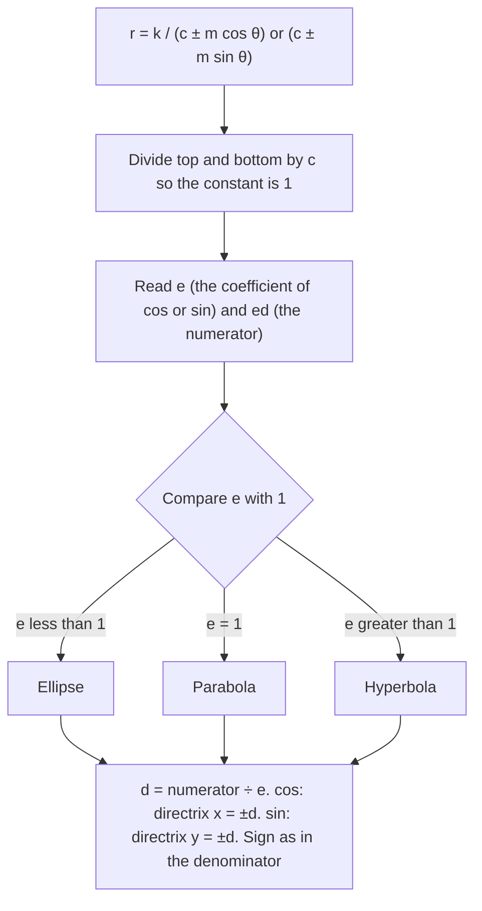

Lesson 35 turned $r = 6\cos\theta$ into a circle, and Lesson 36 drew cardioids, roses and lemniscates. Those curves are natural in polar form because they are built around the pole. This lesson adds a family you have met in algebra, the ellipse, parabola and hyperbola, and shows that in polar coordinates all three come from **one equation** when a focus sits at the pole. That single equation is how astronomers write the orbit of a planet or a comet, and deriving it takes nothing beyond $x = r\cos\theta$ and a little algebra.

## One definition for three curves

In algebra the three conics have three separate definitions (sum of distances, equal distances, difference of distances). There is a single definition that covers all of them. Fix a point $F$, the **focus**, and a line $\ell$ not through $F$, the **directrix**. Fix a positive number $e$, the **eccentricity**. The set of points $P$ with
$$\frac{PF}{PD} = e,$$
where $PD$ is the distance from $P$ to the directrix, is a **conic section**:

| Eccentricity | Conic |
|---|---|
| $0 < e < 1$ | ellipse |
| $e = 1$ | parabola |
| $e > 1$ | hyperbola |

For $e = 1$ this is the familiar "equal distance from focus and directrix" definition of a parabola. For $e \ne 1$ it is a theorem that the curve is the same ellipse or hyperbola as the algebra definitions give (the proof is the rectangular conversion in Example 1, done in general). A circle has $e = 0$ but no directrix: it is the limiting case as $e \to 0$ with the directrix moving off to infinity, so this lesson's equation does not produce circles.


## Deriving the polar equation

Put the focus at the pole and the directrix at the vertical line $x = d$, with $d > 0$. For a point $P = (r, \theta)$ with $r > 0$:

- its distance to the focus is $PF = r$;
- its distance to the directrix is $PD = d - x = d - r\cos\theta$ (the point is on the focus side of the line).

The definition $PF = e \cdot PD$ becomes $r = e(d - r\cos\theta)$. Collect the $r$ terms: $r + er\cos\theta = ed$, so
$$r = \frac{ed}{1 + e\cos\theta}.$$
Moving the directrix changes only the sign or the function:

| Directrix | Equation |
|---|---|
| $x = d$ (right of the pole) | $r = \dfrac{ed}{1 + e\cos\theta}$ |
| $x = -d$ (left) | $r = \dfrac{ed}{1 - e\cos\theta}$ |
| $y = d$ (above) | $r = \dfrac{ed}{1 + e\sin\theta}$ |
| $y = -d$ (below) | $r = \dfrac{ed}{1 - e\sin\theta}$ |

The important detail is the **1** in the denominator. An equation like $r = \dfrac{15}{3 - 2\cos\theta}$ must first be divided through by 3 before $e$ can be read off.



### Example 1: an ellipse

Identify $r = \dfrac{15}{3 - 2\cos\theta}$, find its vertices, and convert it to rectangular form.

**Normalize.** Divide top and bottom by 3: $r = \dfrac{5}{1 - \frac23\cos\theta}$. So $e = \tfrac23 < 1$, an ellipse, and $ed = 5$ gives $d = 7.5$. The minus sign with cosine puts the directrix at $x = -7.5$.

**Vertices.** The major axis lies along the polar axis (the cosine form), so the vertices come from $\theta = 0$ and $\theta = \pi$:
$$r(0) = \frac{15}{3 - 2} = 15, \qquad r(\pi) = \frac{15}{3 + 2} = 3.$$
The vertices are $(15, 0)$ and $(-3, 0)$ in rectangular coordinates. The major axis has length $15 + 3 = 18$, so $a = 9$, and the center is the midpoint $(6, 0)$. The focus at the pole is $c = 6$ from the center, and indeed $\tfrac{c}{a} = \tfrac69 = \tfrac23 = e$.

**Rectangular form.** $b^2 = a^2 - c^2 = 81 - 36 = 45$, so
$$\frac{(x - 6)^2}{81} + \frac{y^2}{45} = 1.$$
(Directly: $3r - 2r\cos\theta = 15$ gives $3r = 15 + 2x$; squaring, $9(x^2 + y^2) = (15 + 2x)^2$, which simplifies to the same equation.)

### Example 2: a parabola

Identify $r = \dfrac{4}{1 + \sin\theta}$ and convert it to rectangular form.

The constant is already 1 and $e = 1$: a parabola, with $ed = 4$, so $d = 4$. Sine with a plus sign means the directrix is $y = 4$, above the focus, so the parabola opens downward. Its vertex is halfway between the focus and the directrix, where $\theta = \tfrac{\pi}{2}$: $r = \tfrac42 = 2$, the point $(0, 2)$. At $\theta = 0$ and $\theta = \pi$, $r = 4$, giving the points $(4, 0)$ and $(-4, 0)$ level with the focus.

Rectangular: $r + r\sin\theta = 4$ means $\sqrt{x^2 + y^2} = 4 - y$. Square: $x^2 + y^2 = 16 - 8y + y^2$, so $x^2 = 16 - 8y$, or $y = 2 - \tfrac{x^2}{8}$.

### Example 3: a hyperbola and a negative $r$

Identify $r = \dfrac{6}{2 + 4\cos\theta}$ and find its vertices.

Normalize: $r = \dfrac{3}{1 + 2\cos\theta}$, so $e = 2$, a hyperbola, and $d = 1.5$ (directrix $x = 1.5$).

At $\theta = 0$: $r = \tfrac33 = 1$, the vertex $(1, 0)$. At $\theta = \pi$: $r = \tfrac{3}{1 - 2} = -3$. A negative $r$ points backward (Lesson 35), so this is the point $(3, 0)$, on the far side of the directrix. The vertices are $(1, 0)$ and $(3, 0)$, the center is $(2, 0)$, $a = 1$ and $c = 2$ (check: $\tfrac ca = 2 = e$). With $b^2 = c^2 - a^2 = 3$:
$$(x - 2)^2 - \frac{y^2}{3} = 1.$$
The denominator is zero when $\cos\theta = -\tfrac12$, at $\theta = \tfrac{2\pi}{3}$ and $\tfrac{4\pi}{3}$. In those directions $r$ blows up: they are the directions of the asymptotes, slopes $\pm\sqrt3$. The branch nearer the pole is traced while $1 + 2\cos\theta > 0$; the other branch comes from the negative values of $r$.

```plot
{"x": [-7, 5], "y": [-5, 5], "equal": true, "curves": [{"x": "(1/(1 + 0.5cos(t)))cos(t)", "y": "(1/(1 + 0.5cos(t)))sin(t)", "t": [0, 6.2832], "label": "e = 0.5"}, {"x": "(2/(1 + cos(t)))cos(t)", "y": "(2/(1 + cos(t)))sin(t)", "t": [-2.5, 2.5], "dashed": true, "label": "e = 1"}, {"x": "(4/(1 + 2cos(t)))cos(t)", "y": "(4/(1 + 2cos(t)))sin(t)", "t": [-1.85, 1.85], "label": "e = 2"}, {"x": "(4/(1 + 2cos(t)))cos(t)", "y": "(4/(1 + 2cos(t)))sin(t)", "t": [2.34, 3.94]}], "segments": [{"from": [2, -5], "to": [2, 5], "dashed": true}], "points": [{"at": [0, 0], "label": "focus"}], "labels": [{"at": [2.3, 4.4], "text": "directrix x = 2"}], "caption": "r = 2e/(1 + e cos θ) with the same focus and directrix: e = 0.5 (ellipse), e = 1 (parabola), e = 2 (hyperbola)"}
```

## What the eccentricity measures

For an ellipse, $e = \tfrac{c}{a}$ is the distance from the center to a focus as a fraction of the semi-major axis. Near 0 the ellipse is nearly round; near 1 it is long and thin. Adding the two vertex distances, $\dfrac{ed}{1 + e} + \dfrac{ed}{1 - e} = \dfrac{2ed}{1 - e^2}$, which is the major axis $2a$. So $ed = a(1 - e^2)$ and
$$r = \frac{a(1 - e^2)}{1 + e\cos\theta},$$
the form used for orbits. The closest and farthest points from the focus are
$$r_{\min} = a(1 - e), \qquad r_{\max} = a(1 + e).$$

## Rotated conics

Replacing $\theta$ with $\theta - \alpha$ rotates any polar graph by $\alpha$ counterclockwise about the pole: the point that used to appear at angle $\theta$ now appears at $\theta + \alpha$. So $r = \dfrac{ed}{1 + e\cos(\theta - \alpha)}$ is the same conic turned so that its axis points in direction $\alpha$. In rectangular form a rotated conic has an $xy$ term and is awkward; in polar form the rotation is one subtraction.

### Example 4: a rotated parabola

Describe $r = \dfrac{4}{1 - \cos\left(\theta - \frac{\pi}{4}\right)}$.

Without the rotation, $r = \dfrac{4}{1 - \cos\theta}$ is a parabola ($e = 1$, $d = 4$) with directrix $x = -4$, opening to the right, with vertex where $\cos\theta = -1$: $\theta = \pi$, $r = 2$. Rotating by $\tfrac{\pi}{4}$, the vertex is now at $\theta = \pi + \tfrac{\pi}{4} = \tfrac{5\pi}{4}$, $r = 2$: the point $(-\sqrt2, -\sqrt2)$. The parabola opens toward the upper right (direction $\tfrac{\pi}{4}$), and its directrix is the line 4 units from the pole facing direction $\tfrac{5\pi}{4}$, which is $x + y = -4\sqrt2$.

## Orbits

Kepler's first law (1609) says each planet moves on an ellipse with the Sun at one focus. Newton later showed that an inverse-square force produces exactly the curves of this lesson: ellipses for bound orbits, and parabolas or hyperbolas for objects that pass by once. With the Sun at the pole and $\theta$ measured from the closest point, the **perihelion** (nearest the Sun), an orbit is
$$r = \frac{a(1 - e^2)}{1 + e\cos\theta},$$
and the farthest point is the **aphelion**. (This is the two-body model: it ignores the small pulls of the other planets.)

### Example 5: Halley's comet

Halley's comet has a semi-major axis of about $17.8$ AU and eccentricity about $0.967$ (1 AU is the mean Earth–Sun distance). Find its perihelion and aphelion distances and its polar equation.

$$r_{\min} = 17.8(1 - 0.967) \approx 0.59 \text{ AU}, \qquad r_{\max} = 17.8(1 + 0.967) \approx 35.0 \text{ AU}.$$
At perihelion it is inside Venus's orbit (about 0.72 AU); at aphelion it is beyond Neptune's (about 30 AU). The numerator is $17.8(1 - 0.967^2) \approx 1.16$, so
$$r \approx \frac{1.16}{1 + 0.967\cos\theta}.$$
Compare Earth: $a \approx 1.000$ AU and $e \approx 0.0167$ give $0.983$ AU at perihelion and $1.017$ AU at aphelion, an orbit so nearly circular that a drawing of it looks like a circle.

## Common mistakes

- **Reading $e$ before normalizing.** In $r = \dfrac{15}{3 - 2\cos\theta}$, $e$ is $\tfrac23$, not 2. Make the constant in the denominator 1 first.
- **Confusing $ed$ with $d$.** The numerator is $ed$; divide by $e$ to get the directrix distance.
- **Dropping a vertex with negative $r$.** For a hyperbola, one vertex usually comes out with $r < 0$; plot it backward, don't discard it.
- **Wrong side for the directrix.** Plus sign: directrix on the positive side ($x = d$ or $y = d$); minus sign: negative side.
- **Expecting a circle.** $e = 0$ makes the numerator $ed = 0$; circles are not in this family.

## Key points

- A conic is the set of points with $\tfrac{PF}{PD} = e$: ellipse ($e < 1$), parabola ($e = 1$), hyperbola ($e > 1$).
- Focus at the pole, directrix $x = d$: $r = \dfrac{ed}{1 + e\cos\theta}$. Use $-$ for $x = -d$, and $\sin\theta$ for horizontal directrices.
- Normalize the denominator to $1 \pm e(\cdot)$ before reading $e$ and $ed$.
- Ellipse: $ed = a(1 - e^2)$, nearest and farthest distances $a(1 \mp e)$.
- Replacing $\theta$ with $\theta - \alpha$ rotates the conic by $\alpha$.
