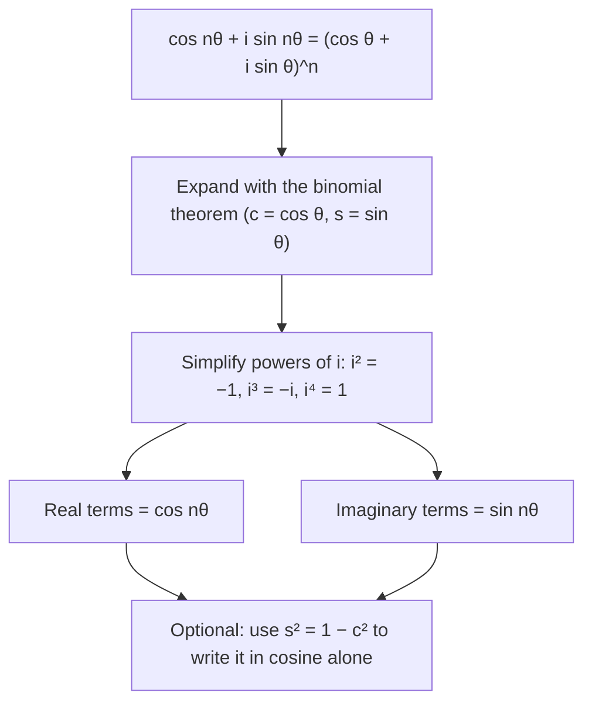

Lesson 39 used De Moivre's theorem to compute powers and to find the $n$th roots of a number, which form a regular polygon. This lesson turns the theorem around and uses it as a tool. Expanding $(\cos\theta + i\sin\theta)^n$ with algebra and comparing with $\cos n\theta + i\sin n\theta$ produces every multiple-angle identity at once, with no memorizing. Then the roots of unity, the corners of that regular polygon, turn out to have tidy algebra of their own: they add to zero, they factor $z^n - 1$, they give $\cos 72^\circ$ exactly, and they hide a surprising fact about chords of a polygon.

## Multiple-angle identities for free

De Moivre's theorem with $r = 1$ says
$$(\cos\theta + i\sin\theta)^n = \cos n\theta + i\sin n\theta.$$
The left side can also be multiplied out with the binomial theorem. Two complex numbers are equal only when their real parts are equal and their imaginary parts are equal, so matching the two parts gives two real identities.



### Example 1: the triple-angle formulas

Write $c = \cos\theta$ and $s = \sin\theta$. By the binomial theorem,
$$(c + is)^3 = c^3 + 3c^2(is) + 3c(is)^2 + (is)^3 = (c^3 - 3cs^2) + i(3c^2s - s^3).$$
Match with $\cos 3\theta + i\sin 3\theta$:
$$\cos 3\theta = c^3 - 3cs^2, \qquad \sin 3\theta = 3c^2s - s^3.$$
Replace $s^2$ by $1 - c^2$ in the first and $c^2$ by $1 - s^2$ in the second:
$$\cos 3\theta = 4\cos^3\theta - 3\cos\theta, \qquad \sin 3\theta = 3\sin\theta - 4\sin^3\theta.$$
Check at $\theta = 60^\circ$: $4\left(\tfrac18\right) - 3\left(\tfrac12\right) = -1 = \cos 180^\circ$. ✓

### Example 2: using a triple-angle formula

If $\cos\theta = \tfrac13$, find $\cos 3\theta$ exactly.

$\cos 3\theta = 4\left(\tfrac13\right)^3 - 3\left(\tfrac13\right) = \tfrac{4}{27} - 1 = -\tfrac{23}{27}$. Doing this with the sum formula for $\cos(2\theta + \theta)$ takes several more lines and needs $\sin\theta$ along the way.

The same method with $n = 4$ gives $\cos 4\theta = c^4 - 6c^2s^2 + s^4 = 8\cos^4\theta - 8\cos^2\theta + 1$ and $\sin 4\theta = 4c^3s - 4cs^3$. In general $\cos n\theta$ is always a polynomial in $\cos\theta$ (these are called Chebyshev polynomials), a fact used in numerical computing.

## The roots of unity as powers of one number

The $n$th roots of unity are $\operatorname{cis}\tfrac{2\pi k}{n}$ for $k = 0, 1, \ldots, n - 1$. Call the first one after 1
$$\omega = \operatorname{cis}\frac{2\pi}{n}.$$
By De Moivre, $\omega^k = \operatorname{cis}\tfrac{2\pi k}{n}$, so the roots are simply $1, \omega, \omega^2, \ldots, \omega^{n-1}$: each is the previous one rotated by $\tfrac{2\pi}{n}$. Such an $\omega$, whose powers give all $n$ roots, is a **primitive root of unity**. Two more facts follow at once:

- $\omega^n = 1$, so powers wrap around: $\omega^{n+3} = \omega^3$.
- Since $|\omega^k| = 1$, the conjugate is the reciprocal: $\overline{\omega^k} = \omega^{-k} = \omega^{n-k}$. The roots other than $\pm1$ come in **conjugate pairs**, mirror images across the real axis.

```plot
{"x": [-1.6, 1.6], "y": [-1.4, 1.4], "equal": true, "circles": [{"center": [0, 0], "r": 1}], "polygons": [{"points": [[1, 0], [0.309, 0.9511], [-0.809, 0.5878], [-0.809, -0.5878], [0.309, -0.9511]]}], "segments": [{"from": [1, 0], "to": [-0.809, 0.5878], "dashed": true}, {"from": [1, 0], "to": [-0.809, -0.5878], "dashed": true}], "points": [{"at": [1, 0], "label": "1"}, {"at": [0.309, 0.9511], "label": "ω"}, {"at": [-0.809, 0.5878], "label": "ω²"}, {"at": [-0.809, -0.5878], "label": "ω³"}, {"at": [0.309, -0.9511], "label": "ω⁴"}], "xLabel": "real", "yLabel": "imaginary", "caption": "Fifth roots of unity, ω = cis 72°: ω and ω⁴ are a conjugate pair, and so are ω² and ω³. Dashed: the diagonals from 1"}
```

## They add up to zero

**Claim:** for $n \ge 2$, $1 + \omega + \omega^2 + \cdots + \omega^{n-1} = 0$.

**Why (geometry).** Call the sum $S$. Multiplying by $\omega$ rotates every root to the next one, so it just reorders the list: $\omega S = S$. Since $\omega \ne 1$, this forces $S = 0$.

**Why (algebra).** It's a geometric series: $S = \dfrac{\omega^n - 1}{\omega - 1} = \dfrac{1 - 1}{\omega - 1} = 0$.

Physically: $n$ equal forces pointing to the corners of a regular polygon balance. Taking real and imaginary parts gives trig identities, for example (with $n = 5$)
$$1 + \cos 72^\circ + \cos 144^\circ + \cos 216^\circ + \cos 288^\circ = 0.$$

### Example 3: the cube roots of $-8$

Find all three, using a root of unity.

One cube root is obvious: $(-2)^3 = -8$. If $w^3 = -8$ and $\omega = \operatorname{cis}120^\circ$, then $(-2\omega)^3 = -8\omega^3 = -8$, so multiplying one root by the roots of unity gives all of them:
$$-2, \qquad -2\operatorname{cis}120^\circ = -2\left(-\tfrac12 + \tfrac{\sqrt3}{2}i\right) = 1 - \sqrt3\,i, \qquad -2\operatorname{cis}240^\circ = 1 + \sqrt3\,i.$$
They add to $-2 + 1 + 1 = 0$, as they must: they are $-2$ times the cube roots of unity.

## Factoring $z^n - 1$

The roots of $z^n - 1 = 0$ are the $n$th roots of unity, so by the factor theorem
$$z^n - 1 = (z - 1)(z - \omega)(z - \omega^2)\cdots(z - \omega^{n-1}).$$
Multiply each conjugate pair together. For $\alpha = \tfrac{2\pi k}{n}$,
$$(z - \operatorname{cis}\alpha)(z - \operatorname{cis}(-\alpha)) = z^2 - (2\cos\alpha)z + 1,$$
because the sum of the pair is $2\cos\alpha$ and the product is $|\operatorname{cis}\alpha|^2 = 1$. So $z^n - 1$ factors into real linear and quadratic factors with cosines as coefficients.

### Example 4: $z^6 - 1$

The sixth roots of unity are $1$, $-1$ and the pairs at $\pm60^\circ$ and $\pm120^\circ$. With $2\cos60^\circ = 1$ and $2\cos120^\circ = -1$:
$$z^6 - 1 = (z - 1)(z + 1)(z^2 - z + 1)(z^2 + z + 1).$$
Check against algebra: $z^6 - 1 = (z^3 - 1)(z^3 + 1)$, and $z^3 - 1 = (z - 1)(z^2 + z + 1)$, $z^3 + 1 = (z + 1)(z^2 - z + 1)$. ✓

## An exact value: $\cos 72^\circ$

The special angles of Lesson 11 are multiples of $30^\circ$ and $45^\circ$. The fifth roots of unity reach $72^\circ$. Let $z = \operatorname{cis}72^\circ$. It satisfies $z^5 = 1$ and $z \ne 1$, so dividing $z^5 - 1$ by $z - 1$:
$$z^4 + z^3 + z^2 + z + 1 = 0.$$

### Example 5

Find $\cos 72^\circ$ exactly.

**Divide by $z^2$** (allowed since $z \ne 0$): $z^2 + z + 1 + z^{-1} + z^{-2} = 0$.

**Substitute $w = z + z^{-1}$.** Since $z^{-1} = \bar z$, $w = 2\cos 72^\circ$. Also $w^2 = z^2 + 2 + z^{-2}$, so $z^2 + z^{-2} = w^2 - 2$. The equation becomes
$$(w^2 - 2) + w + 1 = 0, \qquad w^2 + w - 1 = 0.$$

**Solve and choose.** $w = \dfrac{-1 \pm \sqrt5}{2}$. Since $\cos 72^\circ > 0$, take the plus sign:
$$\cos 72^\circ = \frac{w}{2} = \frac{\sqrt5 - 1}{4} \approx 0.3090.$$
The other root, $\tfrac{-1 - \sqrt5}{2}$, is $2\cos 144^\circ$, so $\cos 144^\circ = -\tfrac{1 + \sqrt5}{4}$ and, by the supplement rule, $\cos 36^\circ = \tfrac{1 + \sqrt5}{4} \approx 0.8090$. The golden ratio $\tfrac{1 + \sqrt5}{2}$ appears because these are the angles of a regular pentagon.

In 1796, at 18, Carl Friedrich Gauss used the same kind of algebra on the 17th roots of unity to show that a regular 17-gon can be constructed with straightedge and compass, the first new constructible polygon found since ancient Greece.

## A surprise about polygon diagonals

Draw a regular $n$-gon inscribed in the unit circle with one corner at 1. Multiply the lengths of all the sides and diagonals that leave that corner. The answer is always $n$.

**Why.** The other corners are $\omega, \ldots, \omega^{n-1}$, and the distance from 1 to $\omega^k$ is $|1 - \omega^k|$. From the factorization,
$$\frac{z^n - 1}{z - 1} = (z - \omega)(z - \omega^2)\cdots(z - \omega^{n-1}),$$
and the left side is also $1 + z + z^2 + \cdots + z^{n-1}$. Set $z = 1$: the left side is $n$, and taking absolute values on the right gives
$$|1 - \omega|\,|1 - \omega^2|\cdots|1 - \omega^{n-1}| = n.$$

### Example 6: checking the square and the hexagon

**Square** ($n = 4$, corners $1, i, -1, -i$): from 1 the distances are $|1 - i| = \sqrt2$, $|1 - (-1)| = 2$ and $|1 + i| = \sqrt2$. Product: $\sqrt2 \cdot 2 \cdot \sqrt2 = 4$. ✓

**Hexagon** ($n = 6$): the chord to the corner $k$ steps away subtends $60^\circ k$ at the center, so its length is $2\sin(30^\circ k)$: $1, \sqrt3, 2, \sqrt3, 1$. Product: $1 \cdot \sqrt3 \cdot 2 \cdot \sqrt3 \cdot 1 = 6$. ✓

## Common mistakes

- **Forgetting the powers of $i$** when expanding $(c + is)^n$: $(is)^2 = -s^2$ and $(is)^3 = -is^3$. A sign slip here gives a wrong identity; check it at a special angle.
- **Matching the wrong parts.** $\cos n\theta$ is the real part, $\sin n\theta$ the imaginary part.
- **Thinking the sum of roots of unity is 1.** It is 0 for every $n \ge 2$; 1 is only one of the terms.
- **Dropping the factor $z - 1$** or the condition $z \ne 1$: $z^4 + z^3 + z^2 + z + 1 = 0$ holds for the fifth roots of unity other than 1.
- **Choosing the wrong root of $w^2 + w - 1 = 0$.** Use the sign of the cosine you want.

## Key points

- Expanding $(\cos\theta + i\sin\theta)^n$ and matching real and imaginary parts gives formulas for $\cos n\theta$ and $\sin n\theta$; e.g. $\cos 3\theta = 4\cos^3\theta - 3\cos\theta$, $\sin 3\theta = 3\sin\theta - 4\sin^3\theta$.
- The $n$th roots of unity are $1, \omega, \ldots, \omega^{n-1}$ with $\omega = \operatorname{cis}\tfrac{2\pi}{n}$; $\overline{\omega^k} = \omega^{n-k}$.
- They add to 0, and $z^n - 1 = \prod(z - \omega^k)$; each conjugate pair gives $z^2 - 2\cos\tfrac{2\pi k}{n}\,z + 1$.
- All $n$th roots of $c$: one root times each $n$th root of unity.
- $\cos 72^\circ = \tfrac{\sqrt5 - 1}{4}$; the chords from one corner of a regular $n$-gon in the unit circle multiply to $n$.
