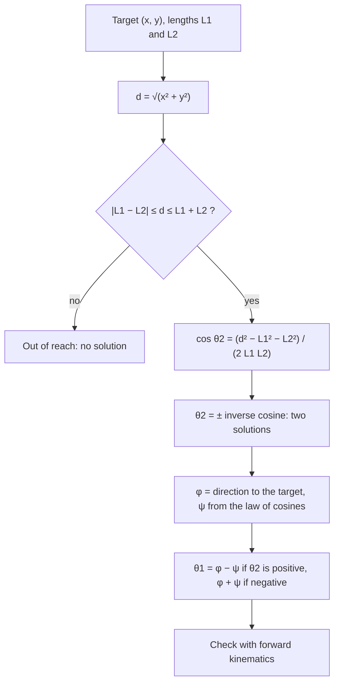

A factory robot that welds car bodies, a telescope mount that follows a star, and the character in a video game that swings a sword all face the same two questions. If I turn these joints by these angles, where does the tip end up? And the reverse: to put the tip *there*, how should I turn the joints? This lesson answers both for a simple arm moving in a plane, and it needs nothing new. The sum formulas (Module 6) rotate points, vectors (Module 8) add up the arm's pieces, and the law of cosines (Module 7) runs the arm backward. Along the way you'll meet an old friend from the ambiguous case: a problem with two correct answers.

## Rotating a point

Start with the basic move. Turn the point $(x, y)$ counterclockwise about the origin by an angle $\theta$. Where does it go? (If you did the Module 8 honors lesson on rotating vectors, this section is a quick review; the arm itself starts in the next section.)

Write the point in polar form, $(x, y) = (r\cos\alpha, r\sin\alpha)$, where $r$ is its distance from the origin and $\alpha$ its direction. A rotation keeps the distance and adds $\theta$ to the direction, so the new point is $(r\cos(\alpha + \theta), r\sin(\alpha + \theta))$. Now expand with the sum formulas:

$$r\cos(\alpha + \theta) = r\cos\alpha\cos\theta - r\sin\alpha\sin\theta = x\cos\theta - y\sin\theta,$$
$$r\sin(\alpha + \theta) = r\sin\alpha\cos\theta + r\cos\alpha\sin\theta = x\sin\theta + y\cos\theta.$$

These are the rotation formulas:
$$x' = x\cos\theta - y\sin\theta, \qquad y' = x\sin\theta + y\cos\theta.$$

Notice what happened: $r$ and $\alpha$ disappeared. You never need the point's angle; the formulas work straight from its coordinates. That is exactly why computers use them. Engineers usually write the four numbers $\cos\theta$, $-\sin\theta$, $\sin\theta$, $\cos\theta$ as a square array called a **rotation matrix**; you'll multiply with such arrays in linear algebra, but the arithmetic is just the two formulas above.

You have seen the same idea once before. Multiplying the complex number $x + yi$ by $\cos\theta + i\sin\theta$ gives
$$(x\cos\theta - y\sin\theta) + (x\sin\theta + y\cos\theta)\,i,$$
the same two expressions, because multiplying complex numbers adds their arguments.

### Example 1: rotating a point by 30°

Rotate $(4, 1)$ by $30^\circ$ counterclockwise about the origin.

**Step 1: the values.** $\cos 30^\circ = \tfrac{\sqrt3}{2}$, $\sin 30^\circ = \tfrac12$.

**Step 2: substitute.**
$$x' = 4\cdot\tfrac{\sqrt3}{2} - 1\cdot\tfrac12 = 2\sqrt3 - \tfrac12 \approx 2.964, \qquad y' = 4\cdot\tfrac12 + 1\cdot\tfrac{\sqrt3}{2} = 2 + \tfrac{\sqrt3}{2} \approx 2.866.$$

**Step 3: check.** A rotation keeps distances from the origin. Before: $\sqrt{16 + 1} = \sqrt{17} \approx 4.123$. After: $\sqrt{2.964^2 + 2.866^2} \approx 4.123$. Good.

Two more facts follow from the formulas. Rotating by $\theta$ and then by $\varphi$ is the same as rotating once by $\theta + \varphi$ (the angles add, just as the complex arguments do). And rotating by $-\theta$ undoes a rotation by $\theta$: since cosine is even and sine is odd, that just flips the signs of the $\sin\theta$ terms.

## A two-link arm

Here is the simplest useful robot: a **planar two-link arm**. A shoulder joint is fixed at the origin. A rigid link of length $L_1$ runs to an elbow joint, and a second link of length $L_2$ runs from the elbow to the gripper, which roboticists call the **end effector**. Each joint can only turn.


The arm is described by two **joint angles**:

- $\theta_1$, the angle of link 1 measured counterclockwise from the positive $x$-axis;
- $\theta_2$, the angle of link 2 measured from the *direction of link 1* (the dashed line in the picture), counterclockwise positive.

The second angle is relative: it is what the elbow motor actually controls. So link 2 points in the absolute direction $\theta_1 + \theta_2$.

## Forward kinematics: from angles to position

**Forward kinematics** means finding where the end effector is from the joint angles. Treat each link as a vector. Link 1 is the vector of length $L_1$ at angle $\theta_1$, and link 2 is the vector of length $L_2$ at angle $\theta_1 + \theta_2$. The gripper is at their sum:

$$x = L_1\cos\theta_1 + L_2\cos(\theta_1 + \theta_2), \qquad y = L_1\sin\theta_1 + L_2\sin(\theta_1 + \theta_2).$$

That's all there is to it: it's the "components of a vector" calculation from Module 8, done twice and added. Arms with more links just add more terms, each with the sum of all the joint angles before it.

### Example 2: where is the gripper?

The arm in the picture has $L_1 = 40$ cm, $L_2 = 30$ cm, $\theta_1 = 30^\circ$ and $\theta_2 = 45^\circ$. Find the position of the elbow and of the gripper.

**Step 1: the elbow.** $(40\cos 30^\circ, 40\sin 30^\circ) = (20\sqrt3, 20) \approx (34.64, 20.00)$.

**Step 2: link 2's absolute direction.** $\theta_1 + \theta_2 = 75^\circ$.

**Step 3: add link 2.** $30\cos 75^\circ \approx 7.765$ and $30\sin 75^\circ \approx 28.978$, so the gripper is at
$$(34.641 + 7.765,\ 20 + 28.978) \approx (42.41, 48.98) \text{ cm}.$$

A common slip is to use $45^\circ$ for link 2. That would describe an arm whose second link points $45^\circ$ above the *ground*, not $45^\circ$ beyond link 1.

## Inverse kinematics: from position to angles

The question a robot really faces runs the other way. A camera spots a part at $(x, y)$; what joint angles put the gripper there? This is **inverse kinematics**, and here the law of cosines does the work.

Draw the triangle with corners at the shoulder $O$, the elbow, and the target $T$. Its sides are $L_1$, $L_2$ and the distance $d = \sqrt{x^2 + y^2}$ from shoulder to target. Three sides known: that's SSS, so the law of cosines gives every angle.

**The elbow.** The triangle's interior angle at the elbow is $180^\circ - \theta_2$ (link 2 turns away from the straight-on direction by $\theta_2$). The law of cosines says $d^2 = L_1^2 + L_2^2 - 2L_1L_2\cos(180^\circ - \theta_2)$, and $\cos(180^\circ - \theta_2) = -\cos\theta_2$, so
$$\cos\theta_2 = \frac{d^2 - L_1^2 - L_2^2}{2L_1L_2}.$$

**The shoulder.** Let $\varphi$ be the direction from the shoulder to the target (found with $\tan\varphi = \tfrac{y}{x}$ and the quadrant checked), and let $\psi$ be the triangle's angle at the shoulder:
$$\cos\psi = \frac{L_1^2 + d^2 - L_2^2}{2L_1 d}.$$
Link 1 is turned away from the target line by $\psi$, to one side or the other.

**Two answers.** $\cos\theta_2 = c$ has two solutions with $-180^\circ < \theta_2 < 180^\circ$: $\theta_2 = \pm\cos^{-1} c$. They are mirror images across the line from shoulder to target, which is why they are called the **elbow-up and elbow-down** solutions. With positive $\theta_2$ the elbow sits on the clockwise side of the target line, so $\theta_1 = \varphi - \psi$; with negative $\theta_2$ it sits on the other side, so $\theta_1 = \varphi + \psi$. This is the ambiguous case of Module 7 again: the same three lengths, two different triangles (one a reflection of the other).



**Reach.** The triangle exists only if the triangle inequality holds: $|L_1 - L_2| \le d \le L_1 + L_2$. The points the gripper can reach, its **workspace**, form a ring (an annulus) between radii $|L_1 - L_2|$ and $L_1 + L_2$. Outside the ring, the formula above gives $|\cos\theta_2| > 1$, and the calculator's error message is the mathematics telling you the target is out of reach. On the outer edge the arm is fully stretched ($\theta_2 = 0$) and the two solutions merge into one.

### Example 3: reaching a target

The same arm ($L_1 = 40$, $L_2 = 30$) must put its gripper at $(50, 30)$. Find both solutions.

**Step 1: distance.** $d^2 = 50^2 + 30^2 = 3400$, $d \approx 58.31$. Since $10 \le 58.31 \le 70$, the target is reachable.

**Step 2: elbow angle.** $\cos\theta_2 = \dfrac{3400 - 1600 - 900}{2\cdot 40\cdot 30} = \dfrac{900}{2400} = 0.375$, so $\theta_2 = \pm 67.98^\circ$.

**Step 3: direction and shoulder angle.** The target is in quadrant I with $\tan\varphi = \tfrac{30}{50}$, so $\varphi \approx 30.96^\circ$. Then
$$\cos\psi = \frac{1600 + 3400 - 900}{2\cdot 40\cdot 58.31} \approx 0.8789, \qquad \psi \approx 28.49^\circ.$$

**Step 4: the two solutions.**
- Elbow down: $\theta_2 \approx 67.98^\circ$, $\theta_1 = 30.96^\circ - 28.49^\circ \approx 2.48^\circ$.
- Elbow up: $\theta_2 \approx -67.98^\circ$, $\theta_1 = 30.96^\circ + 28.49^\circ \approx 59.45^\circ$.

**Step 5: check one.** For the first, $40\cos 2.48^\circ + 30\cos 70.45^\circ \approx 39.96 + 10.04 = 50.0$ and $40\sin 2.48^\circ + 30\sin 70.45^\circ \approx 1.73 + 28.27 = 30.0$. It lands on the target.

```shape
{"polygons": [], "circles": [{"center": [0, 0], "r": 70, "dashed": true}, {"center": [0, 0], "r": 10, "dashed": true}], "segments": [{"from": [0, 0], "to": [39.96, 1.73], "label": "elbow down"}, {"from": [39.96, 1.73], "to": [50, 30]}, {"from": [0, 0], "to": [20.33, 34.45], "label": "elbow up"}, {"from": [20.33, 34.45], "to": [50, 30]}, {"from": [0, 0], "to": [50, 30], "dashed": true}], "points": [{"at": [0, 0], "label": "shoulder"}, {"at": [50, 30], "label": "target (50, 30)"}, {"at": [39.96, 1.73]}, {"at": [20.33, 34.45]}], "caption": "Both solutions reach (50, 30); they are mirror images across the dashed line. The dashed circles of radius 10 and 70 bound the workspace."}
```

Which solution should the robot use? Mathematics says both are correct; engineering chooses. A real controller picks the one that avoids obstacles, stays within the joints' limits, or needs the smallest motion from where the arm is now.

### Example 4: out of reach

Can the arm reach $(60, 45)$? Here $d = \sqrt{3600 + 2025} = 75 > 70$, so no. The formula agrees: $\cos\theta_2 = \tfrac{5625 - 2500}{2400} \approx 1.30$, which no angle has.

## Common mistakes

- **Using $\theta_2$ as an absolute angle.** The elbow angle is measured from link 1, so link 2 points at $\theta_1 + \theta_2$.
- **Dropping one solution.** $\cos\theta_2 = c$ has two answers, $\pm\cos^{-1}c$, and each comes with its own $\theta_1$. Pair $\varphi - \psi$ with positive $\theta_2$ and $\varphi + \psi$ with negative $\theta_2$.
- **The quadrant of $\varphi$.** $\tan^{-1}\tfrac{y}{x}$ alone is wrong when the target has $x < 0$; check the quadrant as in Module 8 (programming languages provide `atan2(y, x)` for this).
- **Signs in the rotation formulas.** The minus sign is in $x'$: $x' = x\cos\theta - y\sin\theta$. For a clockwise rotation use $-\theta$.
- **Degrees and radians.** Robot software almost always works in radians; a calculator in the wrong mode gives a confident wrong answer.

## Key points

- Rotation by $\theta$ about the origin: $x' = x\cos\theta - y\sin\theta$, $y' = x\sin\theta + y\cos\theta$. It comes from the sum formulas, and it is multiplication by $\cos\theta + i\sin\theta$.
- Forward kinematics adds link vectors: $x = L_1\cos\theta_1 + L_2\cos(\theta_1 + \theta_2)$, $y = L_1\sin\theta_1 + L_2\sin(\theta_1 + \theta_2)$.
- Inverse kinematics uses the law of cosines: $\cos\theta_2 = \dfrac{d^2 - L_1^2 - L_2^2}{2L_1L_2}$, then $\theta_1 = \varphi \mp \psi$.
- A reachable target off the workspace boundary has two solutions (elbow up and elbow down); the workspace is the ring $|L_1 - L_2| \le d \le L_1 + L_2$.
