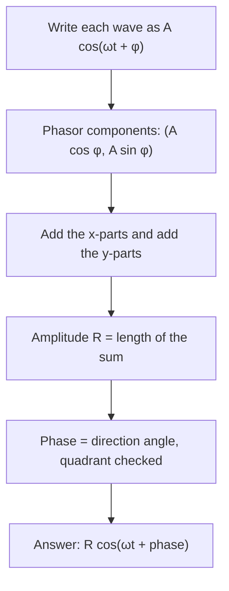

The sum formulas lesson showed that $\sin x + \sqrt3\cos x$ is a single wave, $2\sin(x + \tfrac{\pi}{3})$. That was a small trick there; in engineering it is everyday work. The electricity in a wall socket, the sound from two speakers, and the radio signals reaching an antenna are all waves of one frequency, arriving with different sizes and different timing. Adding them with identities gets messy fast. This lesson shows the engineer's shortcut: draw each wave as an arrow, add the arrows as vectors (Module 8), and read off the result. The arrows are called phasors, and they are also complex numbers (Module 9). At the end you'll use them to analyze a real alternating-current circuit.

## A wave is the shadow of a turning arrow

Picture an arrow of length $A$ that starts at angle $\varphi$ and turns counterclockwise about the origin at a steady angular speed $\omega$ (in radians per second). At time $t$ it points at angle $\omega t + \varphi$, so its $x$-coordinate is
$$A\cos(\omega t + \varphi).$$
That is a sinusoid with amplitude $A$, angular frequency $\omega$ and phase $\varphi$. In other words, *every* sinusoid is the shadow, on the $x$-axis, of a turning arrow.

Now take two sinusoids with the **same** $\omega$. Their arrows turn at the same rate, so they turn together like the spokes of one wheel: the angle between them never changes. The sum of the two shadows is the shadow of the sum of the arrows (the $x$-component of a sum of vectors is the sum of the $x$-components). And the sum of two arrows that turn together is a third arrow turning with them. So:

> The sum of two sinusoids with the same frequency is a sinusoid with that same frequency. Its amplitude and phase come from adding the arrows at $t = 0$.

The arrow at $t = 0$, of length $A$ at angle $\varphi$, is the wave's **phasor**, often written $A\angle\varphi$. It keeps exactly the two facts that differ from wave to wave, size and timing, and leaves out the turning that they all share. The idea was developed for electrical engineering in the 1890s, most famously by Charles Steinmetz.

## Adding phasors

To add $A_1\cos(\omega t + \varphi_1) + A_2\cos(\omega t + \varphi_2)$:



A sine wave is first rewritten as a cosine: $\sin\theta = \cos(\theta - 90^\circ)$, so $A\sin(\omega t + \varphi)$ has phasor $A\angle(\varphi - 90^\circ)$.

### Example 1: two waves, one result

Write $5\cos(\omega t + 20^\circ) + 8\cos(\omega t - 50^\circ)$ as a single cosine.

**Step 1: components.**
$$5\angle 20^\circ = (5\cos 20^\circ,\ 5\sin 20^\circ) \approx (4.698,\ 1.710),$$
$$8\angle(-50^\circ) = (8\cos 50^\circ,\ -8\sin 50^\circ) \approx (5.142,\ -6.128).$$

**Step 2: add.** $(9.840,\ -4.418)$.

**Step 3: length and angle.** $R = \sqrt{9.840^2 + 4.418^2} \approx 10.79$. The point is in quadrant IV with $\tan\varphi = \tfrac{-4.418}{9.840}$, so $\varphi \approx -24.18^\circ$.

**Answer:** $5\cos(\omega t + 20^\circ) + 8\cos(\omega t - 50^\circ) \approx 10.79\cos(\omega t - 24.18^\circ)$.

Notice $10.79 < 5 + 8$. The waves don't peak at the same moment, so they partly work against each other.

```plot
{"x": [-3.2, 6.3], "y": [-12, 12], "functions": [{"f": "5cos(x + 0.34907)", "dashed": true, "label": "5 cos(x + 20°)"}, {"f": "8cos(x - 0.87266)", "dashed": true, "label": "8 cos(x − 50°)"}, {"f": "5cos(x + 0.34907) + 8cos(x - 0.87266)", "label": "sum ≈ 10.79 cos(x − 24.18°)"}], "xLabel": "ωt (radians)", "caption": "The sum of two same-frequency waves is one wave of the same frequency"}
```

## Interference

For the size of the sum alone you don't even need components. The two phasors and their sum form a triangle, and by the law of cosines (with the angle between the arrows equal to the **phase difference** $\Delta = \varphi_2 - \varphi_1$):
$$R^2 = A_1^2 + A_2^2 + 2A_1A_2\cos\Delta.$$
(It is a plus sign because the parallelogram's diagonal is opposite the angle $180^\circ - \Delta$.) Check Example 1: $\Delta = 70^\circ$, and $25 + 64 + 80\cos 70^\circ \approx 116.36$, so $R \approx 10.79$.

- $\Delta = 0^\circ$: the waves peak together and $R = A_1 + A_2$. This is **constructive interference**.
- $\Delta = 180^\circ$: one peaks while the other bottoms out, and $R = |A_1 - A_2|$. This is **destructive interference**. With equal amplitudes the waves cancel completely.

That last case is how noise-cancelling headphones work: a microphone picks up the outside noise and the speaker plays a copy shifted by half a cycle. (Real noise is a mix of many frequencies, so the cancellation is only partial, best for steady low sounds.)

### Example 2: two equal waves, 120° apart

Two speakers each produce a 2-unit tone at your ear, but one arrives $120^\circ$ of a cycle later. How loud is the sum?

$R^2 = 4 + 4 + 8\cos 120^\circ = 8 - 4 = 4$, so $R = 2$. Two waves of size 2 added to give a wave of size 2: the three phasors form an equilateral triangle. In general, two equal waves $A$ with phase difference $\Delta$ give $R = 2A\left|\cos\tfrac{\Delta}{2}\right|$ (a nice use of the half-angle formula, since $1 + \cos\Delta = 2\cos^2\tfrac{\Delta}{2}$).

## Phasors in AC circuits

Household electricity is **alternating current** (AC): the voltage is a sinusoid. In North America it alternates at 60 Hz with a peak of about 170 V (the familiar "120 V" is the root-mean-square value, $170/\sqrt2 \approx 120$). In a circuit driven at one frequency, every voltage and current is a sinusoid of that frequency, so phasors describe them all. Each of the three basic components shifts the timing in its own way. Taking the current as $I\cos\omega t$ (phasor along the positive $x$-axis):

| Component | Voltage amplitude | Voltage phasor direction |
|---|---|---|
| Resistor $R$ | $IR$ | in phase with the current ($0^\circ$) |
| Inductor $L$ | $IX_L$, with $X_L = \omega L$ | leads the current by $90^\circ$ |
| Capacitor $C$ | $IX_C$, with $X_C = \dfrac{1}{\omega C}$ | lags the current by $90^\circ$ |

$X_L$ and $X_C$ are the **inductive and capacitive reactance**, measured in ohms like resistance. (The 90° shifts come from physics: an inductor's voltage depends on how fast the current changes, and a capacitor's on how much charge has built up. Here we take them as given, for ideal components.)

In a **series RLC circuit** the same current flows through all three, and the source voltage is the phasor sum of the three voltages. The inductor and capacitor phasors point in opposite directions, so they partly cancel, and the picture is a right triangle:

$$V = I\sqrt{R^2 + (X_L - X_C)^2} = IZ, \qquad \tan\varphi = \frac{X_L - X_C}{R}.$$

$Z = \sqrt{R^2 + (X_L - X_C)^2}$ is the circuit's **impedance**, its total opposition to the current, and $\varphi$ is the angle by which the source voltage leads the current. Engineers write the impedance as the complex number $Z = R + j(X_L - X_C)$, using $j$ for $\sqrt{-1}$ because $i$ already means current. Its modulus and argument are exactly $Z$ and $\varphi$.


### Example 3: a series RLC circuit

A series circuit has $R = 30\ \Omega$, $L = 0.2$ H and $C = 50\ \mu$F, driven by a 60 Hz source of amplitude 170 V. Find the impedance, the current amplitude, and the phase angle.

**Step 1: angular frequency.** $\omega = 2\pi(60) \approx 376.99$ rad/s.

**Step 2: reactances.** $X_L = 376.99 \times 0.2 \approx 75.40\ \Omega$ and $X_C = \dfrac{1}{376.99 \times 0.00005} \approx 53.05\ \Omega$.

**Step 3: impedance.** $Z = \sqrt{30^2 + (75.40 - 53.05)^2} = \sqrt{900 + 22.35^2} \approx 37.41\ \Omega$.

**Step 4: current.** $I = \dfrac{170}{37.41} \approx 4.544$ A.

**Step 5: phase.** $\tan\varphi = \tfrac{22.35}{30}$, so $\varphi \approx 36.68^\circ$: the voltage leads the current by about $36.7^\circ$.

The picture shows something surprising. The inductor's voltage amplitude is $IX_L \approx 342.6$ V, *twice the source's 170 V*. There's no contradiction: the inductor and capacitor voltages are half a cycle apart, so most of each cancels the other, and only their difference, about 101.6 V, adds to the resistor's 136.3 V. Phasors add as arrows, not as numbers: $\sqrt{136.3^2 + 101.6^2} \approx 170$.

## Resonance

$X_L = \omega L$ grows with frequency while $X_C = \tfrac{1}{\omega C}$ shrinks. At one frequency they are equal, the reactive parts cancel, $Z = R$ is as small as it can be, and the current is largest. That is **resonance**, and setting $\omega L = \tfrac{1}{\omega C}$ gives
$$\omega_0 = \frac{1}{\sqrt{LC}}, \qquad f_0 = \frac{1}{2\pi\sqrt{LC}}.$$
For Example 3's parts, $f_0 = \dfrac{1}{2\pi\sqrt{0.2 \times 0.00005}} \approx 50.3$ Hz. An old-style radio tuner uses the same idea: turning the dial changes a capacitor, which moves the resonant frequency onto the station you want, so that station's signal gets a much stronger response than the others. (Real tuning circuits are often wired differently from this simple series circuit, but the resonance condition is the same.)

The phase angle also controls power. A resistor uses energy; ideal inductors and capacitors only store it and give it back. The average power delivered is $\tfrac12 VI\cos\varphi$ (with peak values), and $\cos\varphi$ is called the **power factor**. In Example 3 it is $\cos 36.68^\circ \approx 0.80$.

## Common mistakes

- **Adding amplitudes as plain numbers.** $5\cos(\omega t + 20^\circ) + 8\cos(\omega t - 50^\circ)$ does not have amplitude 13. Add the phasors as vectors.
- **Mixing sine and cosine.** Convert every wave to one form first: $A\sin(\omega t + \varphi) = A\cos(\omega t + \varphi - 90^\circ)$.
- **Adding waves of different frequencies.** Phasors only work when every wave has the same $\omega$; with different frequencies the arrows drift apart and the sum is not a single sinusoid (that's how beats arise).
- **Forgetting the quadrant** of the resulting phase, as with any vector direction.
- **Using $f$ where $\omega$ belongs.** Reactances use the angular frequency $\omega = 2\pi f$.

## Key points

- $A\cos(\omega t + \varphi)$ is the $x$-shadow of an arrow (its phasor $A\angle\varphi$) turning at rate $\omega$.
- Same-frequency sinusoids add like their phasors: add components, then find length and angle. $R^2 = A_1^2 + A_2^2 + 2A_1A_2\cos\Delta$.
- Phase difference $0^\circ$: constructive interference ($R = A_1 + A_2$); $180^\circ$: destructive ($R = |A_1 - A_2|$).
- Series RLC: $X_L = \omega L$, $X_C = \tfrac{1}{\omega C}$, $Z = \sqrt{R^2 + (X_L - X_C)^2}$, $\tan\varphi = \tfrac{X_L - X_C}{R}$, resonance at $f_0 = \tfrac{1}{2\pi\sqrt{LC}}$.
