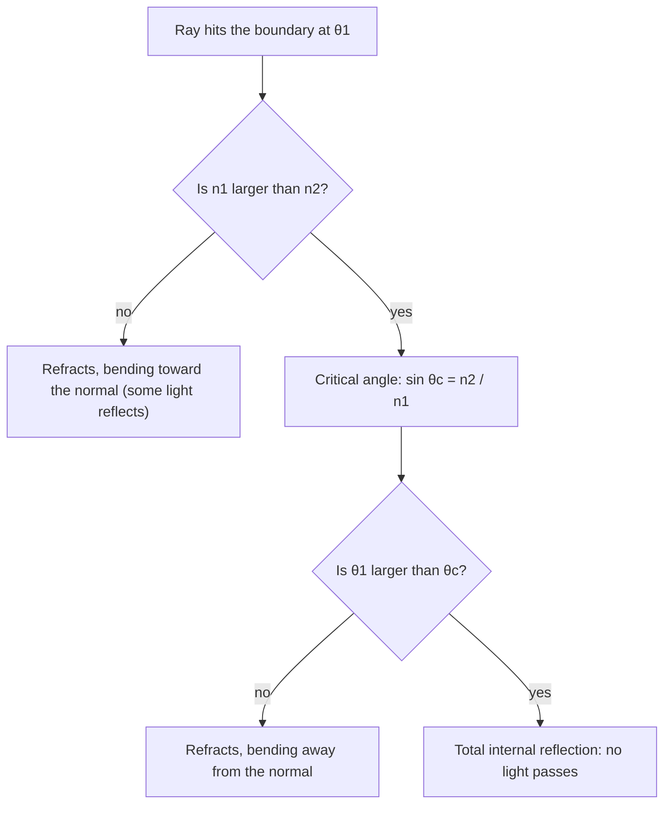

A straw in a glass of water looks broken at the surface. A swimming pool looks shallower than it is. A diamond sparkles far more than a piece of glass cut the same way, and a hair-thin glass fiber can carry an internet connection under an ocean. All of these come from one law about what light does when it crosses from one material into another, and that law is a statement about sines. This lesson uses right-triangle trig (Module 2), inverse sine and its restricted range (Module 5), and a Pythagorean identity (Module 6) to understand it, and shows where the law itself comes from.

## Angles from the normal

When a ray of light hits a flat boundary, such as the surface of water, optics measures every angle from the **normal**: the line perpendicular to the boundary at the point where the ray hits. (Measuring from the surface instead gives the complementary angles, and the formulas below would change sines into cosines.)


Three rays meet at that point:

- the **incident ray** arrives at the **angle of incidence** $\theta_1$;
- part of the light bounces back as the reflected ray, and the **law of reflection** says it leaves at the same angle, $\theta_1$, on the other side of the normal;
- the rest crosses the boundary as the refracted ray, at the **angle of refraction** $\theta_2$.

The bending of the ray as it crosses is called **refraction**.

## Snell's law

Each transparent material has an **index of refraction** $n$: the speed of light in a vacuum, $c$, divided by its speed in the material, $n = \tfrac{c}{v}$. Light travels more slowly in a material than in a vacuum, so $n \ge 1$, and the larger $n$ is, the slower the light (such a material is called optically denser). Some typical values (they vary slightly with the color of the light): air $1.0003$ (we'll use $1.00$), water $1.33$, ordinary glass about $1.5$, diamond $2.42$.

**Snell's law** connects the two angles:
$$n_1\sin\theta_1 = n_2\sin\theta_2.$$

Read it as a balance: the quantity $n\sin\theta$ is the same on both sides of the boundary. Going into a material with a larger $n$, $\sin\theta$ must get smaller, so the ray bends *toward* the normal. Going into a smaller $n$, it bends *away*. A ray along the normal ($\theta_1 = 0$) doesn't bend at all.

The law has a long history. Ibn Sahl described it in Baghdad in 984, in a work on burning mirrors and lenses; Thomas Harriot found it again in 1602 and Willebrord Snellius in 1621, but neither published it. René Descartes published it in 1637, and it carries Snellius's name today.

### Example 1: into water

Light in air strikes a calm lake at $40^\circ$ from the normal. At what angle does it travel in the water?

**Step 1: set up.** $1.00\sin 40^\circ = 1.33\sin\theta_2$.

**Step 2: solve for the sine.** $\sin\theta_2 = \dfrac{\sin 40^\circ}{1.33} \approx \dfrac{0.6428}{1.33} \approx 0.4833$.

**Step 3: inverse sine.** $\theta_2 = \sin^{-1} 0.4833 \approx 28.90^\circ$.

Is there a second angle with this sine, $180^\circ - 28.90^\circ$? Not here: refraction angles are measured from the normal and lie between $0^\circ$ and $90^\circ$, which is exactly the range where $\sin^{-1}$ gives the one right answer. The ray bent toward the normal, as it should when $n$ increases.

## Why sines? A derivation from waves

Christiaan Huygens explained the law in 1678 by treating light as a wave. Think of a straight wavefront (a line of crests, perpendicular to the rays) arriving at the boundary at an angle. One end of it, at $A$, touches the boundary first. During the time $t$ that the other end needs to reach the boundary at $B$, traveling the distance $v_1 t$, the light that entered at $A$ has spread into the second material, but only a distance $v_2 t$, because it moves at a different speed there.

```shape
{"segments": [{"from": [-1.2, 0], "to": [5.2, 0]}, {"from": [0, 0], "to": [4, 0], "label": "AB"}, {"from": [0, 0], "to": [1.653, 1.97], "dashed": true}, {"from": [1.653, 1.97], "to": [4, 0], "label": "v₁t", "arrow": true}, {"from": [0, 0], "to": [1.043, -1.756], "label": "v₂t", "arrow": true}, {"from": [1.043, -1.756], "to": [4, 0], "dashed": true}], "rightAngles": [[[1.653, 1.97], [0, 0], [4, 0]], [[1.043, -1.756], [0, 0], [4, 0]]], "points": [{"at": [0, 0]}, {"at": [4, 0], "label": "B"}], "labels": [{"at": [-0.2, 0.25], "text": "A"}, {"at": [-1, 0.45], "text": "medium 1"}, {"at": [-1, -0.45], "text": "medium 2"}], "caption": "Dashed lines are wavefronts. Two right triangles share the hypotenuse AB: sin θ₁ = v₁t / AB and sin θ₂ = v₂t / AB."}
```

The two dashed wavefronts and the boundary make two right triangles that share the hypotenuse $AB$. The wavefront's angle with the boundary equals the ray's angle with the normal (both are the ray's direction turned by $90^\circ$), so
$$\sin\theta_1 = \frac{v_1 t}{AB}, \qquad \sin\theta_2 = \frac{v_2 t}{AB}.$$
Divide: $\dfrac{\sin\theta_1}{\sin\theta_2} = \dfrac{v_1}{v_2} = \dfrac{c/n_1}{c/n_2} = \dfrac{n_2}{n_1}$, which is Snell's law. The sines appear because each one is a side over the shared hypotenuse.

## Total internal reflection

Now send light the other way, from water ($n_1 = 1.33$) up into air ($n_2 = 1.00$). Then $\sin\theta_2 = 1.33\sin\theta_1$, which is *larger* than $\sin\theta_1$. At $\theta_1 = 30^\circ$, $\sin\theta_2 = 0.665$ and $\theta_2 \approx 41.68^\circ$. But at $\theta_1 = 60^\circ$, Snell's law asks for $\sin\theta_2 \approx 1.152$, and no angle has a sine bigger than 1.

Physics agrees with the algebra: no light gets out. All of it reflects back into the water. This is **total internal reflection**. It begins at the **critical angle** $\theta_c$, where the refracted ray would just skim along the surface ($\theta_2 = 90^\circ$):
$$n_1\sin\theta_c = n_2\sin 90^\circ \quad\Longrightarrow\quad \sin\theta_c = \frac{n_2}{n_1} \qquad (n_1 > n_2).$$
It can only happen going from a larger index to a smaller one; otherwise $\tfrac{n_2}{n_1} > 1$ and there is no critical angle.



### Example 2: critical angles

Find the critical angle for water to air and for diamond to air.

**Water:** $\sin\theta_c = \tfrac{1.00}{1.33} \approx 0.7519$, so $\theta_c \approx 48.75^\circ$. A diver looking up sees the whole sky squeezed into a circle about $2 \times 48.75^\circ \approx 97.5^\circ$ across; beyond it, the surface acts like a mirror.

**Diamond:** $\sin\theta_c = \tfrac{1.00}{2.42} \approx 0.4132$, so $\theta_c \approx 24.41^\circ$. That small critical angle is a big part of why diamonds sparkle: light that enters a well-cut stone hits the back faces at more than $24.4^\circ$, is totally reflected, and comes back out the top. Glass, with $\theta_c \approx 41.8^\circ$, traps far less.

## Optical fibers

An optical fiber is a thin glass **core** surrounded by a **cladding** of glass with a slightly smaller index. Light traveling along the core strikes the core–cladding wall at a steep angle from the normal, beyond the critical angle, so it is totally reflected again and again and is carried along, around gentle bends, with very little loss.

Light entering the end of the fiber from the air must not come in too steeply, or it will hit the wall below the critical angle and leak out. Let the light enter at angle $\theta_a$ (from the fiber's axis) and refract to angle $r$ inside the core, with index $n_1$. The ray then hits the side wall at $90^\circ - r$ from *its* normal, since the wall is perpendicular to the end face. For the largest allowed $\theta_a$, that wall angle is exactly critical: $\sin(90^\circ - r) = \tfrac{n_2}{n_1}$, that is, $\cos r = \tfrac{n_2}{n_1}$. Then Snell's law at the end face, plus the Pythagorean identity, gives
$$\sin\theta_a = n_1\sin r = n_1\sqrt{1 - \cos^2 r} = n_1\sqrt{1 - \frac{n_2^2}{n_1^2}} = \sqrt{n_1^2 - n_2^2}.$$
The number $\sqrt{n_1^2 - n_2^2}$ is the fiber's **numerical aperture**, and $\theta_a$ is its **acceptance angle**. (This ray picture is a simplification; very thin fibers need the full wave theory of light.)

### Example 3: a fiber's acceptance angle

A fiber has core index $1.48$ and cladding index $1.46$. Find its numerical aperture and acceptance angle in air.

**Step 1:** $n_1^2 - n_2^2 = 2.1904 - 2.1316 = 0.0588$.

**Step 2:** numerical aperture $= \sqrt{0.0588} \approx 0.2425$.

**Step 3:** $\theta_a = \sin^{-1} 0.2425 \approx 14.03^\circ$. Light arriving within about $14^\circ$ of the axis is trapped and carried along the fiber.

Notice how small the index difference is, yet total internal reflection still works: the critical angle at the wall is $\sin^{-1}\tfrac{1.46}{1.48} \approx 80.6^\circ$, so rays running nearly parallel to the axis, which meet the wall at nearly $90^\circ$ from its normal, are trapped.

## Common mistakes

- **Measuring from the surface.** Snell's law uses angles from the normal. If a problem gives the angle with the surface, subtract it from $90^\circ$ first.
- **Swapping $n_1$ and $n_2$.** $n_1$ belongs to the side the light comes *from*. Check the direction of bending: toward the normal when entering a larger $n$.
- **Taking the inverse sine of a number above 1.** That isn't a calculator error to fix; it means total internal reflection.
- **Using a critical angle when going into a denser material.** Light going from air into water always gets in (partly); total internal reflection needs $n_1 > n_2$.

## Key points

- Angles are measured from the normal. Reflection: angle out = angle in.
- Snell's law: $n_1\sin\theta_1 = n_2\sin\theta_2$, with $n = \tfrac{c}{v}$. It follows from two right triangles sharing a hypotenuse.
- Entering a larger $n$, the ray bends toward the normal; entering a smaller $n$, away from it.
- Critical angle: $\sin\theta_c = \tfrac{n_2}{n_1}$ (only when $n_1 > n_2$). Beyond it, total internal reflection.
- A fiber's numerical aperture is $\sin\theta_a = \sqrt{n_1^2 - n_2^2}$.
