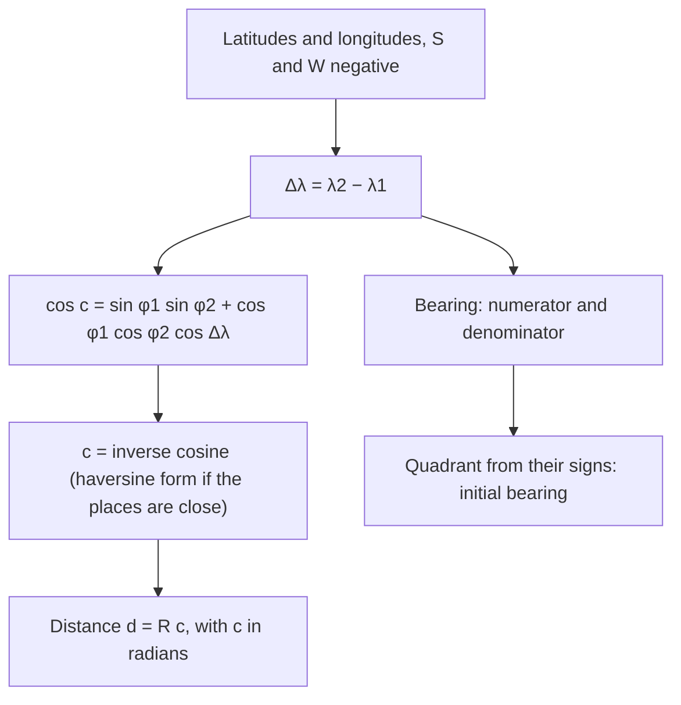

New York and Madrid are at almost the same latitude, about $40.5^\circ$ N. So a flight between them should head due east, right? It doesn't. The shortest route leaves New York heading east-northeast, bulges north to about $46^\circ$ N over the Atlantic, and comes down into Spain from the northwest. (Real flights also bend their routes to use or avoid the winds, but they start from this one.) The reason is that the Earth is (nearly) a sphere, and on a sphere the shortest path between two points is an arc of a great circle, a circle whose center is the center of the sphere. This lesson computes those arcs. It brings together the dot product (Module 8), the difference formula for cosine (Module 6), the law of cosines (Module 7) and inverse trig (Module 5), and it ends with a fact that surprises everyone the first time: the angles of a triangle on a sphere add up to *more* than $180^\circ$.

Throughout, we treat the Earth as a sphere of radius $R = 6371$ km (its mean radius). The real Earth is slightly flattened at the poles, so distances computed this way can be off by up to about half a percent; airlines and GPS receivers use a more exact ellipsoid model, but the spherical answer is the standard first approximation.

## Positions as angles

A place is given by two angles. Its latitude $\varphi$ is its angle north (positive) or south (negative) of the equator, measured at the Earth's center. Its longitude $\lambda$ is its angle east (positive) or west (negative) of the prime meridian through Greenwich, England. New York is at about $(40.71^\circ, -74.01^\circ)$ and Madrid at about $(40.42^\circ, -3.70^\circ)$.

The distance along the surface between two places is an arc, so by $s = r\theta$ (Lesson 3),
$$d = R\,c,$$
where $c$ is the **central angle** between them, in radians. Everything comes down to finding $c$.

## The central angle from the dot product

Put the Earth's center at the origin of a 3-D coordinate system, with the $z$-axis through the North Pole and the $x$-axis through the point at latitude $0^\circ$, longitude $0^\circ$. The point at latitude $\varphi$ and longitude $\lambda$ on a sphere of radius 1 is
$$\mathbf{u} = \langle \cos\varphi\cos\lambda,\ \cos\varphi\sin\lambda,\ \sin\varphi\rangle.$$
(Go up to height $\sin\varphi$; the remaining horizontal distance $\cos\varphi$ splits into $x$ and $y$ parts by the angle $\lambda$, exactly like polar coordinates.)

Vectors in space work like vectors in the plane with one more component: the dot product is $\mathbf{u}\cdot\mathbf{v} = u_1v_1 + u_2v_2 + u_3v_3$, and it still equals $|\mathbf{u}||\mathbf{v}|\cos c$, where $c$ is the angle between them. For two unit vectors,
$$\cos c = \cos\varphi_1\cos\varphi_2(\cos\lambda_1\cos\lambda_2 + \sin\lambda_1\sin\lambda_2) + \sin\varphi_1\sin\varphi_2.$$
The parentheses are the cosine difference formula, $\cos(\lambda_2 - \lambda_1)$. Writing $\Delta\lambda = \lambda_2 - \lambda_1$:
$$\cos c = \sin\varphi_1\sin\varphi_2 + \cos\varphi_1\cos\varphi_2\cos\Delta\lambda.$$
The **great-circle distance** is then $d = R\,c$ with $c = \cos^{-1}(\ldots)$ in radians. The range of $\cos^{-1}$, $0$ to $\pi$, is exactly right: the shorter arc between two points is never more than half a great circle.

### Example 1: New York to Madrid

**Step 1: the pieces.** $\Delta\lambda = -3.70^\circ - (-74.01^\circ) = 70.31^\circ$.
$\sin 40.71^\circ\,\sin 40.42^\circ \approx 0.42290$ and $\cos 40.71^\circ\,\cos 40.42^\circ\,\cos 70.31^\circ \approx 0.57709 \times 0.33693 \approx 0.19444$.

**Step 2: the central angle.** $\cos c \approx 0.42290 + 0.19444 = 0.61734$, so $c \approx 51.88^\circ \approx 0.9054$ rad.

**Step 3: the distance.** $d \approx 6371 \times 0.9054 \approx 5769$ km.

For comparison, holding a due-east course along the $40.5^\circ$ parallel would cover about 5,940 km, roughly 170 km farther. A circle of latitude is not a great circle (its center is on the Earth's axis, not at the Earth's center), so it is not the shortest route.

## The spherical triangle behind the formula

There is a second way to see the same formula, and it explains its name. Join the North Pole $N$ and the two places $A$ and $B$ by great-circle arcs. The result is a **spherical triangle**: three points on a sphere joined by great-circle arcs.

On a sphere, a side is measured by the central angle it spans. The side from $N$ to $A$ runs down a meridian from latitude $90^\circ$ to $\varphi_1$, so it is $90^\circ - \varphi_1$, called the **colatitude** of $A$. The angle at the pole is the difference in longitude, $\Delta\lambda$. Write $a = 90^\circ - \varphi_2$ and $b = 90^\circ - \varphi_1$; then $\cos a = \sin\varphi_2$ and $\sin a = \cos\varphi_2$ (cofunctions), and the formula above becomes
$$\cos c = \cos a\cos b + \sin a\sin b\cos C,$$
where $C = \Delta\lambda$ is the angle opposite side $c$. This is the **spherical law of cosines**, and it holds for every spherical triangle (sides measured as central angles). Compare it with the flat law of cosines, $c^2 = a^2 + b^2 - 2ab\cos C$.

They agree for small triangles. If $a$, $b$ and $c$ are small (in radians), use the small-angle approximations $\cos x \approx 1 - \tfrac{x^2}{2}$ and $\sin x \approx x$:
$$1 - \tfrac{c^2}{2} \approx \left(1 - \tfrac{a^2}{2}\right)\left(1 - \tfrac{b^2}{2}\right) + ab\cos C.$$
Expand, drop the tiny $\tfrac{a^2b^2}{4}$ term, and multiply by $-2$: $c^2 \approx a^2 + b^2 - 2ab\cos C$. On a patch of the Earth small enough to look flat, spherical trig turns into ordinary trig.

## Which way to head: the initial bearing

The direction to start out in, measured clockwise from north, is the **initial bearing**. Working in the same spherical triangle (with the spherical law of sines and cosines, which we won't derive here), it satisfies
$$\tan\theta = \frac{\sin\Delta\lambda\,\cos\varphi_2}{\cos\varphi_1\sin\varphi_2 - \sin\varphi_1\cos\varphi_2\cos\Delta\lambda},$$
with the quadrant chosen from the signs of the numerator ($\sin\theta$ side, east or west) and the denominator ($\cos\theta$ side, north or south), just as for a vector direction. Programs use `atan2(numerator, denominator)`.

### Example 2: the heading out of New York

**Numerator:** $\sin 70.31^\circ\cos 40.42^\circ \approx 0.7168$.
**Denominator:** $\cos 40.71^\circ\sin 40.42^\circ - \sin 40.71^\circ\cos 40.42^\circ\cos 70.31^\circ \approx 0.3242$.

Both are positive, so the bearing is in the northeast quadrant: $\theta = \tan^{-1}\tfrac{0.7168}{0.3242} \approx 65.7^\circ$. A plane bound for Madrid, which lies almost due east, sets off about $24^\circ$ north of east.

Along a great circle the bearing keeps changing (only routes along a meridian or the equator hold a fixed heading). A path that keeps one fixed bearing is a **rhumb line**. It is easier to steer, which is why sailors long preferred it, but except along a meridian or the equator it is longer than the great-circle route. Before computers, navigators approximated a great circle by a chain of short rhumb lines, changing heading every so often.

## Rounding trouble and the haversine formula

The law-of-cosines formula has a weakness for nearby points. Two places 1 km apart have $c = \tfrac{1}{6371} \approx 0.000157$ rad, so $\cos c \approx 0.9999999877$. A calculator that keeps 8 significant digits stores this as $0.99999999$, and $\cos^{-1} 0.99999999 \approx 0.000141$ rad, which gives about 0.90 km: a 10% error from rounding alone. The trouble is that $\cos c$ changes very slowly near $c = 0$, so tiny rounding in $\cos c$ means large errors in $c$.

The cure uses the half-angle idea. The *haversine* is $\text{hav}\,\theta = \sin^2\tfrac{\theta}{2} = \tfrac{1 - \cos\theta}{2}$. Rewriting the law of cosines in haversines (a page of identities, which we skip) gives the **haversine formula**:
$$\text{hav}\,c = \text{hav}(\varphi_2 - \varphi_1) + \cos\varphi_1\cos\varphi_2\,\text{hav}\,\Delta\lambda, \qquad c = 2\sin^{-1}\sqrt{\text{hav}\,c}.$$
For small distances everything in it is small, and small numbers keep their significant digits, so it stays accurate. That's why navigation software uses this form. For New York to Madrid it gives the same 5769 km.

## Triangles with too many degrees

Draw a spherical triangle with one corner at the North Pole and two on the equator, $90^\circ$ of longitude apart. Each meridian meets the equator at a right angle, and the angle at the pole is $90^\circ$. The three angles add up to $270^\circ$!

On a sphere the angle sum of every triangle is more than $180^\circ$. The extra amount is the **spherical excess**, $E = A + B + C - 180^\circ$, and a theorem usually credited to Albert Girard (1629) says it measures the area:
$$\text{Area} = R^2 E, \qquad E \text{ in radians}.$$

### Example 3: one eighth of the world

For the pole-and-equator triangle, $E = 270^\circ - 180^\circ = 90^\circ = \tfrac{\pi}{2}$, so the area is $\tfrac{\pi}{2}R^2 \approx \tfrac{\pi}{2}(6371)^2 \approx 63.8$ million km². The whole sphere has area $4\pi R^2$, and $\tfrac{\pi/2}{4\pi} = \tfrac18$. Check: the triangle is one of the eight pieces made by the equator and two perpendicular meridian planes. Small triangles have small excess, which is why the flat angle sum of $180^\circ$ works so well for a field or a city.

## Common mistakes

- **Forgetting radians.** $d = Rc$ needs $c$ in radians. With $c$ in degrees, use $d = 2\pi R\cdot\tfrac{c}{360^\circ}$.
- **Signs of south and west.** Southern latitudes and western longitudes are negative; $\Delta\lambda$ for New York to Madrid is $-3.70 - (-74.01) = 70.31$, not $77.71$.
- **Treating latitude and longitude as flat $x$ and $y$.** A degree of longitude is about 111 km at the equator but shrinks by the factor $\cos\varphi$ toward the poles.
- **Assuming the bearing stays fixed.** The great-circle bearing changes along the route; the formula gives only the starting direction.
- **Using the cosine formula for very short distances** with too few digits; use the haversine form.

## Key points

- Great-circle distance: $\cos c = \sin\varphi_1\sin\varphi_2 + \cos\varphi_1\cos\varphi_2\cos\Delta\lambda$ and $d = Rc$ (radians), from the dot product and the cosine difference formula.
- It is the spherical law of cosines, $\cos c = \cos a\cos b + \sin a\sin b\cos C$, applied to the triangle formed with the North Pole; for small triangles it becomes the flat law of cosines.
- Initial bearing: $\tan\theta = \dfrac{\sin\Delta\lambda\cos\varphi_2}{\cos\varphi_1\sin\varphi_2 - \sin\varphi_1\cos\varphi_2\cos\Delta\lambda}$, quadrant from the signs.
- The haversine form avoids rounding trouble for nearby points.
- Spherical triangles have angle sums over $180^\circ$; the excess gives the area, $R^2E$.
