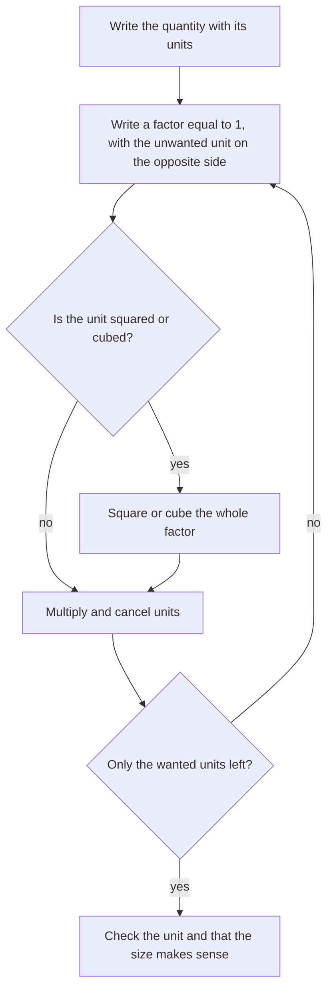
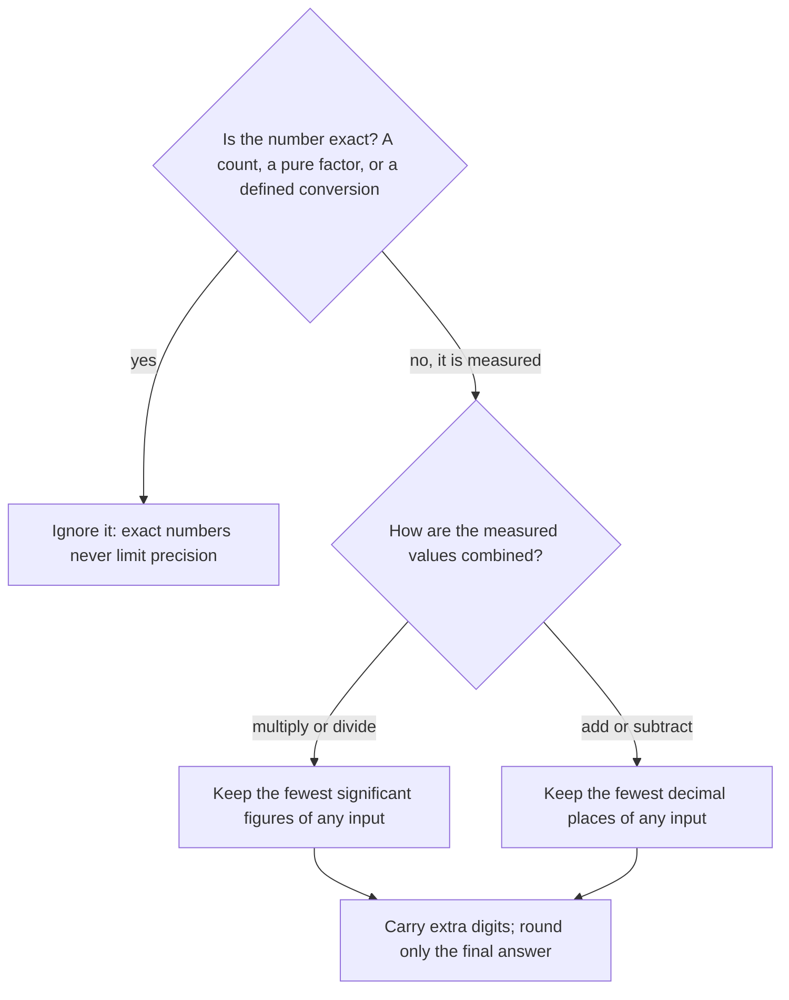

## Why physics starts with measurement

Physics makes claims you can test, and testing means measuring. Every physical quantity in this course is a number times a unit: "3.2 m" means 3.2 copies of the standard length called a meter. Drop the unit and the number means nothing, so a habit worth building on day one is to carry units through every line of every calculation. This lesson sets up three tools you will use in all the others: the SI unit system with its prefixes, the rules for honest precision (significant figures), and dimensional analysis, which catches mistakes before they cost you.

## SI units and prefixes

The international system (**SI units**) builds everything from seven base units. The four you will meet most are the meter (m) for length, the kilogram (kg) for mass, the second (s) for time, and the ampere (A) for current; the kelvin (K), mole (mol) and candela complete the set. Every other unit is a **derived unit**, a product or quotient of base units. Speed is m/s, acceleration m/s², and the newton is defined so that $1\text{ N} = 1\text{ kg·m/s}^2$ (it is the force that gives 1 kg an acceleration of 1 m/s²). The joule is $1\text{ J} = 1\text{ N·m} = 1\text{ kg·m}^2/\text{s}^2$, and the watt is $1\text{ W} = 1\text{ J/s}$.

Prefixes scale a unit by powers of ten:

| Prefix | Symbol | Factor | Prefix | Symbol | Factor |
|---|---|---|---|---|---|
| giga | G | $10^{9}$ | centi | c | $10^{-2}$ |
| mega | M | $10^{6}$ | milli | m | $10^{-3}$ |
| kilo | k | $10^{3}$ | micro | μ | $10^{-6}$ |
| | | | nano | n | $10^{-9}$ |

Large and small values are written in **scientific notation**, $a \times 10^n$ with $1 \le |a| < 10$: the mass of an electron is $9.11 \times 10^{-31}$ kg, far easier to read than thirty zeros.

## Converting units

A **conversion factor** is a fraction equal to 1, such as $\dfrac{1000\text{ m}}{1\text{ km}}$. Multiplying by 1 changes nothing physical, so you may multiply by as many conversion factors as you like, choosing each one so that the unwanted unit cancels.

### Example 1

Convert a highway speed of 108 km/h to m/s.

Write the quantity, then multiply by factors that cancel km and h:

$$108\,\frac{\text{km}}{\text{h}} \times \frac{1000\text{ m}}{1\text{ km}} \times \frac{1\text{ h}}{3600\text{ s}} = \frac{108\,000}{3600}\,\frac{\text{m}}{\text{s}} = 30\text{ m/s}.$$

Check: km cancels against km, h against h, leaving m/s. A useful shortcut follows: dividing km/h by 3.6 gives m/s.

When a unit is squared or cubed, the conversion factor must be squared or cubed too. Since $1\text{ cm} = 10^{-2}\text{ m}$, we get $1\text{ cm}^2 = (10^{-2}\text{ m})^2 = 10^{-4}\text{ m}^2$ and $1\text{ cm}^3 = 10^{-6}\text{ m}^3$. Forgetting to square the factor is the most common conversion error in the whole course.

### Example 2

A plate has area 250 cm². What is its area in m²?

$$250\text{ cm}^2 \times \left(\frac{1\text{ m}}{100\text{ cm}}\right)^2 = 250 \times 10^{-4}\text{ m}^2 = 0.025\text{ m}^2.$$

If you had used $\tfrac{1}{100}$ instead of $\left(\tfrac{1}{100}\right)^2$ you would get 2.5 m², a plate the size of a dining table.

The whole procedure fits in one loop: keep multiplying by factors of 1 until only the units you want are left.

## Significant figures

No measurement is exact. A ruler marked in millimeters lets you read a length as 12.3 cm with the last digit estimated; writing 12.300 cm would claim precision you don't have. **Significant figures** (sig figs) are the digits that carry real information. The rules:

- Nonzero digits are significant: 4.56 has three.
- Zeros between nonzero digits are significant: 2.05 has three.
- Leading zeros only place the decimal point: 0.0071 has two.
- Trailing zeros after a decimal point are significant: 3.400 has four.
- Trailing zeros in a whole number without a decimal point are ambiguous: write 1200 as $1.2 \times 10^3$ (two) or $1.200 \times 10^3$ (four) to be clear.

Scientific notation removes every ambiguity, because all digits in $a$ are significant.

*Calculating with measured values.* The result can't be more reliable than the weakest input, but "weakest" means different things for different operations:

- *Multiplying or dividing*: keep as many sig figs as the input with the fewest sig figs.
- *Adding or subtracting*: keep as many decimal places as the input with the fewest decimal places.

Exact numbers (counted objects, the 2 in $2\pi r$, defined conversions like 100 cm = 1 m) never limit precision. Round only at the end; carry an extra digit or two through intermediate steps.

This chart sums up which rule applies.

### Example 3

A rectangle measures 4.52 m by 2.1 m. Report its area.

$4.52 \times 2.1 = 9.492$. The inputs have 3 and 2 sig figs, so the answer gets 2: area $= 9.5\text{ m}^2$.

Now add masses of 12.41 kg and 3.2 kg: $15.61$, but 3.2 is known only to tenths, so report 15.6 kg.

**Accuracy** and **precision** are different ideas. Accuracy is how close a result is to the true value; precision is how tightly repeated measurements cluster (and how many digits you can justify). A miscalibrated scale can be very precise and still inaccurate.

The classic picture is four targets, each hit six times. The center stands for the true value.

## Dimensional analysis

Every quantity has a **dimension**: length [L], mass [M], time [T], and so on. Speed has dimension [L]/[T], acceleration [L]/[T]², force [M][L]/[T]². **Dimensional analysis** rests on one fact: you can only add, subtract or equate quantities with the same dimension. So both sides of any correct equation must match dimensionally, term by term.

That gives a fast sanity test. Is $x = v_0 t + \tfrac12 a t^2$ plausible? $[v_0 t] = \tfrac{L}{T}\cdot T = L$ and $[a t^2] = \tfrac{L}{T^2}\cdot T^2 = L$. Every term is a length, as $x$ is. If you derive $x = v_0 t^2$, the check fails ($[L][T]$), so you know an error crept in. The pure number $\tfrac12$ has no dimension, so dimensional analysis can't detect a wrong numerical factor; it catches wrong powers and missing quantities.

### Example 4

A pendulum's period $T$ might depend on its length $L$, the bob's mass $m$, and $g$ (dimension [L]/[T]²). Find the form of the relationship.

Suppose $T = C\,L^a m^b g^c$ with $C$ a pure number. Dimensions: $[T]^1 = [L]^a [M]^b [L]^c [T]^{-2c}$. Matching powers: mass gives $b = 0$; time gives $-2c = 1$, so $c = -\tfrac12$; length gives $a + c = 0$, so $a = \tfrac12$. Therefore $T = C\sqrt{L/g}$. The mass drops out, and the full theory later supplies $C = 2\pi$.

Arguments of functions like $\sin$, $e^x$ and $\ln$ must be dimensionless, which is another quick check: $e^{-t/\tau}$ makes sense only if $\tau$ is a time.

## Estimation and orders of magnitude

Physicists often estimate before calculating. An **order of magnitude** is the power of ten nearest a value: a person's mass (70 kg) is order $10^2$ kg. Rough estimates ("how many heartbeats in a lifetime?" about $70\text{ beats/min} \times 5\times10^5\text{ min/yr} \times 80\text{ yr} \approx 3\times10^9$) tell you whether a precise answer is reasonable.

## Units of derivatives and integrals

Units follow calculus operations naturally. A derivative $\dfrac{dx}{dt}$ is a ratio of small changes, so its unit is (unit of $x$)/(unit of $t$): position in m gives velocity in m/s. An integral $\int f\,dt$ is a sum of products $f\,\Delta t$, so its unit is (unit of $f$)·(unit of $t$): integrating velocity (m/s) over time (s) gives meters. Keep this in mind when checking calculus-based formulas: $\int F\,dx$ has units N·m = J, which is why it can be an energy.

## Common mistakes

- Converting area or volume with an unsquared or uncubed factor (cm² to m² is $10^{-4}$, not $10^{-2}$).
- Dropping units midway and then guessing them at the end.
- Rounding intermediate results, so the final answer drifts.
- Applying the multiplication rule to addition (or the reverse).
- Treating "dimensionally correct" as "correct": a missing factor of 2 passes the check.

## Key points

- Every quantity is a number times a unit; SI base units include m, kg, s, A, K, mol.
- Convert by multiplying by factors equal to 1; square or cube them for areas and volumes.
- Multiply/divide: fewest sig figs. Add/subtract: fewest decimal places. Exact numbers don't count.
- Equations must be dimensionally consistent; function arguments must be dimensionless.
- Derivatives divide units; integrals multiply them.
