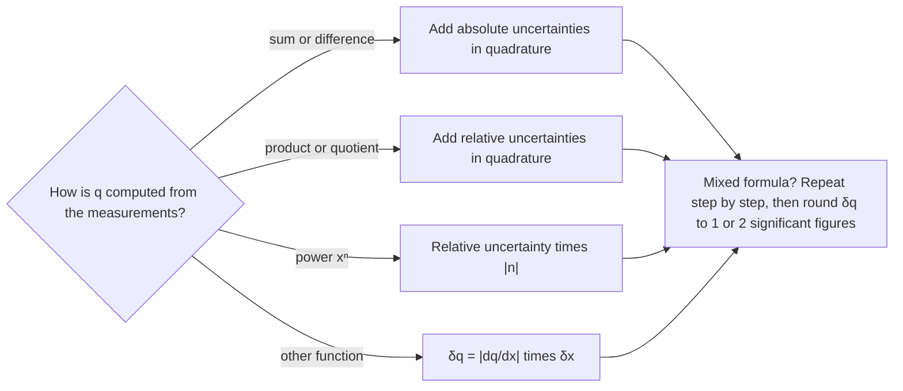

## Beyond significant figures

The measurement lesson used significant figures to show roughly how well a number is known: 12.3 cm claims a tenth of a centimeter, 12.300 cm claims much more. That shorthand is fine for homework, but a lab report needs to say exactly how far the true value could be from your result, and to work out how that doubt carries into anything you calculate from it. This lesson does both. It covers how to state an uncertainty, how to get one from repeated readings, how uncertainties combine in sums, products, powers and general functions, and how to decide whether your result agrees with someone else's.

## Stating a result with its uncertainty

A measured result is written as a best estimate plus or minus an uncertainty, $x \pm \delta x$. The **uncertainty** $\delta x$ (also called the absolute uncertainty) has the same units as $x$ and marks the range the true value probably lies in. For example, $L = 0.750 \pm 0.002$ m says the length is most likely between 0.748 m and 0.752 m.

Often the more telling number is the **relative uncertainty**, $\delta x / |x|$, usually given as a percentage. It has no units, so you can compare the quality of a length with the quality of a time: $0.002/0.750 = 0.27\%$.

A common convention for reporting:

- Round the uncertainty to one significant figure, or two if its first digit is 1 (0.0634 becomes 0.06; 0.0147 becomes 0.015).
- Round the best estimate to the same decimal place as the uncertainty: $9.8134 \pm 0.0634$ is reported as $9.81 \pm 0.06$.

Writing $9.8134 \pm 0.06$ makes no sense: if the second decimal place is uncertain, the third and fourth carry no information.

Where does a first uncertainty come from? For a single reading, from the instrument. On an analog scale, people often take half the smallest division (some labs use the whole division); on a digital display, one unit in the last digit unless the manufacturer states more. These are conventions, not laws, so say which one you used.

## Two kinds of error

In measurement, "error" means the difference from the true value, not a blunder. It comes in two kinds:

- **Random error** scatters repeated readings above and below the true value: your reaction time with a stopwatch, a needle that jitters, estimating between scale marks. Averaging many readings reduces its effect.
- **Systematic error** shifts every reading the same way: a scale that reads 0.5 g with nothing on it, a ruler with a worn end, a pendulum length measured to the wrong point. Averaging does nothing to it, since every reading carries the same shift. You find it only by checking the method or calibrating against a known standard.

These match the measurement lesson's two ideas. Random error limits precision; systematic error limits accuracy.

## Repeated readings: mean, standard deviation, standard error

When you can repeat a measurement $n$ times, statistics gives a better uncertainty than any instrument rule. The best estimate is the mean,
$$\bar x = \frac{1}{n}\sum_{i=1}^{n} x_i.$$

The spread of single readings is the sample **standard deviation**,
$$s = \sqrt{\frac{1}{n-1}\sum_{i=1}^{n}(x_i - \bar x)^2},$$
which tells you how far a typical single reading lies from the mean. (The $n-1$ instead of $n$ corrects for the fact that the mean was computed from the same data.)

But you report the mean, not one reading, and the mean is more reliable than any one reading. Its uncertainty is the **standard error of the mean**,
$$\delta \bar x = \frac{s}{\sqrt n}.$$

The $\sqrt n$ is the reason averaging helps, and also the reason it helps slowly: four times as many readings only halve the uncertainty. It shrinks random error only; a systematic shift stays the same however many readings you take.

### Example 1

A student times a cart down a track five times: 2.43, 2.51, 2.38, 2.47 and 2.46 s. Report the time with its uncertainty.

Mean: $(2.43 + 2.51 + 2.38 + 2.47 + 2.46)/5 = 12.25/5 = 2.450$ s.

Deviations from the mean: $-0.02,\ 0.06,\ -0.07,\ 0.02,\ 0.01$ s. Their squares add to $0.0004 + 0.0036 + 0.0049 + 0.0004 + 0.0001 = 0.0094\text{ s}^2$.

Standard deviation: $s = \sqrt{0.0094/4} = \sqrt{0.00235} = 0.048$ s. A single timing is good to about ±0.05 s.

Standard error: $\delta\bar t = 0.048/\sqrt5 = 0.022$ s. Report $t = 2.45 \pm 0.02$ s.

## Propagating uncertainty through a calculation

Usually the quantity you want is calculated, not measured: a density from a mass and a volume, $g$ from a pendulum's length and period. **Propagation of uncertainty** works out how the input uncertainties feed into the result.

*Sums and differences.* If $q = x + y$ or $q = x - y$, the worst case is that both errors push the same way, giving $\delta q = \delta x + \delta y$. But when the errors are random and independent, they are unlikely to both be at their extremes at once, and the realistic estimate is to add them in quadrature:
$$\delta q = \sqrt{(\delta x)^2 + (\delta y)^2}.$$
**Adding in quadrature** (the square root of the sum of squares, like the Pythagorean theorem) always gives less than the plain sum. It follows from a result in statistics: for independent errors, the squares of the standard deviations (the variances) add. Note that the uncertainties add even when the quantities are subtracted.

*Products and quotients.* If $q = xy$ or $q = x/y$, the relative uncertainties add in quadrature:
$$\frac{\delta q}{|q|} = \sqrt{\left(\frac{\delta x}{x}\right)^2 + \left(\frac{\delta y}{y}\right)^2}.$$

*Powers.* If $q = x^n$, then $\dfrac{\delta q}{|q|} = |n|\,\dfrac{\delta x}{|x|}$. Squaring a quantity doubles its relative uncertainty, and a square root halves it. This is not the product rule applied to $x \cdot x$: the two factors are the same measurement, so their errors are not independent, and the full $2\,\delta x/x$ applies.

Exact numbers such as $4\pi^2$ or $\tfrac12$ carry no uncertainty, so they don't change the relative uncertainty.



The significant-figure rules from the measurement lesson are rough versions of these. For products, sig figs track relative precision; for sums, decimal places track absolute precision. That is why the two operations have different rules.

### Example 2

A student measures a pendulum's length as $L = 0.750 \pm 0.002$ m and times 20 swings as $34.74 \pm 0.10$ s. Find $g = 4\pi^2 L/T^2$ with its uncertainty.

Period: $T = 34.74/20 = 1.737$ s. Dividing by the exact 20 divides the uncertainty too: $\delta T = 0.10/20 = 0.005$ s. (Timing many swings is a standard trick: your reaction-time error is spread over 20 periods.)

Best value: $g = 4\pi^2(0.750)/(1.737)^2 = 9.813\text{ m/s}^2$.

Relative uncertainties: $\delta L/L = 0.002/0.750 = 0.27\%$. $T$ is squared, so it contributes $2\,\delta T/T = 2(0.005/1.737) = 0.58\%$.

Combine in quadrature: $\delta g/g = \sqrt{0.27^2 + 0.58^2}\,\% = 0.63\%$, so $\delta g = 0.0063 \times 9.813 = 0.062\text{ m/s}^2$.

Report $g = 9.81 \pm 0.06\text{ m/s}^2$. The worst-case sum, $0.27\% + 0.58\% = 0.84\%$, would give $\pm 0.08$. The timing dominates, so a better clock (or timing more swings) helps more than a better ruler.

### Example 3

A beaker with liquid has mass $152.4 \pm 0.2$ g; the empty beaker has mass $148.9 \pm 0.2$ g. How well is the mass of the liquid known?

$m = 152.4 - 148.9 = 3.5$ g, with $\delta m = \sqrt{0.2^2 + 0.2^2} = 0.28 \approx 0.3$ g. So $m = 3.5 \pm 0.3$ g.

Each weighing was good to about 0.13%, but the result is uncertain by about 8%. Subtracting two nearly equal numbers keeps their absolute uncertainties while the result becomes small. When an experiment depends on a small difference, measure the difference directly if you can.

## The general rule from calculus

All of these rules come from one idea. If $q = f(x)$ and $\delta x$ is small, the tangent line gives the change in $q$:
$$\delta q = \left|\frac{dq}{dx}\right|\delta x.$$
For a power, $q = x^n$ gives $dq/dx = n x^{n-1}$, and dividing by $q$ gives $\delta q/|q| = |n|\,\delta x/|x|$, the power rule. For several independent inputs, each one contributes through its partial derivative, and the contributions add in quadrature:
$$\delta q = \sqrt{\left(\frac{\partial q}{\partial x}\,\delta x\right)^2 + \left(\frac{\partial q}{\partial y}\,\delta y\right)^2 + \cdots}$$
For $q = xy$, $\partial q/\partial x = y$ and $\partial q/\partial y = x$; dividing by $q = xy$ gives the product rule above.

This rule handles functions the others can't. For $q = \sin\theta$ with $\theta = 30.0^\circ \pm 0.5^\circ$: $\delta q = |\cos\theta|\,\delta\theta$, with $\delta\theta$ *in radians*, since the derivative of $\sin\theta$ is $\cos\theta$ only for radians. $0.5^\circ = 0.00873$ rad, so $\delta q = 0.866 \times 0.00873 = 0.0076$, and $\sin\theta = 0.500 \pm 0.008$.

The tangent-line rule assumes $\delta x$ is small enough that the function is nearly straight over $x \pm \delta x$. That is a simplification; for large uncertainties or a function near a maximum (like $\sin\theta$ near $90^\circ$), compute $f(x + \delta x)$ and $f(x - \delta x)$ directly instead.

## Does the result agree?

Suppose three students measure $g$ where the accepted local value is $9.80\text{ m/s}^2$: A gets $9.81 \pm 0.06$, B gets $9.62 \pm 0.05$, C gets $9.90 \pm 0.15$.

```plot
{"x": [0, 4], "y": [9.4, 10.1], "xLabel": "student", "yLabel": "g (m/s²)", "segments": [{"from": [0, 9.80], "to": [4, 9.80], "dashed": true}, {"from": [1, 9.75], "to": [1, 9.87]}, {"from": [2, 9.57], "to": [2, 9.67]}, {"from": [3, 9.75], "to": [3, 10.05]}], "points": [{"at": [1, 9.81], "label": "A"}, {"at": [2, 9.62], "label": "B"}, {"at": [3, 9.90], "label": "C"}], "labels": [{"at": [2.0, 9.85], "text": "accepted 9.80"}], "caption": "Three results for g with their uncertainty bars; the dashed line is the accepted value"}
```

Compare the **discrepancy** (the difference between the result and the accepted value, or between two results) with the uncertainty. When two measured results are compared, the uncertainty of their difference is the two uncertainties added in quadrature, $\sqrt{\delta_1^2 + \delta_2^2}$, since a difference is being taken. A rough rule of thumb, assuming the uncertainty behaves like one standard deviation: a discrepancy within about $2\,\delta$ is consistent; one much beyond that points to a mistake or a systematic error.

- A: off by 0.01, much less than 0.06. Consistent.
- C: off by 0.10, less than one uncertainty of 0.15. Consistent, but C's result is too imprecise to test much.
- B: off by 0.18, which is $0.18/0.05 = 3.6$ uncertainties. Not consistent. Something shifted every reading, for example measuring $L$ to the top of the bob instead of its center: a short $L$ gives a low $g$.

C "agrees" and B does not, yet B's number is more precise. Agreement depends on the uncertainty as well as the value. That is why a result without an uncertainty can't really be checked.

## Common mistakes

- Reporting more digits in the best value than the uncertainty supports ($9.8134 \pm 0.06$).
- Subtracting uncertainties when the quantities are subtracted. They always combine as a sum (in quadrature).
- Adding absolute uncertainties for a product, or relative ones for a sum.
- Treating $x^2$ as two independent factors and using $\sqrt2\,\delta x/x$ instead of $2\,\delta x/x$.
- Using degrees for $\delta\theta$ in the calculus rule.
- Expecting averaging to remove a systematic error.
- Quoting the standard deviation of the readings as the uncertainty of the mean; divide by $\sqrt n$.

## Key points

- Write results as $x \pm \delta x$; relative uncertainty $\delta x/|x|$ compares quality across quantities.
- Round $\delta x$ to one or two significant figures and the best value to match.
- Random error scatters readings and averages down as $1/\sqrt n$; systematic error shifts them all and does not.
- Mean $\bar x$, standard deviation $s$, standard error $s/\sqrt n$.
- Sums and differences: absolute uncertainties in quadrature. Products and quotients: relative uncertainties in quadrature. Powers: $|n|$ times the relative uncertainty.
- General rule: $\delta q = |dq/dx|\,\delta x$, with partial derivatives in quadrature for several inputs.
- As a rule of thumb, a result agrees with another if the discrepancy is within about two uncertainties.
