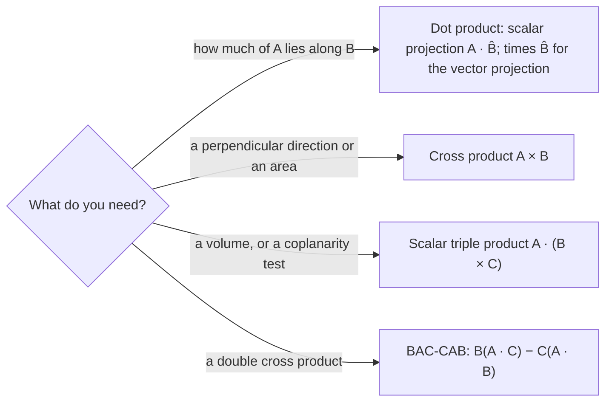

## More from the same two products

The vectors lesson introduced components, the dot product and the cross product. Those tools answer more questions than that lesson asked. How much of a force acts along a ramp? What are a vector's components in tilted axes, and why does the physics come out the same in any axes? What is the volume of a crystal cell, and can three forces all lie in one plane? This lesson builds three tools from what you already know (projections, rotated axes and triple products) and uses each on a physics problem.

## Unit vectors in any direction

Dividing a nonzero vector by its own magnitude gives a vector of length 1 pointing the same way:
$$\hat B = \frac{\vec B}{|\vec B|}.$$
For $\vec B = 2\hat\imath + \hat\jmath + 2\hat k$, $|\vec B| = \sqrt{4 + 1 + 4} = 3$, so $\hat B = \tfrac23\hat\imath + \tfrac13\hat\jmath + \tfrac23\hat k$. A unit vector carries only a direction, which is exactly what we need to ask "how much of $\vec A$ points that way?"

## Projections

The **scalar projection** of $\vec A$ onto $\vec B$ is the signed length of the part of $\vec A$ along $\vec B$:
$$A_B = \vec A\cdot\hat B = A\cos\phi = \frac{\vec A\cdot\vec B}{|\vec B|}.$$
It is positive when the angle $\phi$ between the vectors is less than $90^\circ$ and negative when it is more. The ordinary components $A_x$, $A_y$, $A_z$ are just the scalar projections onto $\hat\imath$, $\hat\jmath$, $\hat k$.

Multiplying by $\hat B$ turns it into a vector, the **vector projection**:
$$\vec A_\parallel = (\vec A\cdot\hat B)\,\hat B = \frac{\vec A\cdot\vec B}{B^2}\,\vec B.$$
Whatever is left over is perpendicular to $\vec B$:
$$\vec A_\perp = \vec A - \vec A_\parallel.$$


Why is $\vec A_\perp$ perpendicular to $\vec B$? Check with a dot product: $\vec A_\perp\cdot\hat B = \vec A\cdot\hat B - (\vec A\cdot\hat B)(\hat B\cdot\hat B) = 0$, because $\hat B\cdot\hat B = 1$. Since the two parts are perpendicular, the Pythagorean theorem gives $A^2 = A_\parallel^2 + A_\perp^2$, a useful check.

This split is everywhere in mechanics. Only the part of a force along the displacement does work ($W = \vec F\cdot\vec d = F_d\,d$, where $F_d$ is the scalar projection). On a ramp, gravity splits into a part along the surface and a part pressing into it.

### Example 1

A force $\vec F = 6\hat\imath + 2\hat\jmath - 3\hat k$ N acts on a box that moves through $\vec d = 2\hat\imath + \hat\jmath + 2\hat k$ m. Find the parts of $\vec F$ along and perpendicular to the motion, and the work done.

Dot product: $\vec F\cdot\vec d = 12 + 2 - 6 = 8$ N·m, so the work is $W = 8$ J. With $|\vec d| = 3$ m, the scalar projection is $F_d = 8/3 = 2.67$ N.

Vector projection: $\vec F_\parallel = \dfrac{8}{9}(2\hat\imath + \hat\jmath + 2\hat k) = 1.78\hat\imath + 0.89\hat\jmath + 1.78\hat k$ N.

Perpendicular part: $\vec F_\perp = \vec F - \vec F_\parallel = 4.22\hat\imath + 1.11\hat\jmath - 4.78\hat k$ N, with magnitude 6.47 N.

Checks: $\vec F_\perp\cdot\vec d = 8.44 + 1.11 - 9.56 \approx 0$ (it is exactly zero with fractions: $\tfrac{38}{9}, \tfrac{10}{9}, -\tfrac{43}{9}$). And $|\vec F|^2 = 49$ while $2.67^2 + 6.47^2 = 7.1 + 41.9 = 49.0$. Most of this 7.0 N force pushes sideways to the motion and does no work.

## Direction cosines

The angles $\alpha$, $\beta$, $\gamma$ that $\vec A$ makes with the $x$, $y$ and $z$ axes are given by its **direction cosines**:
$$\cos\alpha = \frac{A_x}{A},\qquad \cos\beta = \frac{A_y}{A},\qquad \cos\gamma = \frac{A_z}{A}.$$
These are the components of $\hat A$, and because $\hat A$ has length 1, $\cos^2\alpha + \cos^2\beta + \cos^2\gamma = 1$. For $\vec A = 2\hat\imath + 3\hat\jmath + 6\hat k$, $A = \sqrt{4 + 9 + 36} = 7$, so the angles are $\cos^{-1}(2/7) = 73.4^\circ$, $\cos^{-1}(3/7) = 64.6^\circ$ and $\cos^{-1}(6/7) = 31.0^\circ$. Only two of the three angles are independent; the identity fixes the third up to sign.

## Rotating the axes

The vectors lesson said axes are your choice. Here is what changing them does to the components. Rotate the $x$ and $y$ axes counterclockwise by an angle $\varphi$. The new unit vectors, written in the old axes, are
$$\hat\imath' = \cos\varphi\,\hat\imath + \sin\varphi\,\hat\jmath,\qquad \hat\jmath' = -\sin\varphi\,\hat\imath + \cos\varphi\,\hat\jmath.$$

```shape
{"segments": [{"from": [0, 0], "to": [4, 0], "arrow": true, "label": "x"}, {"from": [0, 0], "to": [0, 3.2], "arrow": true, "label": "y"}, {"from": [0, 0], "to": [3.46, 2], "arrow": true, "dashed": true, "label": "x′"}, {"from": [0, 0], "to": [-1.6, 2.77], "arrow": true, "dashed": true, "label": "y′"}, {"from": [0, 0], "to": [1.4, 2.6], "arrow": true, "label": "A"}], "curves": [{"x": "0.9cos(t)", "y": "0.9sin(t)", "t": [0, 0.5236]}], "labels": [{"at": [1.2, 0.33], "text": "φ"}], "caption": "Axes x′ and y′ are the x and y axes turned counterclockwise by φ. The vector A does not move; only its components change."}
```

Each new component is a scalar projection, so it is a dot product with a new unit vector:
$$A_{x'} = \vec A\cdot\hat\imath' = A_x\cos\varphi + A_y\sin\varphi,\qquad A_{y'} = \vec A\cdot\hat\jmath' = -A_x\sin\varphi + A_y\cos\varphi.$$

The components change, but the vector doesn't. Squaring and adding, the cross terms cancel and $A_{x'}^2 + A_{y'}^2 = A_x^2 + A_y^2$: the magnitude is the same in both sets of axes. The same algebra shows that $\vec A\cdot\vec B$ is unchanged. Quantities like these, which every choice of axes agrees on, are called invariants, and physical laws are written in terms of them. That is why a ramp problem gives the same answer in tilted or level axes.

### Example 2

A 2.0 kg block rests on a ramp inclined at $30^\circ$. Find the components of its weight along and perpendicular to the ramp.

In level axes the weight is $\vec W = (0,\ -mg) = (0,\ -19.6)$ N. Tilt the axes by $\varphi = 30^\circ$ so $x'$ points up the slope:

$W_{x'} = 0\cdot\cos30^\circ + (-19.6)\sin30^\circ = -9.8$ N (down the slope),

$W_{y'} = -0\cdot\sin30^\circ + (-19.6)\cos30^\circ = -17.0$ N (into the ramp).

These are the familiar $-mg\sin\theta$ and $-mg\cos\theta$ from the friction lesson, now derived instead of read off a sketch. Check: $\sqrt{9.8^2 + 17.0^2} = 19.6$ N, the same magnitude.

## The scalar triple product

Three vectors can be combined into one number, the **scalar triple product** $\vec A\cdot(\vec B\times\vec C)$. In components it is a determinant:
$$\vec A\cdot(\vec B\times\vec C) = \begin{vmatrix} A_x & A_y & A_z \\ B_x & B_y & B_z \\ C_x & C_y & C_z \end{vmatrix}.$$

Its meaning is geometric. $|\vec B\times\vec C|$ is the area of the parallelogram that $\vec B$ and $\vec C$ span, and $\vec B\times\vec C$ is perpendicular to it. Dotting with $\vec A$ multiplies that area by the part of $\vec A$ along the normal, which is the height. So $|\vec A\cdot(\vec B\times\vec C)|$ is the volume of the parallelepiped (the slanted box) with edges $\vec A$, $\vec B$, $\vec C$.


Three facts follow:

- The sign is positive when $\vec A$ is on the same side of the base as $\vec B\times\vec C$, so $\vec A$, $\vec B$, $\vec C$ form a right-handed set.
- Cycling the vectors keeps the value, $\vec A\cdot(\vec B\times\vec C) = \vec B\cdot(\vec C\times\vec A) = \vec C\cdot(\vec A\times\vec B)$ (same box), while swapping two flips the sign (as swapping two rows of a determinant does).
- The product is zero exactly when the three vectors are **coplanar** (lie in one plane): the box is flat and has no volume.

### Example 3

Find the volume of the box with edges $\vec A = \hat\imath + \hat\jmath + 4\hat k$, $\vec B = 3\hat\imath$ and $\vec C = \hat\imath + 2\hat\jmath$ (in meters). Then decide whether $(1, 2, 3)$, $(2, 1, 0)$ and $(4, 5, 6)$ are coplanar.

$\vec B\times\vec C$: the $\hat\imath$ and $\hat\jmath$ components are $0\cdot0 - 0\cdot2 = 0$ and $0\cdot1 - 3\cdot0 = 0$, and the $\hat k$ component is $3\cdot2 - 0\cdot1 = 6$. So $\vec B\times\vec C = 6\hat k$: it is normal to the base (the $xy$ plane), and the base area is 6 m². Then $\vec A\cdot(\vec B\times\vec C) = 4 \times 6 = 24$, so the volume is 24 m³. The height is $A_z = 4$ m, the part of $\vec A$ along the normal, not $|\vec A| = 4.24$ m.

For the second set, expand the determinant along the first row: $1(1\cdot6 - 0\cdot5) - 2(2\cdot6 - 0\cdot4) + 3(2\cdot5 - 1\cdot4) = 6 - 24 + 18 = 0$. They are coplanar. Indeed $(4, 5, 6) = 2(1, 2, 3) + (2, 1, 0)$.

## The vector triple product

Crossing a vector with a cross product gives a vector, and an identity removes the nested cross products:
$$\vec A\times(\vec B\times\vec C) = \vec B\,(\vec A\cdot\vec C) - \vec C\,(\vec A\cdot\vec B).$$
This is the **vector triple product**, remembered as "BAC minus CAB". The result lies in the plane of $\vec B$ and $\vec C$, since it is built from them. You can verify the identity by writing out components, which is tedious but direct.

The parentheses matter: the cross product is not associative. $(\hat\imath\times\hat\imath)\times\hat\jmath = \vec 0\times\hat\jmath = \vec 0$, but $\hat\imath\times(\hat\imath\times\hat\jmath) = \hat\imath\times\hat k = -\hat\jmath$.

### Example 4

A turntable spins with angular velocity $\vec\omega = 3.0\hat k$ rad/s. A point on it sits at $\vec r = 0.20\hat\imath + 0.50\hat k$ m (measured from a point on the axis). Its velocity is $\vec v = \vec\omega\times\vec r$ and its acceleration is $\vec a = \vec\omega\times(\vec\omega\times\vec r)$. Find $\vec a$.

BAC-CAB with $\vec A = \vec B = \vec\omega$ and $\vec C = \vec r$: $\vec a = \vec\omega(\vec\omega\cdot\vec r) - \vec r\,(\omega^2)$.

$\vec\omega\cdot\vec r = 3.0 \times 0.50 = 1.5$ and $\omega^2 = 9.0$, so $\vec a = 1.5(3.0\hat k) - 9.0(0.20\hat\imath + 0.50\hat k) = 4.5\hat k - 1.8\hat\imath - 4.5\hat k = -1.8\hat\imath$ m/s².

The $\hat k$ parts cancel and what is left points straight at the axis with magnitude $\omega^2\rho$, where $\rho = 0.20$ m is the distance from the axis. That is the centripetal acceleration from the circular motion lesson, found without drawing a single circle.



## Common mistakes

- Projecting onto $\vec B$ instead of $\hat B$: $\vec A\cdot\vec B$ alone is $|\vec B|$ times too big.
- Using $\dfrac{\vec A\cdot\vec B}{B}\vec B$ for the vector projection; it needs $B^2$ in the denominator (or $\hat B$ twice).
- Rotating the vector instead of the axes, which flips the sign of $\varphi$ in the formulas.
- Taking the height of a parallelepiped as $|\vec A|$ rather than the component of $\vec A$ along $\vec B\times\vec C$.
- Dropping the absolute value: a triple product can be negative, but a volume can't.
- Moving the parentheses in $\vec A\times(\vec B\times\vec C)$; the cross product is not associative.

## Key points

- $\hat B = \vec B/|\vec B|$. Scalar projection $\vec A\cdot\hat B$; vector projection $(\vec A\cdot\hat B)\hat B$; perpendicular part $\vec A - \vec A_\parallel$.
- Direction cosines are the components of $\hat A$, and their squares add to 1.
- Rotating the axes by $\varphi$: $A_{x'} = A_x\cos\varphi + A_y\sin\varphi$, $A_{y'} = -A_x\sin\varphi + A_y\cos\varphi$. Magnitudes and dot products don't change.
- $|\vec A\cdot(\vec B\times\vec C)|$ is the volume of the parallelepiped; zero means coplanar; cyclic order keeps the sign.
- $\vec A\times(\vec B\times\vec C) = \vec B(\vec A\cdot\vec C) - \vec C(\vec A\cdot\vec B)$; with $\vec\omega$ twice it gives the centripetal acceleration.
