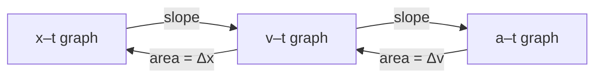

## What kinematics is for

**Kinematics** describes motion, where things are and how fast that changes, without yet asking what causes it (that's Newton's laws, in the next module). We start with motion along a straight line, because everything in two and three dimensions is built from it one axis at a time. The vector ideas from the last lesson apply directly: in one dimension a vector is just a signed number, with the sign giving the direction.

## Position, displacement, and distance

Choose an origin and a positive direction. An object's **position** $x$ is its coordinate along that line. The **displacement** over a time interval is the change in position,

$$\Delta x = x_f - x_i,$$

which can be positive, negative or zero. **Distance** is the total length of path covered, always positive. Walk 5 m forward and 5 m back: distance 10 m, displacement 0.

## Velocity and speed

The **average velocity** over an interval is displacement divided by elapsed time:

$$v_{\text{avg}} = \frac{\Delta x}{\Delta t}.$$

**Average speed** is distance divided by time. They can differ wildly: a runner who finishes one lap of a 400 m track in 80 s has average speed 5 m/s but average velocity 0, since she ends where she started.

Average velocity hides what happened inside the interval. Shrink the interval and you approach the **instantaneous velocity**, the velocity at one moment, which is what a speedometer reports (its magnitude is the instantaneous speed).

### Example 1

A cyclist rides 6.0 km east in 15 min, then 2.0 km west in 5.0 min. Find the average velocity and average speed for the whole trip, in km/h.

Total time: 20 min $= \tfrac13$ h. Displacement: $+6.0 - 2.0 = +4.0$ km (east). Distance: $6.0 + 2.0 = 8.0$ km.

Average velocity: $\dfrac{4.0\text{ km}}{1/3\text{ h}} = 12$ km/h east. Average speed: $\dfrac{8.0}{1/3} = 24$ km/h.

Notice you can't average the two legs' velocities ($24$ km/h and $-24$ km/h) to get the answer; average velocity always comes from total displacement over total time.

## Acceleration

**Acceleration** is the rate of change of velocity:

$$a_{\text{avg}} = \frac{\Delta v}{\Delta t},$$

with units m/s², read "meters per second, per second": each second the velocity changes by that many m/s. Its sign tells the direction of the change, not whether the object speeds up. An object speeds up when $v$ and $a$ have the same sign and slows down when they have opposite signs. A car moving in the $-x$ direction and braking has $v < 0$ and $a > 0$. Avoid the word "deceleration" in calculations; it hides the sign.

## Motion graphs

Graphs carry the same information as equations, often more clearly.

*Position–time ($x$–$t$) graph.* The slope at any point is the instantaneous velocity. A straight line means constant velocity; a curve means changing velocity. The slope of a chord between two points is the average velocity over that interval.

```plot
{"x": [0, 6], "y": [-1, 10], "xLabel": "t (s)", "yLabel": "x (m)", "functions": [{"f": "0.5*x^2 - 0.5*x", "from": 0, "to": 5, "label": "x(t)"}], "tangents": [{"f": "0.5*x^2 - 0.5*x", "at": 3}], "points": [{"at": [3, 3], "label": "slope here = v(3) = 2.5 m/s"}], "caption": "An x–t graph curving upward: the slope (velocity) is increasing"}
```

*Velocity–time ($v$–$t$) graph.* Two facts make it the most useful kinematics graph:

1. The slope is the acceleration.
2. The signed area between the curve and the $t$ axis is the displacement. Area above the axis counts positive, below counts negative.

The area fact comes from $\Delta x = v\,\Delta t$ for each thin strip of time: the strip's area is exactly its displacement, and adding strips adds displacements.

```plot
{"x": [0, 10], "y": [-4, 8], "xLabel": "t (s)", "yLabel": "v (m/s)", "functions": [{"f": "if(x < 4, 1.5*x, if(x < 7, 6, 6 - 4*(x - 7)))", "from": 0, "to": 9, "label": "v(t)"}], "shade": [{"f": "if(x < 4, 1.5*x, if(x < 7, 6, 6 - 4*(x - 7)))", "from": 0, "to": 9}], "caption": "Speeding up (0–4 s), constant velocity (4–7 s), then slowing, stopping at 8.5 s and reversing"}
```

*Acceleration–time ($a$–$t$) graph.* The area under it is the change in velocity, $\Delta v$.

The four graph facts fit together in one picture: going down the chain takes slopes (derivatives), going back up takes areas (integrals).



Reading the direction of motion and whether the object speeds up straight off a $v$–$t$ graph is a skill worth practicing. Above the axis the object moves in $+x$, below it in $-x$; it speeds up wherever the graph moves away from the axis and slows down wherever it moves toward it.


### Example 2

Use the $v$–$t$ graph above. (a) What is the acceleration from 0 to 4 s? (b) What is the displacement from 0 to 7 s? (c) When does the object turn around?

(a) Slope $= \dfrac{6 - 0}{4 - 0} = 1.5$ m/s².

(b) Area: a triangle from 0 to 4 s, $\tfrac12(4)(6) = 12$ m, plus a rectangle from 4 to 7 s, $3(6) = 18$ m. Total 30 m.

(c) It turns around where $v$ changes sign. After 7 s, $v = 6 - 4(t - 7)$, which is zero at $t = 8.5$ s. Before 8.5 s it moves in $+x$, after it in $-x$. Note that $a = -4$ m/s² throughout the last segment, including the instant $v = 0$: the object is momentarily at rest but still accelerating.

## Velocity and acceleration as derivatives

Instantaneous quantities are derivatives. Velocity is the derivative of position and acceleration the derivative of velocity:

$$v(t) = \frac{dx}{dt}, \qquad a(t) = \frac{dv}{dt} = \frac{d^2x}{dt^2}.$$

These are the "slope of the graph" statements made exact. Going the other way, the "area under the graph" statements are integrals:

$$x(t) = x_0 + \int_0^t v(t')\,dt', \qquad v(t) = v_0 + \int_0^t a(t')\,dt'.$$

The initial values $x_0$ and $v_0$ are the constants of integration: knowing the acceleration alone doesn't tell you where the object started or how fast it was going.

### Example 3

A particle moves along $x$ with $x(t) = 2t^3 - 9t^2 + 12t$ (meters, seconds). Find its velocity and acceleration at $t = 3$ s, and the times when it is momentarily at rest.

Differentiate: $v(t) = 6t^2 - 18t + 12$ and $a(t) = 12t - 18$.

At $t = 3$: $v = 54 - 54 + 12 = 12$ m/s and $a = 36 - 18 = 18$ m/s².

At rest when $v = 0$: $6(t^2 - 3t + 2) = 6(t - 1)(t - 2) = 0$, so $t = 1$ s and $t = 2$ s. Between them $v < 0$ (try $t = 1.5$: $v = -1.5$ m/s), so the particle moves forward, backs up between 1 and 2 s, then moves forward again.

### Example 4

A drag racer's acceleration is $a(t) = 12 - 2t$ m/s² for $0 \le t \le 6$ s, starting from rest at $x = 0$. Find its velocity and position at $t = 6$ s.

$v(t) = \int_0^t (12 - 2t')\,dt' = 12t - t^2$, so $v(6) = 72 - 36 = 36$ m/s.

$x(t) = \int_0^t (12t' - t'^2)\,dt' = 6t^2 - \tfrac13 t^3$, so $x(6) = 216 - 72 = 144$ m.

The constant-acceleration formulas of the next lesson would be wrong here, because $a$ changes with time.

## Common mistakes

- Confusing distance with displacement, or speed with velocity.
- Reading an $x$–$t$ graph's height as the velocity; velocity is the slope.
- Thinking negative acceleration always means slowing down.
- Thinking $v = 0$ means $a = 0$ (a ball at the top of its flight has $v = 0$ but $a = -9.8$ m/s²).
- Averaging velocities from legs of unequal duration.

## Key points

- Displacement $\Delta x = x_f - x_i$ is signed; distance is not.
- $v_{\text{avg}} = \Delta x/\Delta t$; $a_{\text{avg}} = \Delta v/\Delta t$.
- Slope of $x$–$t$ is $v$; slope of $v$–$t$ is $a$; area under $v$–$t$ is $\Delta x$; area under $a$–$t$ is $\Delta v$.
- $v = dx/dt$, $a = dv/dt$; integrate (with initial conditions) to go back.
