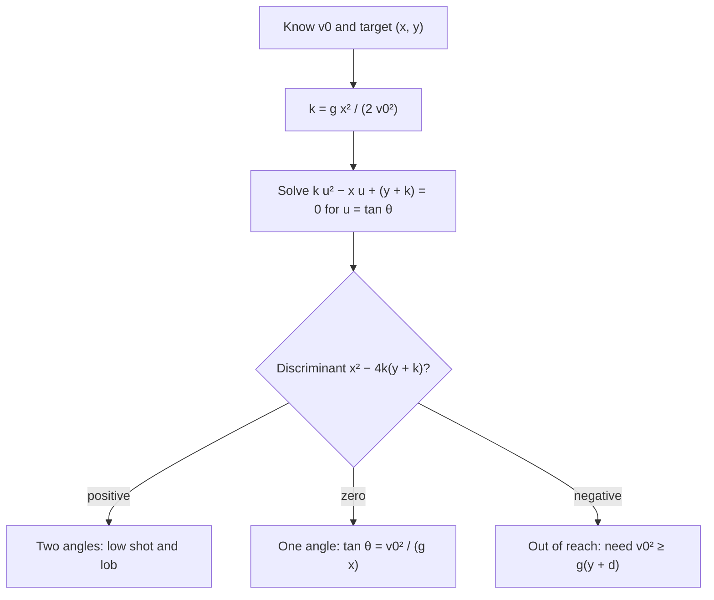

## Turning the question around

The projectile lesson answered forward questions: given the launch speed and angle, where does the ball go? Real aiming runs the other way. A firefighter knows where the window is and how fast water leaves the nozzle, and needs the angle. A shot-putter wants to know the farthest anyone could throw at a given release speed. A skier launching off a ramp onto a downhill landing slope cares about distance *along the slope*, not along the horizontal. This lesson answers these inverse questions with one idea: write the path as an equation and ask when it has solutions.

As in the core lesson, air resistance is ignored throughout. That is a real simplification: for a baseball or a golf ball, drag changes ranges by tens of percent and lowers the best launch angle. The results here are exact for the idealized model and good approximations for slow, dense projectiles such as a shot put or a stream of water over a short distance.

## The trajectory as a quadratic in tan θ

Put the launch point at the origin, $+y$ up, launch speed $v_0$ at angle $\theta$ above horizontal. Eliminating $t$ from the component equations gave the **trajectory equation**

$$y = x\tan\theta - \frac{g x^2}{2v_0^2\cos^2\theta}.$$

To find the angle that passes through a given point $(x, y)$, use the identity $\dfrac{1}{\cos^2\theta} = 1 + \tan^2\theta$ and write $u = \tan\theta$:

$$y = xu - k(1 + u^2), \qquad k = \frac{g x^2}{2v_0^2}.$$

Rearranged, this is an ordinary quadratic in $u$:

$$k u^2 - x u + (y + k) = 0.$$

A quadratic has two, one or no real roots, and each case means something physical:

- **Two roots:** two launch angles reach the target, a low, flat shot and a high lob.
- **One root:** exactly one angle works; the target is at the edge of what this speed can reach.
- **No roots:** the target is out of reach at this speed, whatever the angle.



### Example 1

A firefighter's nozzle shoots water at 20.0 m/s. A window is 30.0 m away horizontally and 5.0 m above the nozzle. At what angles should the nozzle point? Use $g = 9.8$ m/s².

Compute $k = \dfrac{9.8 \times 30.0^2}{2 \times 20.0^2} = \dfrac{8820}{800} = 11.025$ m. The quadratic is

$$11.025u^2 - 30.0u + 16.025 = 0.$$

Discriminant: $30.0^2 - 4(11.025)(16.025) = 900 - 706.7 = 193.3$, positive, so two angles work. Its square root is $13.90$, so

$$u = \frac{30.0 \pm 13.90}{22.05} = 0.730 \text{ or } 1.991,$$

giving $\theta = \tan^{-1}(0.730) = 36.1^\circ$ and $\theta = \tan^{-1}(1.991) = 63.3^\circ$.

Which is better? The time to reach the window is $t = x/(v_0\cos\theta)$: $30.0/(20.0\cos 36.1^\circ) = 1.86$ s for the low shot and $30.0/(20.0\cos 63.3^\circ) = 3.34$ s for the lob. The low shot arrives sooner and flatter, so it is usually the practical choice; the lob comes down more steeply, which can help clear an obstacle in front of the target.

## Which points can you reach? The safety parabola

Set the discriminant to zero to find the boundary between reachable and unreachable points: $x^2 = 4k(y + k)$. Substituting $k$ and solving for $y$ gives

$$y = \frac{v_0^2}{2g} - \frac{g x^2}{2v_0^2}.$$

This downward parabola is the **safety parabola**: every trajectory launched at speed $v_0$ (at any angle) stays on or under it, and each trajectory touches it at exactly one point. A curve that touches every member of a family of curves this way is called their *envelope*. The name comes from artillery: outside the curve, you are safe from a gun of that muzzle speed.

```plot
{"x": [0, 44], "y": [0, 23], "equal": true, "xLabel": "x (m)", "yLabel": "y (m)", "functions": [{"f": "x*tand(20) - 9.8*x^2/(800*cosd(20)^2)", "from": 0, "to": 26.24}, {"f": "x*tand(35) - 9.8*x^2/(800*cosd(35)^2)", "from": 0, "to": 38.35}, {"f": "x*tand(50) - 9.8*x^2/(800*cosd(50)^2)", "from": 0, "to": 40.20}, {"f": "x*tand(65) - 9.8*x^2/(800*cosd(65)^2)", "from": 0, "to": 31.27}, {"f": "x*tand(80) - 9.8*x^2/(800*cosd(80)^2)", "from": 0, "to": 13.96}, {"f": "20.408 - 0.01225*x^2", "from": 0, "to": 40.82, "dashed": true}], "labels": [{"at": [33, 9.5], "text": "safety parabola"}], "caption": "Launches at 20 m/s at 20°, 35°, 50°, 65° and 80°: each path touches the dashed safety parabola once"}
```

Two points on the safety parabola are worth checking. At $x = 0$ it reaches $v_0^2/(2g)$, the height of a straight-up throw. At $y = 0$ it reaches $x = v_0^2/g$, the level-ground range at $45^\circ$. Both match the core lesson, a good sign the algebra is right.

In Example 1 the safety parabola at $x = 30.0$ m is at $y = \dfrac{400}{19.6} - 11.025 = 9.38$ m. The 5.0 m window is below it (two angles), but a window 10 m up could not be reached at 20.0 m/s.

On the boundary itself the double root is $u = x/(2k)$, so the single launch angle satisfies

$$\tan\theta = \frac{v_0^2}{g x}.$$

## The minimum launch speed

Turn the boundary around: for a fixed target, what is the smallest launch speed that reaches it? At that speed the target lies exactly on the safety parabola. Multiply the boundary equation by $2gv_0^2$ and collect terms:

$$v_0^4 - 2gy\,v_0^2 - g^2x^2 = 0.$$

This is a quadratic in $v_0^2$; its positive root is $v_0^2 = gy + \sqrt{g^2y^2 + g^2x^2}$. With $d = \sqrt{x^2 + y^2}$, the straight-line distance to the target,

$$v_{0,\min}^2 = g\,(y + d).$$

Check: for a target on level ground, $y = 0$ and $d = x$, so $v_0^2 = gx$, the familiar $R = v_0^2/g$.

The best angle is $\tan\theta = v_0^2/(gx) = (y + d)/x$. If the line to the target rises at angle $\alpha$ above horizontal ($\sin\alpha = y/d$, $\cos\alpha = x/d$), then $\dfrac{y + d}{x} = \dfrac{1 + \sin\alpha}{\cos\alpha} = \tan\!\left(45^\circ + \tfrac{\alpha}{2}\right)$, an identity you can verify with the half-angle formulas. So

$$\theta_{\text{best}} = 45^\circ + \frac{\alpha}{2}:$$

the most economical launch direction bisects the angle between the vertical and the line of sight to the target. For a level target ($\alpha = 0$) it gives the familiar $45^\circ$.

### Example 2

What is the slowest a ball can be thrown to reach a ledge 12.0 m away horizontally and 4.0 m higher than the release point, and at what angle?

$d = \sqrt{12.0^2 + 4.0^2} = 12.65$ m. Then $v_0^2 = 9.8(4.0 + 12.65) = 163.2$ m²/s², so $v_{0,\min} = 12.8$ m/s.

Angle: $\tan\theta = (4.0 + 12.65)/12.0 = 1.387$, so $\theta = 54.2^\circ$. Check with the bisector rule: $\alpha = \tan^{-1}(4.0/12.0) = 18.4^\circ$, and $45^\circ + 9.2^\circ = 54.2^\circ$.

Any slower throw falls short at every angle; any faster throw gives two angles that work.

## Projectiles on a slope

Now launch from the bottom of a straight slope that rises at angle $\alpha$, with $\theta$ still measured from the horizontal (not from the slope).


The slope is the line $y = x\tan\alpha$. Setting the trajectory equal to it and dividing by $x$:

$$\tan\alpha = \tan\theta - \frac{g x}{2v_0^2\cos^2\theta} \quad\Rightarrow\quad x = \frac{2v_0^2\cos^2\theta\,(\tan\theta - \tan\alpha)}{g}.$$

Since $\tan\theta - \tan\alpha = \dfrac{\sin(\theta - \alpha)}{\cos\theta\cos\alpha}$, and the distance along the slope is $L = x/\cos\alpha$,

$$L = \frac{2v_0^2\cos\theta\,\sin(\theta - \alpha)}{g\cos^2\alpha}.$$

For $\alpha = 0$ this is $2v_0^2\sin\theta\cos\theta/g$, the level-ground range, as it should be.

To maximize $L$, use the product-to-sum identity $2\cos\theta\sin(\theta - \alpha) = \sin(2\theta - \alpha) - \sin\alpha$. Only the first term depends on $\theta$, and it is largest when $2\theta - \alpha = 90^\circ$:

$$\theta_{\text{best}} = 45^\circ + \frac{\alpha}{2}, \qquad L_{\max} = \frac{v_0^2(1 - \sin\alpha)}{g\cos^2\alpha} = \frac{v_0^2}{g(1 + \sin\alpha)},$$

using $\cos^2\alpha = (1 - \sin\alpha)(1 + \sin\alpha)$. For a downhill slope, $\alpha$ is negative: the best angle drops below $45^\circ$ and the maximum distance grows.

It is no coincidence that the bisector rule reappears. The farthest landing point on the slope is the point where the slope just touches the safety parabola, and reaching a point on the safety parabola is exactly the minimum-speed problem. You can check: with $y = L\sin\alpha$ and $d = L$, the condition $v_0^2 = g(y + d)$ gives $L = v_0^2/[g(1 + \sin\alpha)]$.

### Example 3

A ball is thrown at 15.0 m/s up a hillside that rises at $20^\circ$. (a) How far up the slope does it land if thrown at $40^\circ$ above horizontal? (b) What angle gives the greatest distance, and what is it?

(a) $L = \dfrac{2(15.0)^2\cos 40^\circ\sin 20^\circ}{9.8\cos^2 20^\circ} = \dfrac{450(0.7660)(0.3420)}{9.8(0.8830)} = \dfrac{117.9}{8.653} = 13.6$ m.

(b) $\theta_{\text{best}} = 45^\circ + 10^\circ = 55^\circ$, and $L_{\max} = \dfrac{225}{9.8(1 + 0.3420)} = 17.1$ m.

For comparison, the same throw on level ground reaches $225/9.8 = 23.0$ m, and down a $20^\circ$ slope it reaches $\dfrac{225}{9.8(1 - 0.342)} = 34.9$ m at $35^\circ$.

## A little history

Galileo's *Two New Sciences* (1638) proved that, without air resistance, a projectile's path is a parabola, and that launch elevations equally above and below $45^\circ$ give the same range. Gunners had long tabulated ranges by experience; Galileo's result was an early example of a mathematical law describing motion on Earth. Real cannonballs moved fast enough that drag mattered a great deal, so his tables were idealizations, the same caution that applies to this lesson.

## Common mistakes

- Measuring the launch angle from the slope instead of from the horizontal and then using the formulas above, which assume $\theta$ from the horizontal.
- Dropping the second root of the quadratic in $\tan\theta$: both angles are physical.
- Concluding a target is unreachable without checking the discriminant (or the safety parabola).
- Using the level-ground range $v_0^2\sin 2\theta/g$ for a target above or below the launch point.
- Treating $d$ in $v_0^2 = g(y + d)$ as the horizontal distance; it is the straight-line distance to the target.
- Forgetting that $\alpha$ is negative for a downhill slope.

## Key points

- With $u = \tan\theta$ and $k = gx^2/(2v_0^2)$, the target condition is $ku^2 - xu + (y + k) = 0$: two, one or no launch angles.
- Safety parabola: $y = \dfrac{v_0^2}{2g} - \dfrac{gx^2}{2v_0^2}$; reachable points lie on or under it.
- Minimum speed to reach a point: $v_0^2 = g(y + d)$, launched at $45^\circ + \alpha/2$.
- Up a slope of angle $\alpha$: $L = \dfrac{2v_0^2\cos\theta\sin(\theta - \alpha)}{g\cos^2\alpha}$, maximum $\dfrac{v_0^2}{g(1 + \sin\alpha)}$ at $\theta = 45^\circ + \alpha/2$.
- All of this ignores air resistance, which lowers ranges and best angles for fast, light projectiles.
