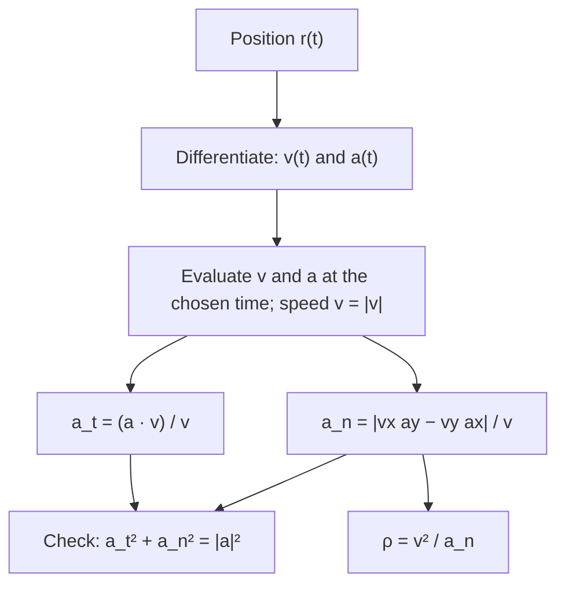

## Splitting acceleration the natural way

The two-dimensional motion lesson said that acceleration has two jobs: a tangential part along the velocity changes the speed, and a radial part perpendicular to the velocity changes the direction. It computed the tangential part once, with a dot product, and left the rest as "turning". This lesson finishes the job. We will find how big the turning part is, show that it equals $v^2/\rho$ for a number $\rho$ that measures how sharply the path bends, and use that to answer questions such as "where does a thrown ball's path bend most sharply?" and "how far does a particle travel along a curved path?". These are the tools engineers use for road and rail curves, roller coasters and flight paths.

## The unit tangent and the unit normal

At any instant the velocity points along the path. Write it as speed times a direction:

$$\vec v = v\,\hat T, \qquad \hat T = \frac{\vec v}{|\vec v|},$$

where $\hat T$ is the **unit tangent vector**. Differentiate with the product rule:

$$\vec a = \frac{d\vec v}{dt} = \frac{dv}{dt}\,\hat T + v\,\frac{d\hat T}{dt}.$$

The first term is along the path and changes only the speed. The second is the turning part. Because $\hat T$ always has length 1, $\hat T\cdot\hat T = 1$; differentiating gives $2\hat T\cdot \dfrac{d\hat T}{dt} = 0$, so $d\hat T/dt$ is perpendicular to $\hat T$. Its direction, pointing toward the inside of the bend, is the **unit normal vector** $\hat N$.

How fast does $\hat T$ turn? Near any point, a smooth path looks like an arc of a circle, the **osculating circle** ("kissing circle"), which has the same tangent and the same bend as the path there. Its radius is the **radius of curvature** $\rho$, and its center is the center of curvature. A straight line has $\rho = \infty$; a tight hairpin has small $\rho$. The reciprocal $\kappa = 1/\rho$ is the **curvature**.


Along an arc of radius $\rho$, moving a path length $ds$ turns the direction through an angle $d\phi = ds/\rho$ (that's the definition of an angle in radians). A unit vector turned through a small angle $d\phi$ changes by $d\phi$ in magnitude. So

$$\left|\frac{d\hat T}{dt}\right| = \frac{d\phi}{dt} = \frac{1}{\rho}\frac{ds}{dt} = \frac{v}{\rho}.$$

Putting the pieces together gives the central result:

$$\vec a = \underbrace{\frac{dv}{dt}}_{a_t}\,\hat T + \underbrace{\frac{v^2}{\rho}}_{a_n}\,\hat N.$$

The tangential acceleration $a_t = dv/dt$ is the rate of change of speed; it can be positive (speeding up) or negative (slowing down). The **normal acceleration** $a_n = v^2/\rho$ is never negative and always points toward the center of curvature. For a circle, $\rho$ is just the radius, and $a_n$ becomes the centripetal acceleration $v^2/r$ that the circular-motion lesson builds on. The total magnitude is $|\vec a| = \sqrt{a_t^2 + a_n^2}$.

## Computing the components from vectors

When the motion is given as $\vec r(t)$, you rarely know $\rho$ in advance. Find $\vec v$ and $\vec a$ by differentiating, then:

$$a_t = \frac{\vec a\cdot\vec v}{v}, \qquad a_n = \frac{|v_x a_y - v_y a_x|}{v}, \qquad \rho = \frac{v^2}{a_n} = \frac{v^3}{|v_x a_y - v_y a_x|}.$$

The first is the projection of $\vec a$ onto the direction of motion. The second uses the cross product: $|\vec v\times\vec a| = |v\hat T\times(a_t\hat T + a_n\hat N)| = v\,a_n$, since $\hat T\times\hat T = 0$ and $|\hat T\times\hat N| = 1$. In two dimensions, $|\vec v\times\vec a| = |v_xa_y - v_ya_x|$. A useful check: $a_t^2 + a_n^2$ must equal $a_x^2 + a_y^2$.



### Example 1

A particle moves with $\vec r(t) = (3t^2)\,\hat\imath + (8t - t^3)\,\hat\jmath$ m, the motion from Example 4 of the core lesson. At $t = 1.0$ s, find $a_t$, $a_n$ and the radius of curvature.

Differentiate: $\vec v = (6t,\ 8 - 3t^2)$, $\vec a = (6,\ -6t)$. At $t = 1$: $\vec v = (6, 5)$ m/s and $\vec a = (6, -6)$ m/s². Speed $v = \sqrt{36 + 25} = \sqrt{61} = 7.81$ m/s.

Tangential: $a_t = \dfrac{(6)(6) + (5)(-6)}{7.81} = \dfrac{6}{7.81} = 0.768$ m/s². Positive, so it is speeding up, slowly.

Normal: $v_xa_y - v_ya_x = (6)(-6) - (5)(6) = -66$, so $a_n = \dfrac{66}{7.81} = 8.45$ m/s². (The negative sign of the cross product means the path is turning clockwise.)

Check: $0.768^2 + 8.45^2 = 72.0 = 6^2 + 6^2$.

Radius of curvature: $\rho = \dfrac{61}{8.45} = 7.22$ m. Almost all of this particle's acceleration goes into turning it.

```plot
{"x": [-5, 25], "y": [-6.5, 14], "equal": true, "xLabel": "x (m)", "yLabel": "y (m)", "curves": [{"x": "3*t^2", "y": "8*t - t^3", "t": [0, 2.8]}], "circles": [{"center": [7.621, 1.455], "r": 7.219}], "points": [{"at": [3, 7]}, {"at": [7.621, 1.455], "label": "center"}], "labels": [{"at": [3, 10.6], "text": "t = 1 s"}], "segments": [{"from": [3, 9.9], "to": [3, 7.6], "arrow": true}], "caption": "The path r(t) = (3t², 8t − t³) and its osculating circle at t = 1 s (radius 7.22 m)"}
```

## The projectile revisited

For a projectile, $\vec a = (0, -g)$ everywhere, so $|v_xa_y - v_ya_x| = g\,v_x$ and

$$\rho = \frac{v^3}{g\,v_x}.$$

Since $v_x$ is constant, $\rho$ is proportional to $v^3$: the path bends most sharply where the speed is smallest, at the top. There $v = v_x$, the whole of $g$ is normal acceleration, and $\rho_{\text{top}} = v_x^2/g$. At launch, $v = v_0$ and $v_x = v_0\cos\theta$, so $\rho = v_0^2/(g\cos\theta)$; there gravity has a tangential part $a_t = -g\sin\theta$ (slowing the ball as it rises) and a normal part $a_n = g\cos\theta$.

### Example 2

The soccer ball from the projectile lesson is kicked at 18.0 m/s, $35^\circ$ above level ground. Find the radius of curvature at the top of its path and at launch, and its tangential acceleration at launch.

$v_x = 18.0\cos 35^\circ = 14.74$ m/s.

At the top: $\rho = \dfrac{14.74^2}{9.8} = 22.2$ m.

At launch: $\rho = \dfrac{18.0^2}{9.8\cos 35^\circ} = \dfrac{324}{8.03} = 40.4$ m, and $a_t = -9.8\sin 35^\circ = -5.62$ m/s² (the ball is losing speed at that rate).

The path is nearly twice as tightly curved at the top as at launch, which you can see in any photograph of a long kick.

## Speed versus the size of the acceleration

Two quantities that sound alike are different: $\dfrac{d|\vec v|}{dt}$, the rate of change of speed, is $a_t$; $\left|\dfrac{d\vec v}{dt}\right|$, the size of the acceleration, is $\sqrt{a_t^2 + a_n^2}$. They agree only when the path is straight. A car at a steady speed on a curve has the first equal to zero and the second equal to $v^2/\rho$.

### Example 3

A car on a highway curve of radius 80 m is moving at 20 m/s and speeding up at 1.5 m/s². Find the magnitude of its acceleration and the angle between its acceleration and its velocity.

$a_n = \dfrac{20^2}{80} = 5.0$ m/s², $a_t = 1.5$ m/s², so $|\vec a| = \sqrt{5.0^2 + 1.5^2} = 5.22$ m/s².

The angle from the velocity is $\tan^{-1}(5.0/1.5) = 73.3^\circ$, pointing forward and toward the inside of the curve. If the car were braking instead, $a_t = -1.5$ m/s² and the acceleration would point backward and inward, at $106.7^\circ$ from the velocity.

## Distance along a curved path

The core lessons distinguished distance from displacement. Along a curve, the distance traveled is the **arc length**: add up $ds = v\,dt$,

$$s = \int_{t_1}^{t_2} |\vec v(t)|\,dt.$$

### Example 4

A particle moves on $\vec r(t) = (3t^2)\,\hat\imath + (2t^3)\,\hat\jmath$ m. How far does it travel from $t = 0$ to $t = 1$ s, and how does that compare with its displacement?

$\vec v = (6t, 6t^2)$, so $|\vec v| = 6t\sqrt{1 + t^2}$. With the substitution $w = 1 + t^2$,

$$s = \int_0^1 6t\sqrt{1 + t^2}\,dt = \Big[\,2(1 + t^2)^{3/2}\Big]_0^1 = 2\left(2\sqrt2 - 1\right) = 3.66 \text{ m}.$$

The displacement is from $(0, 0)$ to $(3, 2)$, magnitude $\sqrt{13} = 3.61$ m. The path is only gently curved, so the distance is just a little longer, as it must be: a straight line is the shortest path between two points.

Most arc-length integrals have no neat antiderivative; then you evaluate them numerically, adding up $|\vec v|\,\Delta t$ over many short time steps.

## Common mistakes

- Taking $|\vec a|$ as the rate of change of speed. Only the tangential component changes the speed.
- Using $|\vec a|$ in place of $a_n$ in $\rho = v^2/a_n$.
- Forgetting to divide by $v$ in $a_t = \vec a\cdot\vec v/v$ or in $a_n = |v_xa_y - v_ya_x|/v$.
- Thinking a projectile's path bends most at launch or landing; it bends most at the top, where it is slowest.
- Giving $a_n$ a sign. It is a magnitude pointing toward the center of curvature; the sign of $a_t$ carries the "speeding up or slowing down" information.
- Computing the distance along a path as the magnitude of the displacement.

## Key points

- $\vec a = \dfrac{dv}{dt}\hat T + \dfrac{v^2}{\rho}\hat N$: tangential part changes speed, normal part changes direction.
- From vectors: $a_t = \dfrac{\vec a\cdot\vec v}{v}$, $a_n = \dfrac{|v_xa_y - v_ya_x|}{v}$, $\rho = \dfrac{v^3}{|v_xa_y - v_ya_x|}$; check $a_t^2 + a_n^2 = a^2$.
- The osculating circle has radius $\rho$; curvature is $\kappa = 1/\rho$.
- Projectile: $\rho = v^3/(g v_x)$, smallest at the top, where $\rho = v_x^2/g$.
- Distance along a path: $s = \int |\vec v|\,dt$, never less than the displacement's magnitude.
