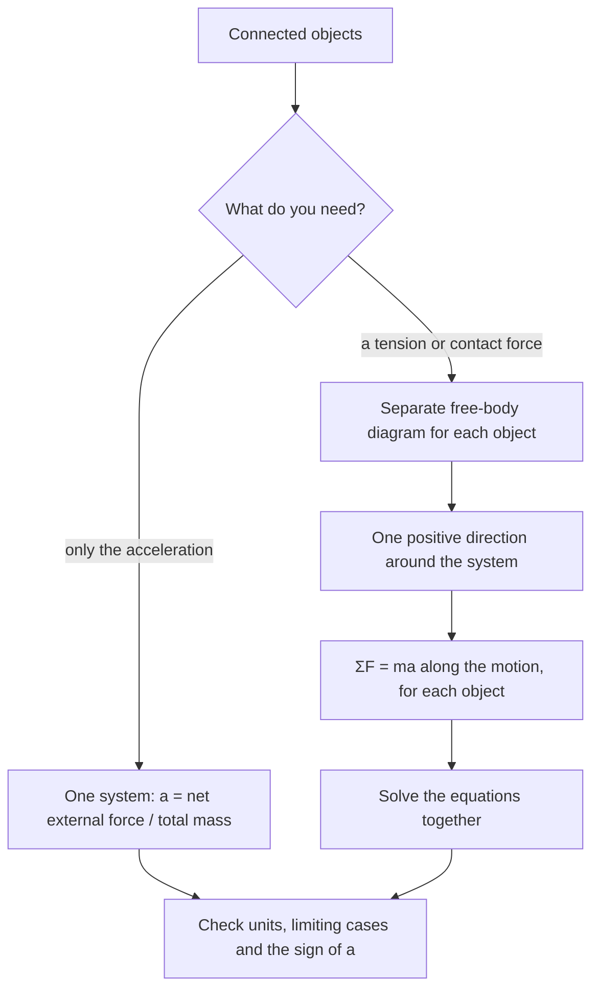

## Objects that pull on each other

Real problems rarely involve one object. Trains pull carriages, cranes lift loads, elevators hang from cables. This lesson extends free-body diagrams to systems of connected objects, linked by ropes and pulleys, and introduces the force that travels along a rope.

## Tension

A rope or cable pulled taut exerts a pull, the **tension** $T$, on whatever is attached to each end. It always pulls (a rope can't push) and acts along the rope. In this course ropes are usually idealized:

- A **massless rope** has the same tension throughout. (Apply $F = ma$ to a small piece: with $m = 0$, the forces on its two ends must balance.)
- An **ideal pulley** (massless, frictionless) changes the direction of a rope without changing its tension.
- An inextensible rope makes the connected objects move together with the same speed and the same magnitude of acceleration.

Tension is not automatically equal to the weight hanging from the rope. It equals $mg$ only if the hanging object is in equilibrium.

### Example 1: a hanging sign

A 20 kg sign hangs from two cables, each making $40^\circ$ with the horizontal. Find the tension in each.

By symmetry both tensions are equal, $T$. Horizontal components cancel. Vertical: $2T\sin 40^\circ = mg = 196$ N, so $T = \dfrac{196}{2(0.6428)} = 152$ N.

Notice each cable carries more than half the weight. As the cables flatten toward horizontal, $\sin\theta \to 0$ and the tension grows without bound, which is why a clothesline can never be pulled perfectly straight with laundry on it.

## Strategy for connected objects

1. Draw a separate free-body diagram for each object.
2. Choose a positive direction for each object consistent with the motion of the system (if block A moves right when block B moves down, call right positive for A and down positive for B). Then all accelerations have the same sign and magnitude $a$.
3. Write $\sum F = ma$ along the motion for each object.
4. Solve the equations together for $a$ and the tensions.

A shortcut for finding $a$ alone: treat the whole chain as one system of total mass $M$. Tensions inside the system are internal forces that cancel in pairs, so only external forces drive it: $a = F_{\text{net, ext}}/M$.

Which route to take depends on what the question asks for:



## The Atwood machine

Two masses $m_1 > m_2$ hang on either side of an ideal pulley. Taking the direction in which $m_1$ falls as positive:

- $m_1$: $m_1 g - T = m_1 a$
- $m_2$: $T - m_2 g = m_2 a$

Adding eliminates $T$: $(m_1 - m_2)g = (m_1 + m_2)a$, so

$$a = \frac{m_1 - m_2}{m_1 + m_2}\,g, \qquad T = \frac{2m_1m_2}{m_1 + m_2}\,g.$$

The tension lies between the two weights: smaller than $m_1g$ (so $m_1$ accelerates down) and larger than $m_2 g$ (so $m_2$ accelerates up). Checks: if $m_1 = m_2$, $a = 0$ and $T = mg$; if $m_2 = 0$, $a = g$ (free fall) and $T = 0$.

```shape
{"circles": [{"center": [0, 4], "r": 0.6}], "segments": [{"from": [-0.6, 4], "to": [-0.6, 1.5]}, {"from": [0.6, 4], "to": [0.6, 2.5]}, {"from": [-1.4, 1.4], "to": [-1.4, 0.4], "arrow": true, "label": "a"}, {"from": [1.4, 1.9], "to": [1.4, 2.9], "arrow": true, "label": "a"}], "polygons": [{"points": [[-1, 0.5], [-0.2, 0.5], [-0.2, 1.5], [-1, 1.5]]}, {"points": [[0.2, 1.8], [1, 1.8], [1, 2.5], [0.2, 2.5]]}], "labels": [{"at": [-0.6, 0.2], "text": "m₁"}, {"at": [0.6, 1.5], "text": "m₂"}], "caption": "Atwood machine: the heavier mass m₁ accelerates down, m₂ up, with the same magnitude a"}
```

### Example 2

In an Atwood machine, $m_1 = 5.0$ kg and $m_2 = 3.0$ kg. Find the acceleration and tension.

$a = \dfrac{5.0 - 3.0}{8.0}(9.8) = 2.45$ m/s². $T = \dfrac{2(5.0)(3.0)}{8.0}(9.8) = 36.75$ N.

Check with $m_2$: $T - m_2g = 36.75 - 29.4 = 7.35$ N $= 3.0(2.45)$ ✓.

## A block on a table pulled by a hanging mass

Block $m_1$ sits on a horizontal table with kinetic friction coefficient $\mu_k$; a rope over a pulley at the table's edge connects it to hanging mass $m_2$. Positive direction: $m_1$ moves toward the pulley, $m_2$ moves down.


The picture shows both free-body diagrams on one sketch. The rope pulls $m_1$ toward the pulley and pulls $m_2$ up, with the same $T$ at both ends because the rope and pulley are ideal.

- $m_1$ (horizontal): $T - \mu_k m_1 g = m_1 a$
- $m_2$ (vertical): $m_2 g - T = m_2 a$

Adding: $a = \dfrac{m_2 - \mu_k m_1}{m_1 + m_2}\,g$. If $m_2 g$ can't overcome static friction ($m_2 < \mu_s m_1$), nothing moves.

### Example 3

$m_1 = 6.0$ kg on the table with $\mu_k = 0.20$; $m_2 = 2.0$ kg hanging. Find $a$ and $T$.

$a = \dfrac{2.0 - 0.20(6.0)}{8.0}(9.8) = \dfrac{0.8}{8.0}(9.8) = 0.98$ m/s².

From $m_2$: $T = m_2(g - a) = 2.0(9.8 - 0.98) = 17.64$ N. Check with $m_1$: $17.64 - 0.20(6.0)(9.8) = 17.64 - 11.76 = 5.88 = 6.0(0.98)$ ✓.

## Mechanical advantage

A movable pulley supported by two rope segments lets you lift a load with half the force: if the load $W$ hangs from a pulley held up by two strands of the same rope, $2T = W$ in equilibrium, so $T = W/2$. The price is distance: to raise the load 1 m, you pull 2 m of rope. Block-and-tackle systems multiply this further. (In energy terms, the work you do is the same; you'll see why in the work lesson.)

## Constraints and ropes with mass

Constraints between connected objects are really statements about derivatives. If a rope of fixed length $L$ connects blocks at positions $x_1$ and $x_2$ measured along the rope, then $x_1 + x_2 = L$ (plus constants), and differentiating twice gives $\ddot x_1 = -\ddot x_2$: equal and opposite accelerations in those coordinates. For a movable pulley, the constraint is $2y_{\text{load}} + y_{\text{end}} = \text{const}$, so the load's acceleration is half the rope end's. Writing the length constraint and differentiating is the safe way to handle complicated pulley systems.

A rope with mass is different: tension varies along it. A uniform rope of mass $M$ and length $L$ hanging vertically has tension $T(y) = \dfrac{M}{L}\,g\,y$ at a height $y$ above its bottom end, since that point supports the weight of the rope below it.

## Common mistakes

- Setting tension equal to the hanging weight when the system accelerates.
- Using inconsistent sign conventions for the two objects, which makes the accelerations seem to differ.
- Including tension when treating the whole system as one object (it's internal).
- Forgetting friction on the table block, or using $\mu_s$ when it's sliding.

## Key points

- Tension pulls along a rope; ideal ropes and pulleys keep it the same throughout.
- Draw a separate FBD for each object; use one consistent positive direction around the system.
- Atwood: $a = \dfrac{m_1 - m_2}{m_1 + m_2}g$, $T = \dfrac{2m_1m_2}{m_1 + m_2}g$.
- Table and hanging mass: $a = \dfrac{m_2 - \mu_k m_1}{m_1 + m_2}g$.
- Whole-system shortcut: $a = F_{\text{ext}}/M_{\text{total}}$.
