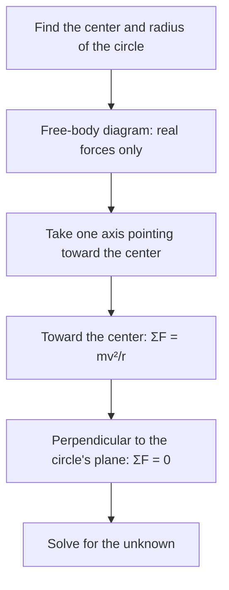

## Turning requires a force

A car rounding a bend, a satellite in orbit, a ball whirled on a string: each moves in a circle, and each is accelerating even if its speed never changes, because its velocity keeps changing direction. By Newton's second law, something must supply a net force. This lesson finds how large that acceleration is, where it points, and which real forces provide it.

## Describing circular motion

An object moving in a circle of radius $r$ at constant speed $v$ is in **uniform circular motion**. The time for one revolution is the **period** $T$, and the number of revolutions per second is the **frequency** $f = 1/T$ (unit hertz, Hz $=$ s$^{-1}$). Since one lap is a distance $2\pi r$,

$$v = \frac{2\pi r}{T} = 2\pi r f.$$

## Centripetal acceleration

The velocity is always tangent to the circle, and the acceleration points toward the center. It's called **centripetal acceleration** ("center-seeking"), with magnitude

$$a_c = \frac{v^2}{r} = \frac{4\pi^2 r}{T^2}.$$

*Why $v^2/r$?* In a short time $\Delta t$, the object moves through a small angle $\Delta\theta = v\Delta t/r$. Its velocity vector, of fixed length $v$, rotates through the same angle, so the change in velocity has magnitude $|\Delta\vec v| \approx v\,\Delta\theta = v^2\Delta t/r$. Dividing by $\Delta t$ gives $a = v^2/r$. And as $\Delta\theta \to 0$, $\Delta\vec v$ is perpendicular to $\vec v$, pointing inward.

```shape
{"x": [-1.6, 1.6], "y": [-1.25, 1.6], "circles": [{"center": [0, 0], "r": 1}], "segments": [{"from": [0.707, 0.707], "to": [0.0, 1.414], "arrow": true}, {"from": [0.707, 0.707], "to": [0.283, 0.283], "arrow": true}], "points": [[0, 0], [0.707, 0.707]], "labels": [{"at": [0.47, 1.2], "text": "v"}, {"at": [0.32, 0.6], "text": "a"}, {"at": [0, -0.2], "text": "center"}], "caption": "In uniform circular motion (here counterclockwise), velocity v is tangent and acceleration a points to the center"}
```

## Centripetal force is a role, not a new force

Newton's second law toward the center reads

$$\sum F_{\text{toward center}} = \frac{mv^2}{r}.$$

The left side is the net inward force from real, identifiable forces: tension, gravity, friction, the normal force, or a combination. "Centripetal force" is a job description for whatever force(s) do the turning; it never belongs on a free-body diagram as an extra arrow. When the inward force disappears (a string snaps), the object continues in a straight line along the tangent. It doesn't fly outward; "centrifugal force" is what you feel in the car's non-inertial frame, not a real force in an inertial one.

Every circular-motion problem in this lesson follows the same steps:



### Example 1: car on a flat curve

What is the maximum speed at which a car can round a flat curve of radius 50 m if $\mu_s = 0.80$ between tires and road?

The tires don't slide sideways, so static friction provides the inward force. Vertically, $n = mg$. At the limit, $f_s = \mu_s mg = \dfrac{mv^2}{r}$, so

$$v_{\max} = \sqrt{\mu_s g r} = \sqrt{0.80(9.8)(50)} = 19.8\text{ m/s} \approx 71\text{ km/h}.$$

The mass cancels: a truck and a motorcycle have the same limit (with the same tires). On ice, with $\mu_s \approx 0.1$, the limit drops to 7 m/s.

## Banked curves

Highway engineers tilt curves so the normal force helps. On a frictionless curve banked at angle $\theta$, the normal force tilts toward the center. Vertically, $n\cos\theta = mg$; horizontally (toward the center), $n\sin\theta = mv^2/r$. Dividing,

$$\tan\theta = \frac{v^2}{rg}.$$


In the picture, the vertical part of the normal force, $n\cos\theta$, holds the car up against its weight, and the horizontal part, $n\sin\theta$, points toward the center and does the turning. Nothing else is needed at the design speed.

At this design speed no friction is needed at all. Faster than this, friction must act down the slope; slower, up the slope.

## Vertical circles

A roller coaster loop or a bucket swung overhead moves in a vertical circle, usually not at constant speed, but the inward equation still holds at each point.

At the *top*, both gravity and the normal force (or tension) point down, toward the center: $n + mg = \dfrac{mv^2}{r}$. The minimum speed to stay on the track is when $n = 0$:

$$v_{\min} = \sqrt{gr}.$$

At the *bottom*, the normal force points up (toward the center) and gravity down: $n - mg = \dfrac{mv^2}{r}$, so $n = mg + \dfrac{mv^2}{r}$, which is why riders feel pressed into their seats at the bottom.

### Example 2

A 0.50 kg bucket of water is swung in a vertical circle of radius 0.90 m. (a) What is the minimum speed at the top for the water to stay in? (b) If the speed at the bottom is 5.0 m/s, what tension does the arm supply there?

(a) $v_{\min} = \sqrt{9.8(0.90)} = 2.97$ m/s. At that speed gravity alone provides exactly the needed inward force, and the water is in free fall along the circle with the bucket.

(b) At the bottom: $T = mg + \dfrac{mv^2}{r} = 0.50(9.8) + \dfrac{0.50(25)}{0.90} = 4.9 + 13.9 = 18.8$ N.

### Example 3: conical pendulum

A 0.20 kg ball on a 1.0 m string swings in a horizontal circle with the string at $30^\circ$ from vertical. Find its speed and period.

Radius: $r = L\sin 30^\circ = 0.50$ m. Vertical: $T\cos 30^\circ = mg$. Inward: $T\sin 30^\circ = mv^2/r$. Dividing, $\tan 30^\circ = \dfrac{v^2}{rg}$, so $v = \sqrt{rg\tan 30^\circ} = \sqrt{0.50(9.8)(0.577)} = 1.68$ m/s. Period: $T_{\text{period}} = 2\pi r/v = 1.87$ s.

## Circular motion as a vector function

Parametrize the motion: $\vec r(t) = r\cos(\omega t)\,\hat\imath + r\sin(\omega t)\,\hat\jmath$, where $\omega = 2\pi/T$ is the angular speed (radians per second). Differentiating,

$$\vec v = -r\omega\sin(\omega t)\,\hat\imath + r\omega\cos(\omega t)\,\hat\jmath, \qquad \vec a = -r\omega^2\cos(\omega t)\,\hat\imath - r\omega^2\sin(\omega t)\,\hat\jmath = -\omega^2\vec r.$$

So $|\vec v| = r\omega$, $\vec v\cdot\vec r = 0$ (tangent), and $\vec a$ points opposite to $\vec r$, toward the center, with magnitude $r\omega^2 = v^2/r$. This confirms the geometric argument exactly.

When the speed changes (nonuniform circular motion), the acceleration has a tangential part $a_t = dv/dt$ as well as the radial part $v^2/r$, and the total is $a = \sqrt{a_t^2 + (v^2/r)^2}$.

## Common mistakes

- Drawing a separate "centripetal force" arrow in a free-body diagram.
- Saying an object released from circular motion flies outward (it flies off along the tangent).
- Using $n = mg$ at the top or bottom of a vertical circle.
- Mixing up period and frequency, or forgetting to convert rpm to revolutions per second.

## Key points

- $v = 2\pi r/T$; $a_c = v^2/r$ toward the center.
- Real forces supply the inward net force: $\sum F_{\text{in}} = mv^2/r$.
- Flat curve: $v_{\max} = \sqrt{\mu_s g r}$. Banked, frictionless: $\tan\theta = v^2/(rg)$.
- Top of a vertical loop: $v_{\min} = \sqrt{gr}$. Bottom: $n = mg + mv^2/r$.
- In vector form, $\vec r(t)$ differentiated twice gives $\vec a = -\omega^2\vec r$.
