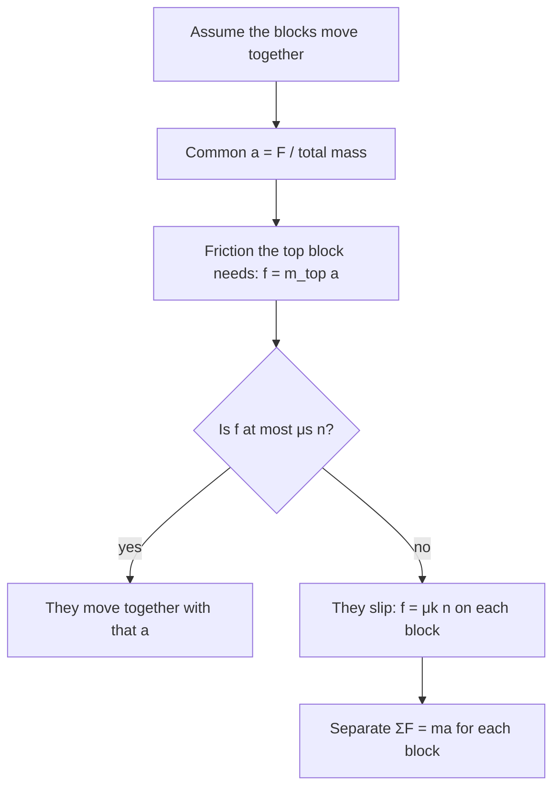

## Beyond one block on one surface

The friction lesson treated one object sliding (or not) on a fixed surface, and the tension lesson connected objects with ideal ropes. Real machines combine the two: a load carried on a truck bed, a book on a board being pulled out from under it, a sled hauled with a rope, a boat's mooring line wrapped around a post. This lesson works through three such systems. Each one uses only $f_s \le \mu_s n$, $f_k = \mu_k n$ and $\sum\vec F = m\vec a$, but each needs a careful free-body diagram and one new idea: friction that pushes an object *forward*, an angle you can optimize with calculus, and a tension that changes continuously along a rope.

## Two objects held together by friction

Put a box on the flat bed of a truck and accelerate the truck. Nothing pushes the box forward except the bed, through static friction. So friction on the box points *forward*, in the direction of its acceleration. This surprises many students, who expect friction always to point backward. The rule is that friction opposes *relative* sliding between the two surfaces: without friction the box would slide backward relative to the bed, so friction pushes it forward. By the third law, the box pushes the bed backward with the same friction force.

How hard can the truck accelerate before the box slides? The largest friction the box can get is $\mu_s n = \mu_s mg$, so its largest acceleration is

$$a_{\max} = \frac{\mu_s mg}{m} = \mu_s g.$$

The box's mass cancels. A truck that accelerates faster than $\mu_s g$ leaves its load behind.

The same reasoning handles two stacked blocks with the force applied to the bottom one. The reliable method has two stages:

1. **Assume they move together.** Treat both as one system to find the common acceleration $a$, then find the friction the top block needs: $f = m_{\text{top}}a$.
2. **Check the assumption.** If $f \le \mu_s n_{\text{top}}$, they really do move together. If not, they slip, and you redo the problem with kinetic friction and a separate acceleration for each block.



```shape
{"polygons": [{"points": [[0, 0], [6, 0], [6, 1], [0, 1]]}, {"points": [[3.6, 1], [5.4, 1], [5.4, 2.2], [3.6, 2.2]]}], "segments": [{"from": [-2, -0.1], "to": [8.5, -0.1]}, {"from": [6, 0.5], "to": [8, 0.5], "arrow": true, "label": "F"}, {"from": [4.1, 1.6], "to": [5.3, 1.6], "arrow": true, "label": "f on top block"}, {"from": [5, 0.6], "to": [3.8, 0.6], "arrow": true, "label": "f on board"}], "labels": [{"at": [1.5, 0.5], "text": "board, 6.0 kg"}, {"at": [4.5, 2.5], "text": "book, 2.0 kg"}], "caption": "A book on a board pulled by F: friction pushes the book forward and the board backward (a third-law pair)"}
```

### Example 1: how hard can you pull?

A 2.0 kg book lies on a 6.0 kg board, which rests on a frictionless floor. Between book and board, $\mu_s = 0.40$ and $\mu_k = 0.30$. You pull the board horizontally. What is the largest force for which the book doesn't slip?

The book's largest acceleration is $\mu_s g = 0.40(9.8) = 3.92$ m/s². If the book and board move together, the whole 8.0 kg system has that acceleration, so

$$F_{\max} = (m_{\text{book}} + m_{\text{board}})\,\mu_s g = 8.0(3.92) = 31.4\text{ N}.$$

Notice that the friction between the blocks is *internal* to the two-block system, so it doesn't appear in $F = Ma$ for the whole system; it only limits how large $a$ can be.

### Example 2: when they slip

Now you pull the same board with 50 N. Does the book slip? If so, find each acceleration, and how long the book takes to slide 0.50 m back to the board's rear edge.

*Check the assumption.* Moving together, $a = 50/8.0 = 6.25$ m/s², so the book would need $f = 2.0(6.25) = 12.5$ N of friction. The most static friction can give is $\mu_s n = 0.40(2.0)(9.8) = 7.84$ N. Not enough: the book slips.

*Slipping.* Now kinetic friction acts: $f_k = 0.30(2.0)(9.8) = 5.88$ N, forward on the book and backward on the board.

- Book: $5.88 = 2.0\,a_{\text{book}}$, so $a_{\text{book}} = 2.94$ m/s² forward.
- Board: $50 - 5.88 = 6.0\,a_{\text{board}}$, so $a_{\text{board}} = 7.35$ m/s² forward.

Both move forward, but the board gains on the book at a **relative acceleration** of $7.35 - 2.94 = 4.41$ m/s². Starting from rest, the book slides 0.50 m back along the board when $\tfrac12(4.41)t^2 = 0.50$, so $t = 0.48$ s. Relative to the floor, the book moves forward the whole time; it just doesn't keep up.

## Pulling at the best angle

When you drag a heavy crate with a rope, pulling slightly upward helps: the upward part of the pull lowers the normal force and therefore the friction. Pull too steeply, though, and little of the force is left to move the crate forward. Calculus finds the best compromise.

Pull with force $F$ at angle $\theta$ above horizontal, at constant velocity, on a floor with kinetic coefficient $\mu$. Vertically, $n = mg - F\sin\theta$. Horizontally, $F\cos\theta = \mu n = \mu(mg - F\sin\theta)$. Solving for $F$:

$$F(\theta) = \frac{\mu mg}{\cos\theta + \mu\sin\theta}.$$

$F$ is smallest where the denominator is largest. Setting its derivative to zero, $-\sin\theta + \mu\cos\theta = 0$, so

$$\tan\theta_{\text{best}} = \mu, \qquad F_{\min} = \frac{\mu mg}{\sqrt{1 + \mu^2}}.$$

(At $\tan\theta = \mu$, $\cos\theta = 1/\sqrt{1+\mu^2}$ and $\sin\theta = \mu/\sqrt{1+\mu^2}$, so the denominator is $\sqrt{1+\mu^2}$.) The angle whose tangent is $\mu$ is called the **angle of friction**. It has already appeared once: a block on an incline is on the verge of slipping when $\tan\theta = \mu_s$, so that incline is tilted at the angle of friction too. Geometrically, the normal force and friction add to a single contact force that leans back from the normal by the angle of friction; pulling at that angle makes your rope perpendicular to the contact force, which wastes nothing.

### Example 3

A 40 kg crate is dragged at constant speed across a floor with $\mu_k = 0.50$. Compare a horizontal pull with the best angle.

Horizontal: $F = \mu mg = 0.50(40)(9.8) = 196$ N.

Best angle: $\theta = \tan^{-1}(0.50) = 26.6^\circ$, and $F_{\min} = \dfrac{196}{\sqrt{1.25}} = 175$ N, about 11% less. The rope then lifts with $F\sin\theta = 78$ N, well below the crate's 392 N weight, so the crate stays on the floor and the formula holds. (If $F\sin\theta$ came out larger than $mg$, the crate would lift off and this model would no longer apply.)

## Rope around a post: the capstan equation

Sailors have long known that a rope wrapped a few turns around a post (a bollard or capstan) lets one person hold a load far too heavy to hold by hand. The reason is friction that acts all along the wrapped part of the rope.


Take a short piece of rope that covers a small angle $d\theta$ of the post, as in the picture, with tension $T$ at one end and $T + dT$ at the other. The two tension forces aren't quite opposite: each tilts toward the post by $d\theta/2$, so together they press the piece against the post with a force $T\,d\theta$ (to first order). The post pushes back with a normal force $dn = T\,d\theta$. Along the rope, the difference in tension must be balanced by friction. When the rope is on the verge of slipping, friction has its maximum value $\mu\,dn$:

$$dT = \mu T\,d\theta.$$

This is the same differential equation as exponential growth. Separating and integrating over the whole wrapped part, from the holding end ($T_{\text{hold}}$) to the load end ($T_{\text{load}}$):

$$\int_{T_{\text{hold}}}^{T_{\text{load}}}\frac{dT}{T} = \mu\int_0^{\theta}d\theta \quad\Longrightarrow\quad T_{\text{load}} = T_{\text{hold}}\,e^{\mu\theta}.$$

This is the **capstan equation**, also called the Euler–Eytelwein formula. The **wrap angle** $\theta$ is the total angle of post the rope touches, in radians: $2\pi$ for each full turn. Three features stand out:

- The tension ratio grows *exponentially* with the wrap angle, so each extra turn multiplies the holding power by the same factor.
- The radius of the post doesn't appear. A thin pole and a thick bollard give the same ratio (in this idealized model).
- With $\mu_s$, it gives the largest load you can hold without slipping. If the rope is already sliding, use $\mu_k$; the same formula then relates the tensions on either side of, say, a rope being lowered over a fixed rod.

The model is simplified: it treats the rope as flexible and massless and assumes one constant $\mu$ all along the contact. Real ropes are stiff and stretch, so the measured ratio differs somewhat, but the exponential growth with wrap angle is real and is why a few turns make such a difference.

### Example 4

A sailor wraps a mooring line three full turns around a bollard, with $\mu_s = 0.30$ between rope and bollard. Holding the free end with 100 N, what is the largest pull from the boat she can resist? How much would one turn resist?

Three turns: $\theta = 3(2\pi) = 6\pi = 18.85$ rad, and $\mu\theta = 5.65$.

$$T_{\text{load}} = 100\,e^{5.65} = 100(286) = 2.86\times10^{4}\text{ N}.$$

About 29 kN, the weight of a mass of roughly 2.9 tonnes, held with a pull she could keep up all day. With one turn, $e^{0.30(2\pi)} = e^{1.885} = 6.6$, so she could resist only about 660 N. Going from one turn to three multiplies the ratio by $6.6^2 \approx 43$.

## Common mistakes

- Assuming friction on an object always points backward. Static friction on a box in an accelerating truck points forward, the way the box accelerates.
- Using $f = \mu_s n$ for stacked blocks without first checking that they slip; if they move together, friction is only what the top block needs.
- Including the friction between two stacked blocks when treating them as one system (it's internal).
- In the best-angle problem, keeping $n = mg$; the upward pull reduces $n$, which is the whole point.
- In the capstan equation, using degrees or "number of turns" for $\theta$ instead of radians, or putting the larger tension on the holding side.

## Key points

- Friction opposes relative sliding; it can push an object forward. A load stays on an accelerating truck only if $a \le \mu_s g$.
- Stacked blocks: assume they move together, find the needed friction, check it against $\mu_s n$; if they slip, write separate equations with $\mu_k n$.
- The pull that drags a crate with least force is at $\tan\theta = \mu$, the angle of friction, with $F_{\min} = \mu mg/\sqrt{1 + \mu^2}$.
- Capstan equation: $T_{\text{load}} = T_{\text{hold}}e^{\mu\theta}$, with $\theta$ the wrap angle in radians, independent of the post's radius.
