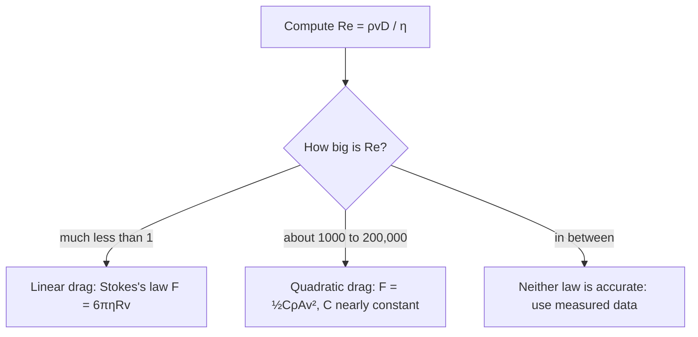

## Motion through air and water

The friction lesson ended with a short look at drag: a falling object with drag $bv$ approaches a terminal velocity $mg/b$ exponentially, and fast objects in air feel a drag closer to $\tfrac12 C\rho Av^2$. This lesson takes drag seriously. It asks which drag law applies when, solves Newton's second law exactly for the quadratic law, and uses the solutions to see how much drag changes a fall or a vertical throw. Along the way you'll meet the most important number in fluid mechanics, the Reynolds number.

## Two drag laws

Drag is the force a fluid (air, water, oil) exerts on an object moving through it, opposite to the object's velocity relative to the fluid. Two simple laws cover most cases.

**Linear drag**, $F_D = bv$, applies to small or slow objects in a viscous fluid: dust and droplets in air, bacteria and silt in water, a ball bearing sinking in honey. The fluid flows smoothly around the object, and the drag comes from the fluid's viscosity $\eta$ (its internal friction, in Pa·s). For a sphere of radius $R$, George Stokes worked out in 1851 that

$$F_D = 6\pi\eta R v,$$

which is **Stokes's law**: here $b = 6\pi\eta R$.

**Quadratic drag**, $F_D = \tfrac12 C\rho A v^2$, applies to larger, faster objects: balls, cars, people, raindrops a few millimeters across. The object has to shove fluid out of its way and leaves a turbulent wake behind it, so the drag depends on the fluid's density $\rho$ rather than its viscosity. $A$ is the object's cross-sectional area facing the flow, and the **drag coefficient** $C$ is a dimensionless number that depends on shape: roughly 0.5 for a smooth sphere, about 1 for a person falling flat, about 0.3 for a streamlined car. These values are approximate; $C$ is measured, not derived, and it changes somewhat with speed.

It's convenient to write the quadratic law as $F_D = cv^2$ with $c = \tfrac12 C\rho A$ (units kg/m).

## Which law? The Reynolds number

The choice between the two laws is decided by the **Reynolds number**,

$$Re = \frac{\rho v D}{\eta},$$

where $D$ is the object's size (a sphere's diameter) and $\rho$ and $\eta$ belong to the fluid. It is dimensionless, and it compares the inertia of the fluid being pushed aside with the viscous forces that smooth the flow. As a rough guide for a sphere:



The boundaries are not sharp, and the picture is simplified: above $Re \approx 2\times10^5$ the flow around a sphere changes again and $C$ drops suddenly (the "drag crisis" that dimples on a golf ball exploit). For air, $\rho \approx 1.2$ kg/m³ and $\eta \approx 1.8\times10^{-5}$ Pa·s, so $Re \approx 7\times10^4\,vD$ in SI units: a 10 cm ball at 10 m/s has $Re \approx 7\times10^4$, well inside the quadratic range.

### Example 1: a cloud droplet

A water droplet of radius 10 μm falls through still air ($\eta = 1.8\times10^{-5}$ Pa·s). Find its terminal speed, check the drag law, and estimate how long it takes to reach terminal speed.

Mass: $m = \rho_w\cdot\tfrac43\pi R^3 = 1000\cdot\tfrac43\pi(10^{-5})^3 = 4.19\times10^{-12}$ kg. (The buoyant force of the air is about a thousandth of the weight, so we ignore it.)

Terminal speed with Stokes drag, from $mg = 6\pi\eta Rv_T$:

$$v_T = \frac{mg}{6\pi\eta R} = \frac{(4.19\times10^{-12})(9.8)}{6\pi(1.8\times10^{-5})(10^{-5})} = 0.012\text{ m/s},$$

about 1.2 cm/s. Check: $Re = \dfrac{1.2(0.012)(2\times10^{-5})}{1.8\times10^{-5}} = 0.016$, much less than 1, so the linear law was the right choice. The time constant $m/b = v_T/g$ is about 1.2 ms, so the droplet reaches terminal speed almost instantly. Droplets this small drift on the slightest updraft, which is why clouds float.

## Falling with quadratic drag

Take down as positive. Newton's second law for an object falling from rest with quadratic drag is

$$m\frac{dv}{dt} = mg - cv^2.$$

The acceleration is zero when $cv^2 = mg$, so the terminal velocity is $v_T = \sqrt{mg/c} = \sqrt{2mg/(C\rho A)}$. Writing $mg - cv^2 = c(v_T^2 - v^2)$ and separating variables,

$$\int_0^v \frac{dv}{v_T^2 - v^2} = \frac{c}{m}\int_0^t dt = \frac{g}{v_T^2}\,t.$$

The integral on the left is $\dfrac{1}{v_T}\tanh^{-1}\!\left(\dfrac{v}{v_T}\right)$, so

$$v(t) = v_T\tanh\!\left(\frac{gt}{v_T}\right).$$

The natural time scale is $\tau = v_T/g$, the time free fall would take to reach $v_T$. Integrating once more gives the distance fallen, $y(t) = \dfrac{v_T^2}{g}\ln\cosh\!\left(\dfrac{gt}{v_T}\right)$.

Early on, $\tanh u \approx u$, so $v \approx gt$: drag is negligible while the object is slow. Late, $\tanh u \to 1$ and $v \to v_T$. Compared with linear drag, $v_T(1 - e^{-t/\tau})$ with the same $v_T$ and $\tau$, the quadratic curve stays close to free fall longer and then levels off more sharply, because quadratic drag is weak at low speed and strong at high speed.

```plot
{"x": [0, 20], "y": [0, 80], "xLabel": "t (s)", "yLabel": "v (m/s)", "functions": [{"f": "9.8*x", "label": "no drag", "dashed": true}, {"f": "51.6*tanh(x/5.27)", "label": "quadratic drag"}, {"f": "51.6*(1 - exp(-x/5.27))", "label": "linear drag"}, {"f": "51.6", "dashed": true}], "labels": [{"at": [16, 55], "text": "v_T = 51.6 m/s"}], "caption": "Speed of the skydiver in Example 2 with quadratic drag, compared with free fall and with a linear drag law giving the same terminal speed"}
```

### Example 2: a skydiver

An 80 kg skydiver falls belly-down with $C = 0.70$ and $A = 0.70$ m² in air of density 1.2 kg/m³. Find her terminal speed, the time to reach 90% of it, and how far she falls in that time.

$c = \tfrac12(0.70)(1.2)(0.70) = 0.294$ kg/m, so

$$v_T = \sqrt{\frac{mg}{c}} = \sqrt{\frac{80(9.8)}{0.294}} = 51.6\text{ m/s} \approx 186\text{ km/h}.$$

Time constant: $\tau = v_T/g = 5.27$ s. Ninety percent of $v_T$ needs $\tanh(t/\tau) = 0.90$, so $t = \tau\tanh^{-1}(0.90) = 5.27(1.472) = 7.76$ s.

Distance: $y = \dfrac{v_T^2}{g}\ln\cosh(1.472) = 272(0.830) = 226$ m.

Without drag, 7.76 s of free fall would give 76 m/s and 295 m. Drag has taken off a third of her speed already, and from then on she gains almost nothing: the rest of a long jump is at a steady speed near 52 m/s. (These numbers are for illustration; real skydivers change $C$ and $A$ a lot just by changing posture.)

## Thrown upward

On the way up, gravity and drag both point down. With up positive,

$$m\frac{dv}{dt} = -mg - cv^2 = -\frac{mg}{v_T^2}\left(v_T^2 + v^2\right),$$

using the same $v_T = \sqrt{mg/c}$. Separating, $\int \dfrac{dv}{v_T^2 + v^2} = \dfrac{1}{v_T}\tan^{-1}\dfrac{v}{v_T}$, and the time to reach the top from launch speed $v_0$ is

$$t_{\text{up}} = \frac{v_T}{g}\tan^{-1}\!\left(\frac{v_0}{v_T}\right).$$

For the height, use the chain rule $\dfrac{dv}{dt} = v\dfrac{dv}{dy}$, which turns the equation into one for $v$ as a function of height:

$$v\frac{dv}{dy} = -\frac{g}{v_T^2}\left(v_T^2 + v^2\right) \quad\Longrightarrow\quad h = \frac{v_T^2}{2g}\ln\!\left(1 + \frac{v_0^2}{v_T^2}\right).$$

The same trick on the way down gives the speed after falling a height $h$ from rest: $v^2 = v_T^2\left(1 - e^{-2gh/v_T^2}\right)$.

### Example 3: a ball thrown straight up

A ball is thrown straight up at 30 m/s. Its terminal speed is about 35 m/s (a rough figure for a baseball). Compare the flight with and without drag.

$\tau = v_T/g = 35/9.8 = 3.57$ s.

Time up: $t_{\text{up}} = 3.57\tan^{-1}(30/35) = 3.57(0.709) = 2.53$ s, versus $30/9.8 = 3.06$ s without drag.

Height: $h = \dfrac{35^2}{2(9.8)}\ln\!\left(1 + \dfrac{900}{1225}\right) = 62.5(0.551) = 34.4$ m, versus $\dfrac{30^2}{2(9.8)} = 45.9$ m without drag.

Return speed: $v^2 = v_T^2(1 - e^{-2gh/v_T^2})$. Since $e^{2gh/v_T^2} = 1 + v_0^2/v_T^2$, this simplifies to $v = \dfrac{v_0v_T}{\sqrt{v_0^2 + v_T^2}} = \dfrac{30(35)}{\sqrt{2125}} = 22.8$ m/s, not 30 m/s. The fall back takes $\tau\tanh^{-1}(22.8/35) = 2.77$ s, longer than the 2.53 s trip up: with drag, the descent is slower than the ascent, and the ball lands with less speed than it was thrown with. Drag has turned mechanical energy into heat in the air.

## Common mistakes

- Using quadratic drag for tiny particles (or Stokes drag for a ball): check the Reynolds number.
- Forgetting that drag acts opposite the *velocity*: down on the way up, up on the way down. The sign of the $cv^2$ term changes between the two halves of a throw.
- Treating $C$ as a universal constant. It depends on shape, and its quoted values are approximate.
- Assuming the time constant is the time to reach terminal velocity; the speed only approaches $v_T$, reaching 76% of it at $t = \tau$ for quadratic drag ($\tanh 1 = 0.76$) and 63% for linear drag.
- Assuming the up and down trips take equal times, as they do without drag.

## Key points

- Linear drag $bv$ (Stokes: $b = 6\pi\eta R$) for $Re \ll 1$; quadratic drag $\tfrac12C\rho Av^2$ for $Re$ of about $10^3$ to $2\times10^5$. $Re = \rho vD/\eta$.
- Quadratic drag, falling from rest: $v_T = \sqrt{2mg/(C\rho A)}$, $v = v_T\tanh(gt/v_T)$, $y = (v_T^2/g)\ln\cosh(gt/v_T)$.
- Thrown up: $t_{\text{up}} = (v_T/g)\tan^{-1}(v_0/v_T)$ and $h = \dfrac{v_T^2}{2g}\ln(1 + v_0^2/v_T^2)$.
- $v\,dv/dy$ turns a velocity-dependent force into an equation in height.
- With drag, the trip down is slower than the trip up, and the landing speed is less than the launch speed.
