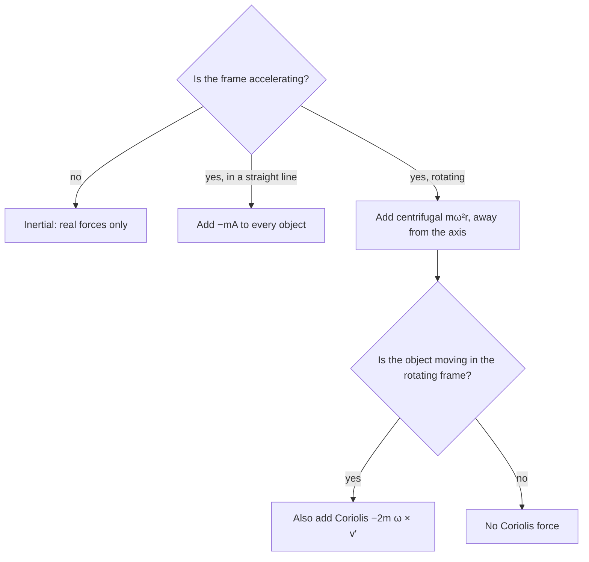

## When Newton's laws seem to fail

The Newton's-laws lesson pointed out that the laws hold in inertial (non-accelerating) frames, and that a coffee cup sliding backward in an accelerating car has no force pushing it. The circular-motion lesson added that "centrifugal force" is something you feel in a turning car, not a real force in an inertial frame. Both remarks raise a question: what if we *want* to work in the car's frame, or on a merry-go-round, or on the rotating Earth, where all our measurements are actually made? This lesson shows how. In an accelerating frame you can keep using $\sum\vec F = m\vec a$ if you add **fictitious forces** (also called inertial forces or pseudo-forces): terms that come from the frame's acceleration, not from any object pushing or pulling.

## A frame with constant acceleration

Let a frame (a car, an elevator) accelerate at $\vec A$ relative to an inertial frame. An object's acceleration measured in the car, $\vec a'$, is its true acceleration minus the car's: $\vec a' = \vec a - \vec A$. Multiply by $m$ and use $m\vec a = \sum\vec F$:

$$m\vec a' = \sum\vec F_{\text{real}} - m\vec A.$$

So in the car's frame, Newton's second law works if you add one extra force, $-m\vec A$, to every object: a fictitious force opposite the frame's acceleration and proportional to the object's mass. A frame where this is needed is a **non-inertial frame**.

The fictitious force is proportional to $m$, exactly like gravity. That means you can lump the two together into an **effective gravity**:

$$\vec g_{\text{eff}} = \vec g - \vec A.$$

Inside the car, everything behaves as if gravity were $\vec g_{\text{eff}}$: a plumb line hangs along it, a liquid's surface sets perpendicular to it, and a scale reads $mg_{\text{eff}}$. The elevator problems from the Newton's-laws lesson are this idea in one dimension: accelerating upward at $a$, the effective gravity is $g + a$ and you feel heavier; in free fall, $\vec A = \vec g$, so $\vec g_{\text{eff}} = 0$ and you float.

Fictitious forces have no agent and no third-law partner: nothing pulls the cup backward, and the cup pulls nothing forward. That is the test that tells them apart from real forces.

### Example 1: a pendulum in an accelerating van

A van accelerates forward at 3.0 m/s². A small mass hangs from the ceiling on a string. At what angle from vertical does the string hang (once it stops swinging), and what is the effective gravity?

*Van frame.* The bob is at rest in the van, so the forces on it, including the fictitious one, add to zero. Vertically, $T\cos\theta = mg$. Horizontally, the string's pull forward balances the fictitious force backward: $T\sin\theta = mA$. Dividing,

$$\tan\theta = \frac{A}{g} = \frac{3.0}{9.8}, \qquad \theta = 17.0^\circ \text{ toward the rear}.$$

$g_{\text{eff}} = \sqrt{9.8^2 + 3.0^2} = 10.2$ m/s², pointing down and backward along the string.

*Ground frame, as a check.* There's no fictitious force; the bob accelerates forward at 3.0 m/s², so the string's horizontal pull must supply $mA$: $T\sin\theta = mA$, the same equation. The two frames always agree; the fictitious force is just $m\vec a$ moved to the other side of the equation.

### Example 2: holding a block still on an accelerating wedge

A block sits on a frictionless $20^\circ$ wedge. How fast must the wedge accelerate horizontally (toward the side the block would slide off) so the block stays put on the slope?

In the wedge's frame, the block is at rest under its weight $mg$, the normal force $n$ and the fictitious force $mA$, which points horizontally toward the uphill side (opposite the wedge's acceleration). Along the slope, the down-slope part of the weight, $mg\sin\theta$, must balance the up-slope part of the fictitious force, $mA\cos\theta$:

$$A = g\tan\theta = 9.8\tan 20^\circ = 3.57\text{ m/s}^2.$$

Equivalently, $\vec g_{\text{eff}}$ must be perpendicular to the slope, so the slope is "level" in the effective gravity. Compare the banked curve: there, too, the speed is right when the net of gravity and the needed acceleration is perpendicular to the road.

## Rotating frames: centrifugal and Coriolis forces

A rotating frame (a merry-go-round, a space station, the Earth) is non-inertial even though its center stays put, because every point in it is accelerating toward the axis. For a frame rotating at constant angular velocity $\vec\omega$, a careful derivation (beyond this lesson) gives, for an object at position $\vec r$ from the axis moving with velocity $\vec v'$ in the rotating frame,

$$m\vec a' = \sum\vec F_{\text{real}} \;-\; m\vec\omega\times(\vec\omega\times\vec r) \;-\; 2m\vec\omega\times\vec v'.$$

The two extra terms are:

- the **centrifugal force**, $-m\vec\omega\times(\vec\omega\times\vec r)$, which points directly away from the axis with magnitude $m\omega^2 r_\perp$ ($r_\perp$ is the distance from the axis). It acts on every object in the frame, moving or not.
- the **Coriolis force**, $-2m\vec\omega\times\vec v'$, which acts only on objects *moving* in the rotating frame. It is perpendicular to the velocity, so it changes direction, not speed, and does no work. Its size is $2m\omega v'$ when the motion is perpendicular to the axis.

An object at rest on a merry-go-round feels the centrifugal force balanced by whatever holds it in place (friction, a handrail). From the ground, the same handrail force is simply the centripetal force making it go around: the same physics, described from two frames.

### Example 3: artificial gravity in a space station

A ring-shaped space station of radius 100 m spins so that astronauts standing on the outer wall feel normal Earth gravity. (a) What angular speed and period are needed? (b) An astronaut runs along the floor at 1.5 m/s in the direction of spin. How big is the Coriolis force on her, as a fraction of her weight?

(a) In the station frame, the floor's normal force balances the centrifugal force, so the "weight" she feels is $m\omega^2 r$. Setting $\omega^2 r = 9.8$:

$$\omega = \sqrt{\frac{9.8}{100}} = 0.313\text{ rad/s}, \qquad T = \frac{2\pi}{\omega} = 20.1\text{ s},$$

about 3 revolutions per minute.

(b) Coriolis acceleration: $2\omega v' = 2(0.313)(1.5) = 0.94$ m/s², about 10% of $g$. Running with the spin, it points away from the axis (into the floor), so she feels about 10% heavier; running against the spin, about 10% lighter. A dropped wrench doesn't fall "straight down" either. Effects like these are one reason designers of rotating habitats favor large radii and slow spins.

From the inertial frame, part (b) is ordinary circular motion: she is now going around at $\omega r + v'$, so the floor must supply $(\omega r + v')^2/r = 9.8 + 0.94 + 0.02$ m/s² of inward acceleration. The Coriolis term is the middle piece of that square.

## The rotating Earth

Earth turns once per sidereal day (23.93 h), so $\omega = 7.29\times10^{-5}$ rad/s. Standing on it, we are in a rotating frame, and both fictitious forces show up, though weakly.

*Centrifugal.* At the equator, $\omega^2R = (7.29\times10^{-5})^2(6.38\times10^6) = 0.034$ m/s². This is part of the reason the measured free-fall acceleration is about 9.78 m/s² at the equator and 9.83 m/s² at the poles; Earth's slightly flattened shape provides the rest. The "$g$" we measure and use is already the effective gravity, real gravity plus the centrifugal term.

*Coriolis.* Moving objects in the Northern Hemisphere are deflected to the right of their motion, and in the Southern Hemisphere to the left. Over a few seconds the effect is tiny: an object dropped from rest from a 100 m tower at the equator falls for 4.5 s and lands only about $\tfrac13\omega g t^3 \approx 2$ cm east of the point directly below. Over hours and hundreds of kilometers it is large: air flowing in toward a low-pressure center is deflected to the right, which is why hurricanes turn counterclockwise in the Northern Hemisphere and clockwise in the Southern. It also explains the **Foucault pendulum**, first shown in Paris in 1851: the plane of a long pendulum's swing slowly turns relative to the floor, once every $23.93\text{ h}/\sin\lambda$ at latitude $\lambda$ (about 32 h in Paris), direct evidence that the Earth rotates.

## Common mistakes

- Adding fictitious forces while working in an inertial (ground) frame. Pick one frame per problem: real forces only in an inertial frame; real plus fictitious forces in a non-inertial one.
- Looking for a third-law partner or an agent for a fictitious force. It has neither.
- Confusing centrifugal with centripetal. Centripetal is the real net inward force in an inertial frame; centrifugal is the fictitious outward force in the rotating frame.
- Forgetting the Coriolis force for objects that move in a rotating frame, or applying it to objects at rest there.
- Believing the Coriolis force decides which way a sink or toilet drains. For a basin a meter across it is far weaker than leftover swirls from filling and the basin's shape; it only dominates for large, slow flows like weather systems.

## Key points

- In a frame accelerating at $\vec A$, add the fictitious force $-m\vec A$; equivalently, use effective gravity $\vec g_{\text{eff}} = \vec g - \vec A$.
- A plumb line or pendulum at rest hangs along $\vec g_{\text{eff}}$: $\tan\theta = A/g$ in a forward-accelerating vehicle.
- Rotating frames: centrifugal force $m\omega^2r_\perp$ away from the axis on everything; Coriolis force $-2m\vec\omega\times\vec v'$ on moving objects only, perpendicular to their velocity.
- Artificial gravity on a ring of radius $r$ needs $\omega = \sqrt{g/r}$.
- Earth's rotation lowers effective gravity slightly at the equator, steers hurricanes and turns the Foucault pendulum.
