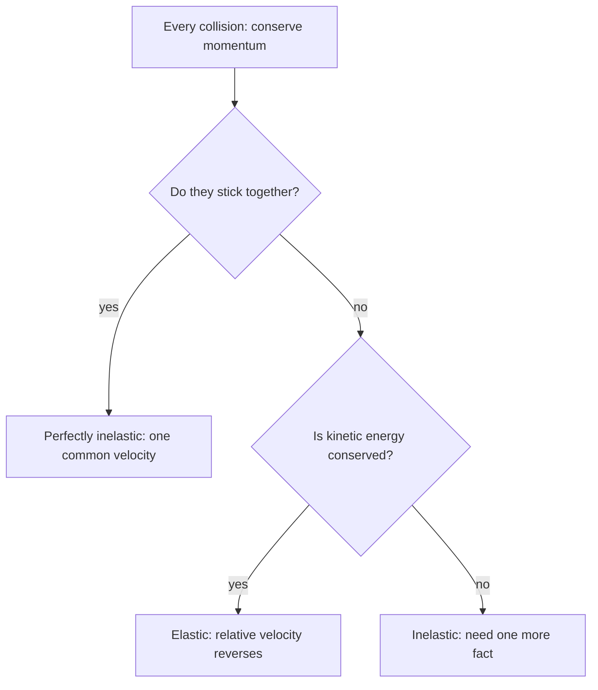

## Momentum always, energy sometimes

In a collision two objects exert large forces on each other for a short time. Those forces are internal to the two-object system, so total momentum is conserved (external forces like friction are negligible during the brief impact). Kinetic energy is a different story: depending on how the objects deform, stick or bounce, some kinetic energy may turn into heat, sound and permanent deformation. This lesson classifies collisions by what happens to kinetic energy and shows how to solve each kind, in one and two dimensions.

## Types of collisions

- **Elastic collision**: kinetic energy is conserved as well as momentum. Collisions between billiard balls, steel ball bearings, or gas molecules are nearly elastic.
- **Inelastic collision**: momentum is conserved but kinetic energy is not; some is converted to other forms. Most real collisions are inelastic.
- **Perfectly inelastic collision**: the objects stick together and move with a common final velocity. This loses the most kinetic energy that momentum conservation allows.

In every case, momentum is conserved. Kinetic energy is never *gained* in a collision unless stored energy is released (an explosion, a compressed spring).



## Perfectly inelastic collisions

With a common final velocity $v_f$,

$$m_1v_{1i} + m_2v_{2i} = (m_1 + m_2)v_f.$$

One equation, one unknown.

### Example 1

A 1500 kg car moving east at 20 m/s rear-ends a 1000 kg car moving east at 10 m/s, and they lock bumpers. Find their common velocity and the kinetic energy lost.

$1500(20) + 1000(10) = 2500\,v_f$, so $v_f = 40\,000/2500 = 16$ m/s east.

$K_i = \tfrac12(1500)(400) + \tfrac12(1000)(100) = 300\,000 + 50\,000 = 350\,000$ J.
$K_f = \tfrac12(2500)(256) = 320\,000$ J.

Lost: 30 000 J, about 8.6% of the initial kinetic energy. (In a head-on collision with the same speeds, far more is lost, since the momenta partly cancel.)

### Example 2: the ballistic pendulum

A 10 g bullet is fired into a 2.0 kg wooden block hanging from strings. The block (with the bullet embedded) swings up 0.12 m. How fast was the bullet moving?

This is a two-stage problem, and each stage uses a different conservation law.

*Stage 1, the collision* (perfectly inelastic, very brief): momentum is conserved, energy is not. $mv = (m + M)V$.

*Stage 2, the swing*: no collision, only gravity does work, so mechanical energy is conserved: $\tfrac12(m + M)V^2 = (m + M)gh$, giving $V = \sqrt{2gh} = \sqrt{2(9.8)(0.12)} = 1.534$ m/s.

Back to stage 1: $v = \dfrac{m + M}{m}V = \dfrac{2.010}{0.010}(1.534) = 308$ m/s.

Using energy conservation across the collision would give a badly wrong answer: over 99% of the bullet's kinetic energy becomes heat and deformation in the wood.

## Elastic collisions in one dimension

For a head-on elastic collision, both momentum and kinetic energy are conserved:

$$m_1v_{1i} + m_2v_{2i} = m_1v_{1f} + m_2v_{2f},$$
$$\tfrac12m_1v_{1i}^2 + \tfrac12m_2v_{2i}^2 = \tfrac12m_1v_{1f}^2 + \tfrac12m_2v_{2f}^2.$$

Solving these together (factor the energy equation as a difference of squares and divide by the momentum equation) gives a much simpler linear condition: the relative velocity reverses,

$$v_{1i} - v_{2i} = -(v_{1f} - v_{2f}).$$

For target $m_2$ initially at rest, the results are

$$v_{1f} = \frac{m_1 - m_2}{m_1 + m_2}\,v_{1i}, \qquad v_{2f} = \frac{2m_1}{m_1 + m_2}\,v_{1i}.$$

Three special cases build intuition:

- *Equal masses*: $v_{1f} = 0$, $v_{2f} = v_{1i}$. The moving ball stops and the target takes all its velocity (Newton's cradle, a pool cue ball's "stop shot").
- *Heavy hits light* ($m_1 \gg m_2$): the heavy object barely slows, and the light one leaves at about $2v_{1i}$.
- *Light hits heavy* ($m_1 \ll m_2$): the light object bounces back with nearly its original speed; the heavy one barely moves (a ball bouncing off a wall).

The graph shows both final velocities, as fractions of $v_{1i}$, for every mass ratio:

```plot
{"x": [0, 6], "y": [-1.1, 2.1], "xLabel": "mass ratio m₁/m₂", "yLabel": "final velocity ÷ v₁ᵢ", "functions": [{"f": "(x - 1)/(x + 1)", "label": "projectile"}, {"f": "2*x/(x + 1)", "label": "target"}], "points": [{"at": [1, 0]}], "labels": [{"at": [2.1, -0.45], "text": "equal masses"}], "caption": "Elastic head-on collision with the target at rest: the projectile bounces back when m₁ < m₂; the target never exceeds twice v₁ᵢ"}
```

### Example 3

A 0.30 kg cart moving at 2.0 m/s collides elastically with a 0.20 kg cart at rest. Find both final velocities.

$v_{1f} = \dfrac{0.30 - 0.20}{0.50}(2.0) = 0.40$ m/s; $v_{2f} = \dfrac{2(0.30)}{0.50}(2.0) = 2.4$ m/s.

Check momentum: $0.30(0.40) + 0.20(2.4) = 0.12 + 0.48 = 0.60 = 0.30(2.0)$ ✓. Check energy: $\tfrac12(0.30)(0.16) + \tfrac12(0.20)(5.76) = 0.024 + 0.576 = 0.60$ J $= \tfrac12(0.30)(4.0)$ ✓. Relative velocity: $2.0 - 0 = 2.0$ before, $2.4 - 0.40 = 2.0$ apart after ✓.

The **coefficient of restitution** $e = \dfrac{|v_{2f} - v_{1f}|}{|v_{1i} - v_{2i}|}$ measures bounciness: $e = 1$ for elastic, $e = 0$ for perfectly inelastic.

## Collisions in two dimensions

When objects hit off-center they scatter at angles. Momentum is conserved as a vector, giving two equations:

$$\sum p_x \text{ before} = \sum p_x \text{ after}, \qquad \sum p_y \text{ before} = \sum p_y \text{ after}.$$

### Example 4

A 1200 kg car heading east at 15 m/s collides at an intersection with a 1800 kg truck heading north at 12 m/s. They stick together. Find the speed and direction of the wreckage.

$x$: $1200(15) = 3000\,v_x$, so $v_x = 6.0$ m/s.
$y$: $1800(12) = 3000\,v_y$, so $v_y = 7.2$ m/s.

Speed $= \sqrt{6.0^2 + 7.2^2} = 9.37$ m/s, at $\tan^{-1}(7.2/6.0) = 50.2^\circ$ north of east. The momentum vectors add tip to tail: the car's 18 000 kg·m/s east plus the truck's 21 600 kg·m/s north gives the wreckage's 28 100 kg·m/s.


Accident investigators run this calculation in reverse, from skid marks to pre-crash speeds.

A neat result: when equal masses collide elastically with one initially at rest, they move off at right angles to each other (unless the collision is head-on). Energy conservation $v_1^2 = v_{1f}^2 + v_{2f}^2$ plus momentum $\vec v_1 = \vec v_{1f} + \vec v_{2f}$ is the Pythagorean theorem, so the two final velocities must be perpendicular.

## Going further: the center-of-mass frame

In the frame moving with the center of mass, the total momentum is zero: before a collision the objects approach each other with opposite momenta, and afterward they recede with opposite momenta. An elastic collision in this frame just reverses each velocity (in 1D) or rotates the pair of momenta (in 2D). The kinetic energy can be split as $K = \tfrac12Mv_{\text{cm}}^2 + K_{\text{rel}}$, and only the relative part $K_{\text{rel}}$ can be lost; the CM part must remain because $v_{\text{cm}}$ can't change. That explains why a perfectly inelastic collision loses exactly $K_{\text{rel}} = \tfrac12\dfrac{m_1m_2}{m_1 + m_2}(v_{1i} - v_{2i})^2$, the maximum allowed. For Example 1: $\tfrac12(600)(10)^2 = 30\,000$ J, matching.

## Common mistakes

- Assuming kinetic energy is conserved in every collision.
- Using energy conservation through the impact in a ballistic pendulum.
- Dropping signs for objects moving in opposite directions.
- Adding momentum magnitudes instead of components in 2D.

## Key points

- Momentum is conserved in all collisions; kinetic energy only in elastic ones.
- Perfectly inelastic: $m_1v_{1i} + m_2v_{2i} = (m_1 + m_2)v_f$.
- Elastic, target at rest: $v_{1f} = \dfrac{m_1 - m_2}{m_1 + m_2}v_{1i}$, $v_{2f} = \dfrac{2m_1}{m_1 + m_2}v_{1i}$; relative velocity reverses.
- In 2D, conserve $p_x$ and $p_y$ separately.
- Multi-stage problems: momentum through the collision, energy before or after it.
