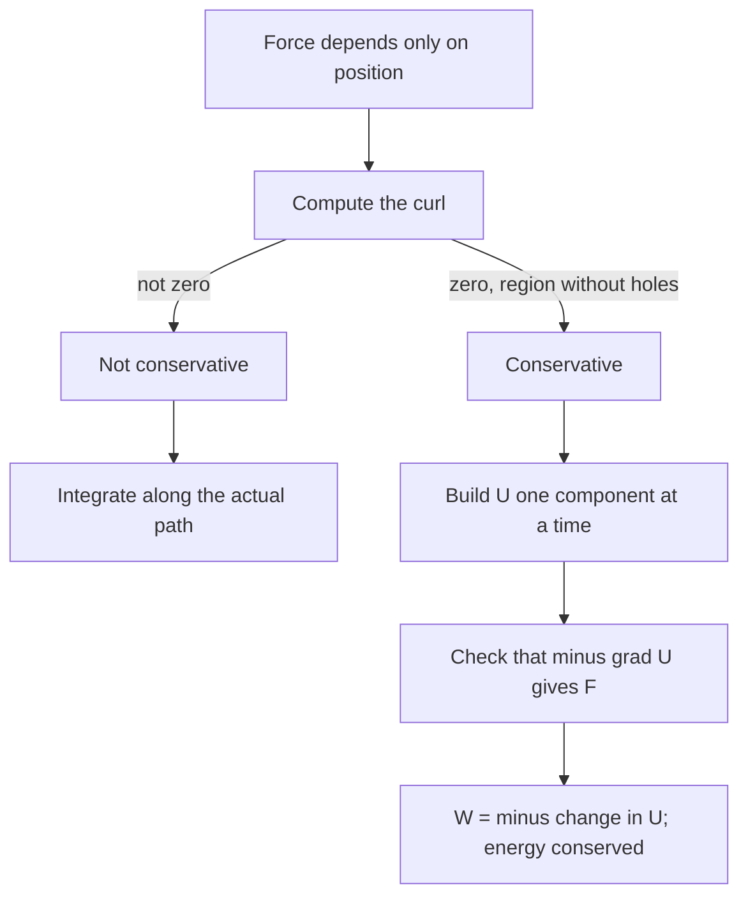

## Beyond one dimension

The energy lesson defined a conservative force as one whose work between two points doesn't depend on the path, and it found the force from the potential energy with $F = -dU/dx$, mentioning $\vec F = -\nabla U$ in three dimensions. Most of its examples, though, were one-dimensional, where almost any force that depends only on position is conservative. In a plane or in space that is no longer true. This lesson answers three questions that come up as soon as a force varies in more than one direction: how do you compute the work along a curved path, how can you tell whether a force is conservative without trying every path, and, if it is, how do you build its potential energy? The tools are the line integral, the curl and the gradient from multivariable calculus, used here for what they mean physically.

## Work along a path

A force that depends on position, $\vec F(x, y, z)$, is a **force field**: it assigns a force vector to every point. The work it does on an object moving along a path $C$ is the **line integral**

$$W = \int_C \vec F\cdot d\vec\ell = \int_C \left(F_x\,dx + F_y\,dy + F_z\,dz\right).$$

To evaluate it, describe the path with a parameter: $\vec r(t) = (x(t), y(t), z(t))$ for $t$ from $t_1$ to $t_2$. Then $d\vec\ell = \vec r\,'(t)\,dt$ and

$$W = \int_{t_1}^{t_2} \vec F(\vec r(t))\cdot\vec r\,'(t)\,dt,$$

an ordinary one-variable integral. The parameter doesn't have to be time; any smooth description of the path gives the same answer. For a path made of straight pieces, add the work on each piece.

### Example 1

Two force fields act in the $xy$-plane (forces in N, positions in m):

$$\vec F_1 = (2xy,\; x^2), \qquad \vec F_2 = (-y,\; x).$$

Find the work each does on an object that moves from $A = (0, 0)$ to $B = (2, 1)$ along path a (along the $x$ axis to $(2, 0)$, then straight up to $(2, 1)$) and along path b (the straight line $y = x/2$).


*Path a, first leg* ($y = 0$, $dy = 0$, $x$ from 0 to 2): only $F_x\,dx$ counts. For $\vec F_1$, $F_x = 2x(0) = 0$, so 0 J. For $\vec F_2$, $F_x = -0 = 0$, so 0 J.

*Path a, second leg* ($x = 2$, $dx = 0$, $y$ from 0 to 1): only $F_y\,dy$ counts. For $\vec F_1$, $\int_0^1 2^2\,dy = 4$ J. For $\vec F_2$, $\int_0^1 2\,dy = 2$ J.

*Path b*: $\vec r(t) = (2t, t)$, $\vec r\,' = (2, 1)$, $t$ from 0 to 1.
- $\vec F_1 = (4t^2, 4t^2)$, so $\vec F_1\cdot\vec r\,' = 8t^2 + 4t^2 = 12t^2$ and $W = \int_0^1 12t^2\,dt = 4$ J.
- $\vec F_2 = (-t, 2t)$, so $\vec F_2\cdot\vec r\,' = -2t + 2t = 0$ and $W = 0$ J.

$\vec F_1$ does 4 J along both paths; $\vec F_2$ does 2 J along one and 0 J along the other. Two paths agreeing doesn't prove $\vec F_1$ is conservative, but the disagreement proves $\vec F_2$ is not.

## Three equivalent statements

For a force field defined on a region, these say the same thing:

1. The work between any two points is the same along every path (**path independence**).
2. The work around every closed path is zero.
3. There is a function $U(x, y, z)$ with $\vec F = -\nabla U$.

Statements 1 and 2 are equivalent because going out along one path and back along another is a closed loop: zero total work means the two one-way works are equal. Statement 3 gives statement 1 by the chain rule: along any path, $\vec F\cdot d\vec\ell = -\nabla U\cdot d\vec\ell = -dU$, so $W = -(U_B - U_A)$ whatever route is taken. Conversely, if the work is path independent you can *define* $U$ at each point as minus the work done from a fixed reference point, and that $U$ has $\vec F = -\nabla U$.

For $\vec F_2$, the closed loop "out along path a, back along path b" gives $2 - 0 = 2$ J of work: the field does net positive work on every trip around, so no potential energy can describe it.

## The curl test

Checking every path is impossible, so we use derivatives. If $\vec F = -\nabla U$ in the plane, then $F_x = -\partial U/\partial x$ and $F_y = -\partial U/\partial y$. Mixed second partial derivatives of a smooth function are equal, so

$$\frac{\partial F_y}{\partial x} = -\frac{\partial^2 U}{\partial x\,\partial y} = \frac{\partial F_x}{\partial y}.$$

A conservative field must satisfy $\partial F_y/\partial x = \partial F_x/\partial y$. In three dimensions there are three such conditions, packed into the **curl**:

$$\nabla\times\vec F = \left(\frac{\partial F_z}{\partial y} - \frac{\partial F_y}{\partial z},\; \frac{\partial F_x}{\partial z} - \frac{\partial F_z}{\partial x},\; \frac{\partial F_y}{\partial x} - \frac{\partial F_x}{\partial y}\right).$$

A conservative field has $\nabla\times\vec F = \vec 0$. The converse holds on any region without holes (a *simply connected* region, such as all of space or a solid ball): zero curl everywhere there guarantees a potential. On a region with a hole, such as a plane with a point removed, a field can have zero curl and still do nonzero work around the hole; that caveat matters in electromagnetism, rarely in mechanics.

Check Example 1: for $\vec F_1$, $\partial F_y/\partial x = 2x = \partial F_x/\partial y$. Conservative. For $\vec F_2$, $\partial F_y/\partial x = 1$ but $\partial F_x/\partial y = -1$; the difference is 2, not 0.

The curl also measures *how* nonconservative a field is. By Green's theorem, the work around a closed loop in the plane equals the integral of $\partial F_y/\partial x - \partial F_x/\partial y$ over the enclosed area (counterclockwise loop). For $\vec F_2$ that integrand is 2 everywhere, and the loop of Example 1 encloses the triangle $(0,0)$, $(2,0)$, $(2,1)$ with area 1 m², so the loop work is $2(1) = 2$ J, exactly what we found.

```plot
{"x": [-2.4, 2.4], "y": [-2.4, 2.4], "equal": true, "xLabel": "x (m)", "yLabel": "y (m)", "vectorField": {"u": "-y", "v": "x", "step": 0.8}, "caption": "F₂ = (−y, x) circulates around the origin: a trip around any loop gains work, so it has no potential energy"}
```

```plot
{"x": [-2.4, 2.4], "y": [-2.4, 2.4], "equal": true, "xLabel": "x (m)", "yLabel": "y (m)", "vectorField": {"u": "-x", "v": "-y", "step": 0.8}, "caption": "F = (−x, −y), a two-dimensional spring force, points straight toward the origin: curl zero, U = ½(x² + y²)"}
```

## Building the potential energy

Once the curl test passes, find $U$ by integrating one component at a time:

1. Integrate $-F_x$ with respect to $x$, treating $y$ and $z$ as constants. The "constant" of integration is an unknown function $g(y, z)$.
2. Differentiate that result with respect to $y$, set it equal to $-F_y$, and solve for $\partial g/\partial y$; integrate to get $g$ up to a function $h(z)$.
3. Repeat with $z$ to find $h$, up to a true constant (the choice of zero of $U$).
4. Check: $-\nabla U$ must give back every component of $\vec F$.

### Example 2

The force $\vec F = (2xy,\; x^2 + 2yz,\; y^2)$ N acts in space ($x, y, z$ in m). Show it is conservative, find $U$, and find the work it does on a particle moving from the origin to $(1, 2, 3)$ m.

*Curl*: $\partial F_z/\partial y - \partial F_y/\partial z = 2y - 2y = 0$; $\partial F_x/\partial z - \partial F_z/\partial x = 0 - 0 = 0$; $\partial F_y/\partial x - \partial F_x/\partial y = 2x - 2x = 0$. Conservative.

*Step 1*: $U = -\int 2xy\,dx = -x^2y + g(y, z)$.

*Step 2*: $-\partial U/\partial y = x^2 - \partial g/\partial y$ must equal $x^2 + 2yz$, so $\partial g/\partial y = -2yz$ and $g = -y^2z + h(z)$.

*Step 3*: $U = -x^2y - y^2z + h(z)$, and $-\partial U/\partial z = y^2 - h'(z)$ must equal $y^2$, so $h$ is a constant; take it to be 0.

$$U = -x^2y - y^2z \text{ J}.$$

*Work*: $W = -\Delta U = U(0,0,0) - U(1,2,3) = 0 - (-2 - 12) = 14$ J, along any path. (Integrating along the straight line $\vec r(t) = (t, 2t, 3t)$ gives the same 14 J, a good independent check.)

## Central forces

A **central force** points along the line to a fixed center and has a magnitude that depends only on the distance $r$ from it: $\vec F = f(r)\,\hat r$. Every such force is conservative. Along any path, only the radial part of each step does work, $\vec F\cdot d\vec\ell = f(r)\,dr$, so the work from $r_1$ to $r_2$ is $\int_{r_1}^{r_2} f(r)\,dr$ whatever the path does sideways. The potential energy is

$$U(r) = -\int f(r)\,dr.$$

The two-dimensional spring above ($f = -kr$) gives $U = \tfrac12kr^2$. Newton's gravitational force ($f = -GMm/r^2$) gives $U = -GMm/r$, which the gravitation lesson uses for escape speed and orbits. The swirling field $\vec F_2$ is not central: it points *around* the origin, never along $\hat r$.

## Equipotentials and the gradient

Draw the curves (or, in 3D, surfaces) on which $U$ is constant: **equipotentials**, like the contour lines of a hiking map. The gradient $\nabla U$ points in the direction in which $U$ increases fastest and is perpendicular to the equipotential through that point. So the force $-\nabla U$:

- is perpendicular to the equipotentials (moving along one does no work);
- points "downhill," toward lower $U$;
- is strongest where the equipotentials are closest together.

A force need not point toward the bottom of the potential well, only straight across the local contour.


### Example 3

A 0.50 kg puck on a frictionless table is held by springs so that $U(x, y) = 2x^2 + 8y^2$ J ($x, y$ in m). It is released from rest at $P = (1.0, 0.50)$ m. Find the force at $P$. Later the puck passes through $Q = (0, -0.50)$ m; how fast is it moving there?

$\vec F = -\nabla U = (-4x,\; -16y)$. At $P$: $\vec F = (-4.0, -8.0)$ N, magnitude $\sqrt{16 + 64} = 8.94$ N. The direction toward the origin is $(-1.0, -0.50)$, a different direction: the force follows the contour map, not the straight line home, because the $y$ springs are stiffer. (The puck's path is curved too: the $y$ motion oscillates exactly twice as fast as the $x$ motion, and the puck swings back and forth along an arc through $P$ and $Q$.)

Energy: $U(P) = 2(1.0)^2 + 8(0.50)^2 = 4.0$ J and $U(Q) = 0 + 8(-0.50)^2 = 2.0$ J. With only conservative forces working, $K_Q = U(P) - U(Q) = 2.0$ J, so $v = \sqrt{2(2.0)/0.50} = 2.83$ m/s. The shape of the path never entered the calculation: that is the payoff of having a potential.

## Which real forces are conservative?

Gravity, ideal springs and the electrostatic force are conservative. Kinetic friction and drag are not, and they are not even force *fields*: they depend on the velocity, so the same point can see different forces. Nonconservative fields that depend only on position do exist in nature; the electric field induced by a changing magnetic field (University Physics II) circulates like $\vec F_2$. That is no perpetual motion machine: the energy it delivers around each loop comes from whatever is changing the magnetic field.



## Common mistakes

- Concluding that a force is conservative because two particular paths gave the same work. One disagreement proves nonconservative; agreement proves nothing.
- Forgetting the minus sign: $\vec F = -\nabla U$ and $W = -\Delta U$.
- Treating the "constant" of integration in step 1 as a number instead of a function of the other variables.
- Assuming the force points toward the minimum of $U$. It points perpendicular to the equipotential through the point.
- Calling friction conservative because its magnitude is constant. Its direction follows the velocity, so it always takes energy out.

## Key points

- Work along a path: $W = \int_C\vec F\cdot d\vec\ell$; parametrize the path to evaluate it.
- Conservative means path-independent work, zero work around closed loops and $\vec F = -\nabla U$: all three are equivalent.
- Curl test: $\nabla\times\vec F = \vec 0$ (in 2D, $\partial F_y/\partial x = \partial F_x/\partial y$), sufficient on a region without holes.
- Build $U$ by integrating $-F_x$, $-F_y$, $-F_z$ in turn; then $W = -\Delta U$ along any path.
- Central forces $f(r)\hat r$ are conservative with $U = -\int f\,dr$.
- The force is perpendicular to equipotentials and points toward lower $U$.
