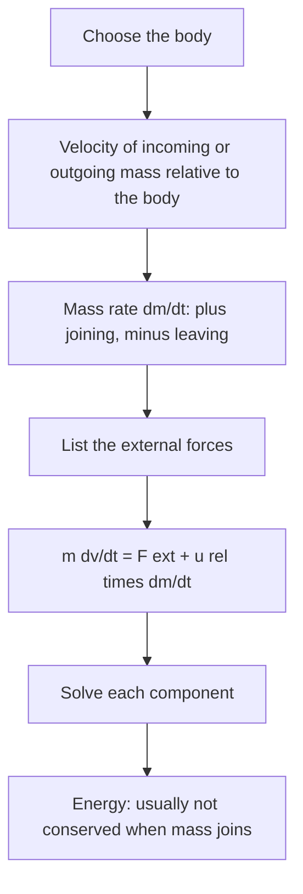

## When the mass changes

The momentum lesson derived the rocket equation for a rocket far from any planet: exhaust leaves at speed $u$ relative to the rocket, and the rocket gains $\Delta v = u\ln(m_i/m_f)$. Rockets are one member of a large family. A conveyor belt collects sand, a fire hose pushes water against a wall, a rain-filled cart picks up mass, a chain piles up on a scale. In each, mass crosses the boundary of the object we care about, carrying momentum with it. This lesson builds one equation that handles all of them, applies it to a rocket climbing against gravity, and works out the forces from belts, jets and a falling chain.

## The equation of motion for a variable-mass system

Call the object of interest the *body*: at time $t$ it has mass $m$ and velocity $\vec v$. In a short time $dt$ a small mass $\delta m$, moving with velocity $\vec w$, joins it. The body plus the small mass together form a system of fixed mass, so Newton's second law in momentum form applies to them:

$$\vec F_{\text{ext}}\,dt = \underbrace{(m + \delta m)(\vec v + d\vec v)}_{\text{after}} - \underbrace{(m\vec v + \delta m\,\vec w)}_{\text{before}}.$$

Expanding and dropping the product of two small quantities, $\delta m\,d\vec v$:

$$m\,d\vec v = \vec F_{\text{ext}}\,dt + (\vec w - \vec v)\,\delta m.$$

Divide by $dt$ and write $dm/dt$ for the rate at which the body's mass changes (positive when mass joins, negative when it leaves; the same algebra with $\delta m < 0$ covers ejected mass):

$$m\frac{d\vec v}{dt} = \vec F_{\text{ext}} + \vec u_{\text{rel}}\frac{dm}{dt}, \qquad \vec u_{\text{rel}} = \vec w - \vec v.$$

The new term is the momentum delivered by mass crossing the boundary. It depends only on the velocity of that mass *relative to the body*. Two quick checks:

- *Rocket*: exhaust leaves backward at $u$ relative to the rocket, so $\vec u_{\text{rel}}$ points backward and $dm/dt < 0$. The product points forward with size $u\,|dm/dt|$: the thrust from the momentum lesson.
- *Leaky sand cart*: sand dribbles straight down through a hole in a moving cart's floor. It leaves with the cart's own horizontal velocity, so $u_{\text{rel}} = 0$ horizontally and the cart's speed doesn't change. The cart gets lighter but no faster.

The leaky cart shows why the tempting shortcut $\vec F = d(m\vec v)/dt = m\,d\vec v/dt + \vec v\,dm/dt$ is wrong for the body alone: it would predict that losing mass at the cart's own velocity changes its speed with no force acting. Applied to a body that gains or loses mass, $d(m\vec v)/dt$ also gives different answers in different inertial frames, which no law of motion may do. Newton's second law is safe only for a system whose mass is fixed, which is exactly what the derivation above used.

## A rocket climbing against gravity

For a rocket rising vertically, the external force is its weight. With exhaust speed $u$ and a constant burn rate $R = |dm/dt|$, the equation becomes

$$m\frac{dv}{dt} = uR - mg.$$

The rocket lifts off only if the thrust $uR$ exceeds the initial weight $m_ig$. Dividing by $m$ and integrating over the burn, while $m$ falls from $m_i$ to $m(t) = m_i - Rt$:

$$v(t) = u\ln\frac{m_i}{m(t)} - gt.$$

The first term is the free-space rocket equation; the second is the **gravity loss**, the speed that the weight has taken away during the burn. A slow, heavy burn spends a long time fighting gravity, which is one reason launch rockets have thrust well above their weight.

### Example 1

A rocket of total mass $2.0\times10^5$ kg burns $1.5\times10^5$ kg of propellant at a steady 1000 kg/s with exhaust speed 3.0 km/s, rising vertically. Ignoring drag and the change of $g$ with height, find the thrust, the acceleration at liftoff, the burn time and the speed at burnout.

- Thrust: $uR = (3000)(1000) = 3.0\times10^6$ N.
- Liftoff: weight $= (2.0\times10^5)(9.8) = 1.96\times10^6$ N, so $a = \dfrac{3.0\times10^6}{2.0\times10^5} - 9.8 = 15 - 9.8 = 5.2$ m/s².
- Burn time: $t_b = 1.5\times10^5/1000 = 150$ s, leaving $m_f = 5.0\times10^4$ kg.
- Burnout speed: $v = 3000\ln\dfrac{2.0\times10^5}{5.0\times10^4} - 9.8(150) = 3000\ln 4 - 1470 = 4159 - 1470 = 2690$ m/s.

Gravity cost 1470 m/s, more than a third of the 4160 m/s the same burn would give in empty space. Real launch vehicles also lose speed to drag and tip over toward horizontal during the climb, so this vertical model is a simplification; it shows the size of the gravity loss, not a real trajectory.

```plot
{"x": [0, 160], "y": [0, 4.5], "xLabel": "time (s)", "yLabel": "speed (km/s)", "functions": [{"f": "3*ln(200000/(200000 - 1000*x))", "from": 0, "to": 150, "label": "no gravity"}, {"f": "3*ln(200000/(200000 - 1000*x)) - 0.0098*x", "from": 0, "to": 150, "label": "rising against gravity"}], "caption": "Example 1's rocket: the gap between the curves is the gravity loss gt, 1.47 km/s at burnout"}
```

## Mass joining a moving body: the conveyor belt

Sand falls straight down onto a horizontal belt that a motor keeps moving at constant speed $v$, at a rate $R$ (kg/s). Horizontally the sand arrives with $w_x = 0$, so $u_{\text{rel}} = -v$, and the belt's speed is constant ($dv/dt = 0$):

$$0 = F + (-v)R \quad\Rightarrow\quad F = Rv.$$

The motor must supply a horizontal force $Rv$ (through the belt) just to keep the speed constant, and therefore a power $P = Fv = Rv^2$. But the sand gains kinetic energy at only $\tfrac12Rv^2$ per second. The other half becomes heat: each bit of sand slides on the belt until friction brings it up to speed. Viewed from the belt's frame, each bit of sand arrives moving backward at $v$ and is stopped by kinetic friction, which turns its $\tfrac12\delta m\,v^2$ into thermal energy. That is why the split is always exactly half, whatever the friction coefficient.


### Example 2

Gravel drops onto a belt moving at 2.0 m/s at a rate of 50 kg/s. Find the extra force and power the motor must supply, and how much of that power becomes heat.

$F = Rv = 50(2.0) = 100$ N; $P = Rv^2 = 50(2.0)^2 = 200$ W. Kinetic energy gained per second: $\tfrac12(50)(2.0)^2 = 100$ W. Heat: $200 - 100 = 100$ W.

## Jets hitting surfaces

A stream of fluid carries momentum at a steady rate. A jet of density $\rho$, cross-sectional area $A$ and speed $v$ delivers mass at $\rho Av$ (kg/s), each kilogram carrying momentum $v$. The **momentum flux**, momentum delivered per second, is

$$\frac{dp}{dt} = \rho Av^2.$$

If a wall stops the jet's forward motion (the water spreads out sideways along the wall), the wall must supply force $\rho Av^2$ to remove that momentum, and by the third law the jet pushes the wall with the same force. If a curved bucket turns the jet straight back at the same speed, the momentum change per kilogram is $2v$ and the force doubles to $2\rho Av^2$. This is the idea behind the Pelton wheel, a water turbine with a ring of cup-shaped buckets. For a wheel whose buckets move away from the jet at speed $V$, the water hits at relative speed $v - V$; in the ideal frictionless case the force is $2\rho Av(v - V)$ and the power $2\rho Av(v - V)V$ is greatest at $V = v/2$, where it equals $\tfrac12\rho Av^3$, the jet's entire kinetic energy flux. The water leaves the bucket at $V - (v - V) = 0$ in the ground frame. Real Pelton wheels reach roughly 90% efficiency.

### Example 3

A fire hose nozzle 2.0 cm in diameter sends a horizontal water jet at 20 m/s straight at a wall, where the water splashes out sideways. What force does the jet exert on the wall? ($\rho = 1000$ kg/m³.)

$A = \pi(0.010)^2 = 3.14\times10^{-4}$ m². Mass rate: $\rho Av = 1000(3.14\times10^{-4})(20) = 6.28$ kg/s. Force: $\rho Av^2 = 6.28(20) = 126$ N, about the weight of a 13 kg object. Notice $F \propto v^2$: doubling the jet speed quadruples the force.

## A chain falling onto a scale

A uniform chain of length $L$ and mass per unit length $\lambda$ hangs with its lower end just touching a scale pan, and is released. Model the chain as perfectly flexible, with the falling part in free fall. When a length $y$ has landed, the falling part moves at $v = \sqrt{2gy}$. The scale supports the chain already piled on it, weight $\lambda gy$, *and* must stop the links arriving at rate $\lambda v$ with speed $v$, a momentum flux $\lambda v^2 = 2\lambda gy$:

$$F_{\text{scale}} = \lambda gy + 2\lambda gy = 3\lambda gy.$$

Just as the last link lands ($y = L$), the scale reads three times the chain's weight, and then drops back to one times the weight as soon as the chain is at rest. Careful experiments with real chains find forces of this size, sometimes somewhat larger, because a real chain's falling part is not exactly in free fall.



## Common mistakes

- Writing $F = d(mv)/dt$ for a body that gains or loses mass. Use the relative-velocity form, or apply $F = dp/dt$ to a closed system that includes the moving mass.
- Using the exhaust's velocity relative to the ground instead of relative to the rocket.
- Forgetting the gravity loss: in a gravity field the rocket equation needs the $-gt$ term.
- Assuming the conveyor motor's power all goes into the sand's kinetic energy. Exactly half becomes heat.
- Writing the jet force as $\rho Av$ (that's the mass rate) instead of $\rho Av^2$.

## Key points

- Variable mass: $m\,d\vec v/dt = \vec F_{\text{ext}} + \vec u_{\text{rel}}\,dm/dt$, with $\vec u_{\text{rel}}$ the velocity of the crossing mass relative to the body.
- Vertical rocket with constant burn rate: $v = u\ln(m_i/m) - gt$; the $gt$ term is the gravity loss.
- Conveyor at constant speed: force $Rv$, power $Rv^2$, half of it heat.
- Jet: momentum flux $\rho Av^2$; stopping it takes force $\rho Av^2$, reversing it $2\rho Av^2$.
- Idealized falling chain: the scale reads $3\lambda gy$, three times the landed weight.
