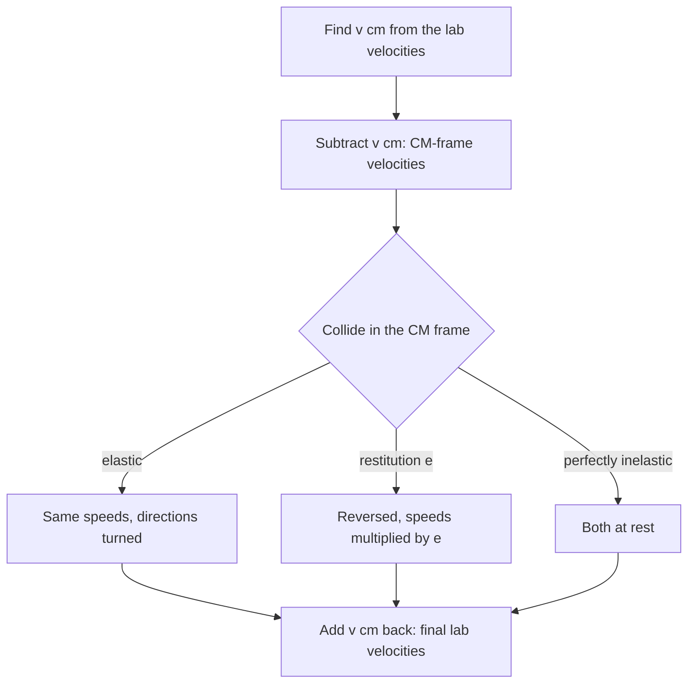

## A better place to watch

The collisions lesson solved collisions in the **laboratory frame**, the frame in which the target is at rest or the ground is still, and ended with a short look at the frame moving with the center of mass. That frame deserves more than a paragraph. In it, total momentum is zero, the two objects always move in opposite directions, and an elastic collision does nothing but turn their velocities. Working there makes several results that are messy in the lab frame almost obvious: how much energy a collision can possibly lose, how much energy a moving particle can hand to a target at rest (the physics behind slowing neutrons in a nuclear reactor), and why a heavy projectile can only be deflected through a limited angle by a light target, a fact Rutherford relied on when he discovered the atomic nucleus.

## Going to the CM frame and back

The center of mass of two particles moves at

$$\vec v_{\text{cm}} = \frac{m_1\vec v_1 + m_2\vec v_2}{m_1 + m_2},$$

and with no external force it keeps that velocity through the collision. The **center-of-mass frame** (CM frame) is the inertial frame moving at $\vec v_{\text{cm}}$. Velocities in it, marked with a prime, are found by subtracting:

$$\vec v_1' = \vec v_1 - \vec v_{\text{cm}} = \frac{m_2}{m_1 + m_2}(\vec v_1 - \vec v_2), \qquad \vec v_2' = -\frac{m_1}{m_1 + m_2}(\vec v_1 - \vec v_2).$$

Both depend only on the relative velocity $\vec v_{\text{rel}} = \vec v_1 - \vec v_2$, and the momenta are equal and opposite:

$$\vec p_1' = -\vec p_2' = \mu\,\vec v_{\text{rel}}, \qquad \mu = \frac{m_1m_2}{m_1 + m_2}.$$

The combination $\mu$ is the **reduced mass**. It is always smaller than either mass; for equal masses it is half of one, and for a very heavy $m_2$ it is almost exactly $m_1$.

The recipe for any collision is then: subtract $\vec v_{\text{cm}}$, collide in the CM frame, add $\vec v_{\text{cm}}$ back.



## Kinetic energy splits in two

Write each lab velocity as $\vec v_{\text{cm}} + \vec v_i'$ and expand the total kinetic energy. The cross terms add up to $\vec v_{\text{cm}}\cdot(m_1\vec v_1' + m_2\vec v_2') = 0$, because the CM-frame momenta cancel. What remains is

$$K = \tfrac12Mv_{\text{cm}}^2 + \tfrac12\mu v_{\text{rel}}^2, \qquad M = m_1 + m_2,$$

the kinetic energy of the center of mass plus the kinetic energy in the CM frame, which equals $\tfrac12\mu v_{\text{rel}}^2$. (This decomposition, valid for any number of particles, is sometimes called König's theorem.) The first part can't change in a collision, because $\vec v_{\text{cm}}$ can't. So only the **relative kinetic energy** $\tfrac12\mu v_{\text{rel}}^2$ is available to be lost to heat and deformation, or, in particle physics, to be turned into new particles.

In one dimension the coefficient of restitution says the relative speed after is $e$ times the relative speed before. In the CM frame that means both velocities reverse and shrink by the factor $e$, so the relative kinetic energy becomes $e^2$ times its old value:

$$K_{\text{lost}} = (1 - e^2)\,\tfrac12\mu v_{\text{rel}}^2.$$

$e = 1$ (elastic) loses nothing; $e = 0$ (perfectly inelastic) loses all of the relative kinetic energy, the maximum, which is why sticking together is the most lossy outcome momentum allows.

### Example 1

A 2.0 kg cart moving at 6.0 m/s hits a 4.0 kg cart at rest, head-on, with coefficient of restitution 0.50. Find the energy lost and both final velocities.

*CM velocity*: $v_{\text{cm}} = \dfrac{2.0(6.0)}{6.0} = 2.0$ m/s.

*Energy split*: total $K = \tfrac12(2.0)(6.0)^2 = 36$ J. CM part: $\tfrac12(6.0)(2.0)^2 = 12$ J. Reduced mass $\mu = \dfrac{(2.0)(4.0)}{6.0} = 1.33$ kg, so the relative part is $\tfrac12(1.33)(6.0)^2 = 24$ J. (Check: $12 + 24 = 36$ J.)

*Loss*: $K_{\text{lost}} = (1 - 0.50^2)(24) = 18$ J.

*Velocities*: in the CM frame the carts move at $6.0 - 2.0 = +4.0$ m/s and $0 - 2.0 = -2.0$ m/s. The collision reverses each and multiplies by 0.50: $-2.0$ m/s and $+1.0$ m/s. Adding 2.0 m/s back: $v_{1f} = 0$ and $v_{2f} = 3.0$ m/s.

Check: momentum $2.0(0) + 4.0(3.0) = 12$ kg·m/s, as before; final kinetic energy $\tfrac12(4.0)(3.0)^2 = 18$ J $= 36 - 18$.

## Elastic collisions: just a rotation

In an elastic collision the relative kinetic energy is unchanged, so each object keeps its CM-frame speed. The only thing the collision can do is turn the pair of opposite momenta through some **scattering angle** $\theta^*$, set by the details of the impact (where the objects hit, the shape of the force). Head-on in one dimension, $\theta^* = 180°$: each CM-frame velocity simply reverses. Back in the lab, $v_{1f} = v_{\text{cm}} - (v_{1i} - v_{\text{cm}}) = 2v_{\text{cm}} - v_{1i}$. With the target at rest, $v_{\text{cm}} = m_1v_{1i}/(m_1 + m_2)$, and this gives

$$v_{1f} = \frac{2m_1 - (m_1 + m_2)}{m_1 + m_2}\,v_{1i} = \frac{m_1 - m_2}{m_1 + m_2}\,v_{1i},$$

the collisions lesson's formula without solving a quadratic.

## How much energy can a target take?

For a head-on elastic collision with $m_2$ at rest, $v_{2f} = \dfrac{2m_1}{m_1 + m_2}v_{1i}$, so the fraction of the projectile's kinetic energy handed to the target is

$$\frac{K_{2f}}{K_{1i}} = \frac{m_2}{m_1}\left(\frac{2m_1}{m_1 + m_2}\right)^2 = \frac{4m_1m_2}{(m_1 + m_2)^2}.$$

It equals 1 only for equal masses and falls off on both sides: a ping-pong ball can't transfer much energy to a bowling ball, nor a bowling ball to a ping-pong ball (which flies off fast but carries little energy). A glancing collision transfers less than a head-on one.

```plot
{"x": [0, 10], "y": [0, 1.1], "xLabel": "mass ratio m₁/m₂", "yLabel": "fraction transferred", "functions": [{"f": "4*x/(1 + x)^2", "from": 0.01, "to": 10}], "points": [{"at": [1, 1]}], "labels": [{"at": [3.6, 0.92], "text": "equal masses: all of it"}], "caption": "Head-on elastic collision with the target at rest: fraction of the projectile's kinetic energy given to the target"}
```

This is the design rule for a nuclear reactor's **moderator**. Fission releases neutrons at about 2 MeV, but uranium-235 is far more likely to fission when struck by a slow neutron (about 0.025 eV), so the neutrons must be slowed by elastic collisions with light nuclei. Taking the neutron's mass as 1 and the nucleus's as $A$, a head-on collision transfers $4A/(1 + A)^2$ of the neutron's energy: all of it for hydrogen ($A = 1$), 89% for deuterium, 28% for carbon ($A = 12$), but under 2% for uranium-238. That is why water, heavy water and graphite are the common moderators. Over all directions the average transfer is smaller; if the scattering is equally likely in every CM direction (a reasonable approximation for neutrons on light nuclei), the average is $2A/(1 + A)^2$, half the head-on value.

### Example 2

A 2.0 MeV neutron slows down in graphite (carbon, $A = 12$). Even if every collision were head-on, how many collisions would it take to reach 0.025 eV?

Each head-on collision leaves the neutron with $1 - \dfrac{4(12)}{13^2} = \left(\dfrac{11}{13}\right)^2 = 0.716$ of its energy. After $n$ collisions the energy is $(0.716)^n(2.0\times10^6\text{ eV})$. Set this equal to 0.025 eV:

$$n = \frac{\ln(0.025/2.0\times10^6)}{\ln 0.716} = \frac{-18.2}{-0.334} = 54.5,$$

so at least 55 collisions. Real collisions are mostly glancing; averaging over directions, the standard estimate is roughly 115 collisions in carbon, against about 18 in hydrogen.

## The largest deflection angle

Now let the collision be elastic but not head-on, with $m_2$ at rest and $m_1$ arriving at speed $v$. In the CM frame the projectile moves at speed $v_1' = \dfrac{m_2}{m_1 + m_2}v$ before and after; only its direction changes. Its final lab velocity is $\vec v_{1f} = \vec v_{\text{cm}} + \vec v_1'$, where $\vec v_{\text{cm}}$ has length $\dfrac{m_1}{m_1 + m_2}v$. As $\theta^*$ ranges over every possible value, the tip of $\vec v_{1f}$ traces a circle of radius $v_1'$ centered at the tip of $\vec v_{\text{cm}}$.

The diagram is drawn for $m_1 = 2m_2$, so the circle's radius is half the distance $OC$.


- If $m_1 > m_2$, the circle's radius is smaller than the distance to its center, so the origin lies outside it. The lab velocity can tilt only until it is tangent to the circle, at angle $\theta_{\max}$ with $\sin\theta_{\max} = \dfrac{v_1'}{v_{\text{cm}}} = \dfrac{m_2}{m_1}$.
- If $m_1 = m_2$, the circle passes through the origin. Combined with the target's velocity, this is the collisions lesson's right-angle rule.
- If $m_1 < m_2$, the origin is inside the circle, and every direction, including straight back, is possible.

### Example 3

An alpha particle (mass about 4 u) collides elastically with a proton (about 1 u) at rest. What is the largest angle through which the alpha can be deflected? And by an electron at rest ($m_\alpha/m_e \approx 7300$)?

Proton: $\sin\theta_{\max} = \tfrac14$, so $\theta_{\max} = 14.5°$. Electron: $\sin\theta_{\max} = 1/7300$, so $\theta_{\max} \approx 0.008°$.

That second number is history. Around 1909–1911, Geiger and Marsden, working with Rutherford, found that about 1 alpha particle in 8000 bounced off a thin metal foil through more than 90°. Collisions with electrons could never do that, however many there were along the path; only a target much heavier than the alpha could turn it back. Rutherford concluded that the atom's positive charge and almost all its mass sit in a tiny nucleus.

## Common mistakes

- Forgetting that the CM part of the kinetic energy, $\tfrac12Mv_{\text{cm}}^2$, can never be lost; only $\tfrac12\mu v_{\text{rel}}^2$ can.
- Using the total mass or one of the masses where the reduced mass belongs.
- Changing the speeds in the CM frame for an elastic collision. Elastic means same speeds there, only new directions.
- Forgetting to add $\vec v_{\text{cm}}$ back at the end.
- Expecting a heavy projectile to bounce back off a light target. Its deflection can't exceed $\sin^{-1}(m_2/m_1)$.

## Key points

- CM frame: $\vec v' = \vec v - \vec v_{\text{cm}}$; momenta are $\pm\mu\vec v_{\text{rel}}$ with $\mu = m_1m_2/(m_1 + m_2)$.
- $K = \tfrac12Mv_{\text{cm}}^2 + \tfrac12\mu v_{\text{rel}}^2$; only the second part can be lost: $K_{\text{lost}} = (1 - e^2)\tfrac12\mu v_{\text{rel}}^2$.
- An elastic collision keeps CM-frame speeds and only turns the momenta.
- Head-on elastic, target at rest: fraction transferred $4m_1m_2/(m_1 + m_2)^2$, largest for equal masses.
- Heavy on light: largest lab deflection $\sin\theta_{\max} = m_2/m_1$.
