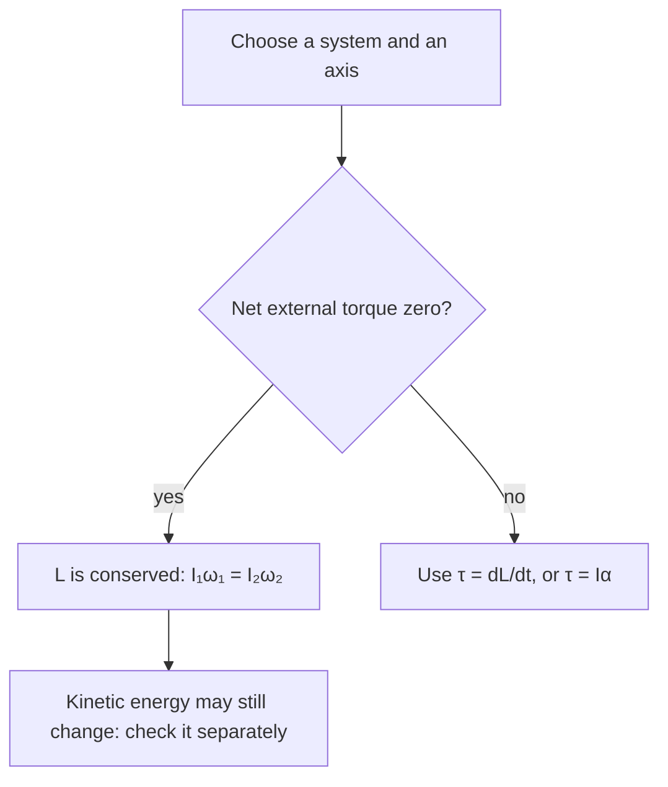

## Two ideas that complete rotational mechanics

A wheel rolling down a road both translates and rotates, and the two motions are locked together. And a spinning skater who pulls in her arms speeds up without anyone pushing her. This lesson explains both: rolling without slipping, which combines the last two lessons, and angular momentum, whose conservation is as fundamental as that of linear momentum.

## Rolling without slipping

When a wheel of radius $R$ rolls without slipping, the point touching the ground is momentarily at rest (no skidding). In one revolution the center moves forward one circumference, $2\pi R$, so

$$v_{\text{cm}} = R\omega, \qquad a_{\text{cm}} = R\alpha.$$

The motion is a translation of the center plus a rotation about it. The top of the wheel moves at $v_{\text{cm}} + R\omega = 2v_{\text{cm}}$, the bottom at $v_{\text{cm}} - R\omega = 0$. That's why the top of a bicycle wheel's spokes look blurred in photos while the bottom ones look sharp.

Adding the two motions point by point gives the rolling velocities:

The kinetic energy has both parts:

$$K = \tfrac12Mv_{\text{cm}}^2 + \tfrac12I_{\text{cm}}\omega^2.$$

Writing $I_{\text{cm}} = cMR^2$ (with $c = 1$ for a hoop, $\tfrac12$ for a disk, $\tfrac25$ for a solid sphere, $\tfrac23$ for a hollow sphere) and $\omega = v/R$:

$$K = \tfrac12(1 + c)Mv^2.$$

## Rolling down an incline

Release a rolling object from rest at height $h$. Static friction at the contact point makes it roll, but does no work, because the contact point doesn't move. So mechanical energy is conserved:

$$Mgh = \tfrac12(1 + c)Mv^2 \quad\Rightarrow\quad v = \sqrt{\frac{2gh}{1 + c}}.$$

Mass and radius cancel; only the shape factor $c$ matters. Objects with mass concentrated near the center (small $c$) win a race: solid sphere ($c = 0.4$) beats solid cylinder ($0.5$) beats hollow sphere ($0.667$) beats hoop ($1$). A frictionless sliding block ($c = 0$, no rotation) beats them all, because none of its energy is tied up in spinning.

The acceleration down a slope of angle $\theta$ follows the same pattern: $a = \dfrac{g\sin\theta}{1 + c}$.

### Example 1

A solid ball and a hoop are released from rest at the top of a ramp 1.5 m high. Find each one's speed at the bottom.

Ball: $v = \sqrt{\dfrac{2(9.8)(1.5)}{1.4}} = \sqrt{21.0} = 4.58$ m/s.

Hoop: $v = \sqrt{\dfrac{2(9.8)(1.5)}{2}} = \sqrt{14.7} = 3.83$ m/s.

The ball arrives first. The hoop puts half its kinetic energy into rotation; the ball only $\tfrac{0.4}{1.4} = 29\%$.

## Angular momentum

The rotational analog of momentum is **angular momentum**. For a rigid object rotating about a fixed axis,

$$L = I\omega$$

(kg·m²/s). For a single particle moving past a point, $L = mvr_\perp$, where $r_\perp$ is the perpendicular distance from the point to the particle's line of motion: even a particle moving in a straight line has angular momentum about a point not on that line.

Just as net force changes linear momentum, net torque changes angular momentum:

$$\sum\tau = \frac{\Delta L}{\Delta t}.$$

## Conservation of angular momentum

If the net external torque on a system is zero, its angular momentum is constant:

$$I_i\omega_i = I_f\omega_f.$$

This is **conservation of angular momentum**. The striking consequence: if a system changes shape and its moment of inertia changes, its rotation rate adjusts in the opposite direction. A skater pulling in her arms reduces $I$, so $\omega$ increases. A diver tucks to spin faster and opens out to slow down before entering the water. A collapsing star can shrink to a neutron star spinning hundreds of times per second.

Before using it, check the condition, about a definite axis:

### Example 2

A skater spins at 2.0 rev/s with her arms out, where $I = 4.5$ kg·m². She pulls her arms in, reducing $I$ to 1.8 kg·m². (a) What is her new spin rate? (b) What happens to her kinetic energy?

(a) $\omega_f = \dfrac{I_i}{I_f}\omega_i = \dfrac{4.5}{1.8}(2.0) = 5.0$ rev/s. (Units of $\omega$ cancel in the ratio, so rev/s is fine here.)

(b) In rad/s, $\omega_i = 12.57$ and $\omega_f = 31.42$. $K_i = \tfrac12(4.5)(12.57)^2 = 355$ J; $K_f = \tfrac12(1.8)(31.42)^2 = 888$ J. Kinetic energy increases by a factor of 2.5: her arm muscles do work pulling the mass inward. Angular momentum is conserved, kinetic energy is not.

### Example 3: a rotational collision

A 2.0 kg disk spins at 30 rad/s on a frictionless axle; $I_1 = 0.040$ kg·m². A second, non-rotating disk with $I_2 = 0.060$ kg·m² is dropped onto it and they spin together. Find the final angular speed.

No external torque about the axle: $I_1\omega_1 = (I_1 + I_2)\omega_f$, so $\omega_f = \dfrac{0.040(30)}{0.100} = 12$ rad/s. Like a perfectly inelastic collision, kinetic energy drops (from 18 J to 7.2 J), lost to friction between the disks.

## Angular momentum as a vector

In general, angular momentum about a point is the cross product

$$\vec L = \vec r\times\vec p,$$

and differentiating, $\dfrac{d\vec L}{dt} = \dfrac{d\vec r}{dt}\times\vec p + \vec r\times\dfrac{d\vec p}{dt} = \vec v\times m\vec v + \vec r\times\vec F = \vec\tau$, since $\vec v\times\vec v = 0$. So

$$\vec\tau_{\text{net}} = \frac{d\vec L}{dt}.$$

For a rigid body spinning about a symmetry axis, $\vec L = I\vec\omega$, with $\vec\omega$ along the axis by the right-hand rule.

The vector form explains a **gyroscope**'s **precession**. A spinning top tilted from vertical has $\vec L$ along its axis. Gravity's torque about the pivot is horizontal, perpendicular to $\vec L$. A torque perpendicular to $\vec L$ changes its direction, not its size, so instead of falling over, the axis swings slowly around the vertical. The precession rate is $\Omega = \dfrac{\tau}{L} = \dfrac{Mgr}{I\omega}$: the faster the spin, the slower the precession.

Kepler's second law (equal areas in equal times) is also angular momentum conservation: gravity points toward the Sun, so its torque about the Sun is zero, $\vec L$ of the planet is constant, and the area swept per unit time, $\dfrac{L}{2m}$, is constant.

## Common mistakes

- Forgetting rotational kinetic energy for rolling objects (getting $\sqrt{2gh}$).
- Thinking static friction does work on a rolling object.
- Assuming kinetic energy is conserved when angular momentum is.
- Using rev/s in an energy formula (fine in a ratio, not in $\tfrac12I\omega^2$).

## Key points

- Rolling without slipping: $v = R\omega$; $K = \tfrac12Mv^2 + \tfrac12I\omega^2 = \tfrac12(1 + c)Mv^2$.
- Down an incline from rest: $v = \sqrt{2gh/(1 + c)}$; smaller $c$ wins.
- $L = I\omega$ (or $\vec r\times\vec p$); $\vec\tau = d\vec L/dt$.
- No external torque: $I_i\omega_i = I_f\omega_f$.
