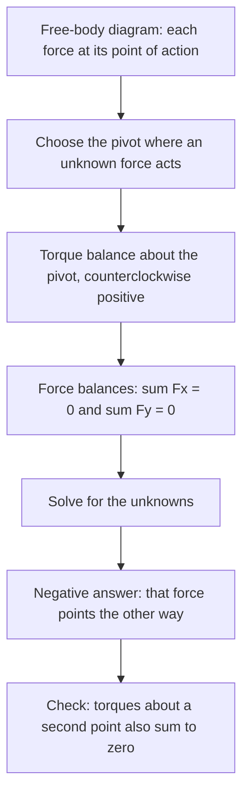

## Structures that stay put

Bridges, shelves, ladders and your own skeleton are designed not to move. Engineers need to know the forces in each support and cable to make sure nothing breaks or tips over. For a point particle, staying at rest just needs zero net force. An extended object can have zero net force and still start spinning (think of two equal, opposite forces at opposite ends of a ruler), so it needs a second condition. This lesson puts torque to work on objects that don't move at all.

## The two conditions

A rigid object is in **static equilibrium** when it is at rest and stays at rest. That requires

$$\sum\vec F = 0 \qquad\text{and}\qquad \sum\tau = 0 \text{ about any axis}.$$

The first prevents translation, the second rotation. In two dimensions this gives three equations: $\sum F_x = 0$, $\sum F_y = 0$, $\sum\tau = 0$. So you can solve for up to three unknown forces or distances.

*Freedom to choose the axis.* If the net force is zero, the net torque is the same about every point. So you may compute torques about whatever point is most convenient. The best choice is a point where an unknown force acts: that force then has zero lever arm and drops out of the torque equation, leaving fewer unknowns.

## Center of gravity

Gravity acts on every bit of an object, but for torque purposes its total effect is as if the whole weight $Mg$ acted at one point, the **center of gravity**. In a uniform gravitational field (any object on Earth smaller than a mountain), the center of gravity is the center of mass. A uniform beam's weight acts at its midpoint.

This explains tipping. An object resting on a base is stable as long as its center of gravity lies above the base. Lean it until the center of gravity passes beyond the edge of the base, and gravity's torque about that edge tips it over. Wide bases and low centers of gravity make objects harder to tip, which is why racing cars are low and wide.


For this box (90 by 150 units), the center of gravity is directly above the edge at a tilt of $\arctan(45/75) = 31^\circ$: tilted less, it falls back; tilted more, it tips.

## Solving equilibrium problems

1. Draw a free-body diagram of the object, showing each force *at the point where it acts*.
2. Choose a pivot point for torques, ideally where an unknown force acts.
3. Write $\sum\tau = 0$ about that point (counterclockwise positive).
4. Write $\sum F_x = 0$ and $\sum F_y = 0$.
5. Solve. If a force comes out negative, it points opposite to the way you drew it.

As a flowchart, with a final check that catches most slips:



### Example 1: a seesaw

A 30 kg child sits 1.8 m from the pivot of a seesaw. Where must a 45 kg child sit on the other side to balance it? (The seesaw is uniform and pivoted at its center.)

Torques about the pivot (the pivot's force and the board's weight act there, so they contribute nothing):

$$30g(1.8) = 45g\,x \quad\Rightarrow\quad x = \frac{30(1.8)}{45} = 1.2\text{ m}.$$

The heavier child sits closer. Balance is about equal torques, not equal weights.

### Example 2: a beam on two supports

A uniform 6.0 m plank of mass 20 kg rests on supports at its two ends, A (left) and B (right). A 60 kg painter stands 1.5 m from end A. Find the force each support exerts.

Weights: plank $20(9.8) = 196$ N at 3.0 m from A; painter $60(9.8) = 588$ N at 1.5 m from A.

Torques about A (eliminates $F_A$):

$$F_B(6.0) - 196(3.0) - 588(1.5) = 0 \quad\Rightarrow\quad F_B = \frac{588 + 882}{6.0} = 245\text{ N}.$$

Vertical forces: $F_A + F_B = 196 + 588 = 784$ N, so $F_A = 539$ N.

Check with torques about B: $-F_A(6.0) + 196(3.0) + 588(4.5) = -3234 + 588 + 2646 = 0$ ✓. The support nearer the painter carries more of the load.

```shape
{"polygons": [{"points": [[0, 0], [6, 0], [6, 0.2], [0, 0.2]]}, {"points": [[-0.2, -0.6], [0.2, -0.6], [0, 0]]}, {"points": [[5.8, -0.6], [6.2, -0.6], [6, 0]]}], "segments": [{"from": [0, -1.6], "to": [0, -0.7], "arrow": true}, {"from": [6, -1.6], "to": [6, -0.7], "arrow": true}, {"from": [3, 0.1], "to": [3, -0.9], "arrow": true}, {"from": [1.5, 1.4], "to": [1.5, 0.25], "arrow": true}], "labels": [{"at": [0.45, -1.3], "text": "F_A"}, {"at": [5.55, -1.3], "text": "F_B"}, {"at": [3.6, -0.6], "text": "196 N"}, {"at": [2.1, 0.9], "text": "588 N"}], "caption": "Plank on two supports with a painter 1.5 m from the left end"}
```

### Example 3: a hinged beam held by a cable

A uniform 4.0 m horizontal beam of mass 25 kg is hinged to a wall at its left end. A cable from its right end to the wall makes $30^\circ$ with the beam. A 40 kg sign hangs from the right end. Find the cable tension and the hinge force.

Weights: beam 245 N at 2.0 m; sign 392 N at 4.0 m.

Torques about the hinge (removes both unknown hinge components). The cable's perpendicular component is $T\sin 30^\circ$ at 4.0 m:

$$T\sin 30^\circ(4.0) - 245(2.0) - 392(4.0) = 0 \quad\Rightarrow\quad T = \frac{490 + 1568}{2.0} = 1029\text{ N}.$$

Horizontal: hinge pushes outward, $H = T\cos 30^\circ = 891$ N. Vertical: $V + T\sin 30^\circ = 245 + 392$, so $V = 637 - 514.5 = 122.5$ N upward. A shallow cable angle makes the tension much larger than the weights it holds, a recurring theme.


## Ladders

A ladder leaning on a smooth wall is held by the floor's normal force, floor friction, the wall's normal force, and gravity. Taking torques about the foot of the ladder eliminates the two floor forces and gives the wall force; horizontal balance then gives the friction needed. If friction would need to exceed $\mu_s n$, the ladder slips. Steeper ladders need less friction, which is why the usual safety rule is a 4:1 ratio of height to base distance (about $76^\circ$).

## Distributed loads and stability

Torque balance for continuous loads uses integrals. A beam carrying a distributed load $w(x)$ (newtons per meter) experiences a total load $W = \int w(x)\,dx$, acting at $\bar x = \dfrac{\int x\,w(x)\,dx}{\int w(x)\,dx}$, the load's "center of mass." For a load increasing linearly from 0 to $w_0$ along a beam of length $L$, $W = \tfrac12w_0L$ and $\bar x = \tfrac23L$: replace it by a single force there and proceed as before.

Equilibrium can also be stable or unstable, which ties back to potential energy: an object resting where its gravitational $U = Mgy_{\text{cg}}$ is at a minimum (any small tilt raises its center of gravity) is stable; at a maximum, unstable.

## Elasticity: supports that stretch

Equilibrium problems treat beams and cables as rigid, but every real support deforms a little. For small deformations the **stress** (force per unit area, $F/A$, in pascals) is proportional to the **strain** (the fractional change in length, $\Delta L/L$, a pure number):

$$\frac{F}{A} = Y\,\frac{\Delta L}{L},$$

where $Y$ is **Young's modulus**, a property of the material (roughly $2\times10^{11}$ Pa for steel, $7\times10^{10}$ Pa for aluminum). This is Hooke's law written for materials: comparing with $F = k\,\Delta L$, a rod or cable acts as a spring of stiffness $k = YA/L$. The same stress works for compression (squeezing a metal column shortens it by the same rule, with essentially the same $Y$). Past the material's **elastic limit** it no longer springs back when the load is removed, and beyond that it breaks. Two more moduli describe other deformations. A force $F$ applied parallel to a face of area $A$ (a shear) slides that face sideways by $\Delta x$ relative to the opposite face a distance $L$ away: $F/A = S\,\Delta x/L$, where $S$ is the **shear modulus**. Squeezing from all sides with an added pressure $\Delta P$ shrinks the volume: $\Delta P = -B\,\Delta V/V$, where $B$ is the **bulk modulus** (it sets the speed of sound in a fluid, and fluids have a bulk modulus but no shear modulus). For instance, the cable in Example 3 is $4.0/\cos 30^\circ = 4.6$ m long; if it is steel with a 1.0 cm² cross-section, the 1029 N tension stretches it by $\Delta L = \dfrac{FL}{AY} = \dfrac{1029(4.6)}{(1.0\times10^{-4})(2\times10^{11})} \approx 0.24$ mm, small enough that treating it as rigid was fine.

## Common mistakes

- Taking torques about a point but then including forces acting at that point (they have zero lever arm).
- Placing a beam's weight at its end instead of its center of gravity.
- Using the distance along the beam instead of the perpendicular lever arm for a slanted force.
- Forgetting that a hinge can exert both horizontal and vertical components.
- In $F/A = Y\,\Delta L/L$, using the diameter instead of the cross-sectional area $\pi d^2/4$, or forgetting to convert mm² or cm² to m².

## Key points

- Static equilibrium: $\sum\vec F = 0$ and $\sum\tau = 0$.
- Choose the torque pivot where an unknown force acts.
- A uniform object's weight acts at its center (center of gravity).
- An object tips when its center of gravity moves outside its base.
- Elasticity: stress $F/A = Y \times$ strain $\Delta L/L$, so $\Delta L = FL/(AY)$; shear $F/A = S\,\Delta x/L$; bulk $\Delta P = -B\,\Delta V/V$.
