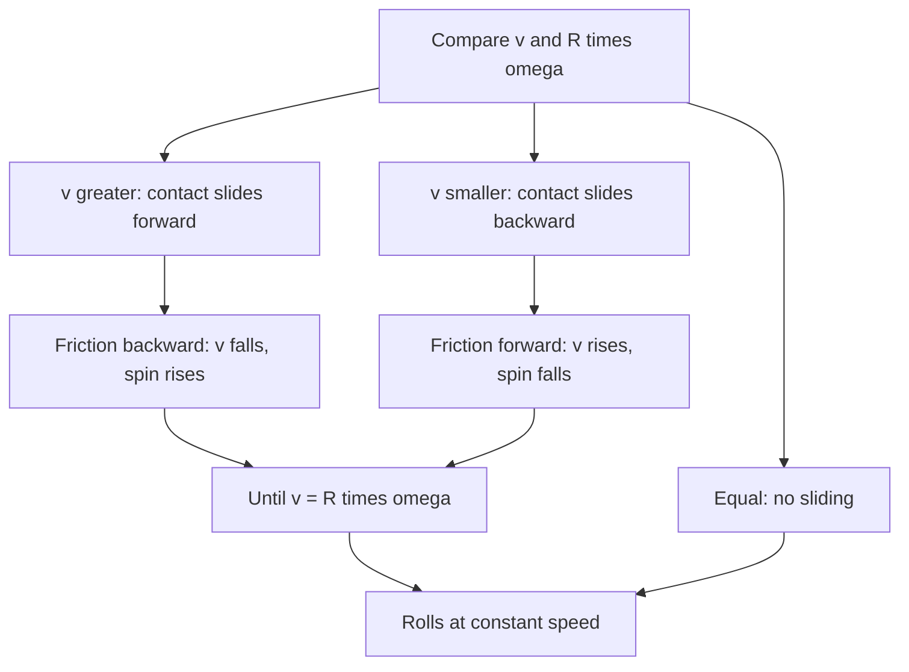

## When the no-slip condition fails

The rolling lesson assumed that the wheel or ball never skids: the contact point is at rest and $v_{\text{cm}} = R\omega$ at every instant. That is true once an object has settled into rolling, but not at the start. A bowling ball leaves the bowler's hand sliding, with little spin. A cue ball struck low slides with backspin. A car that brakes too hard locks its wheels and skids. In each case $v_{\text{cm}} \ne R\omega$, the contact point slides, and **kinetic friction** acts until the motion settles into rolling.

This lesson works out what happens during that sliding phase using only the tools of this module: $\sum F = Ma$ for the center of mass, $\sum\tau = I\alpha$ about the center, and angular momentum about a well-chosen point. It ends with the reverse problem: where to strike an object so that it starts rolling (or swinging) cleanly, with no jolt at all. That point is the **center of percussion**, the physicist's version of a bat's sweet spot.

Throughout, the surface is level, $I_{\text{cm}} = cMR^2$ as in the rolling lesson, and "forward spin" means spin in the rolling sense (clockwise for an object moving to the right).

## The slip velocity decides the friction

The velocity of the contact point is the velocity of the center plus the velocity due to rotation about the center. At the bottom of the ball, forward spin carries the surface backward, so

$$v_{\text{contact}} = v_{\text{cm}} - R\omega.$$

This is the **slip velocity** (zero exactly when the object rolls without slipping). Kinetic friction always opposes sliding, so it points opposite to the slip velocity:

- $v_{\text{cm}} > R\omega$ (too little spin, the bowling-ball case): the contact point slides forward, friction points backward.
- $v_{\text{cm}} < R\omega$ (more forward spin than rolling needs, as for a cue ball struck high): the contact point slides backward, friction points forward.
- Backspin ($\omega < 0$) always belongs to the first case, because then $v_{\text{cm}} - R\omega$ is larger than $v_{\text{cm}}$. The safe rule is to compute $v_{\text{cm}} - R\omega$ with signs and let friction oppose it.
- $v_{\text{cm}} = R\omega$: no sliding, no kinetic friction. On a level surface with no other horizontal force, nothing changes after that: the object rolls on at constant speed (ignoring rolling resistance).


Friction does two jobs at once. Pointing backward at the bottom of the ball, it slows the center ($a_{\text{cm}} = -\mu_k g$) and, because it acts a distance $R$ below the center, it exerts a torque $\mu_kMgR$ in the forward-spin sense, so it spins the ball up ($\alpha = \mu_kMgR/I_{\text{cm}} = \mu_kg/(cR)$). The speed falls and the spin rises until they match.



## Sliding to rolling with forces and torques

Launch a ball with speed $v_0$ and no spin. While it slides,

$$v(t) = v_0 - \mu_kgt, \qquad R\omega(t) = \frac{\mu_kg}{c}\,t.$$

Rolling begins when these are equal: $v_0 - \mu_kgt^* = \mu_kgt^*/c$, so

$$t^* = \frac{c\,v_0}{(1 + c)\mu_kg}, \qquad v_f = v_0 - \mu_kgt^* = \frac{v_0}{1 + c}.$$

The final speed doesn't depend on the coefficient of friction at all. A slippery lane makes the ball slide longer, a grippy one shorter, but either way a solid sphere ($c = \tfrac25$) ends up rolling at $\tfrac57$ of its launch speed.

## The same answer from angular momentum

That $\mu_k$ dropped out is a hint that a conservation law is at work. Take angular momentum about a fixed point $P$ on the floor, on the line along which the ball touches it. The friction force acts *at* floor level along that line, so its lever arm about $P$ is zero. The normal force and the weight are vertical, equal in size and act along the same vertical line through the center, so their torques about $P$ cancel. The net torque about $P$ is zero, and angular momentum about $P$ is conserved.

The angular momentum of a rolling or sliding ball about $P$ has two parts: the center's motion, $Mv_{\text{cm}}R$ (the center is a height $R$ above the floor), plus the spin about the center, $I_{\text{cm}}\omega$. Initially there is no spin; finally $\omega = v_f/R$:

$$Mv_0R = Mv_fR + cMR^2\cdot\frac{v_f}{R} = (1 + c)Mv_fR \quad\Rightarrow\quad v_f = \frac{v_0}{1 + c}.$$

The same idea handles any starting spin $\omega_0$ (positive for forward spin, negative for backspin):

$$v_f = \frac{v_0 + cR\omega_0}{1 + c}.$$

If backspin is strong enough that $cR|\omega_0| > v_0$, then $v_f$ is negative: the object stops and rolls back toward you.

### Example 1: a bowling ball

A bowling ball (treat it as a uniform solid sphere, $c = \tfrac25$) of mass 7.0 kg and radius 0.11 m is released at 8.0 m/s with no spin. Take $\mu_k = 0.10$ (a value chosen for round numbers; real lanes are oiled unevenly, so friction varies along the lane). Find the time and distance it slides, its final speed, and the kinetic energy lost.

Time sliding: $t^* = \dfrac{0.4(8.0)}{1.4(0.10)(9.8)} = 2.33$ s.

Final speed: $v_f = 8.0/1.4 = 5.71$ m/s, with $\omega = v_f/R = 51.9$ rad/s.

Distance sliding: $d = v_0t^* - \tfrac12\mu_kg(t^*)^2 = 8.0(2.332) - \tfrac12(0.98)(2.332)^2 = 16.0$ m, most of a 18.3 m lane.

Energy: $K_i = \tfrac12(7.0)(8.0)^2 = 224$ J; $K_f = \tfrac12(1 + c)Mv_f^2 = \tfrac12(1.4)(7.0)(5.714)^2 = 160$ J. So 64 J, exactly $\tfrac{c}{1 + c} = \tfrac27$ of the start, is turned into heat by kinetic friction.

```plot
{"x": [0, 3.5], "y": [0, 9], "xLabel": "t (s)", "yLabel": "speed (m/s)", "functions": [{"f": "8 - 0.98*x", "from": 0, "to": 2.332}, {"f": "2.45*x", "from": 0, "to": 2.332}, {"f": "5.714", "from": 2.332, "to": 3.5, "dashed": true}], "labels": [{"at": [0.8, 7.9], "text": "v"}, {"at": [1.2, 1.9], "text": "Rω"}], "points": [{"at": [2.332, 5.714], "label": "rolling begins"}], "caption": "Example 1: the center slows and the spin speeds up until v = Rω at 2.33 s"}
```

The lost fraction is general. With no initial spin, $K_f/K_i = \dfrac{(1 + c)v_f^2}{v_0^2} = \dfrac{1}{1 + c}$, so the fraction lost is $\dfrac{c}{1 + c}$, again independent of $\mu_k$: a hoop launched without spin loses half its kinetic energy before it rolls.

### Example 2: a hoop thrown with backspin

A child rolls a hoop of radius 0.40 m along a level path at 3.0 m/s, flicking it so it has 12 rad/s of backspin. The coefficient of kinetic friction is 0.30. What does the hoop do?

Slip velocity at the start: $v - R\omega = 3.0 - 0.40(-12) = 7.8$ m/s forward, so friction points backward the whole time. Angular momentum about a floor point ($c = 1$):

$$v_f = \frac{v_0 + cR\omega_0}{1 + c} = \frac{3.0 + 0.40(-12)}{2} = -0.90\text{ m/s}.$$

The hoop ends up rolling *backward* at 0.90 m/s. Timing: friction decelerates the center at $\mu_kg = 2.94$ m/s², so the center stops after $3.0/2.94 = 1.02$ s, 1.53 m out, and the rolling condition is reached at $t^* = \dfrac{c(v_0 - R\omega_0)}{(1 + c)\mu_kg} = \dfrac{7.8}{2(2.94)} = 1.33$ s, by which time the hoop has come back to 1.39 m. Check: $v(1.33) = 3.0 - 2.94(1.327) = -0.90$ m/s ✓.

## Where to hit: the center of percussion

Now reverse the question. Instead of letting friction sort out the motion, can we strike an object so it starts out in exactly the motion we want? A short, hard blow delivers an impulse $J$ that changes both momentum and angular momentum:

$$\Delta(Mv_{\text{cm}}) = J, \qquad \Delta(I_{\text{cm}}\omega) = Jh,$$

where $h$ is the perpendicular distance from the center of mass to the line of the blow.

*A cue ball.* Strike a ball of radius $R$ horizontally at a height $b$ above the table, so $h = b - R$. Then $v = J/M$ and $\omega = J(b - R)/(cMR^2)$. It rolls immediately, with no sliding phase at all, if $v = R\omega$:

$$\frac{J}{M} = \frac{J(b - R)}{cMR} \quad\Rightarrow\quad b = (1 + c)R.$$

For a solid ball, $b = 1.4R$, that is $\tfrac25R$ above the center. Hit higher and the ball starts with extra topspin; hit lower and friction must spin it up, as in Example 1.

*A bat or a hammer swung about a pivot.* Hold a rigid object at a pivot $P$ a distance $d$ from its center of mass, and let a ball strike it a distance $b$ from $P$. In general the pivot (your hands) must also supply an impulse $J_P$, which is the sting you feel. Linear impulse: $J + J_P = Mv_{\text{cm}} = M\omega d$. Angular impulse about $P$ (where $J_P$ has no lever arm): $Jb = I_P\omega$. Setting $J_P = 0$ and dividing,

$$b = \frac{I_P}{Md}.$$

That point is the center of percussion relative to $P$. Strike there and the object starts rotating about $P$ on its own, so the hands feel no jolt.


### Example 3: a rod held at one end

Find the center of percussion of a uniform rod of length 0.90 m held at one end.

$I_P = \tfrac13ML^2$ and $d = L/2$, so

$$b = \frac{\tfrac13ML^2}{M(L/2)} = \frac23L = 0.60\text{ m from the hand}.$$

It is below the center of mass, never at it: a blow at the center of mass would push the whole rod sideways, and the hand would have to hold back the handle end. The cue-ball result is the same idea, with the contact point with the table as the pivot: $I_P = cMR^2 + MR^2 = (1 + c)MR^2$ and $d = R$ give $b = (1 + c)R$.

*Simplified model.* A real baseball or cricket bat is not a uniform rod and is not perfectly rigid. Its "sweet spot" is a small region set by both the center of percussion and the bat's vibration modes (where the blow excites the least vibration). The rigid-body result explains the jolt to the hands; the sting from vibration is a separate effect.

## Common mistakes

- Assuming $v = R\omega$ from the start when an object is launched sliding, or "spinning up" with no friction.
- Getting the direction of kinetic friction from the direction of motion instead of from the slip velocity $v_{\text{cm}} - R\omega$.
- Taking angular momentum about the center of mass and expecting it to be conserved: friction has a lever arm $R$ about the center. Use a point on the floor.
- Forgetting the $MvR$ part of the angular momentum about the floor point.
- Placing the center of percussion at the center of mass.

## Key points

- Slip velocity $v_{\text{cm}} - R\omega$; kinetic friction opposes it until rolling begins.
- Launched with no spin: $t^* = \dfrac{cv_0}{(1 + c)\mu_kg}$, $v_f = \dfrac{v_0}{1 + c}$, and a fraction $\dfrac{c}{1 + c}$ of the kinetic energy is lost.
- Angular momentum about a point on the floor is conserved during skidding: $v_f = \dfrac{v_0 + cR\omega_0}{1 + c}$.
- Center of percussion: $b = \dfrac{I_P}{Md}$ from the pivot; $\tfrac23L$ for a uniform rod held at an end; $1.4R$ above the table for a solid ball.
