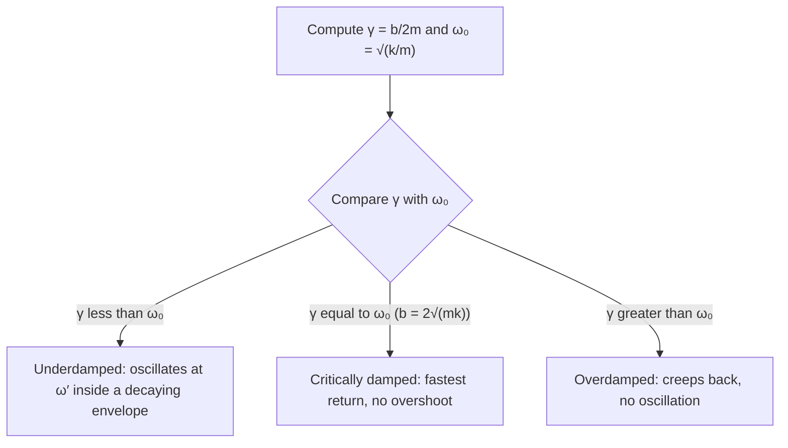

## Beyond the ideal oscillator

The previous lesson's mass on a spring oscillates forever. Real oscillators don't: a plucked string falls silent, a swing stops unless someone pushes it, and a car bounces once or twice after a pothole and then settles. Two extra ingredients explain all of this. A **damping** force drains energy, and a periodic **driving force** can feed energy back in. This lesson solves the equation of motion with each added, and ends with resonance, the reason a small push at the right frequency can produce a huge response. The next lesson then turns to waves.

## The damped equation of motion

The simplest model of friction in an oscillator is a drag force proportional to velocity, $F = -bv$, like the linear drag met with terminal velocity. The positive number $b$ (units kg/s) is the **damping constant**. Newton's second law becomes

$$m\ddot x + b\dot x + kx = 0.$$

It's convenient to write $\omega_0 = \sqrt{k/m}$, the **natural frequency** the oscillator would have with no damping, and $\gamma = b/(2m)$, a decay rate in s⁻¹. Dividing by $m$:

$$\ddot x + 2\gamma\dot x + \omega_0^2x = 0.$$

This is a linear equation with constant coefficients, so try $x = e^{rt}$. Each derivative brings down a factor $r$, giving $r^2 + 2\gamma r + \omega_0^2 = 0$, so

$$r = -\gamma \pm \sqrt{\gamma^2 - \omega_0^2}.$$

Everything depends on the sign under the square root, which compares the damping rate $\gamma$ with $\omega_0$.

## Three damping regimes

**Underdamped** ($\gamma < \omega_0$, light damping). The square root is imaginary, and the real solutions are a cosine times a decaying exponential:

$$x(t) = A_0e^{-\gamma t}\cos(\omega' t + \phi), \qquad \omega' = \sqrt{\omega_0^2 - \gamma^2}.$$

The system still oscillates, slightly slower than $\omega_0$, inside an envelope $\pm A_0e^{-\gamma t}$ that shrinks steadily. Each cycle the amplitude is multiplied by the same factor $e^{-\gamma T'}$, where $T' = 2\pi/\omega'$.

```plot
{"x": [0, 12.5], "y": [-1.2, 1.2], "xLabel": "t (s)", "yLabel": "x (m)", "functions": [{"f": "exp(-0.25*x)*(cos(1.984*x) + 0.126*sin(1.984*x))", "to": 11.5}, {"f": "exp(-0.25*x)", "dashed": true, "to": 11.5}, {"f": "-exp(-0.25*x)", "dashed": true, "to": 11.5}], "labels": [{"at": [6.5, 0.45], "text": "envelope ±A₀e^(−γt)"}], "caption": "Underdamped motion (ω₀ = 2 rad/s, γ = 0.25 s⁻¹), released from rest at x = 1 m"}
```

**Critically damped** ($\gamma = \omega_0$, so $b = 2\sqrt{mk}$). The two roots coincide at $r = -\omega_0$, and the solution is $x = (C_1 + C_2t)e^{-\omega_0t}$. There is no oscillation, and this is the fastest return to equilibrium without overshooting. Car shock absorbers and the closing arms on doors are designed to be near critical damping.

**Overdamped** ($\gamma > \omega_0$, heavy damping). Both roots are real and negative, and $x$ is a sum of two decaying exponentials. The system creeps back to equilibrium without oscillating, more slowly than in the critical case, because the slower exponential ($r = -\gamma + \sqrt{\gamma^2 - \omega_0^2}$, close to zero) lingers. Think of a spring moving through honey.

Which regime you are in comes down to one comparison:



```plot
{"x": [0, 6], "y": [-0.6, 1.1], "xLabel": "t (s)", "yLabel": "x (m)", "functions": [{"f": "exp(-0.5*x)*(cos(1.936*x) + 0.2582*sin(1.936*x))", "to": 5.5}, {"f": "(1 + 2*x)*exp(-2*x)", "to": 5.5}, {"f": "1.0303*exp(-0.3431*x) - 0.0303*exp(-11.657*x)", "dashed": true, "to": 5.5}], "labels": [{"at": [2.6, -0.42], "text": "underdamped"}, {"at": [1.75, 0.3], "text": "critical"}, {"at": [3.2, 0.5], "text": "overdamped"}], "caption": "The three regimes for ω₀ = 2 rad/s, each released from rest at x = 1 m: γ = 0.5, 2 and 6 s⁻¹"}
```

## Energy decay and the quality factor

The energy of an underdamped oscillator is proportional to the amplitude squared, so it decays as $E \propto e^{-2\gamma t} = e^{-bt/m}$. A single number captures how lightly damped an oscillator is, the **quality factor**

$$Q = \frac{\omega_0}{2\gamma} = \frac{m\omega_0}{b} = \frac{\sqrt{mk}}{b}.$$

When $Q$ is large, the fraction of energy lost per cycle is about $2\gamma T = 2\pi/Q$, so $Q \approx 2\pi \times \dfrac{\text{energy stored}}{\text{energy lost per cycle}}$, and the amplitude falls by a factor $e$ in about $Q/\pi$ cycles. A car suspension has $Q$ of order 1; a guitar string a few hundred to a few thousand; a quartz watch crystal tens of thousands or more. Critical damping is $Q = \tfrac12$, and underdamping means $Q > \tfrac12$.

### Example 1

A 0.50 kg block on a spring with $k = 200$ N/m (the block of the previous lesson's Example 1) moves through air with damping constant $b = 0.40$ kg/s. Find $\gamma$, $\omega'$ and $Q$, the time for the amplitude to halve, and the damping constant that would make the system critically damped.

$\omega_0 = \sqrt{200/0.50} = 20$ rad/s and $\gamma = b/2m = 0.40/1.0 = 0.40$ s⁻¹. Since $\gamma \ll \omega_0$ the motion is underdamped.

$\omega' = \sqrt{20^2 - 0.40^2} = \sqrt{399.84} = 19.996$ rad/s: light damping barely changes the frequency.

$Q = \omega_0/(2\gamma) = 20/0.80 = 25$.

Halving the amplitude: $e^{-\gamma t} = \tfrac12$, so $t = \ln 2/\gamma = 0.693/0.40 = 1.73$ s, about 5.5 periods of 0.314 s. (The energy halves twice as fast, in 0.87 s.)

Critical damping needs $b = 2\sqrt{mk} = 2\sqrt{0.50 \times 200} = 20$ kg/s, fifty times the actual damping.

### Example 2

One corner of a car carries 300 kg on a spring of stiffness $3.0\times10^4$ N/m, with a shock absorber of $b = 3000$ kg/s. Is it underdamped, and how much does a bounce shrink per cycle?

$\omega_0 = \sqrt{3.0\times10^4/300} = 10$ rad/s; $\gamma = 3000/600 = 5.0$ s⁻¹. Critical damping would be $b = 2\sqrt{300 \times 3.0\times10^4} = 6000$ kg/s, so this is underdamped with $Q = 10/(2 \times 5.0) = 1.0$.

$\omega' = \sqrt{100 - 25} = 8.66$ rad/s, so $T' = 2\pi/8.66 = 0.726$ s. Each cycle the amplitude is multiplied by $e^{-\gamma T'} = e^{-3.63} = 0.027$. After one cycle a 4 cm bounce is about 1 mm: the car settles almost at once, which is what a well-tuned suspension should do.

## Driven oscillations

Now push the damped oscillator with a sinusoidal force $F_0\cos\omega t$. The **driving frequency** $\omega$ is set by whatever pushes and need not equal $\omega_0$. The equation is

$$m\ddot x + b\dot x + kx = F_0\cos\omega t.$$

The picture shows one way to build this in a lab: a motor-driven wheel moves the far end of the spring back and forth, and a damper (a piston in a cylinder of oil, often called a dashpot) supplies the $-bv$ force.


Its general solution is the damped solution above plus one particular solution. The damped part dies away as $e^{-\gamma t}$ and is called the **transient**. What remains is the **steady state**, an oscillation at the *driving* frequency:

$$x(t) = A\cos(\omega t - \delta).$$

To find $A$, write the steady state as $x = C\cos\omega t + D\sin\omega t$, so $\ddot x = -\omega^2x$. Substituting and matching the $\cos\omega t$ and $\sin\omega t$ terms gives $(k - m\omega^2)C + b\omega D = F_0$ and $(k - m\omega^2)D - b\omega C = 0$. Solving, $A = \sqrt{C^2 + D^2}$ is

$$A(\omega) = \frac{F_0}{\sqrt{(k - m\omega^2)^2 + (b\omega)^2}} = \frac{F_0/m}{\sqrt{(\omega_0^2 - \omega^2)^2 + (2\gamma\omega)^2}},$$

and the displacement lags the force by $\delta$, with $\tan\delta = \dfrac{b\omega}{k - m\omega^2}$.

Check the limits:

- **Slow driving** ($\omega \to 0$): $A \to F_0/k$, just the static stretch, and the mass follows the force in phase.
- **Fast driving** ($\omega \gg \omega_0$): $A \approx F_0/(m\omega^2)$, small. Inertia dominates and the mass moves opposite to the force ($\delta \to 180^\circ$).
- **Driving at $\omega_0$**: the spring and inertia terms cancel, leaving $A = F_0/(b\omega_0)$, limited only by damping, and $\delta = 90^\circ$. The velocity is then in step with the force, so the force does positive work throughout every cycle.

## Resonance and the Q factor

The graph of $A$ against $\omega$ is the **resonance curve**. For light damping it has a tall, narrow peak at $\omega \approx \omega_0$; this is **resonance**. (The exact peak is at $\sqrt{\omega_0^2 - 2\gamma^2}$, slightly below $\omega_0$, and only exists when $Q > 1/\sqrt2$.) Dividing the peak value by the static stretch:

$$\frac{A(\omega_0)}{F_0/k} = \frac{k}{b\omega_0} = \frac{m\omega_0}{b} = Q.$$

So $Q$ also tells you how strongly the oscillator responds at resonance: a $Q = 10$ system driven at resonance swings ten times farther than the same force would stretch it statically.

```plot
{"x": [0, 2], "y": [0, 11], "xLabel": "ω / ω₀", "yLabel": "A / (F₀/k)", "functions": [{"f": "1/sqrt((1 - x^2)^2 + (x/10)^2)", "to": 1.8}, {"f": "1/sqrt((1 - x^2)^2 + (x/3)^2)", "to": 1.8}, {"f": "1/sqrt((1 - x^2)^2 + x^2)", "dashed": true, "to": 1.8}], "labels": [{"at": [1.28, 9.6], "text": "Q = 10"}, {"at": [1.28, 3.6], "text": "Q = 3"}, {"at": [0.3, 2.0], "text": "Q = 1"}], "caption": "Resonance curves: steady-state amplitude relative to the static stretch F₀/k"}
```

The width of the peak is the other face of $Q$. The average power the driving force delivers is $P = \tfrac12b\omega^2A^2$, which peaks at exactly $\omega_0$ with $P_{\max} = F_0^2/(2b)$. It falls to half that peak at two frequencies separated by the **bandwidth** $\Delta\omega = 2\gamma = b/m$, so

$$Q = \frac{\omega_0}{\Delta\omega}.$$

A high-$Q$ oscillator responds strongly but only to a narrow band of frequencies. That selectivity is what a radio tuner needs, and what a building must avoid: engineers keep a structure's natural frequencies away from those of wind gusts, machinery and footsteps, or add damping (tuned mass dampers in skyscrapers) to lower $Q$.

### Example 3

A 0.20 kg mass on a spring with $k = 80$ N/m has damping constant $b = 0.80$ kg/s and is driven by a force of amplitude 2.0 N. Find $Q$, the steady-state amplitude when driven at $\omega_0$, at 10 rad/s and at 30 rad/s, and the bandwidth.

$\omega_0 = \sqrt{80/0.20} = 20$ rad/s, $\gamma = 0.80/0.40 = 2.0$ s⁻¹, and $Q = 20/4.0 = 5.0$. The static stretch is $F_0/k = 2.0/80 = 0.025$ m.

At $\omega_0$: $A = F_0/(b\omega_0) = 2.0/(0.80 \times 20) = 0.125$ m, which is $Q$ times 0.025 m ✓.

At 10 rad/s: $A = \dfrac{2.0/0.20}{\sqrt{(400 - 100)^2 + (2 \times 2.0 \times 10)^2}} = \dfrac{10}{\sqrt{90\,000 + 1600}} = 0.0330$ m.

At 30 rad/s: $A = \dfrac{10}{\sqrt{(400 - 900)^2 + 120^2}} = \dfrac{10}{514} = 0.0194$ m.

Driving at half the natural frequency gives only a little more than the static stretch, and driving 50% above it gives less. The bandwidth is $\Delta\omega = b/m = 4.0$ rad/s, so the strong response lies between about 18 and 22 rad/s.

## Common mistakes

- Using $\omega_0$ where the damped frequency $\omega' = \sqrt{\omega_0^2 - \gamma^2}$ is needed (or vice versa); they differ noticeably only when damping is heavy.
- Writing the decay as $e^{-bt/m}$ for the amplitude: the amplitude decays as $e^{-bt/2m}$; the energy decays as $e^{-bt/m}$.
- Thinking a driven oscillator settles into its natural frequency. In the steady state it moves at the driving frequency.
- Thinking overdamping returns a system to equilibrium fastest. Critical damping does; overdamping is slower.
- Forgetting that at resonance the amplitude is limited by damping alone: $A = F_0/(b\omega_0)$, which grows without bound as $b \to 0$.

## Key points

- Damped oscillator: $m\ddot x + b\dot x + kx = 0$; $\gamma = b/2m$, $\omega_0 = \sqrt{k/m}$.
- Underdamped ($\gamma < \omega_0$): $x = A_0e^{-\gamma t}\cos(\omega' t + \phi)$, $\omega' = \sqrt{\omega_0^2 - \gamma^2}$. Critical: $b = 2\sqrt{mk}$. Overdamped: no oscillation.
- $Q = \omega_0/(2\gamma) = \sqrt{mk}/b$; energy decays as $e^{-bt/m}$.
- Driven steady state: $A = \dfrac{F_0/m}{\sqrt{(\omega_0^2 - \omega^2)^2 + (2\gamma\omega)^2}}$ at the driving frequency.
- At resonance $A = F_0/(b\omega_0) = Q\,F_0/k$; bandwidth $\Delta\omega = b/m$ and $Q = \omega_0/\Delta\omega$.
