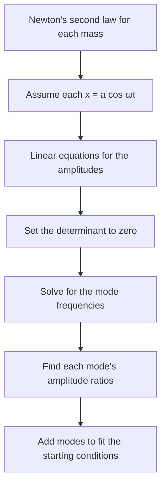

## From one oscillator to many

The simple harmonic motion lesson treated one mass on one spring. The waves lesson treated a string, which you can picture as an enormous number of tiny masses, each pulled by its neighbors. This lesson fills the gap between them: what happens when two or a few oscillators are connected, so that each one pushes on the others? Such a system is a set of **coupled oscillators**. Examples are everywhere: two pendulums joined by a spring, the atoms of a molecule held by chemical bonds, the floors of a building, the masses and springs in a car's suspension.

The motion of coupled oscillators can look messy, with energy wandering from one part to another. The central idea of this lesson is that it is always a sum of a few simple motions, called normal modes, each of which is plain SHM. Finding them turns a hard problem into several easy ones, and it explains where a string's harmonics come from.

## Two masses, three springs

Put two equal masses $m$ on a frictionless track between two walls, connected wall–spring–mass–spring–mass–spring–wall. The outer springs have constant $k$ and the middle **coupling spring** has constant $k'$. Let $x_1$ and $x_2$ be each mass's displacement to the right of its equilibrium position.


The left spring stretches by $x_1$; the middle spring stretches by $x_2 - x_1$; the right spring is compressed by $x_2$. Newton's second law for each mass:

$$m\ddot x_1 = -kx_1 + k'(x_2 - x_1), \qquad m\ddot x_2 = -kx_2 - k'(x_2 - x_1).$$

Each equation contains both coordinates: that is the coupling. Now add the two equations, and then subtract them:

$$m(\ddot x_1 + \ddot x_2) = -k(x_1 + x_2), \qquad m(\ddot x_1 - \ddot x_2) = -(k + 2k')(x_1 - x_2).$$

In terms of the new variables $q_1 = x_1 + x_2$ and $q_2 = x_1 - x_2$, each equation is the ordinary SHM equation $\ddot q = -\omega^2q$ from the SHM lesson, with

$$\omega_1 = \sqrt{\frac km}, \qquad \omega_2 = \sqrt{\frac{k + 2k'}{m}}.$$

Combinations like $q_1$ and $q_2$, which each oscillate independently at a single frequency, are **normal coordinates**.

## Normal modes

A **normal mode** is a motion in which every part of the system oscillates at the same frequency, with fixed amplitude ratios, passing through equilibrium together. The two-mass system has two:

- *Mode 1* ($q_2 = 0$, so $x_1 = x_2$): the masses move together, in phase. The middle spring is never stretched, so it does nothing, and each mass oscillates as if attached only to its outer spring: $\omega_1 = \sqrt{k/m}$.
- *Mode 2* ($q_1 = 0$, so $x_1 = -x_2$): the masses move in opposite directions. The midpoint of the coupling spring never moves, so each mass feels its outer spring plus half of the coupling spring, which has stiffness $2k'$: total $k + 2k'$, so $\omega_2 = \sqrt{(k + 2k')/m}$.

The out-of-phase mode is always the higher frequency here, because it uses the extra stiffness of the coupling spring. Any motion at all is a superposition of the two modes:

$$x_1 = C_1\cos(\omega_1t + \phi_1) + C_2\cos(\omega_2t + \phi_2), \qquad x_2 = C_1\cos(\omega_1t + \phi_1) - C_2\cos(\omega_2t + \phi_2),$$

with the four constants set by the starting positions and velocities. If you start the system in exactly one mode's shape, it stays in that mode forever.

### Example 1

Two 0.50 kg blocks are connected as above with $k = 200$ N/m and $k' = 50$ N/m. Find the two normal-mode frequencies and describe each mode.

$\omega_1 = \sqrt{200/0.50} = 20.0$ rad/s, so $f_1 = 20.0/(2\pi) = 3.18$ Hz: both blocks swing together. This is exactly the single block of the SHM lesson's Example 1, because the coupling spring is idle.

$\omega_2 = \sqrt{(200 + 2 \times 50)/0.50} = \sqrt{600} = 24.5$ rad/s, so $f_2 = 3.90$ Hz: the blocks move toward and away from each other.

## Beats: energy passing back and forth

Now start the same system differently: pull block 1 aside a distance $A$, hold block 2 at equilibrium, and release both from rest. This is not a single mode. At $t = 0$, $q_1 = A$ and $q_2 = A$, both at rest, so $q_1 = A\cos\omega_1t$ and $q_2 = A\cos\omega_2t$. Converting back with $x_1 = (q_1 + q_2)/2$ and $x_2 = (q_1 - q_2)/2$ and the sum-to-product identities:

$$x_1 = A\cos\left(\tfrac{\Delta\omega}{2}t\right)\cos(\bar\omega t), \qquad x_2 = A\sin\left(\tfrac{\Delta\omega}{2}t\right)\sin(\bar\omega t),$$

where $\Delta\omega = \omega_2 - \omega_1$ and $\bar\omega = (\omega_1 + \omega_2)/2$. Each block oscillates at the average frequency inside a slowly varying envelope. Block 1's envelope shrinks to zero just as block 2's reaches its maximum: the energy has moved completely from block 1 to block 2. That takes a time

$$t_{\text{transfer}} = \frac{\pi}{\Delta\omega},$$

and then the energy flows back. This is the beat phenomenon of the sound lesson, $f_{\text{beat}} = |f_1 - f_2|$, now seen as energy sloshing between two oscillators. Weak coupling ($k' \ll k$) makes $\Delta\omega$ small and the transfer slow.

```plot
{"x": [0, 14], "y": [-1.3, 1.3], "xLabel": "t (s)", "yLabel": "x₁ / A", "functions": [{"f": "cos(0.25*x)*cos(8*x)", "to": 12.6}], "caption": "Block 1, released first: its swing dies away and returns"}
```

```plot
{"x": [0, 14], "y": [-1.3, 1.3], "xLabel": "t (s)", "yLabel": "x₂ / A", "functions": [{"f": "sin(0.25*x)*sin(8*x)", "to": 12.6}], "caption": "Block 2, released from equilibrium: it swings fully after π/Δω ≈ 6.3 s. Weak coupling, ω̄ = 8 rad/s and Δω = 0.5 rad/s"}
```

### Example 2

Two identical pendulums, each 0.80 m long with a 0.40 kg bob, hang side by side, joined at the bobs by a weak spring with $k' = 0.25$ N/m. One bob is pulled aside and released while the other hangs still. How long until the first bob is momentarily still and the second swings fully? Use $g = 9.80$ m/s².

For small swings, a pendulum acts like a spring with $k_{\text{eff}} = mg/L$ (the SHM lesson), so this is the two-mass system with $k = mg/L$.

$\omega_1 = \sqrt{g/L} = \sqrt{9.80/0.80} = 3.500$ rad/s (both swing together; the spring is idle).

$\omega_2 = \sqrt{g/L + 2k'/m} = \sqrt{12.25 + 1.25} = \sqrt{13.50} = 3.674$ rad/s.

$\Delta\omega = 0.174$ rad/s, so $t_{\text{transfer}} = \pi/0.174 = 18.0$ s. Each swing takes about $2\pi/3.5 = 1.80$ s, so the energy moves over in about ten swings and returns after about 36 s. (Keep 4 figures in $\omega_1$ and $\omega_2$: their difference is small, so rounding them early would ruin it.)

## The general method

For more masses, adding and subtracting equations is no longer enough, but the same idea works. Guess that in a normal mode every coordinate oscillates at one frequency: $x_j = a_j\cos\omega t$. Then $\ddot x_j = -\omega^2x_j$, and the equations of motion become ordinary linear equations for the amplitudes $a_j$. For the two-mass system:

$$(k + k' - m\omega^2)a_1 - k'a_2 = 0, \qquad -k'a_1 + (k + k' - m\omega^2)a_2 = 0.$$

The trivial answer $a_1 = a_2 = 0$ always works. A real oscillation needs the determinant of the coefficients to be zero:

$$(k + k' - m\omega^2)^2 - k'^2 = 0 \quad\Rightarrow\quad k + k' - m\omega^2 = \pm k',$$

which gives $\omega^2 = k/m$ (with $a_2 = a_1$) and $\omega^2 = (k + 2k')/m$ (with $a_2 = -a_1$), the same modes as before. In linear-algebra language, the mode frequencies come from the eigenvalues and the mode shapes from the eigenvectors.



A system with $N$ coordinates that can oscillate has $N$ normal modes. A linear molecule of three atoms, such as CO₂, has four vibrational modes: a symmetric stretch, an asymmetric stretch, and two bending modes (in perpendicular planes) that share one frequency. Which of these absorb infrared light is what makes CO₂ a greenhouse gas: the bending and asymmetric-stretch modes do, the symmetric stretch does not.

### Example 3

Two small 10 g beads sit on a light string under 30 N of tension, dividing it into three equal 0.30 m segments; the ends are fixed. Find the frequencies of small sideways vibrations.

For a small sideways displacement $y_1$ of bead 1, the tension in each neighboring segment pulls it back with a sideways component of about $F$ times the slope of that segment. Bead 1 feels $-\dfrac Fa y_1$ from the left segment and $\dfrac Fa(y_2 - y_1)$ from the middle one. This is exactly the two-mass system with $k = k' = F/a$.

$F/a = 30/0.30 = 100$ N/m, so $\omega_1 = \sqrt{100/0.010} = 100$ rad/s (15.9 Hz, beads moving to the same side) and $\omega_2 = \sqrt{3 \times 100/0.010} = 173$ rad/s (27.6 Hz, beads moving to opposite sides, with a node at the center).

## From beads to a continuous string

Repeat Example 3 with $N$ beads of mass $m$, spacing $a$, tension $F$, on a string of length $L = (N + 1)a$. Solving the $N$ equations (the result is quoted here, not derived) gives modes

$$\omega_n = 2\sqrt{\frac{F}{ma}}\,\sin\frac{n\pi}{2(N + 1)}, \qquad n = 1, 2, \ldots, N.$$

For $N = 2$ this gives $\sqrt{F/(ma)}$ times $2\sin 30^\circ = 1$ and $2\sin 60^\circ = \sqrt3$, matching Example 3. The $n$th mode shape is a sampled sine curve, $\sin(n\pi x/L)$ evaluated at the beads.

Now let the beads get very many and very close, keeping the mass per length $\mu = m/a$ fixed. For the low modes the angle is small, $\sin\theta \approx \theta$, so

$$\omega_n \approx 2\sqrt{\frac{F}{ma}}\cdot\frac{n\pi a}{2L} = \frac{n\pi}{L}\sqrt{\frac{F}{\mu}} = \frac{n\pi v}{L}, \quad\text{so}\quad f_n = \frac{nv}{2L},$$

exactly the harmonics of the waves lesson, with $v = \sqrt{F/\mu}$. A string's harmonics *are* its normal modes. For a finite number of beads, the high modes fall below this straight line (the sine bends over), so short waves travel more slowly than long ones. A wave speed that depends on frequency is called **dispersion**, and the beaded string is a simple model of how sound travels through the lattice of atoms in a crystal.

## Common mistakes

- Thinking each mass has its own frequency. Each normal mode has one frequency shared by every mass; a single mass's motion is generally a mix of all the modes.
- Forgetting the factor 2 in $k + 2k'$: in the out-of-phase mode, the coupling spring stretches by $2x_1$.
- Starting one mass and expecting a single mode. Releasing one block alone puts in both modes equally, which produces beats.
- Rounding $\omega_1$ and $\omega_2$ before subtracting them for the beat or transfer time.
- Mixing up the transfer time $\pi/\Delta\omega$ with the full back-and-forth cycle $2\pi/\Delta\omega$.

## Key points

- Coupled equations separate into normal coordinates ($x_1 + x_2$ and $x_1 - x_2$ for two equal masses), each in plain SHM.
- Two masses, three springs: $\omega_1 = \sqrt{k/m}$ (in phase), $\omega_2 = \sqrt{(k + 2k')/m}$ (out of phase).
- Any motion is a superposition of normal modes; $N$ coordinates give $N$ modes.
- Modes from $x_j = a_j\cos\omega t$ and a zero determinant (eigenvalues give $\omega^2$, eigenvectors give shapes).
- Releasing one oscillator gives beats; the energy moves across in $\pi/\Delta\omega$.
- A string's harmonics are the normal modes of a many-bead chain in the continuous limit.
