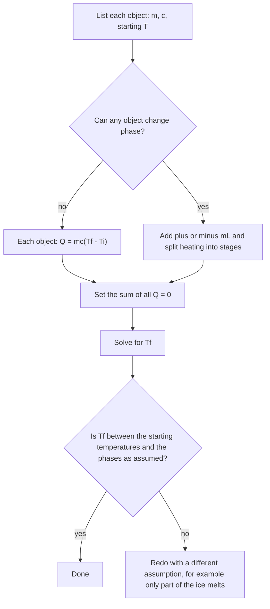

## A new kind of energy bookkeeping

Mechanics tracked kinetic and potential energy of whole objects. When friction "lost" energy, it went into the random jiggling of atoms: thermal energy. Thermodynamics is the physics of that energy. This lesson defines temperature, explains why things expand when heated, and develops calorimetry, the accounting of heat flowing between objects, including the energy hidden in melting and boiling.

## Temperature and thermal equilibrium

**Temperature** measures how hot or cold something is; microscopically, it's tied to the average kinetic energy of its particles. Two objects in contact exchange energy until they reach the same temperature, a state called **thermal equilibrium**. The **zeroth law of thermodynamics** says that if A and B are each in equilibrium with C (a thermometer, say), then A and B are in equilibrium with each other. That's what makes thermometers meaningful.

Three scales are common:

- **Celsius**: water freezes at 0°C and boils at 100°C (at 1 atm).
- **Fahrenheit**: 32°F and 212°F, so $T_F = \tfrac95T_C + 32$.
- **Kelvin** (SI): $T = T_C + 273.15$. Zero kelvin, **absolute zero**, is the lowest possible temperature, where thermal motion is minimal. A kelvin is the same size as a Celsius degree, so temperature *differences* are equal in K and °C.

Physics formulas involving the gas laws or radiation need kelvins. A change "from 20°C to 30°C" is a change of 10 K.

## Thermal expansion

Most materials expand when heated, because atoms vibrating harder push each other a bit farther apart on average. For a length $L$, the change is proportional to the original length and the temperature change:

$$\Delta L = \alpha L\,\Delta T,$$

where $\alpha$ is the **coefficient of linear expansion** (about $12\times10^{-6}$ K⁻¹ for steel, $23\times10^{-6}$ for aluminum). Volumes expand similarly, $\Delta V = \beta V\Delta T$, with $\beta \approx 3\alpha$ for solids. Bridges have expansion joints, and rails are laid with gaps (or pre-stressed) for this reason.

Water is a famous exception: between 0°C and 4°C it contracts as it warms, so it's densest at 4°C. Lakes freeze from the top down, and the 4°C water at the bottom lets fish survive the winter.

### Example 1

A steel bridge span is 200 m long at −10°C. How much longer is it at 35°C? ($\alpha = 12\times10^{-6}$ K⁻¹)

$\Delta L = (12\times10^{-6})(200)(45) = 0.108$ m, about 11 cm, which the expansion joints must absorb.

## Heat and specific heat

**Heat** $Q$ is energy transferred because of a temperature difference. It's measured in joules (or calories: 1 cal $= 4.186$ J; a food Calorie is 1000 cal). Heat is energy in transit, not something an object "contains"; an object contains internal energy.

Adding heat raises temperature by an amount that depends on the mass and the material:

$$Q = mc\,\Delta T,$$

where $c$ is the **specific heat** (J/(kg·K)), the heat needed to warm 1 kg by 1 K. Water's specific heat is unusually large, 4186 J/(kg·K); compare aluminum (900), iron (450) and copper (385). That's why oceans moderate coastal climates and why water is a great coolant.

## Calorimetry

In an insulated container, heat lost by hot objects equals heat gained by cold ones. Writing each $Q$ as $mc(T_f - T_i)$ with its sign, the conservation statement is simply

$$\sum Q = 0.$$

Using $\Delta T = T_f - T_i$ for every object automatically makes the hot objects' $Q$ negative.

### Example 2

A 0.20 kg piece of aluminum at 95°C is dropped into 0.50 kg of water at 20°C in an insulated cup (ignore the cup). What is the final temperature?

$0.20(900)(T_f - 95) + 0.50(4186)(T_f - 20) = 0$

$180T_f - 17\,100 + 2093T_f - 41\,860 = 0$

$2273T_f = 58\,960$, so $T_f = 25.9$°C.

The water barely warms because of its high specific heat and greater mass.

## Phase changes and latent heat

At a phase change, adding heat doesn't raise the temperature: the energy goes into breaking the bonds that hold the solid or liquid together. Ice at 0°C absorbs heat and becomes water at 0°C. The heat needed per kilogram is the **latent heat**:

$$Q = mL.$$

- **Latent heat of fusion** (melting/freezing): $L_f = 3.34\times10^5$ J/kg for water.
- **Latent heat of vaporization** (boiling/condensing): $L_v = 2.26\times10^6$ J/kg for water, nearly seven times larger.

Evaporating sweat carries away lots of heat, which is how you cool off; steam burns are worse than boiling-water burns because condensing steam releases $L_v$ onto your skin.

```plot
{"x": [0, 3200], "y": [-30, 130], "xLabel": "heat added to 1 kg (kJ)", "yLabel": "temperature (°C)", "functions": [{"f": "if(x < 42, -20 + x/2.1, if(x < 376, 0, if(x < 795, (x - 376)/4.186, if(x < 3055, 100, 100 + (x - 3055)/2.01))))", "from": 0, "to": 3150}], "points": [{"at": [200, 0], "label": "melting"}, {"at": [1900, 100], "label": "boiling"}], "caption": "Heating 1 kg of ice from −20°C to steam: flat plateaus at the phase changes"}
```

### Example 3

How much heat turns 0.50 kg of ice at −10°C into water at 30°C? ($c_{\text{ice}} = 2100$ J/(kg·K))

Warm the ice to 0°C: $0.50(2100)(10) = 10\,500$ J.
Melt it: $0.50(3.34\times10^5) = 167\,000$ J.
Warm the water to 30°C: $0.50(4186)(30) = 62\,790$ J.

Total: $2.40\times10^5$ J. Melting takes most of the energy.

The flowchart sums up the procedure for any calorimetry problem, with or without a phase change.



## Heat transfer

Heat moves in three ways:

- **Conduction**, through a material by molecular collisions. The rate through a slab of area $A$, thickness $L$ and **thermal conductivity** $k$ is $\dfrac{Q}{t} = \dfrac{kA\,\Delta T}{L}$. Metals conduct well; air, foam and fiberglass poorly, which makes them good insulators.
- **Convection**, by bulk motion of a fluid: warm air rising, ocean currents.
- **Radiation**, by electromagnetic waves, needing no medium (sunlight). A surface at absolute temperature $T$ radiates power $P = e\sigma AT^4$ (the Stefan–Boltzmann law, $\sigma = 5.67\times10^{-8}$ W/(m²·K⁴), emissivity $0 \le e \le 1$).

A pot of water on a stove uses all three at once: heat conducts along the metal handle, convection currents carry it through the water, and the glowing burner radiates it to a nearby hand.


## Varying specific heat and Newton's law of cooling

When the specific heat varies with temperature, the heat needed is an integral: $Q = m\int_{T_1}^{T_2}c(T)\,dT$. At low temperatures many solids follow $c \propto T^3$, for instance.

Conduction in differential form is Fourier's law, $\dfrac{dQ}{dt} = -kA\dfrac{dT}{dx}$: heat flows down the temperature gradient. And an object cooling by contact with surroundings at $T_s$ often follows **Newton's law of cooling**, $\dfrac{dT}{dt} = -\kappa(T - T_s)$, whose solution $T(t) = T_s + (T_0 - T_s)e^{-\kappa t}$ is the same exponential approach seen with linear drag. A cup of coffee at 90°C in a 20°C room with $\kappa = 0.05$ min⁻¹ is at $20 + 70e^{-0.5} = 62$°C after 10 minutes.

```plot
{"x": [0, 60], "y": [0, 100], "xLabel": "time (min)", "yLabel": "temperature (°C)", "functions": [{"f": "20 + 70*exp(-0.05*x)"}, {"f": "20", "dashed": true}], "points": [{"at": [10, 62.5], "label": "62°C at 10 min"}], "labels": [{"at": [48, 26], "text": "room, 20°C"}], "caption": "Newton's law of cooling: coffee at 90°C in a 20°C room with κ = 0.05 per minute"}
```

## Common mistakes

- Using Celsius where kelvins are required (gas laws, radiation, ratios of temperatures).
- Forgetting the latent heat when a phase change happens in a calorimetry problem.
- Getting signs wrong by writing "heat lost = heat gained" with inconsistent $\Delta T$s (use $\sum Q = 0$ with $T_f - T_i$ everywhere).
- Confusing heat (energy transferred) with temperature.

## Key points

- $T(\text{K}) = T_C + 273.15$; $T_F = \tfrac95T_C + 32$.
- $\Delta L = \alpha L\Delta T$; $\Delta V = \beta V\Delta T$.
- $Q = mc\Delta T$ without a phase change; $Q = mL$ during one.
- Calorimetry: $\sum m c(T_f - T_i) = 0$ (plus any $\pm mL$ terms).
- Conduction $Q/t = kA\Delta T/L$; radiation $P = e\sigma AT^4$.
