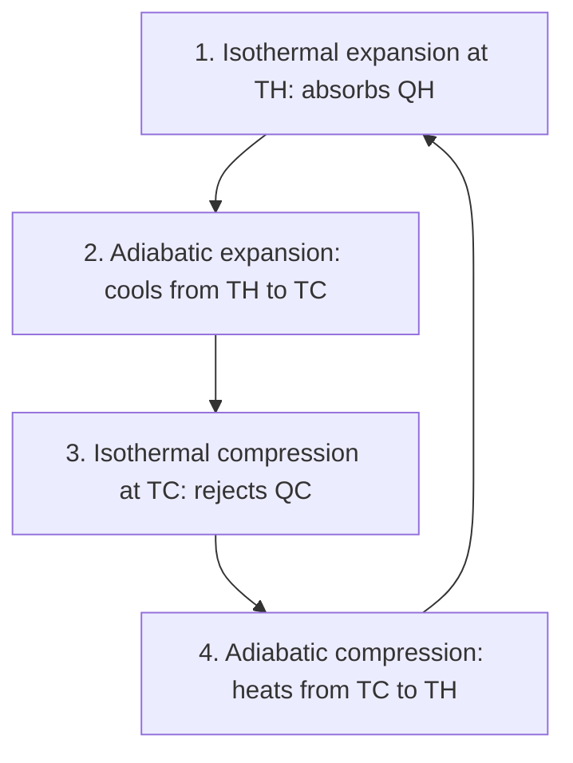

## The direction of time

The first law says energy is conserved, but it doesn't forbid a cold drink from spontaneously getting colder while the room warms up, or a broken egg reassembling. Those things never happen. The second law of thermodynamics captures which processes go in which direction, and it puts a hard limit on how efficiently any engine can turn heat into work. Entropy is the quantity that makes the law precise.

## Heat engines

A **heat engine** takes in heat $Q_H$ from a hot reservoir at temperature $T_H$, converts part of it to work $W$, and dumps the rest, $Q_C$, to a cold reservoir at $T_C$. Running in a cycle, its internal energy returns to the start, so by the first law

$$W = Q_H - Q_C.$$

Its **thermal efficiency** is the fraction of input heat converted to work:

$$e = \frac{W}{Q_H} = 1 - \frac{Q_C}{Q_H}.$$

Car engines manage about 25–35%, power plants 33–45%. Why not 100%? That's the second law.

## The second law

The **second law of thermodynamics** has several equivalent statements:

- *Kelvin–Planck (engine) statement*: no cyclic device can convert heat entirely into work. Some heat must always be rejected to a colder reservoir.
- *Clausius (refrigerator) statement*: heat does not flow spontaneously from a colder object to a hotter one. Moving heat "uphill" requires work.

If either could be violated, the other could be too, by hooking devices together. They're two faces of one law.

## The Carnot engine

What's the best possible efficiency between two given temperatures? Sadi Carnot showed that it belongs to a **reversible** engine, one with no friction and with heat flowing only across infinitesimal temperature differences. The **Carnot cycle** uses two isothermal and two adiabatic steps, and its efficiency depends only on the reservoir temperatures (in kelvins):

$$e_{\text{Carnot}} = 1 - \frac{T_C}{T_H}.$$

No real engine operating between $T_H$ and $T_C$ can beat this. To raise the efficiency limit you must widen the temperature gap, which is why power plants run hot steam and why cold cooling water helps. Even an ideal engine between 500 K and 300 K tops out at 40%.

The four steps of the Carnot cycle, in order:



```plot
{"x": [0, 6.5], "y": [0, 4.5], "xLabel": "V", "yLabel": "P", "functions": [{"f": "4/x", "from": 1, "to": 2}, {"f": "2*(2/x)^(5/3)", "from": 2, "to": 5.657}, {"f": "2/x", "from": 2.828, "to": 5.657, "dashed": true}, {"f": "4*(1/x)^(5/3)", "from": 1, "to": 2.828, "dashed": true}], "points": [{"at": [1, 4], "label": "1"}, {"at": [2, 2], "label": "2"}, {"at": [5.657, 0.354], "label": "3"}, {"at": [2.828, 0.707], "label": "4"}], "labels": [{"at": [2.4, 3.2], "text": "isotherm at TH"}, {"at": [4.6, 1.2], "text": "adiabats"}, {"at": [4.3, 0.15], "text": "isotherm at TC"}], "caption": "A Carnot cycle for a monatomic ideal gas with TH = 2TC: expansion along the solid curves (1 → 2 → 3), compression along the dashed ones (3 → 4 → 1). The enclosed area is the work per cycle."}
```

### Example 1

A power plant's steam enters the turbine at 550°C and leaves to a condenser at 30°C. (a) What is the Carnot efficiency? (b) If the plant actually achieves 38% efficiency and produces 500 MW of electrical power, how much heat does it dump to the environment each second?

(a) $T_H = 823$ K, $T_C = 303$ K. $e_C = 1 - 303/823 = 0.632$, or 63%.

(b) $Q_H$ per second $= 500/0.38 = 1316$ MW. Rejected: $1316 - 500 = 816$ MW, which warms the river or cooling towers. More heat is thrown away than turned into electricity.

## Refrigerators and heat pumps

Run an engine backward and it becomes a **refrigerator**: work $W$ moves heat $Q_C$ out of a cold space and dumps $Q_H = Q_C + W$ into a warmer one. Its performance is measured by the **coefficient of performance**,

$$K = \frac{Q_C}{W}, \qquad K_{\text{Carnot}} = \frac{T_C}{T_H - T_C}.$$

A **heat pump** is the same device used to warm a house; its useful output is $Q_H$, so its COP is $Q_H/W$, with Carnot limit $\dfrac{T_H}{T_H - T_C}$. A heat pump delivering 3 J of heat per joule of electricity isn't violating anything: it moves heat rather than making it.

The energy-flow diagrams compare the two devices. In an engine, heat flows downhill from hot to cold and some of it is diverted as work. In a refrigerator or heat pump, work is put in to drive heat uphill, and the hot reservoir receives $Q_H = Q_C + W$.


### Example 2

A freezer keeps its interior at −18°C in a 22°C kitchen. What's the maximum possible COP? If its actual COP is 2.5, how much electrical energy does it use to remove 1.0 MJ of heat?

$K_{\text{Carnot}} = \dfrac{255}{295 - 255} = 6.4$. Actual: $W = Q_C/K = 1.0/2.5 = 0.40$ MJ.

## Entropy

**Entropy** $S$ is a state variable that measures disorder; more precisely, it grows with the number of microscopic arrangements consistent with a system's macroscopic state (as $S = k_B\ln\Omega$, below). For heat $Q$ transferred reversibly at constant absolute temperature $T$, the entropy change is

$$\Delta S = \frac{Q}{T}$$

(units J/K). The most general statement of the second law is in terms of entropy: *the total entropy of an isolated system never decreases*. It stays constant in reversible processes and increases in every irreversible one (friction, free expansion, heat flowing across a finite temperature difference). Entropy increase is what gives time its direction.

### Example 3

1.0 kg of ice melts at 0°C. What is its entropy change? If the heat came from a large room at 25°C, what is the total entropy change?

Ice: $Q = mL_f = 3.34\times10^5$ J at $T = 273$ K, so $\Delta S_{\text{ice}} = +1223.4$ J/K.

Room: loses the same heat at 298 K, $\Delta S_{\text{room}} = -1120.8$ J/K.

Total: $+102.6$ J/K. Positive, as the second law requires for heat flowing from hot to cold. Reversed (water freezing by giving heat to a warmer room), the total would be negative, which is why it doesn't happen.

## Entropy changes as integrals

When temperature changes during heat transfer, add up $dQ/T$ along a reversible path:

$$\Delta S = \int\frac{dQ_{\text{rev}}}{T}.$$

*Heating at constant specific heat:* $dQ = mc\,dT$, so $\Delta S = mc\int_{T_1}^{T_2}\dfrac{dT}{T} = mc\ln\dfrac{T_2}{T_1}$. Warming 1.0 kg of water from 20°C to 80°C: $\Delta S = 4186\ln(353/293) = 780$ J/K.

*Ideal gas between two states:* $\Delta S = nC_V\ln\dfrac{T_2}{T_1} + nR\ln\dfrac{V_2}{V_1}$. Because $S$ is a state variable, this holds even for an irreversible process between those states; for instance, a free expansion into vacuum (no work, no heat, constant $T$) doubling the volume still has $\Delta S = nR\ln 2 > 0$.

Over a Carnot cycle the reservoirs' entropy changes cancel, $\dfrac{Q_H}{T_H} = \dfrac{Q_C}{T_C}$, which is exactly what gives $e = 1 - T_C/T_H$. Statistically, Boltzmann's formula $S = k_B\ln\Omega$ links entropy to the number of microstates $\Omega$.

## Common mistakes

- Using Celsius in $1 - T_C/T_H$ or $Q/T$.
- Thinking a 100% efficient engine is just an engineering problem; the second law forbids it.
- Assuming entropy can never decrease anywhere (it can locally, like a freezing ice tray, as long as the total increases).
- Confusing COP (can exceed 1) with efficiency (can't).

## Key points

- Engine: $W = Q_H - Q_C$, $e = W/Q_H = 1 - Q_C/Q_H$.
- Carnot limit: $e = 1 - T_C/T_H$ (kelvins); refrigerator $K = Q_C/W \le T_C/(T_H - T_C)$.
- Second law: no perfect engines; heat doesn't flow cold to hot by itself; total entropy never decreases.
- $\Delta S = Q/T$ at constant $T$; $\Delta S = \int dQ_{\text{rev}}/T$ in general.
