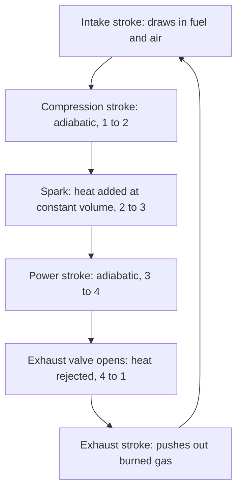

## Why real engines don't run Carnot cycles

The second-law lesson showed that no engine working between two reservoirs can beat the Carnot efficiency $1 - T_C/T_H$, and that the Carnot cycle reaches it using two isotherms and two adiabats. Yet no car, truck or jet runs a Carnot cycle. Its isothermal steps need heat to flow across tiny temperature differences, which is extremely slow, and the loop it draws on a PV diagram is very thin, so each cycle delivers little work for a large, heavy machine. Real engines trade some efficiency for power: they burn fuel quickly inside the cylinder and let the hot gas push.

This lesson analyzes the three cycles that model most real engines: the **Otto cycle** (gasoline engines), the **Diesel cycle** (diesel engines) and the **Brayton cycle** (gas turbines and jet engines). Each is built from the processes of the first-law lesson, and each efficiency follows from the adiabatic relation $TV^{\gamma-1} = \text{constant}$ in a few lines.

## The air-standard model

A real engine burns fuel in air, exhausts the products and draws in fresh air, so the gas inside is not a fixed sample. To analyze it we use the **air-standard model**, a deliberate simplification:

- the working gas is a fixed amount of air, treated as an ideal gas with constant specific heats ($\gamma = 1.4$ for air, $C_V = \tfrac52R$);
- burning the fuel is replaced by heat $Q_H$ added from outside;
- exhausting hot gas and drawing in cool air is replaced by heat $Q_C$ removed, returning the gas to its starting state;
- every step is reversible (no friction, no heat leaking through the cylinder walls).

The model overestimates real efficiencies, often by a factor of about 1.5 to 2, but it gets the trends right: what raises or lowers efficiency and why.

## The Otto cycle

The key design number of a piston engine is its **compression ratio**, $r = V_{\max}/V_{\min}$: the cylinder volume with the piston at the bottom divided by the volume with it at the top. The Otto cycle has four steps (states numbered 1 to 4):

1. **1 → 2, adiabatic compression.** The piston squeezes the air from $V_{\max}$ to $V_{\min}$. No heat flows, so the work done on the gas raises its temperature: $T_2 = T_1r^{\gamma-1}$.
2. **2 → 3, heat added at constant volume.** The spark ignites the fuel, which burns so fast that the piston barely moves. Heat in: $Q_H = nC_V(T_3 - T_2)$.
3. **3 → 4, adiabatic expansion.** The hot gas drives the piston back down: the **power stroke**. $T_4 = T_3/r^{\gamma-1}$.
4. **4 → 1, heat rejected at constant volume.** The exhaust valve opens and the pressure drops at the bottom of the stroke. Heat out: $Q_C = nC_V(T_4 - T_1)$.


The efficiency is $e = 1 - Q_C/Q_H = 1 - \dfrac{T_4 - T_1}{T_3 - T_2}$. Now use the two adiabats: $T_2 = T_1r^{\gamma-1}$ and $T_3 = T_4r^{\gamma-1}$, so $T_3 - T_2 = r^{\gamma-1}(T_4 - T_1)$. The temperatures cancel:

$$e_{\text{Otto}} = 1 - \frac{1}{r^{\gamma-1}}.$$

The efficiency depends only on the compression ratio, not on how much fuel is burned. A higher compression ratio means the gas expands through a bigger temperature drop during the power stroke, turning more of its energy into work.

The real four-stroke engine has two more strokes, intake and exhaust, in which the piston sweeps through the cylinder at roughly atmospheric pressure. In the ideal model they trace the same horizontal line out and back on the PV diagram, so their net work is zero and they are left out of the cycle.



### Example 1

An Otto engine has compression ratio 10. Air enters at $T_1 = 300$ K and $P_1 = 1.0\times10^5$ Pa, and combustion raises the temperature to $T_3 = 2000$ K. Find the efficiency, $T_2$, $P_2$ and $T_4$, the work per mole of air per cycle, and compare with a Carnot engine running between 300 K and 2000 K.

Efficiency: $e = 1 - 10^{-0.4} = 1 - 0.398 = 0.602$, about 60%.

After compression: $T_2 = 300(10)^{0.4} = 754$ K, and $P_2 = P_1r^\gamma = (1.0\times10^5)(10)^{1.4} = 2.51\times10^6$ Pa, about 25 atm. The same adiabat gives $T_4 = 2000/10^{0.4} = 796$ K.

Per mole, with $C_V = \tfrac52(8.314) = 20.8$ J/(mol·K): $Q_H = 20.8(2000 - 754) = 2.59\times10^4$ J and $Q_C = 20.8(796 - 300) = 1.03\times10^4$ J. The net work is $W = Q_H - Q_C = 1.56\times10^4$ J, and $W/Q_H = 0.602$ as promised.

A Carnot engine between the extreme temperatures would reach $1 - 300/2000 = 85\%$. The Otto cycle does worse because it takes in heat over the whole range from 754 K to 2000 K, not all at the top temperature, and rejects it over the range from 796 K down to 300 K, not all at the bottom.

## Why not a much higher compression ratio?

Raising $r$ from 8 to 12 raises the ideal efficiency from 56% to 63%, so why do gasoline engines usually stop around 8 to 12 (a few modern direct-injection designs reach 13 or 14)? Because the fuel and air are compressed together. If the compression heats the mixture too much, it ignites on its own before the spark, in uncontrolled pockets; this **engine knock** (detonation) hammers the pistons and can destroy the engine. Higher-octane fuel resists autoignition and allows a somewhat higher ratio.

Real gasoline engines reach roughly 25–35% efficiency, with the best modern designs near 40% at their most efficient operating point. The gap from the ideal comes from friction, heat lost through the cylinder walls, incomplete combustion, and the fact that hot combustion gases have a lower $\gamma$ than cool air.

## The Diesel cycle

A diesel engine compresses air alone, so knock is not a limit, and compression ratios of about 14 to 22 are common. The compression heats the air above the fuel's ignition temperature, so the fuel ignites as it is injected near the top of the stroke. Fuel keeps burning while the piston starts to move down, which the model treats as heat added at constant pressure. The Diesel cycle is therefore: adiabatic compression (1 → 2), heat added at constant pressure (2 → 3), adiabatic expansion (3 → 4), heat rejected at constant volume (4 → 1).

The **cutoff ratio** $r_c = V_3/V_2$ measures how long the heat addition lasts. Now $Q_H = nC_P(T_3 - T_2)$ while $Q_C = nC_V(T_4 - T_1)$. Following the temperatures around the cycle gives $T_2 = T_1r^{\gamma-1}$, $T_3 = r_cT_2$ and $T_4 = T_1r_c^{\gamma}$, so

$$e_{\text{Diesel}} = 1 - \frac{1}{r^{\gamma-1}}\cdot\frac{r_c^{\gamma} - 1}{\gamma(r_c - 1)}.$$

The second factor is always greater than 1 (it tends to 1 as $r_c \to 1$), so at the *same* compression ratio a Diesel cycle is less efficient than an Otto cycle. Diesels win because they can use a much *higher* compression ratio.

### Example 2

A diesel engine has $r = 18$ and cutoff ratio $r_c = 2.0$ ($\gamma = 1.4$). Find its ideal efficiency and compare it with an Otto cycle of the same compression ratio and with Example 1's gasoline engine.

$r^{\gamma-1} = 18^{0.4} = 3.18$. The cutoff factor is $\dfrac{2^{1.4} - 1}{1.4(2 - 1)} = \dfrac{2.639 - 1}{1.4} = 1.171$.

$e = 1 - \dfrac{1.171}{3.18} = 1 - 0.368 = 0.632$, or 63%.

An Otto cycle at $r = 18$ would give $1 - 18^{-0.4} = 69\%$, but no gasoline engine can run at $r = 18$ without knocking. Against the realistic $r = 10$ gasoline engine (60%), the diesel comes out ahead, and the same holds for real engines: the largest slow-speed marine diesels reach about 50%.

## The Brayton cycle

Gas turbines in power plants and jet engines run continuously instead of in pulses: a compressor raises the pressure of incoming air, fuel burns at steady pressure in a combustion chamber, and the hot gas expands through a turbine. The ideal Brayton cycle is adiabatic compression, heat added at constant pressure, adiabatic expansion, and heat rejected at constant pressure. Its design number is the **pressure ratio** $r_p = P_{\max}/P_{\min}$. For an adiabat $T \propto P^{(\gamma-1)/\gamma}$, and the same cancellation as in the Otto derivation gives

$$e_{\text{Brayton}} = 1 - \frac{1}{r_p^{(\gamma-1)/\gamma}}.$$

### Example 3

A gas turbine has pressure ratio 20 and takes in air at 300 K. Find its ideal efficiency and the air temperature leaving the compressor.

$(\gamma - 1)/\gamma = 0.4/1.4 = 0.2857$. $20^{0.2857} = 2.354$, so $e = 1 - 1/2.354 = 0.575$, about 57%.

The compressor outlet is at $T = 300(2.354) = 706$ K before any fuel burns. Real simple-cycle gas turbines reach roughly 35–45%. In a **combined-cycle** plant, the turbine's hot exhaust (still several hundred degrees Celsius) boils water for a steam turbine, and the best such plants now convert a little over 60% of the fuel's energy to electricity.

```plot
{"x": [2, 24], "y": [0, 0.8], "xLabel": "compression ratio r", "yLabel": "ideal efficiency", "functions": [{"f": "1 - x^(-0.4)"}, {"f": "1 - x^(-0.4)*(2^1.4 - 1)/1.4", "dashed": true}], "points": [{"at": [10, 0.602]}, {"at": [18, 0.632]}], "labels": [{"at": [5, 0.63], "text": "Otto"}, {"at": [15, 0.5], "text": "Diesel, cutoff 2"}], "caption": "Air-standard efficiencies (γ = 1.4). Dots: a gasoline engine at r = 10 (60%) and a diesel at r = 18 (63%). At equal r the Otto cycle wins, but diesels run at much higher r."}
```

## Common mistakes

- Using the Carnot formula for a real engine cycle. Carnot is only an upper limit; the Otto, Diesel and Brayton efficiencies depend on the compression or pressure ratio.
- Writing $1/r^\gamma$ instead of $1/r^{\gamma-1}$ in the Otto efficiency. Temperatures along an adiabat follow $TV^{\gamma-1}$; pressures follow $PV^\gamma$.
- Using the pressure ratio as if it were a volume ratio in the Brayton formula: the exponent is $(\gamma - 1)/\gamma$, not $\gamma - 1$.
- Using $C_V$ for the Diesel heat input. Heat added at constant pressure is $nC_P\Delta T$.
- Taking air-standard efficiencies as real ones. Real engines reach roughly half to two-thirds of them.

## Key points

- Air-standard model: fixed ideal gas, $\gamma = 1.4$, combustion as heat added, exhaust as heat rejected.
- Otto (spark ignition): $e = 1 - r^{1-\gamma}$; limited by knock to $r \approx 8$–12.
- Diesel (compression ignition): $e = 1 - r^{1-\gamma}\dfrac{r_c^\gamma - 1}{\gamma(r_c - 1)}$; lower than Otto at equal $r$, but $r \approx 14$–22 is possible.
- Brayton (gas turbines): $e = 1 - r_p^{-(\gamma-1)/\gamma}$.
- All stay below Carnot between the same extreme temperatures, because heat enters and leaves over a range of temperatures.
